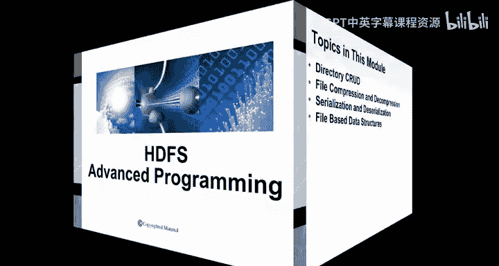
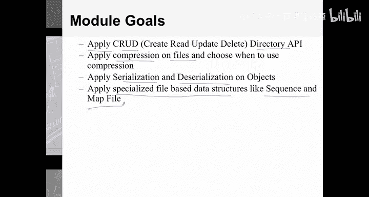

# 约翰霍普金斯大学《Hadoop大数据处理｜Big Data Processing Using Hadoop》中英字幕 - P34：12_HDFS高级编程导论.zh_en - GPT中英字幕课程资源 - BV1g5u6zBExs

Welcome。HDFS advancedanced programming。In this module。

 we will look at some of the advanced HDFS programming concepts。

We will start with learning to perform credit operations on directories。

Then we will look at concepts like compression， serialization。

 and specialized file based data structures such as sequence files and map files。

So what are the topics in this module， this module is broken into four sections。

In the section on Directory Cr， I'll show you how to create， read and update delete files。

In this section on file compression and decompression。

 we will look at the concepts behind compression and we will see how to apply compression and the various code algorithms for HDFS files。

In the section on serialization and desilization。We will see how Hadoop has its own serialization mechanism for serializing objects into streams and rating it back。

 we look at the Hadoop serialization mechanism and the deilization mechanism。

In the section on file based data structures， we will look at how Hadoop has support for some specialized files such as sequence files and map files that allow you to deal with small files in Hadoop。

So what are the module goals after completing this module you will be able to apply cru functionality on directories。

 you'll also be able to apply compression on files and also know when to use compression you'll also be able to apply serialization and decilization techniques on classes and objects。

And then finally， apply specialized file based data structures like sequence files and map files to solve the small file problems in Hadoop。

