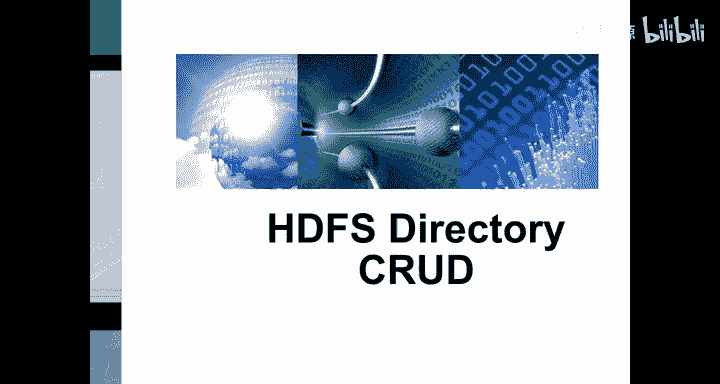
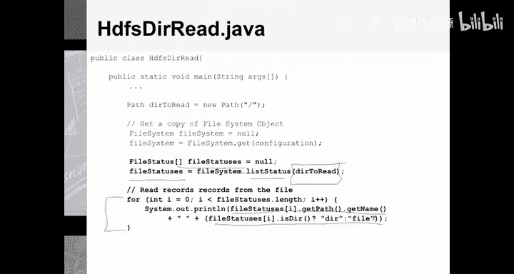
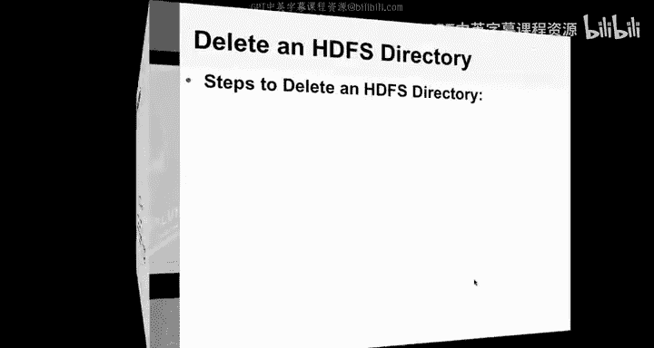
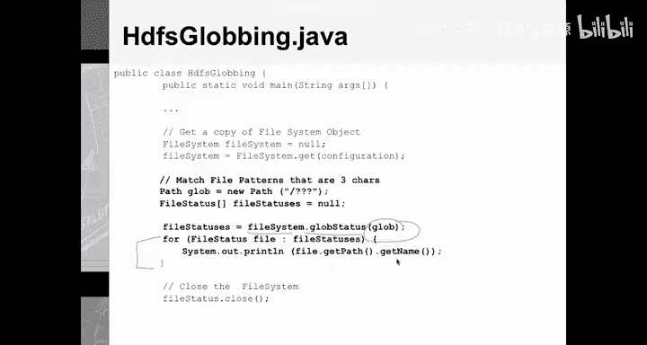
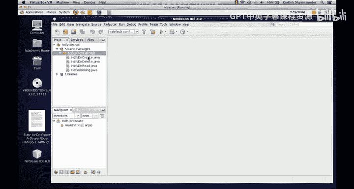
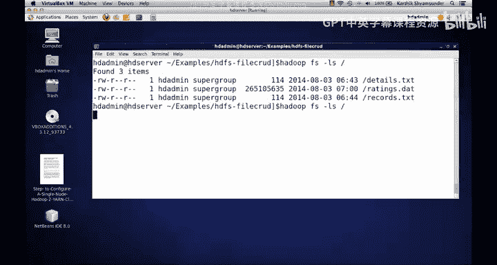
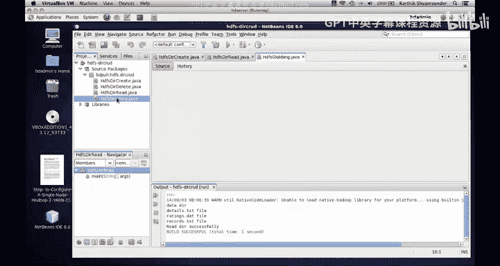
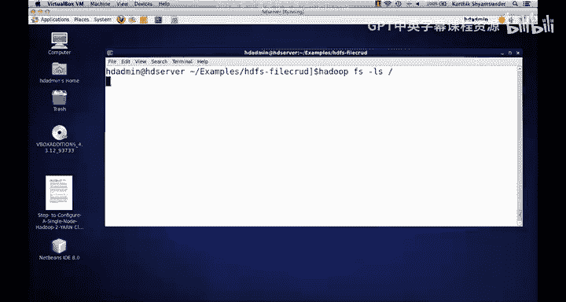
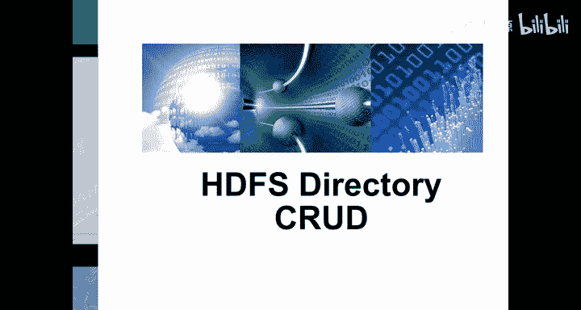

# 约翰霍普金斯大学《Hadoop大数据处理｜Big Data Processing Using Hadoop》中英字幕 - P35：13_目录操作管理.zh_en - GPT中英字幕课程资源 - BV1g5u6zBExs

HTFS Directory crud。In this section， we will look at the Java API for creating， reading。

 and deleting directories。Notice we are not going to talk about updating a directory because if you think about it。

 updating a directory is like creating a file within a directory or creating a directory within a directory。

 we have already talked about creating a file in the directory。

Now we're going to be talking about creating a directory within a directory so that covers the concept。

So what are these steps to create an HDFS directory？

Many of the first few steps you're already familiar with。

Which is creating a Hadoop configuration object。And then getting a file system object once you have a concrete file system in your hand。

 you can invoke a method called the MKDARs method， passing to it， the path object。

 which is the directory path。Which is the directory that you want to create。

There are several overloaded methods available for creating a directory， there's one that takes。

 of course， the PAT， and then there's also one that takes a PAT permission to make the directory and also there is an interesting version of MKDIRs。

 which is a static version of the MKDS directory which takes a file system object as an argument。

It is also possible for you to create a directory and subdirecty and subdirecty。

As many levels as you want， all in one shot， all you have to do is have your path represent this way。

With directories and subdirectories， and it' will create those directories for you automatically。

The MKDARs method also returns a flag， a boolean flag if it cannot make a directory。

Maybe the director is already made。And then once you're done， you close the file system。

Here's HDFS Dork Cate。Here's the directory that I want to create。

 notice I have a long directory name with directories。Data， the， subter and subter。

I get the file system object。And then I call the most important method for making a directory。

 which is MKDIRs passing to it the directory path。What it returns me back is a Boolean status。

That once I'm done， I close default system。Reading。Or listing the contents of a directory。Again。

 get the Hadoop configuration object， get the file system object， and then on the file system object。

 call the list status method。The list status method takes a path。As an argument。

And what it returns you back is an array of file status objects。

 so really what it's doing is it's taking a directory as an argument and giving you the contents of the directory。

 which is the list of all the files and directories within that directory and returning them as a file status object。

The file status object represents a file or a directory。

 it has information about the name of the file， the path to that file。The file permissions。

 the file owner， the replication level， the file size， all that information is in file status。

 and all you have to do is once you get the array， just iterate through the file status objects。

There are several overloaded list status methods available。

 one that takes a path directory of course， and then there's one that takes an array of path directories。

 and the idea here is that you can pass a whole bunch of directorories and get information about all the files within all those directories in one shot。

There is also a mechanism by which you can pass a packed filter where you can say what files and directories that you don't want information on。

 so it's a way to reject or filter through the files that you are not interested in when the file starter subjects get returned。

Once you're done， you close the file system。Let's look at a program that reached the contents of a directory。

In this case， I would like to read the contents of my route directory。

I get the file system object and then I invoke the file systems list status method， passing to it。

 the path to the directory that I want to read， notice that it returns me an array of file status objects which I can iterate through so now I'm itating through the file status array objects。

And as I iterate through， I'm printinging out the complete path to the file。

And also I'm printing out indicating whether it' going it is a directory or a file we'll see this example in action in a few minutes。

Once I'm done， I close the file system。

Steps to delete a director。Create the Hadoop configuration object， get the file system object。

 and then call the delete method on the file system object。

The delete method takes a path object and also takes a Boolean recursive flag。Now， if you recall。

 the delete method is the same delete method that we use to delete a file。

So the only difference here is that I'm deleting a directory and I have the recursive flag that indicates whether I want to delete the directory recursively or not。

The delete method also returns a Boolean indicating whether it was able to delete this directory successfully。

 of course， if delete if the directory did not exist in the first place。

 then it would return a false。And then once you're done， you close the file system。HDFS do delete。

So here's the path to the directory that I want to delete， which is slash data。

And I want to delete the directory recursively， and so that the Boolean flag that I have here。

 I get my file system object， and then I invoke the most important method on the file system object to delete。

Which is the delete method。Passing to it the directory that I want to delete。

 which is this directory right here， which is slash data， and I also want to delete it recursively。

Don't forget that the delete method returns to you a Boolean flag and that's what I would use to print my status。

Back here。Once I'm done， of course， I can close the file system。

We looked at the concept of gllobing in the HDFS API overview。

So let's look at the steps to GB an HDFS file system。You first create the Hadop configuration object。

Then you get a file system object using the configuration object。

 and now we invoke a method called Gob statusus， passing toward it the path。Now。

 the interesting thing about the G status method is the path。That you pass through it。

 this path dirt that you pass to it is actually a Gob pattern。

And so what the Gloob status method returns to you is an array of file status objects that match that Gob pattern。

There are several overloaded methods available for GB status。

 there's one that of course takes the GloB path， there is also the ability to pass an array of Gb path objects。

And then once you're done， you close the file system。So let's look at HDF as glbing。

I get the file system。And then I create a path object and the interesting thing here is that the path object rather than representinging a specific file represents a three character directory or a3 character file name。

 and then I go to my file system object， invoke the G status method passing to it， the G path object。

Asking it to give me a list of all the files that are three characters in my root directory。

And then I can print the contents of that directory。

 basically what I'm printing out here is the name of all the three character directories and files in my root file system。

Of course， once I'm done， I close the file system。

Here I am logged into my HD server as AH amin user ID I want to demonstrate the various Cr operations on directory the first one I want to show you is creating a directory I would like to create a directory called s data slash suber slash sub suber right must click。

And run， But before I run， let me go ahead and do a Hado Fs Ls slash to show you that the directlyy doesn't exist。

Okay， it doesn't exist。Go back and run the program。run。So it created the directory successfully。

Let's do an L minus L。

And yes， we see the directory slash data。 I can also do dash R， which is recursively。

Show me the contents of the data directory。And notice it says that。

It has created data and slash data slash subter， slash data slash subter， s sububer。So。

 the create works。Now I would like to show you read， this is reading a directory。

 reading the contents of the directory。Right mouse click， run file。It's going to。

 it's telling me that there are four。Contents in the slash directory in the root directory。

 the first is data， which is a directory， De do TXT， which is a file， rating data。

 which is a file and records start TXD， which is a file。If you do Hadoop。F， S dash Alice slash。

You'll notice that data is a directory and the other three are files。

 so I can also get other pieces of information from the file status object， but to keep it simple。

 I'm only printing out whether it's a file or a directory here。I can also do gllobing。

Globbing is a concept where。Like we said， we can pass patterns and the pattern here is question mark。

 question mark question mark， which is three letter files or directories。

 So what I would like to do to demonstrate glbing is make a folder record。F。So let's do that。Haoop。

F first dash M， K， D orR slash full。Ever。3 other directory。And I'm also going to do Hadoop。F。

 S dash copy from local。A A A， its a file locally called AAA。 I'm going to copy it into root。

And then I'm going to also call B BBB。Inter root。And I'm going to copy CC into root。

These are three local files。So when I do clear the screen。And I do Hadoop F S dash tell us。

I see。Three files AAA BBB and CC are three letter files。

 I also see a directory which is a three letter directory。

 so now what I want to do is use the Ging concept and pull out all the files and directories throughout three letters。

Rund the program。And there it is， it pulled out AAA， BB， and CC3 files and F， which is a directory。

Finally， I want to show you deletion of the directory， right mouse click。Run。

 I would like to delete the data directory。That's run it。Dete the directory。

 it deleted the directory successfully， notice the true there。And。If I do Hadoop a Fash LS。

 I should not see the data directory， I don't see the data directory。

If I delete the director reader second time。You'll notice that it returned me and false。

Could not delete the directory because it's already been deleted。In this section。

 we looked at the HDFS Cr API for managing directories。

