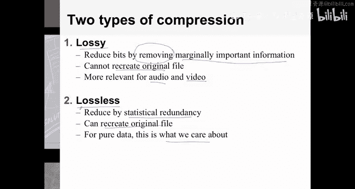
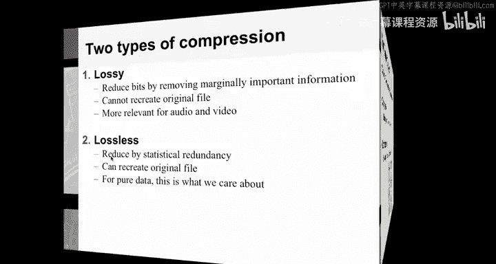
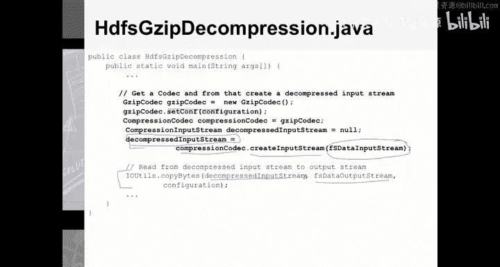
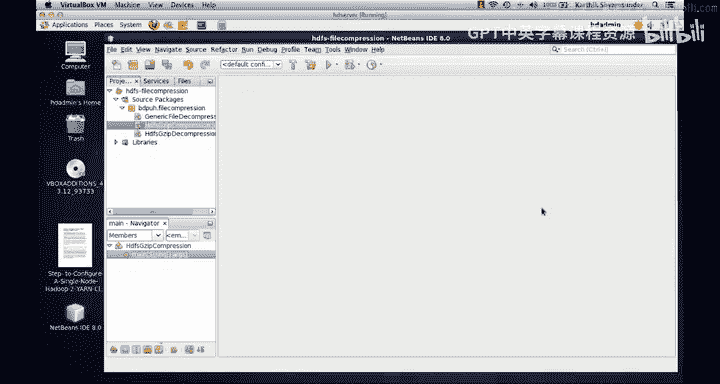
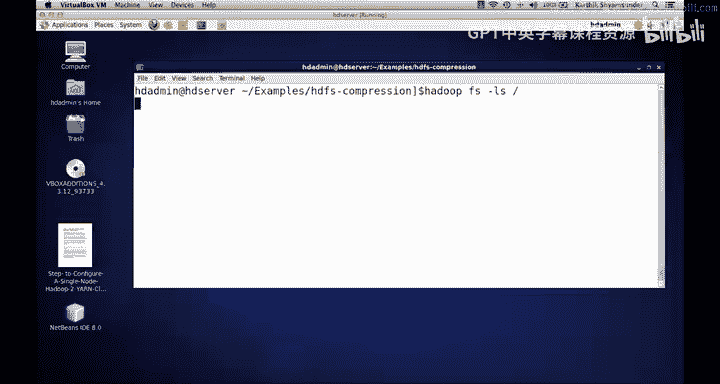
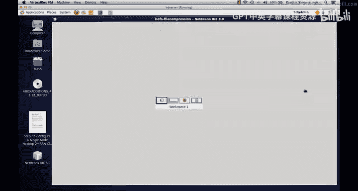
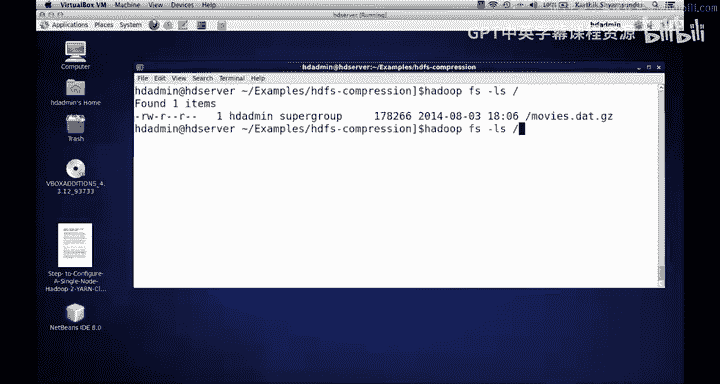

# 约翰霍普金斯大学《Hadoop大数据处理｜Big Data Processing Using Hadoop》中英字幕 - P36：14_文件压缩与解压缩技术.zh_en - GPT中英字幕课程资源 - BV1g5u6zBExs

File compression and decompression。In this section。

 we will formally define compression and the various terminologies associated with it。

We'll also look at the pros and cons of compression on files。

 and finally we will look at Hadoop HDFS support for compression。So what is data compression？

Data compression is encoding original data using fewer bits。

The idea is to reduce this size of data from the original size。

There are different compression algorithms that are there in the marketplace。

They all depend upon what is called the space time trade off。

 some compression algorithms are faster in terms of compressing and decompressing。

But may end up taking more space in the resultant file other compression algorithms may not be as fast in terms of compression。

 but ends up taking less space on the desk。There are different file formats for compression。

 you have T F。自实。Bs of2， LG， snappy， many formats don't forget that data compression is not data encryption they are two different things。

Many times people think that just because something is compressed， it means it's encrypted。

 they both are binary formats， but they are not the same。There are two types of compression。

Lossy and lossless。In lossy compression， you reduce the bits by removing marginally important information。

The key here is removing。You remove information that you may think is not that important in lossy compression。

 you cannot recreate the original file because you have removed some nonimport context。

 classic examples of lossy compression are things that are done on audio and video。

So what when you are sending video files or storing video files？

You remove every  tenth0th frame or every 15th frame， it doesn't matter。

Lostless compression in one where you reduce the content by statistical redundancy In other words。

 you check to see what parts of the content is redundant and then you store it only once in the target file。

And then you keep track of where those different pieces of information occurred。In this format。

 you can recreate the original file。For pure data， this is what we care about。

 so most of the time for data analytics， we end up using lossless compression。

The term Koodak。Kodeak is a fancy word for compressor and decompressor。

The idea here is that you can take the original text or original content and run it through the compressor。

What you end up getting is compressed text or compressed content you can take this compressed content and run it through the decompressor to get the original text。

 so compressor and decompressor is a fancy term for Koak。

What we have in Java is a bunch of code classes that do decompression and decompression。

HDFS compression support There are several built in compression classes in HDFS。

These compression codex， if you may call， may be pure Java implementations， in fact。

 they are pure Java implementations。And there are also some native implementations available if you want to use the native implementation。

 you need to include them in your LD library path。It is also possible to bring in other implementations and the other implementations can be Java implementations or native implementation。

 for example， many times people bring in the LZ implementation LZF is a fairly good implementation。

 but because of the license scheme for LG， they do not distribute it with Hadoop。

 but many times people use LZU implementation in the marketplace。

So what are the benefits of compressing files？It reduces the space needed to store the files。

 especially in HDFS where we may have three times replication， the size multiplies。

 and so it's a pretty good idea to compress files in HDFS。

It also reduces bandwidth for data transfer， especially when you write a block。

 the data has to be replicated between nodes。Rduces the bandwidth。

 It also speeds of data transfer between the disk and main memory。 If you think about it。

 the data transfer rate for disks is not that great。 So by reducing the file size。

 you've actually reduced the amount of data that needs to be loaded into main memory because in order to do any kind of processing。

 you have to load the data into main memory。If you have a file that's 54 gigabytes。

 if you're able to compress it to， let's say 17 gigabytes。

 now you only have to load 17 gigabytes into main memory。

 so you've artificially boosted the data transfer rate for disks。

What are the cons of compression Well compression and decompression is CPU intensive。

 they take CPU cycles so before you compress something you might want to think about it if you're going to be reading the file again and again and again it may be worth not compressing because decompression is going to take CPU cycles so it's a tradeoff and you have to think about it we'll talk more about this thing in the Hadoop mapreuce section。

The compression code interface。The Hadoop Java API has a package called the compression package。

 it defines an interface called the compression Koic interface。

The compression codeak interface is the base interface for all the various codex， for example。

 we have the default codeak for default types， GSZ codeak and B zipip to Koak all coming with Hadoop。

You should， whenever you get a chance， use the compression codeak in your code rather than specific codex。

What you should do is when you instantiate a specific codeak。

 you should assign it to the compression Koak and use the methods available in the compression Koak to invoke all the methods。

There are a couple of very important methods that's there in the compression codeak。

 one is called create input stream and the other is called create output stream。

 this is how you get compressed input stream and compressed output stream。

We will look at this thing in an example。So what are these steps to compress an HDFS file？

The basic idea here is， let's say you already have a file in HDFS。And you want to compress that file。

 all you need to do is read this existing HDFS file and then create a new file that is a compressed file。

So the idea is open the existing file， get the input stream， open a new file， get the output stream。

 but when you write the content into the output stream。

 you should write the content in a compressed fashion and so what you really need to do is convert the output stream into a compressed output stream。

 that's the basic idea， so when you write it out， write it out in a compressed fashion。

You know the first two steps， create the Hadoop configuration object and get the file system object。

You have two files first。You have to open the regular file， which is the input file。

 the file that you're reading from that you want to compress。When you open the file。

 you get an input stream。And then you have to open the second file。

 which is the file to which you're going to be writing the compressed information。

 that's the compressed file。And so when you open the file， you get the output stream。

 so you have input stream， which is the uncompressed stream。

 and then you have the output stream to which you want to write out compressed data。

The trick here is to take the output stream， which is a regular output stream and make it into a compressed output stream。

So in step5， which is the key step， what you're going to do is convert the output stream。

 which is the regular output stream into a compressed output stream for this。

 you'll end up using the compression Koak。And then you read from the input stream and write to the compressed output stream。

 and then you close the input stream or the output stream and the file system。

So let's look at this in a program。Here's a file called HFS Git compression or Java。In this program。

 I have a bunch of dot dot dots indicating to you that there's a lot of stuff that's happening about。

 but the most important thing for you to understand here is that the output file that you have to which you're going to be writing compressed data that let's say is called FS data output stream That's the variable So notice I'm going to the file system creating。

An output stream object， F data output stream， this is the output stream that I'm going to be writing compressed data。

 but it's not a compressed output stream yet in order to make it a compressed output stream。

 what I'm going to do is create a Gs of code object assigning to a compression Koak。

And then I'm going to use the compression codeex create output stream method。

 passing into it the regular data output stream， and so what I end up getting is compressed output stream。

Any content that I write to the compressed output stream will be automatically compressed。

 so now I'm using a very very nice class called Iioutils which has a nice method called copy bytes that takes an input stream and an output stream which in this case is the compressed output stream and of course it also takes a configuration object and writes the file out。

Basically， the Iutto。t Cobys method is a。Helper class helper method that allows you to copy files from one stream into another stream。

You don't have to go and read bike by bite like I did in my previous section。

So how do you decompress an HDFS file， let's say you already have a file that's compressed in HDFS and you want to decompress it。

The idea here is to open that file and so you have an input file， input stream， which is。

Giving your data in compressed fashion， now what you need to do is decompress that。as you read it。

 you want to decompress it， so you need to somehow convert the input stream。

 which is the compressed input stream into a decompressed input stream。

 and then you open a new file out to write so that you can write out the decompressed data。

Let's see how this works once again， you get the Hadoop configuration object。

You get the file system object using the configuration object， and then you open。A file。

 which is the compressed file for reading and get an input stream。

 So what you have here is a compressed input stream the data is coming to you in compressed fashion。

And then you also open a file for writing uncompressed data。

 this is your normal output file that you're going to be writing uncompressed data。The trick is。

To convert the input stream， which is the compressed input stream into a decompressed input stream and the way you do that is by using the compression codeak。

 so the idea or the most important step here is step5。

 which is you convert or you create a decompressed input stream from regular input stream using the compression codeak interface。

 and then you read the decompressed input stream and write to the output stream。And then finally。

 you close the input stream， output stream， and the file system。

So here's a file called H FS G zip compression here。

 I'm instantiating a G zip codeak object and then assigning to a G Z Koak variable。

 And then here's the most important thing。 I have my FS data input stream， which is my。

Compressed input stream， I need to make it an uncompressed input stream or a decompressed input stream。

 so I use the compression Koak called the create input stream method pass to it the FS data input stream and what I get back is a decompressed input stream So whenever I read from the decompressed input stream。

 it automatically is decompressing the data。 and now I use my Iotils copy bytes utility class method or the helper class method to read from the decompressed input stream and write it to my output stream。

 Let's look at all these things in action in the VM。

Here I am in my VM。HD server logged in as HD admin。

Let's open up HDFSG Z compression file。This is the program that is going to compress a file。In HDFS。

 I already have a file called slashmovies。Let me show you that quickly， Hado。F， S dash L slash。

There is audio file call moviesvie。 that I would like to compress。Okay， the first thing I do。

Is get a file system object in my hand。And then Im going to open the file， which is Mo。

tt file that gives me an Fs data input stream， that's the file that I'm going to be reading from。

And then I'm going to create a new file。And the new file that I'm going to create is the original file。

 which is the movieSt dot file， except I'm going to append to it。Gz that's what I'm doing over here。

 a little bit of fancy logic so that I don't have to retype in the file name so I go to the path object and get its path and then append Gz to it。

So that will create slashmo。 dot。gz。I'm going to open that file to write so now I have FS data input stream and FS data output stream FS data input stream represents movies。

 dot and Fs data output stream is going to represent movies。gz。Now。

 what I'm going to do is take the FS data output stream， run it through the。Compression Koak。

 so compression Koak is really ahesive Koak object。

I'm going to run it through the compression codeex create output streamre method。

Getting back a compressed output stream and this compressed output stream is what I should be using to write content out。

Here I'm using the I u class copybys method passing to it the Fs data input stream。

 which is the uncompressed data and then compressing it in the compressed output stream and then eventually。

Closing all the streams。So hopefully this program will compress the file， let's go ahead and run it。

It says it compressed it。To an Hadoop F S L S。And there it is， I have slashmo。 da。gz。

Notice it compressed it from 522197 to 178266。Okay， now I would like to decompress the file。

One thing to note here is。That when I compressed it， notice I created a brand new file。

 The original file still remains the same。 If you want， you can delete the original file。

 That's part of your logic。 You'll have to do it。 What I'm going to do now is delete it by hand。

 Had Fs。Dash or。Slash。Movie start that。 I could have done it in my。Chowd program if I wanted to。

So let me delete the original file。L it。Do位来了。Now I should only have the compressed file， which I do。

Okay， so let's look at the decompression logic， the decompression logic is saying I'm going to open up the Mo。

d。dz file， which is really my input stream now， and then I'm going to generate Mo。Dt file。

So I'm opening the file system， opening the input file， which is the compressed file。

 and then here I am going to create a new file called Mostar dot。So the input stream ismo。dt。gz。

 the output stream is going to be Mo。Dt， which is going to be uncompressed file。So。There it is。

 I'm opening up the FS data output stream， that's going to be the uncompressed file。

I create a GZ code object。I assigned the G sub codeak to compression codeak。

 and the trick here is to take the input stream， which is compressed input stream and then。

And then convert it into a decompressed input stream， so it decompresses it automatically。

 which is exactly what I'm doing here， that was the step number five。

So now that I have the decompressed input stream， anything that I read from the decompressed input stream will be automatically decompressed。

And so I end up using the Iio Uils copybytes method。

To copy from the decompress input stream into the FS data output stream， which is the regular stream。

And then I close the file system and all the other relevant strings。

So let me go ahead and run this program。Grant successfully。So if I do Hadoop F S L S， I should see。

The uncompressed file。There it is。See the uncompressed file right now。So in this section。

 we formally defined compression and the various terminologies associated with it。

We also looked at the pros and cons of compression on files and finally we also looked at HDFS support for compression how do you compress a file in HDFS and how do you decompress a file in HDFS Later we will learn to use compression with Hadoop mapreduce。

