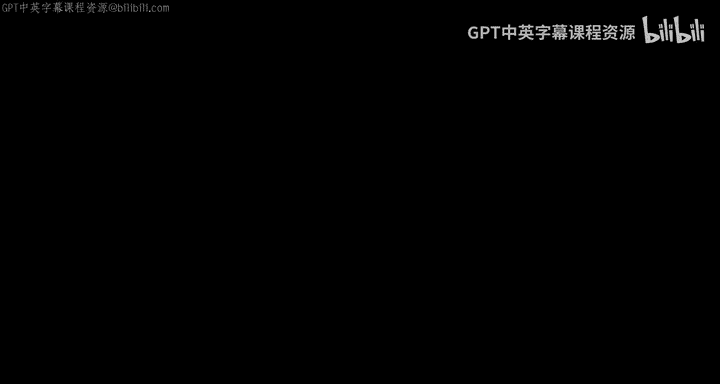
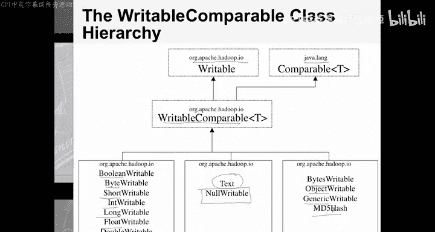
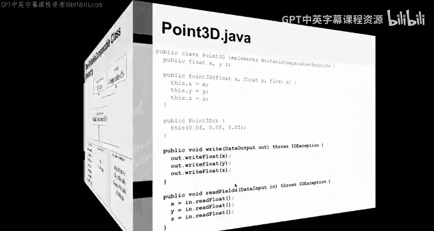
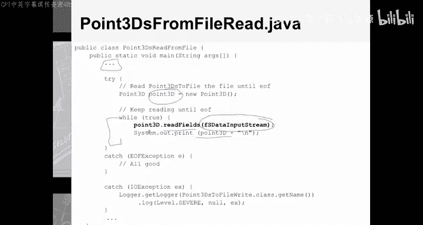
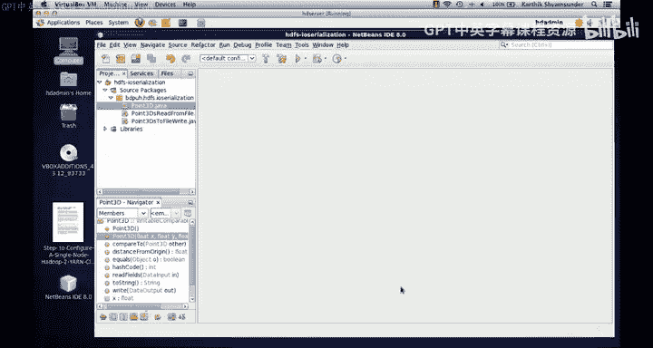
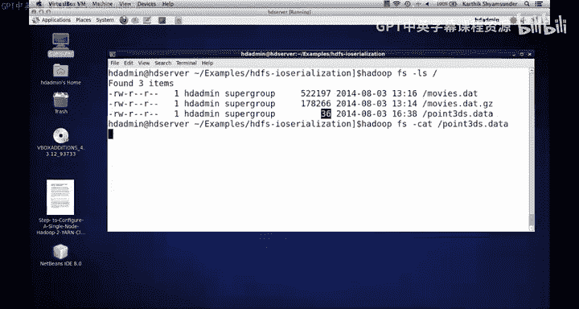

# 约翰霍普金斯大学《Hadoop大数据处理｜Big Data Processing Using Hadoop》中英字幕 - P37：15_序列化与反序列化机制.zh_en - GPT中英字幕课程资源 - BV1g5u6zBExs

Ceralization and decilization。In this section， we will look at serialization and Desilization scheme that is part of Hadoop Common。

 and then we will tie it to the HDFS file system。So let's look at the serialization concepts。

What is serialization？Cerilization is the process of turning structured objects into bike streams。

When I say structured objects， I mean objects like customer object， employee object， a point object。

Point3D object。Transaction object and converting those objects that are in memory into a byte stream。

The reason we may want to do this is because we may want to transmit the objects over a network to other process for interprocess communication。

Or we may want to store the objects into some kind of a permanent storage like HDFS files。

Then there is also this concept called decialization， decsilization is the reverse process。

 it's the process of turning the by streams into structured objects。

We also have this term in the industry called Cdis。

 which is really a pair of serializer and decilizer function。So what about Hadoop and serialization？

Haadop uses serialization。Haoop uses serialization in its mapreuce framework。

 we will see more on this when we get into mapreuce programming。

It also uses serialization for the internal communication between the various components。

 for example， when the name node wants to communicate with the data node。

 when the data node communicates with a client node。

 all the communication that is happening between these different demons is all object communication and its objects being serialized into by streams。

Haoop has invented its own serialization mechanism。There are two interfaces。

 the ridriable interface and the ridriable comparable interface in the Hadoop IO package that support serialization we'll see more on this in a few slides。

Please note that Hadoop has decided to use its own serialization scheme rather than the builtin Java scheme we know that in Java we have Java that Iio serializable interface that allows you to serialize an object into streams。

 but Hadoop guys did not use that they felt the Java serialization is not compact enough and is also complex so they invented their own serialization。

The foundation of Hadoop serialilization is the ridriable interface。

The big idea behind the ridritable interface is that if a class implements the writeritable interface。

 then it means that that particular object can be converted to and read from a stream。

 so that particular object can be converted to a stream object。Into a stream of bytes。

 there are two methods that make up the writeable interface， read fields method。

 which takes a data input object， which is basically a stream and also a right method that takes a data output object。

 which is the output stream。These two methods become the3D of serialization for Java Hadoop serialization。

There are several concrete implementations of this interface， inriable， careriable， longriable。

 or all classes that implement theriable interface。Then there is the compatible interface。

 the compatible interface is really coming from Java， it's coming from the Java dot line package。

 which takes a generic object。The comparable interface has one method called the Comp to method。

 which takes another object as an argument。Any class that implements the comparable interface is supposed to implement the Comp method。

And when you implement the comparative method， you're supposed to return an integer。If this object。

 which is the current object on which you're calling the comp to method。

 is equal to the other object， which is the object that is being passed as an argument into the comp to method。

Then you should return a zero， if this object that is the object on which the comparative method is being called on is lesser than the other object。

 the object that is being passed as an argument， then you should return a negative value。

 if this object that is the object on which the comparative method is being called upon passing the other object is greater than the other object。

 then you should return a positive in value。That's the scheme behind the comparative method。

So the Hadoop serialization interface has a hierarchy for ridriable and ridriable comparables。

In the org。 Apache。 Hadoop package， there is an interface。

 you notice that this box is in dotted line which means it's an interface。

 so there's an interface called the Writeriable interface that we just saw。

And then there is the compatible interface， which is in the Ja line package。

But then the Hadoub guys also created their own interface called ridriable Comparable。

This interface really extends the ridable interface and comparable interface。

The ridriable comparable interface doesn't really have any methods in it， but if you think about it。

 it inherits two methods from theriable interface and one method from the comparable interface。

So any class that implements the ridriable comparable interface has to implement three methods。

There are several classes that implement the ridriable comparable interface， as you can see。

 pretty much all the primitive types。For all the primitive types， there is a。Wriable。

 compatible object。You will notice that there is no stringriable comparable because that's what text does。

It's kind of weird， but that's how they've done it T is really your stringriable。

They also have a concert called null Writeable， which we'll talk about later on for map reduced programming。

And then there are other supporting classes like Btes ridable and object ridable。

 generic ridable and M5 hash， these are all also ridriable comparable objects。

The most important object for us is the text object。

So let's put it all together in a class called the03D。Here I have a class called 03D。

That implements a ridriable comparable interface， which means I should implement the right method。

 the read fields method， and the Comp method。The 0。3D class has three attributes， X， Y， and Z。

 there float。So I have a couple of constructors， a constructor that takes the X， Y， and Z。

 and I also have a default no argument constructor。I also wrote a method called the right method。

 which。Implement the ridriable comparable。 In fact， it's coming from the ridriable interface。

Notice the right method takes as an argument， a data output object。

The data output object is a kind of a stream object。

 so there's a method called right float in that particular object。

 I invoke the right float method to write into the stream the current value for x， y and z。

That's what the right method is and that's pretty much how you write the right method in the right method。

 you take the output object， which is the data output object and you keep writing your object state into that particular object。

In the read fields method， you do the opposite。The data input。

 which is the input stream is being passed to you and all you simply do is read from the input stream and you read in the same order as you wrote。

 you wrote the bytes as X Y and Z and you read it as X。

 Y and Z in this case you assign it back to your object。

 you're basically inflating the object in the read fields method and you are deflating the object in the right method。

Then it's a good practice to have。A two stringing method， so I have provided a two stringing method。

I've also provided a method called distanceance from Or， this is a helper method。

 the reason I have this method is because I would like to have a comparative method implemented it。

 I'm supposed to implement a comparative method because I'm implementing the ridable comparable interface。

Which takes a 03D object。And the way you compare 2。

3D objects now we are actually getting to matrix calculations。

 but the idea here is that the way you compare two point objects in three dimensional matrix is to figure out how far it is from the distance。

 and that's why if I have this Euclideian distance calculation method。

So I use that to figure out whether the current object is lesser than the other object or not。

 and depending upon the answer， I return an integer value back。So that's the comparative method。

And then it's always a good idea to have an equals method of implemented with the equals method I also implemented the hash code method。

Okay。So what do I do with all these things？I'm going to now write a class called03Ds to Fwr。

 this class is going to take the three points instantiate them。

And then write those three points into a file。I have dot dot dots over here indicating to you that I'm opening up a file over there and getting an output stream。

 that's what I've done。The most important portion is this portion right here。

You'll notice that I go to the record1 object， which is a 0。3D object。

 which is a writeriable comparable object， and I invoke the right method passing to it。

 the FS data output tree。The FS data output stream is the file system data output stream for a file to which I want to write the record one object。

So I'm writing the record one object， the record  two object， and the record 3 object。

And then I'm done。So basically， in this program， I'm writing。A file。That contains 3。3D objects。

And then I would like to do thes of it。I have a program called03Ds from fileread。

t Javava in this program， I would like to read the three objects so what I want to do here once again I have dot dot dots。

In the top indicating that I'm opening the file， I'm opening the 0。3 Ds file。

 the file that I wrote a few。Seconds ago in the previous slide。And I would like to read from it。

So you'll notice that I have a big while loop over here and I'm reading。

 so I've instantd a 03D object and almost like an empty 03D object where the x y and0 or0。

And I invoke the read fields method passing to it the FS data input stream that is going to read the first 03D object。

 then I'm going to print it out。 This is going to use the two string method on the 0。

3D object to print it out to the standard output。 And then I read the next one and then I read the next one。

 so I basically。Reading 3。3D objects， and of course at some point I'm not going to be able to read anymore because it reached the end of five。

Okay， so let's see all these things in action。

I'm going to go to my VM。Here I am in my HD server VM logged in as HD admin。

 so let's look at the 03D class， here's 03D。

Point 3D class implements the ridriable comparable interface， it's called three attributes， X， Y。

 and z。They're all floats。And then I have a constructor that takes the X， Y， and z。

I also have a default nor constructor。Because03D implements the writeable comparable interface。

 I have implemented the right method。And the read fields method。

The right method takes the data output object， which is really kind of an output stream。

 notice it uses the out method to write out the attributes in this case it writes out X。

 Y and z in that order。The read fields method takes data input， which is an input stream。

And then reads it in the same order in which the right method wrote out。

I also have a two string method to make it。Nicely printed out。And。

I have a method called distance from Or， which is a helper method。which does the calculation。

 distance from the origin calculation， and then I have the comparative method that takes a 0。

3D object， uses the distance from origin method， which is the helper method to figure out how far it is from the origin。

And then returns either a value of zero or a value that is negative or positive when two objects are being compared。

Then I also have the Es method。And the hash code method implemented。

Then I have a class called03Ds to file right， this is the class that is going to create a file called0。

3D star data in HDFs。And write to it to three points。

I am going in and getting a file system in my hand。Then I'm going in and creating a。Opening the file。

 which is the。File that I just showed you over here 0。

3D data I'm opening the file for create getting an FS data output stream object in my hand。

And then I have record one， record2 and record 3 as 3。3D objects， which I would like to write out。

So if you look at this carefully right here， I'm using record one calling the right method on it。

 which is going to write the record contents。Into FS data output stream， which would be that file。

And then same thing for record two and same thing for record three。

 writing three records out to the output stream。And then eventually closing the file。

So let me go ahead and run this program。It says it created the file successfully， let's look at。HDFs。

There it is， we have a file called 0。3DS doterra that is created。

 notice it is 36 bytes because we have x， Y and z， they are  four bytes each。

 that's 12 bytes per record， three records is 36 bytes。If I do Hado。

 have a dash cat and try to print it out。Ct prints out text files。

 Let's see if it prints out a binary file。

You see a bunch of gobbli go， basically it's binary content。

 that's why you don't see anything meaningful there。s it's very efficient， it's binary。

 it's not a text representation。Okay， so we have this working， let's go back。

And let's try to read the file。Here I am。File to read is slash point3Ds dot data。

 get my file system object， open the file for read。Once I open the file for read。

I'm going to instantiate a shell point 3D object over here and then call the read fields method and I'm doing this in a while loop until I get an end of file and then as I read it I'm going to print it out and this is where the two string method comes into play which nicely displays the contents of 03D。

As I coordinate within parentheses。So。All right， and then close the stream， we're good to go。

 let's go ahead and run this program。Run， and that should print the contents of the  point3D object。

 There we go。 It printed it out in a nice fashion。As coordinate objects。In this section。

 we looked at serialization and decsilization scheme that is part of Hadoop common。

 We also saw how we can。Take an object and serialize it and store it into files。

