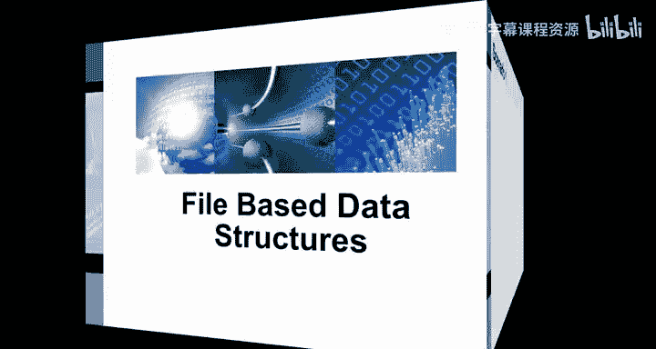
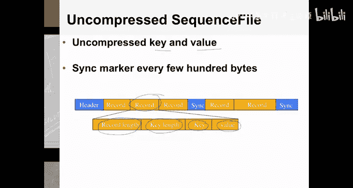
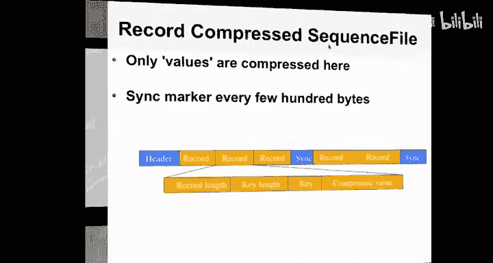
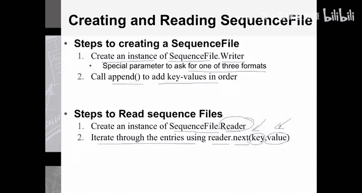
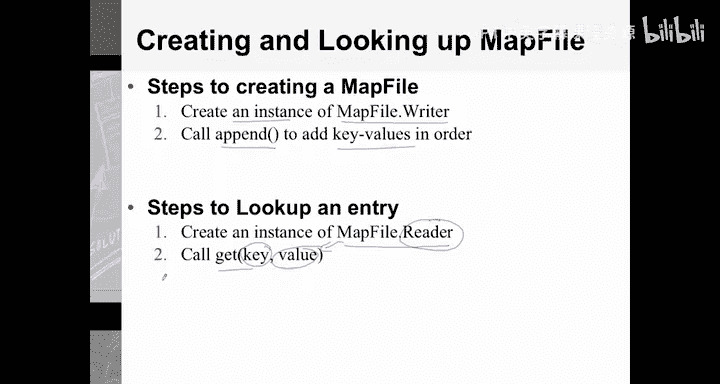
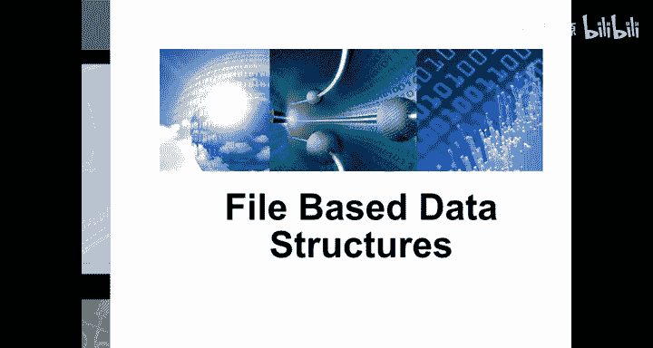

# 约翰霍普金斯大学《Hadoop大数据处理｜Big Data Processing Using Hadoop》中英字幕 - P38：16_基于文件的数据结构.zh_en - GPT中英字幕课程资源 - BV1g5u6zBExs

File based data structures。In this section， we look at two advanced file based data structures supported by Hadoop HDFS。

They are sequence files and map files， and we will see how these file based data structures solve the small file problem in Hadoop HDFS。

Before we look at the file based data structures， let's look at a couple of scenarios。

Let's say we have a popular website accessible globally。

 and we have our service distributed globally for our customers。

Which means we have Ed sites and Ed servers let's say we have 30ed sites and 20 web servers When I say an Ed site。

 I really mean a data center at a specific location， so we may have a data center in New York City。

 a data center in London， a data center in Tokyo and so on and so forth and let's say that each Ed site has about 20 web servers every hour on the hour there is log rotation that's turned on for the access log files。

 which means every hour on the hour the web servers will generate a brand new file。

We as a corporation have a need to store and process these web server access log files。

Because we want to find out what are the popular pages？

How many unique users are coming in who are the unique users？In order to do this。

 we have to bring the data into Hadoop and store it。So architecturally， we have a few questions。

How are we going to store the incoming files？Notice we have these files that are being generated on an hourly basis。

Are we going to store each file for each？Edight for each web server， for each other separately。

 or are we going to combine them？😡，Are we going to compress these files or are we not going to compress these files？

Snetia2。Let's say we have an app where users share photos。Close to a million photographs a day。

We as a corporation have a need to store and process these photos。

We want to process the metadata maybe metadata is information that is in GIF files and JpeG images that tell you where the picture was taken。

 that is the geolocation if that's turned on， when the picture was taken。

 what kind of camera was used， what is the lighting。

 so there's a lot of information in the file metadata that we may want to process。

Maybe we want to do image recognition， which means we want to do face recognition or even brand recognition。

When I say brand recognition， maybe somebodys holding a coke bottle so you want to know who's holding the coke。

 who's holding the Pepsi maybe you have maybe they're standing at Macy's store so there's the Macy' S at the back you're trying to get information about the user and of course recognize the user using face recognition Maybe you want to identify adult content from an architecture perspective we have a few questions How are we going to store the data are we going to store each photo in a separate file or are we going to combine them in a single file。

How do we apply compression， are we going to compress each photograph or the entire file？

There is actually a problem with small files in the word of big data。First of all。

 let's define what a small file is。 A small file is really a file that is smaller than a block size。

We know the default block size in Hadoop is 64 megabytes。

 of course it's changeable to 128 megabytes or 256 megabytes or even 512 megabytes。

And you may want to do this because it kind of affects the name node as we saw。

The problem with small file in HDFS is that name node actually has an overhead。

Per file or per block or per directory of about 150 bytes。

 which means every file for its metadata takes about 150 bytes， and so if you have 1 million files。

 that is going to be 150 megabytes， if you want to store 10 million files。

 then that means you need about 1。5 gigabytes of RA。If you're going to be storing 100 million files。

 then you need about 15 gigabytes of RA for your name node。

If you look at scenario one in scenario one， we have 30 sites， 20 servers， 24 hours per day。

 that's about 14，400 files per day， and that leads to about 5。5 million。Filees per year。

 which means you need about 1。5 gigabyte of Ram to store one years with the data。

 and of course you need more than one years with the data to be stored and there might be other files that you need to generate。

Of course， this is a small file issue because each file may be about eight to 10 megabytes。

In scenario2， where we have the photo sharing example。

 we have a much bigger problem because usually the users share about a million photographs a day for 365 days。

 that's 365 million files， and so we have a much bigger problem now。

We need close to 128 gigabytes of RAM to store all this data。

Actually we have this problem with small files even in Mareduce。

 I know we haven't talked about Mareduce yet， but basically in Mareduce every file gets processed separately by a separate container。

 which means we are going to launch a container or a JVM to process every file and we only are processing8 to 10 mebytes with a file。

 it's not worth it， you're unnecessarily launching JVMs and shutting down JVMs。

So Haddoop has several file based data structures that allow us to solve this problem we have a couple of file based data structures。

 sequence files and map files， let's look at them。So what is a sequence file？

A sequence file is a flat file consisting of key value pairs。Each key value pair is a record。

What you're seeing over here is a sequence file， here's the beginning of the sequence file。

 I have key1 value1， key2， value 2， key3， and so on and so forth。

 so a sequence file is really a container for records where each record is a key value pair combination。

Key and value are binary。Since key in value are binary， they should be serializable。

 we can either use the Java serialization mechanism or the Hadoop serialization mechanism。

It is better to use the Hadoop serialilization mechanism because then you can use it for mapre processing later on。

Key and value can be of different lengths。 You'll notice I have a key of a certain length and then I have value of a certain length。

 and then I have key value， you'll notice that key3。

Is of different length than key1 and the same thing is true for values sequence files also have these things called sync points。

 So from time to time after a few records， that is what is called the sync point record。

 It's a one bind sync that indicates the beginning of a record。

 They don't put this sync at every record。 they put it after a few records。

Here's the general structure of a sequence file， a sequence file has header and of course， records。

 and then a sync marker。The header has information such as the version number。

 every sequence file starts with SQ followed by a number。Then there is the key class name。

 notice a record is made up of key and value， so rather than stor the key class name in every record。

 they store the key class name in the header， also the value class name。

 and then whether you want compression in the file or not。

 and whether you want block level compression and the sync marker character。In terms of。Records。

 a record contains the record length， the key length， the key， and a value。

The sync marker basically is a marker that occupies approximately 1% of the file because after a few hundred bytes。

 they put a sync marker。There are three types of sequence files， uncompressed， record compressed。

 and block compressed。Uncompressed sequence file。In an uncompressed sequence file。

 the key and the value are both uncompressed and there is a sync marker that's placed every few hundred bytes。

 so let's look at a record。A record。Contains the record length。The key length。

And then the key and the value。Notice the key and the value are uncompressed in an uncompressed sequence file。

Then there is record compressed sequence file。In record compressed sequence files。

 only the values are compressed， so if you look at a record， you have the record length。

You have the key length， and then you have the key。

 you'll notice that the value is compressed in this case。

Block compressed sequence files in block compressed sequence files。

 both keys and values are collected in blocks， rather than as a single record。

 they are kept in blocks。And then the blocks are compressed。The size of the block is。

 of course configurable。 we also have sync markers that are placed before the start of every block。

So here's how a block compressed sequence file looks， You have a header。Followed by a sync marker。

 followed by a block， followed by a sync marker followed by a block。

 followed by a sync mark followed by a block and so on and so forth。We know what a header looks like。

 we know what a sync marker is， now let's look at the block。A block has several fields。

Number of records within that block。Compressed key length。This is the。Length of each one of the keys。

And it's stored in a compressed fashion。Compressed keys。

 this is all the keys stored in a compressed fashion。Compressed value length。

 this is the length of the value stored in a compressed fashion。Compressed values。

These are the actual values， so basically by reading this block into memory。

 it can figure out all the keys and all the values。

So let's try to use sequence files for scenario one。For scenario one。

 remember we have web access log files， we can bring in those web access log files that are coming in an overly basis and stick the entire access log file as a record value。

So what is the key， the key can be the edgedge server ID like London。It can be the actual server ID。

 so this is the Ed server location， London， New York， Tokyo， and then we have the server ID。

 so this is the 12th server in London， 12th server in New York City， 12 server in Tokyo。

 and then we can have timestamp， so here I have YYY why， your year， your month， your day， year month。

 day， and then the hour。Once again， 2014 is the year。August is the month， and this is the day 12。

 and this is the hour。 So these are the files for every hour。 And notice when we are stor it in the。

Sequence file， we are storing it as a compressed access lock files。

 so the entire file is being stored in a compressed fashion。

How about using sequence files for scenario2 in scenario2， we are storing images？

Because people are sharing photographs。The way we are going to start it is user ID。

 which is the key followed by an image， and we can store the image。As compressed or uncompressed。

What are the advantages of sequence files， it is efficient from a storage perspective because we can store binary data。

 we can sort images， audio， video， PDF files， or any other binary document。

 we can shortly store text also。Less overhead on the name node， especially for small files。

We also have efficiency in terms of map produce processing。

 I know we haven't gotten into mapreuce yet， but you see the idea of how we can use compression now on larger files and also have this concept called blocks and so we can split on blocks and when we do map produce processing we'll be doing splitting of files so block can be used to split on files。

Sequence5 usage。They can be used as a container for other files。

 they can be used as a data storage mechanism for storing key value pair combinations。

When we start getting into Hadoop map produce programming。

 you'll hear me say key value pair combinations almost every other minute。

During that time you'll see why storing things as key value pair combinations are pretty useful for map producing。

 so this becomes the foundation for mapre processing and of course it gets used by mapRduce framework itself。

How do you create and read sequence files？Here are the steps to create a sequence file。

There is a class called sequence file， which has an inner class called writer。

 all you need to do is create an instance of the sequence file。 writer class。When you do that。

 you can pass some special arguments， especially you need to indicate as to which one of the three sequence file formats you want to create。

You can also pass information about the kind of compression you want and the kind of codeak you wanted to use。

And then you call the append method。To add key values in order here are the steps to read sequence files。

 you create an instance of sequence file。 reader once again reader is an inner class inside the sequence file。

And then you iterate through the entries by invoking the reader's next method， passing to it。

 the key and the value， and what the reader will do is it will fill the key object and the value object with the value for you。

So it's really like a container that you pass to it and it just fills in the value。

Now that we have looked at sequence files， let's look at map files。

A map file is actually a sorted sequence file， so it is really a sequence file with an index and because it has an index。

 it allows for lookups by a key， you could not look up by a key in a sequence file you have to iterate through it here you can do a lookup by a key you can think of a map file as a persistent version of Java uil。

t map remember Javaut dot map is a data structure available as part of the JDK and you can create a map object。

 you can add entries to the map object， you can look up entries but it can only be whatever you can fit in memory whereas a map file can be bigger than the size of memory because everything gets stored in a flat file。

The keys。In a map file must be ridriable comparable if you recall in a sequence file。

 the key can be either Java serialization mechanism or Hadoop serialization mechanism。

 but here they actually use the Hadoop serialization mechanism you are expected you're forced to use the Hadoop serialization mechanism。

 which means the keys have to be ridriable comparable the reason they have to be ridriable compatible is because they have to be ridriable into streams into files。

 and then they also have to be compatible for sorting purposes。The values。Must be ridriable。

 they don't have to be ridriable compatible， but you know at a minimum they have to be ridriable。

 but if you make them writeriable compatible， that's fine by two。So map file usage。

 the map Red framework uses map files internally。Applications can use it for fast lookups and joins。

 which we'll talk about in Mareduce programming， and then you can also use map files as a container for small files with the file name as the key。

 like what we saw in scenario2， where the edge ID and the server ID and the date timestamp give you the key。

Map file construct， Well， it so happens that the map file is actually a directory。

 So when you create a map file， you're really not creating a file。

 you're actually creating a directory。When you're creating a sequence file。

 you're actually creating a file， but when you're creating a map file。

 you're actually creating a directory。😊，When you create a directory。It puts two files in it。

 one is called the data and the other is called index the data file is a complete sequence file when I say complete what I mean is that the data file has all the keys with the associated values。

 it's a complete file。The index file， on the other hand， is a smaller sequence file。

It has key value pairs， of course， because it's a sequence file。The key is the actual key。😡。

But the data is the value of byte offset in the sequence file， so it's almost like an index。

 actually it is an index for every key， it is pointing to where exactly it is located in the map file。

And because your map files can be large files and you don't want to really create an index for each one of them。

 it actually stores only a fraction of the keys， but surely it can be configured。

Creating and looking up map files， here are the steps to create a map file。

 all you have to do is create an instance of the mapfi。 writer object。

 and then you invoke the append method to add the key values。In order to look up an entry。

 all you need to do is create an instance of the reader object。

 which is again an embeddedbed class or inner class of the map file class。

 and then once you have a reader object you can call the get method。

Passing to it the key and the value， of course， value is an object that you pass。

 which gets filled by the get method。

In this section， we looked at a couple of file based data structures， sequence files and map files。

 and we saw how sequence files and map files solve the small file problem in Hadoop。

