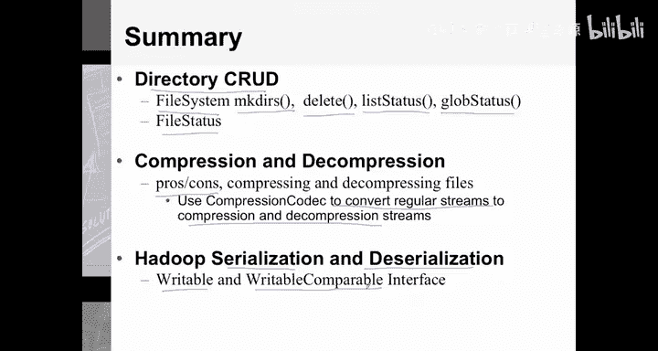
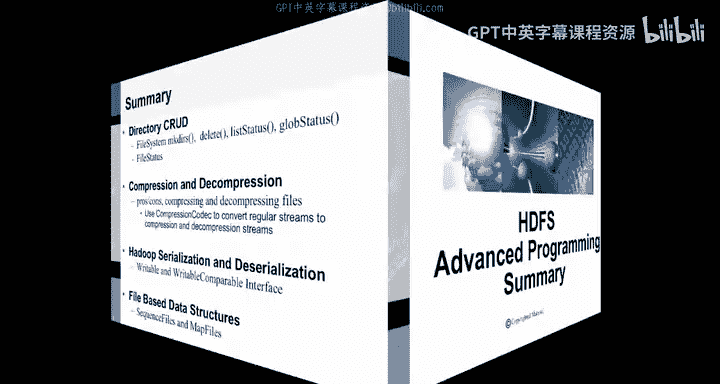

# 约翰霍普金斯大学《Hadoop大数据处理｜Big Data Processing Using Hadoop》中英字幕 - P39：17_HDFS高级编程总结.zh_en - GPT中英字幕课程资源 - BV1g5u6zBExs

HDFS Advanced programming Summary。In summary， in this module， we looked at the directoryC API。

 we saw that the file system class has a method called MKDIRs that allows you to make a directory。

 a method called delete that allows you to delete a directory， which returns a Boolean。

 if it's able to delete the directory successfully， it returns you true。

 if it's not able to delete it because the directory doesn't exist， it returns your false。

We also looked at a method called list status to get a list of all the files in a directory and a method called GB status that allows you to filter files selectively pull out files based upon patterns。

Both list status and GB status returned an array of filed status subjects。

Which gave you information about the file， for example， the name of the file， the size of the file。

 the owner， the permission， the replication factor。Then we looked at compression and decompression。

 we looked at the pros and cons of compression， pros。

 it saves space and the cons that every time you decompress it takes CPU， in fact。

 both compressing and decompressing。Requires CPU we learned how to compress and decompress files and the basic idea behind compression was to convert your regular streams into specialized compression and decompression streams so that you can compress and decompress your content。

Then we looked at Hadoop serialization， we learned that Hadoop has its own serialization mechanism。

 it doesn't use the Java serialization mechanism， and in support of it。

 ridriable and ridriable comparable are both interfaces， ridriable compatible extends from ridriable。

 ridriable has two methods in it， write and read fields。

 ridriable comparable has of course the two methods that's coming from the ridriable interface and also a third method called compare2 that's coming from the comparable interface。

And then we looked at some file based data structures like sequence files and map files that solve the small file problem in Hadoop HDFS。

