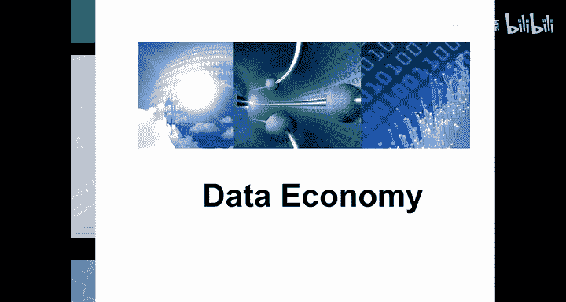
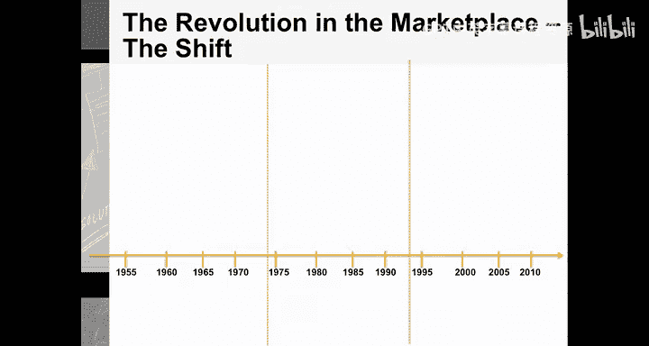
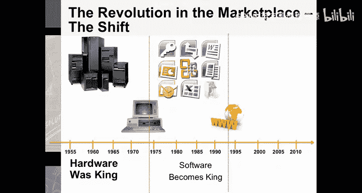
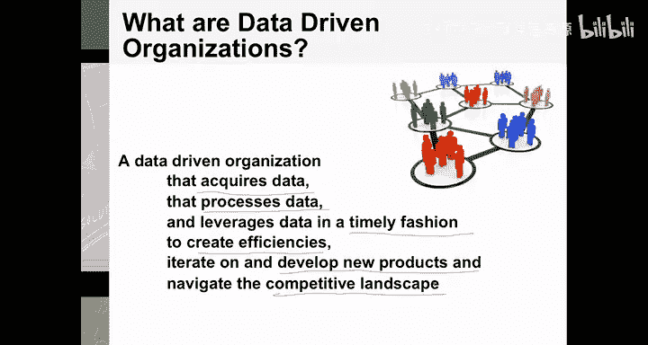
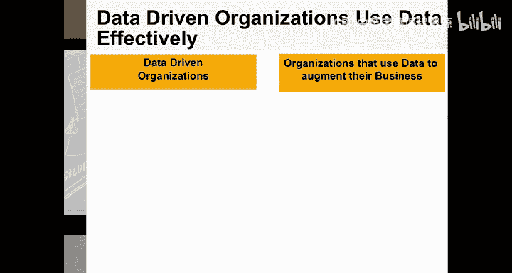
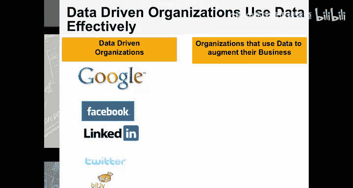
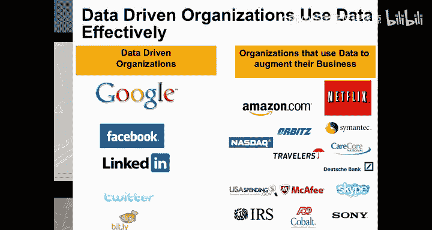
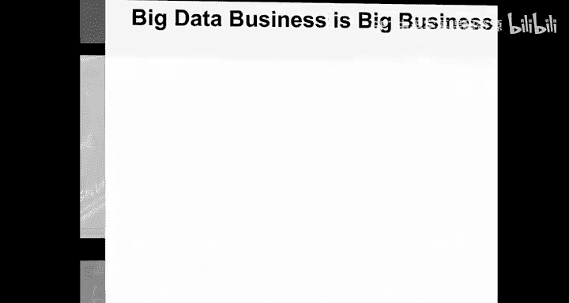
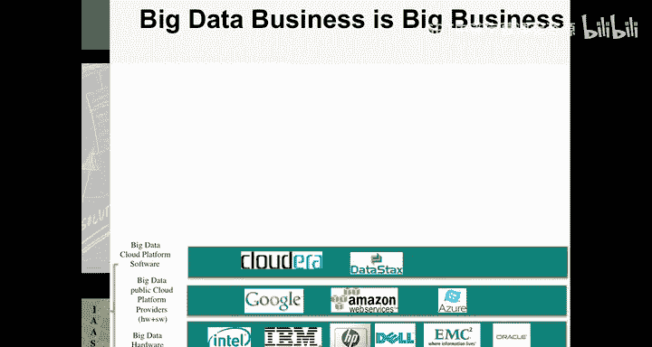
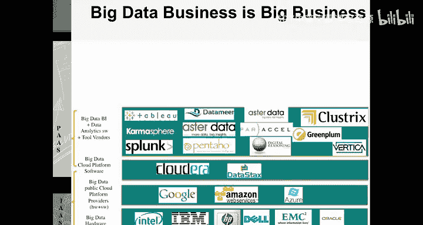

# 约翰霍普金斯大学《Hadoop大数据处理｜Big Data Processing Using Hadoop》中英字幕 - P3：2_数据经济.zh_en - GPT中英字幕课程资源 - BV1g5u6zBExs

Data， economy。Believe it or not， there is a revolution in the marketplace to be more precise。

There is a shift in the revolution in the marketplace in order to explain this concept what I would like to do。

Is take the computing industry timeline and split into three major eras。

If you think about the 1950s and the 1960s。

Hardware was King， companies like IBM， H， digital equipment corporations， they were the king。

 they were making mainframe computers， manyframe computers。

 and were selling it to organizations like AT&T， MCI and other big industries。

They were also selling these computers to government agencies like INS。

 IRS and the process making a lot of money， so they were the kingks Comp like IBM thought hardware was so important that when they actually built the IBM PC they't really care too much about it。

 they didn't even bother to build the operating system for it for them software was just a way to sell the hardware。

 it was the hardware that they were selling so a little known guy at that time named Bill Gates builts the operating system for IBM PC and then changes the marketplace and suddenly in the 1980s software becomes the king Everybody's building applications for the IBM PC and IBMP compatibles for the Microsoft Windows platform many of my friends started doing startups building small applications that they could sell on the PC platform and so software became King and even if you look at the universitiess universities started providing Korea started creating a new field called computer。

Science something interesting happened in the 1990s。

 it was the World web soon everybody started moving towards the web。

Lots of products and services started being offered over the web。

So suddenly data became the new Ken， if you look at the 1990s， especially the early 2000s。

 companies like Google， Facebook， Twitter， these guys started making it big and they were all doing it based upon the data。

 so data is the newK。So what are data driven organizations， a data driven organization is one。

That acquires data and processes the data and leverage the data in a timely fashion in order to create efficiencies and iterate and develop new products and services to navigate the competitive landscape for their business An example I can give you is Amazon。

 co Amazon。com is a retail store on the internet， but they are actually acquiring data when you go through Amazon。

 co when you browse the different products they are keeping track of what are the different products you're looking at they are keeping track of what products you're buying。

 they're keeping track of all these things and so they are able to make a recommendations to you they know that people who bought this particular product would also buy this particular product and so they recommend the particular product to you。

You may have added something to the wish list。 you may have browsed a product。

 so now they know that the product is of interest to you right so from time to time they would send you emails。

 they'll send you coupons， they do all kinds of things so that you can come online and shop so they are actually effectively using data to improve their business。

In fact。Data driven organizations can be categorized into two pure data driven organizations or organizations that use data to augment their business。

 companies like Google， Facebook， LinkedIn， Twitter， Biley are all pure data driven organizations。

Their product is all built around data。If you look at organizations that use data to augment their business。

 Amazon。com as I mentioned is one of those organizations。

 Netflix is another one Netflix isn't the streaming video business。

 but they also keep track of you what videos you are looking at they're keeping track of what videos you're browsing。

 they also know who watched what videos and what videos maybe recommended to you。

 they have a recommendation engine， because the idea there is that they are trying to you be in touch with you so that you'll continue to stay to be their customer。

 same thing with orbits and travelers， NASAq all these different organizations are trying to use data to improve their business for themselves and for their customers。

Big data is big business， everybody is excited about it。When it comes to infrastructure as a service。

 the big data hardware manufacturers like Intel， IBM， H， Dell， Oracle。

 they are all very excited because now they can sell you these hardware， they can sell you the CPU。

 they can sell you the storage， EMC can sell you the storage， right？Big data。

 public cloud platform vendors are also very excited because in order for you to process this particular data。

 you may want to process the data only once every six months or only only once a month。

 you could use these cloud services， process the data and then walk away from there so companies like Google。

 Amazon Web services， even Microsoft Azure， they're all very excited about this big data Cloud platform software companies like Clouder。

 hot and works， Datats are also excited Clouder as the company that provide support for Hadoop。

 Datats provide support for Cassandra and No SQL solutions again for big data you need big data solutions and these guys are providing support platforms for that。

When it comes to PA， which is platform as a service， lots of big data。

 business intelligence software vendors， data analytics software vendors are excited about it Tableau。

 Astra data， datame cluster tricks Splunk they're all excited about this and want to sellute products If you look at the DS asL layer which is data as a service layer。

 Dun in Bradtreet is excited about it because Dun in Bradtreet by the way。

 but Dun Bradt is a company that has information about every company in the marketplace so they can sell you this information it is also infofoChimps Ginip which sells streaming data for Twitter。

 government2。 which is basically a community about exposing government data， Reuters。

 simpleple Ge there's a lot of data a greatest companies that are getting excited about big data too because they can make money in the process。

Information science is affecting every industry here， there's the biotech industry。

 there's a video here that I would like you to watch about the biotech industry。

The linguistics industry is also affected， there's a video on that that I would like you to watch near spare time mining industry there's an article about mining industry and how it is changing because of information science and big data science。

 finance， there is also journalism there is something called data journalism that has become very popular。

Even education industry is being affected pretty much every industry is being affected by information science What I would like to do is talk a few minutes on this linguistics industry you might want to watch the video but let me explain this to you there is a professor at MIT who is doing research on linguistics。

And what he has done is that he has recorded every second of his child's life from the day the child was born and brought to the house on day5 until the child was five years old。

 It's about， I think 18 hours of video that he records on a daily basis and then he process those things through a big data processing platform in order to study linguistics。

 he figured out how his child is learning language。

 He figured out how his child is learning to say the word water you know。

 the fire initially starts start saying the wordbuba and then changes over time to sayvo water water and then eventually they say to say the word water。

 and he's able to study all these things， he's able to do linguistics analysis purely by recording every minute of his child's life and then doing video and audio processing on it There is no way researchers can sit down and watch all this video and analyze it He's able to do this thing through big data processing。

Technologies this is an example of how even the linguistics industry is being affected by big data processing。

So wake up， this is data economy， we are actually in the midst of information science in the making。

 not long ago data was difficult to capture and more expensive to store。

 but that's not the case anymore。You know there wasn't much of it at that time now there's a lot of data。

 data was the bottleneck for much of the human endeavor。

 there is no limit to how much valuable data we can collect and process we are no longer data limited。

 we are in fact insightlim so the people who can work with data。

 the people who can analyze data are the ones that are going to be making a lot of money so we are in the data economy。

