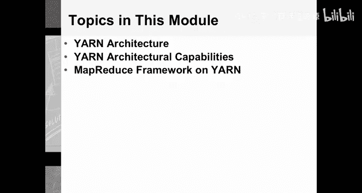
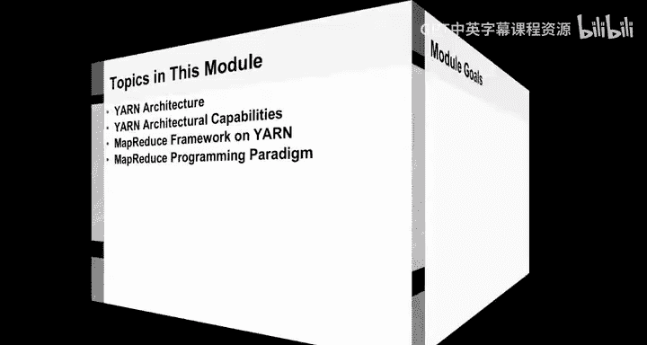
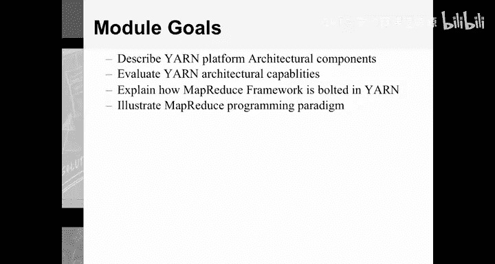

# 约翰霍普金斯大学《Hadoop大数据处理｜Big Data Processing Using Hadoop》中英字幕 - P40：0_YARN与MapReduce架构导论.zh_en - GPT中英字幕课程资源 - BV1g5u6zBExs

Welcome。We will look at Yon platform architecture。Its architectural capabilities and how map produced framework is bolted on top of yarn。

Finally， we will look at the Mareduce framework programming paradigm。

So what are the topics in this module？There are four sections in this module。

We will first look at yarn architecture， including various components of yarn and their interactions。

Then we will look at yan architectural capabilities， including performance， availability。

 scalability， operability and security amongst a few。

Then we will learn how map reduce framework is bolted on YN platformform。

Finally， we will look at the mapreuce programming model。

So what are the module goals？Describe the yarn platform architectural components。

Evaluate the yan architectural capabilities。Explain how mapreuce framework is bolted on yarn。

And finally， illustrate mapre programming paradigm。

