# 约翰霍普金斯大学《Hadoop大数据处理｜Big Data Processing Using Hadoop》中英字幕 - P41：1_YARN架构解析.zh_en - GPT中英字幕课程资源 - BV1g5u6zBExs

Yn architecture。In this section， we will look at the architecture of yarn。

 the various components that make up yarn。Their functional responsibilities and the interactions between them。

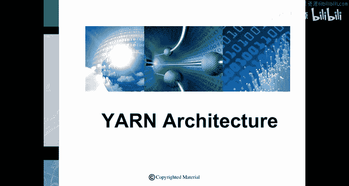

Let's review the Hadoop to Ynt。At the lowest level we have common libraries。

 this is where the configuration， compression and serialization APIs exist then built on top of the common is the HDFS distributed storage。

 this is where the file system API exists， we learned how to create read。

 update and delete files and directories we also learned about some of the file based data structures then built on top of HDFS is the yan platform for distributed processing and then on top of that is the mapreduce framework for big data processing。

Let's look at the Hadoop 1。X stack in Hadoop 1。X you have common built on top of that。

 you have HDFS on top of that you directly have the mapre framework for distributor data processing。

If you go back and look at the Hadoop2ex stack， we have a new layer in between called the yarn layer。

 so let's try to understand why we have this layer， but before we do that。

 let's look at the Hadoop 1 classic MRV1 architecture。

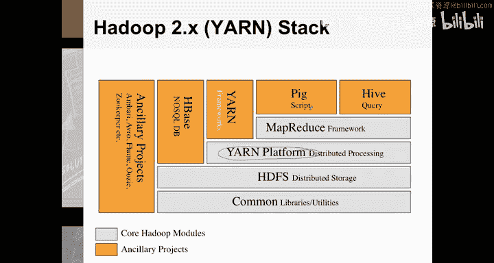

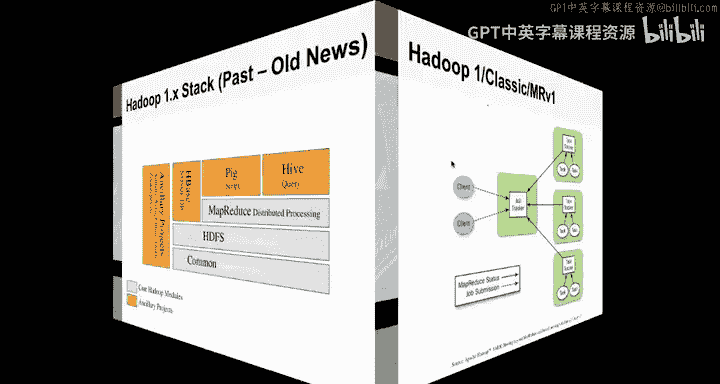

In Hadoop 1 we have again a master slave architecture where we have in the master a demon called the Jo tracker demon that runs。

 and in the slave we have a demon called the task tracker demon that runs the task trackers connect to the Jo tracker master and wait for any work that needs to be done。

Clients submit a job to the master job tracker， the job tracker breaks the job into pieces and depending upon where the different data sets are。

 asks the various task trackers to do the work and the way the task trackers do the work is by launching tasks。

 tasks or JVMs or processes that get launched， we could have map task。

 we could have another map task running， we could have a reduced task running over here。

 in fact multiple clients can submit a job， they get broken down into tasks and the tasks run across multiple machines。

If you look at the Hadoop1 architecture， the platform and the application framework which is the mapreuce framework are both combined。

 you have Jo tracker which is doing resource scheduling and job and task management for mapred task。

 in other words we're doing the work of the application and then you have the task tracker which of course breaks the task into pieces and then runs each of the tasks。

In Hadoop 2， we have yan demons， which are the resource manager yan demons and node manager yan demons。

 these are new demons in Hadoop。So the old demons don't exist anymore and then these demons launch what is called the application master and container these are both containers。

 in fact the application master is a specialized container Now I know that you do not know what a container is yet we'll talk about it in just a few more slides。

Okay， so Hadoop2 actually separates the platform from the application framework。

 it can be any framework， it could be a Mareuce framework， it could be MPI framework。

 but the reality is that it supports the two things in Hadoop2， we have resource manager。

Which is like the job tracker in Hadoop 1， which is only going to be doing resource scheduling Jo trackcker was doing resource scheduling now it's only going to be doing resource scheduling。

The jobb tracker is also doing job and task management for every application that existed。

 that piece is now going to be done by what is called the application master。

And then there is another demon called the node manager De。

 which is going to be managing the resources， it's going to be monitoring the resources and enforcing。

 making sure that the resources are being used in the right way。

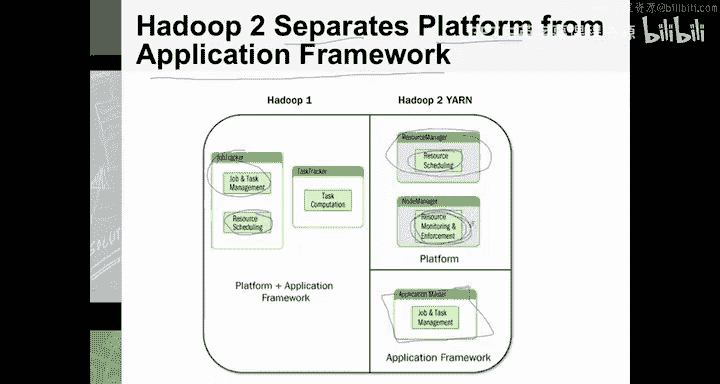

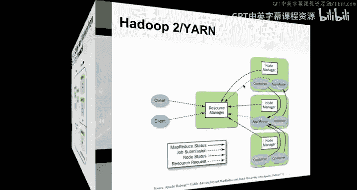

If you look at the Hadoop2 Yon architecture， once again， it's a master slave architecture。

 we have one master and three slaves over here， we have the resource manager running。As the master。

 and then we have node managers running as the slaves， As you can see。

 the three slave hosts have their own node managers running。

Clients submit a job to the master and then the resource manager basically launches what we call the application master that is responsible for doing the job management so notice that the resource manager is not doing job management anymore。

 it's the application master that's going to be doing it so we have client1 and then we have client2 and so we have one app master for client1 and second app master for client2 and these app masters have containers which are like tasks that are assigned to them that do the real work。

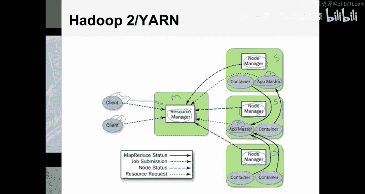

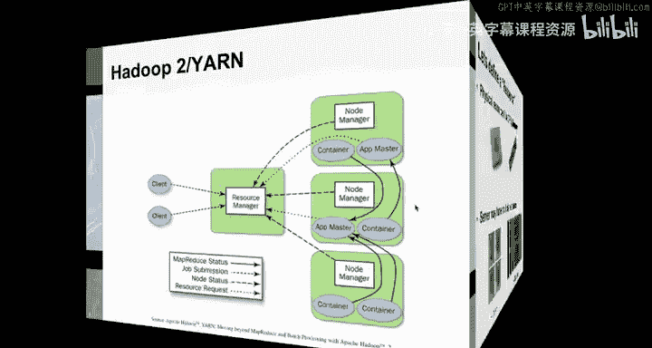

Before we get into the details of the Hadoop 2 architecture。

 let's define a couple of things First I would like to define a resource because we're going to be using the term resource a lot resource resource manager。

 container they all kind of connected。What's a resource。

 a resource is basically physical resources like CPU， memory or even hard diskk。Now。

 in the case of Hadoop yarn， let's think of them as CPU and memory for now。If you look at a server。

 a server have multiple resources， for example， you may have a server that may have four course。

And eight gigabytes of RAM。So you have core  one， core  two， core  three， core 4。

 and then you have one， two， three， four，5， six， seven，8 gigabytes of Ram， let's say。

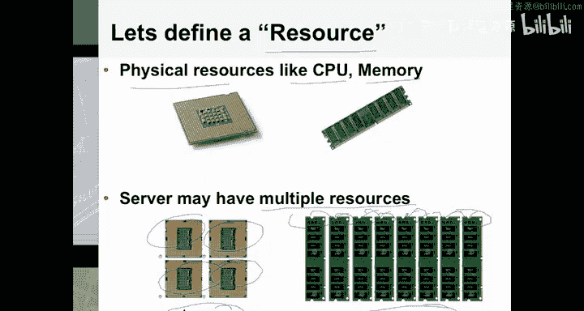

Okay。What's a container， a container is a collection of physical resources on a single node。

A single container is a collection of RA and CPU associated with it， so for example。

 you may have 512 megabyte or 1 gigabyte of RA and one cord to be treated as a single container。

And the idea here is that you can take a server and break it down into multiple containers。

 so remember the server that I showed you in the previous slide where we have four cores of CPU and eight gigabytes of RAM。

 I'm going to assign three containers for that particular server。

First container will have one core and two gigabytes of RAM， second container。

 one core and two gigs of RAM， third container of one core and two gigabytes of RAM Now you might say what happened to the fourth core and the rest of the Ram which is another two gigabytes of RA。

 I'm going to use it for other demons for other processes。So these are the real worker tasks。

 these are the different containers that are going to be used for doing the real work。Okay。

 let's look at the Yon architecture。In the Yon architecture， we have a master slave architecture。

 we have the master node， we have one master node， and as you can see we have several slave nodes here I have six slave nodes。

 each one of them is a node。In the master node， we have the resource manager demon running in the slave node。

 we have the node manager demon running， we have six slave nodes。

 and so we have the six node manager demons running。The node manager demons are slaves to the master。

 and so they connect to the master resource manager for all the instructions and also reporting statusis。

That's what they do。And then there are also these things called containers that run insider node and you can have more than one container here I'm showing you only one container per node。

 we can have container and then we can have another container。

 we can have another container we can have as many containers。

 and then there is a special container called the application master。

 which is the container that does the job management for a specific job。

 or for a specific client requested job。

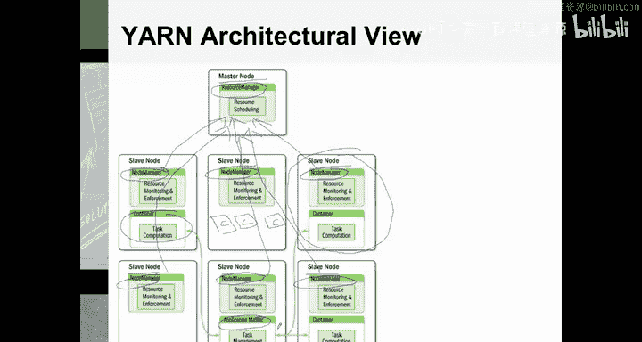

Okay， so that's the high level view of architecture。

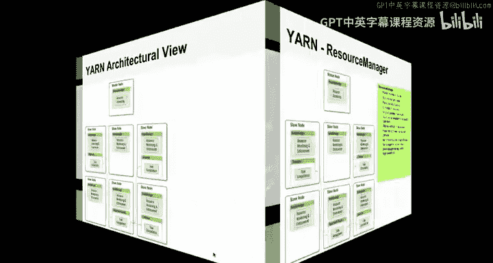

Now， let's look at the details of every one of these demons。 So here's the resource manager。

 The resource manager is the master demon。 It's the master demon in。The yan architecture。

 there is only one instance of the resource manager notice there is only one resource manager running all the slave nodes are running their own demons of node manager demons。

 but not the master resource manager， it is a Java based demon and it's primary responsibility as it says over here is scheduling so it all it does is scheduling that's is primary responsibility。

It gives applications， for example， an application master over here， resources。

 so what is a resource， a container is a resource， so it gives containers or it assigns containers to an application master so that the application master can break its job into pieces and all the work can get done by the various containers。

The resource manager is the ultimate arbiter of resource。

 which means it gives resources to an application master because the application master may have requested for 3。

4，5，10 containers， it would give them those containers， and then it may take them back。

 maybe there is another client that needs to do some work and so it may take those resources back from the application master and give some resources back to it later on when it's available。

It may， if you don't， if the application master does not return the resources back。

 it can even instruct the node manager to give back the resources so it can actually forcefully take the resources back。

 so that's the resource manager。Let's look at the node manager。

 node manager is the slave of the resource manager。And node manager runs on every node。

 as you can see， there's a node manager running on every node， 36 hosts。

 so I have six node managers running。It runs as a Java demon。Of course， that is one per。

Note as we saw， it registers itself with the resource manager。Because that's the master。

 so when it comes up it registers itself with the resource manager and starts sending heartbeats。

 it sends heartbeats to the resource manager。And waits for instructions for the resource manager。

The resource manager may ask it to launch a very special container called the application master。

 so for example， here you have a node manager that may have launched this application master under the direction from the resource manager。

The node manager's primary responsibility is to monitor the node health。

 making sure that the resources are running， and if the resources need to be killed。

 it'll kill it under the instruction of the master node or the master resource manager。Now。

 let's look at the application master。 and application master is basically the master for an application。

 Each client that is submitting a job， each client that is submitting a job is called an application and each application has its own application master。

 So if there were 15。Applications or 15 jobs that were submitted in from the client。

 then there would be 15 applications masters running within the cluster。

The application master is launched by the node manager。

Based upon the instructions that are coming from the resource manager to the node manager。

 it is often referred to as container zero because the application master is really taking a part of a container。

The application master， when it is launched， registers itself with the master resourcesource Manager。

And it even gets an idea associated with it。And then it communicates with a resource manager to get a list of all the containers。

 so you notice that the application master requires containers。

 this particular application master over here is requiring three containers。

 it has three containers assigned to it。And so it is actually these containers are actually gotten from the resource manager。

 the resource manager is assigning those containers to the application master。

And then the application master can use the containers to do whatever processing it wants to do。

So what is a container， a container is a separate process。

It is launched by the node manager based on instructions from the application master the first thing to understand is that the application master itself is a container launched by the node manager and then there are other containers that are launched by the node manager based upon the instructions from the application master。

It's the container where the real work gets done the application master container does the job management work and the rest of the containers are actually doing the real work。

 whatever the business logic computation that needs to be done is being done in the container。

Don't forget that yarn goes beyond Mareus。Because of the way the architecture is laid out。

 you can have different kinds of clients inside your。Yn cluster， you can have。A Mare client。😮。

Or you can even have an MPI client here， I have a mapreuce client。

And then here I have an MPI client MPI is a different framework when a Mare client submits a job。

 there will be a Mareuce application master that will be launched。

 when an MPI client submits job there will be an MPI application master that will launched and these two application masters have different kind of logic。

 one of the application masters is the Mare application master。

 one of the application masters is the MPI， two different technologies， two different frameworks。

 and they can execute their own framework logic in their own way。

The point I'm trying to make here is that we can have multiple frameworks running in our Yn cluster。

 and by the way， you can have multiple Mareuce job oning and multi MPI jobs oning too。

So let's look at an application flow in Yrn。We have a client over here。

The client in step1 submits an application to the resource manager。

 the clients always communicate with the resource manager to submit a job。

The resource manager working through the node manager will launch an application master。

Once the application master is launched， the application master in step two communicates with the resource manager and part of the communication process is registering the application。

 so notice it is registering the application。And then it will basically in step three。

 communicate with the resource manager and say， hey， you know what。

 I'm going to be doing a job and for that job I need containers so it is going to request for the containers。

The？Resource manager。Then looks at the cluster， figures out where the containers are。

 and eventually assigns the containers to the application master。

Once the application master gets the containers in step3， in step4。

 it'll go to the appropriate node manager and ask them to launch containers。

 so the node manager launches a container， it's going to talk to this node manager and launch a container and so these are the containers that are going to be doing the real work。

In step5， once the containers are launched， then it communicates with the container so that the containers can actually do the real work for that particular job once all the containers have finished their job or their little task。

Then the job is completed， once the job is completed。

 it goes back to the resource manager and says the job is complete and so it unregisters the application and then the application master goes away and of course all the containers that were launched also go away。

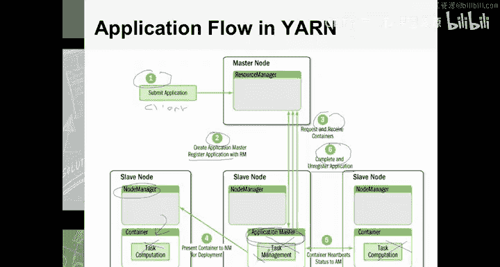

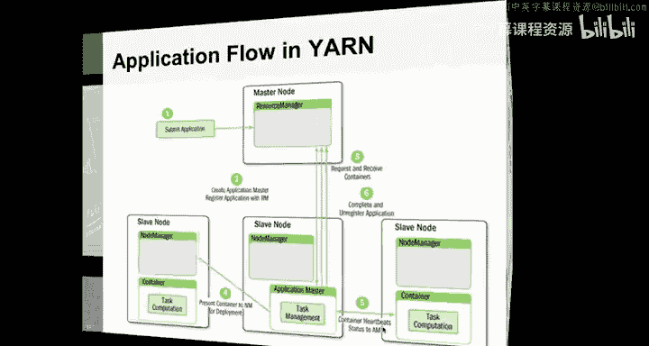

So let's look at some more details in this case I'm going to show you what really happens when a client submits an application request。

 so this is the interaction between the client， the resource manager， node manager。

 and then the application master。A little bit more detail in step one。

 declined client submits an application request。The resource manager accepts it and gives it an application ID in step 2。

 and then in step 3。The client then submits what is called the application context。With it。

 it sends the application ID， the user that's submitting this request， the these are priority cus。

 we have what is called scheduling， we have a couple of different kinds of schedulers that are built into yarn。

For different schedules， for we have different cues， priority cues， and things like that。

 this is that particular queue。And then there is also what is called container launch context。

 which has information such as what are the different Hadoop HDFS files that need to be processed。

 security token to access them， all kinds of information is being sent as part of submitting this job。

 so the job submission process is a little bit more complicated than what I showed you in the previous slide。

Once the job is submitted， the resource manager says， okay， I'm only a scheduler。

 I'm not really going to do any application related work。

 so it is going to ask one of the node managers。To launch an application master。

 So notice it launch an application， and then the application master then communicates with the resource manager。

 So let's see what happens there In step 4， once the application master comes up。

It basically sends an application master a registration request saying， hey。

 I'm registering myself with you。In step5， the resource manager says okay， thanks for registering。

 by the way these are the resource capabilities， resource capabilities are these are the different nodes that I have。

 these are the containers I have， these are the RA sizes， these are the CPU sizes。

 these are the things that I have。The application master then says okay。

 I'm looking for some resources， so it says I'm looking for these kind of containers。

 so it asks for those containers in step six to the resource manager。

The resource manager then would assign the containers。

 and this is where I said the resource manager may give all the containers that were requested。

 it may give part of the containers， it may give。Maybe all or maybe part and then take them away and then give it back to the application master at some point。

 so there's a lot of negotiations that happen throughout the process。Okay。

 so that's the submission work and the application master。Being launched。

Now let's look at what happens next， the application master。

 once it has a list of all the containers， will communicate with each one of the node managers and ask it to start a container so that the tasks can be done。

 notice the application master interacts with node manager to start tasks and also to start tasks。

 actually to start containers and to start containers。

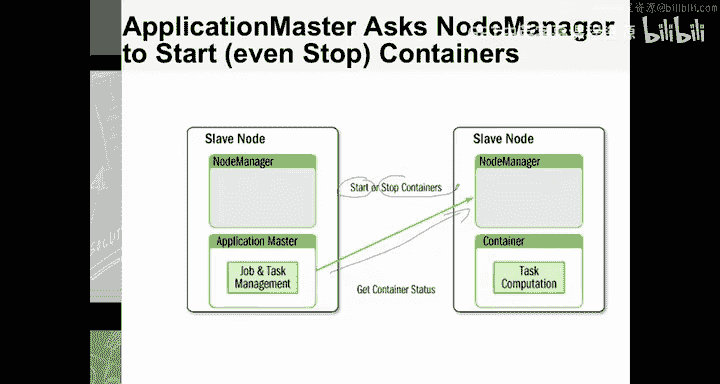

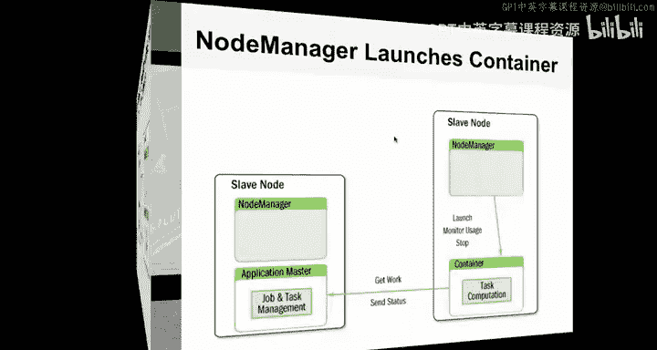

In this slide you're seeing how the node manager starts a container， this is the container。

 which is of course going to do some task， and the container communicates with the application master in a way that our multi-level master slave relationship。

 we know that the node manager is the slave of the master resource manager。If you think about it。

 the application master is the master for a job and the container is the slave for an application master。

 slave for a job okay， so the container contacts the application master requests work that needs to be done and then is actually doing the real work over here。

Here I'm showing you the application master， the node manager and the resource manager interactions。

 a bigger picture。 As you can see， the application master is the。

Star behind this entire process in order to execute a piece of job。

So the application master is sending continuous heartbeat to the resource manager。

 actually the node manager is also sending continuous heartbeat to the resource manager。

 the application master will contact the node manager to start containers to stop containers and then the responses are also coming from the containers back to the application master back to the node manager。

The resource manager can send kill operations to the node manager so that a container can be killed because the resource manager feels that a container needs to be taken back so that it can give that particular container to somebody else。

 you can see that and if it actually first requests the resource manager actually request the application master to kill the container directly。

 in fact， if that happens， the application master can request the node manager to kill the container。

 but if the application master does not do that， then the resource manager will go in and ask the node manager to kill the container。

Okay now let's look at the yarn ports。The resource manager runs on port 8032。

 It listens on port 8032。 It's an IP protocol， which is Interprocess communication protocol。

 the node manager when it launches， it connects to the resource manager on 8032 to register itself with it。

The application master， once it launch registers itself to the resource manager。Also the clients。

 when they submit a job， they communicate to the resource manager on port 8032 the resource manager also has a really nice web UI。

 which is an admin UI， runs on port 8088 When you submit your application you can look at the status of your application on this resource manager web UI。

There is also a node manager WebUI available which runs on port 8042。 This is not very useful。

 it's not as useful as the resource manager webUI where you can check out your application status。

So let's talk about starting yarn demons。The way you start yan demons is by invoking the start yan O H。

 which will start all the demons， which in this case would be the resource manager and the node manager。

And then you can also start a specific demon if you want by invoking Ydemon。

sh command passing to which start。And then the name of the demon that you want to start。

 the name can be either resource manager or node manager。 So here you'll just say yaonde or S。

 start resource manager and that would start the resource manager or ya demon or S。

 start node manager and that would start the node manager。

You can also stop all yan demons and the way you stop all yan demons is by invoking the stop dashed yan S shellll program that is going to stop the resource manager and the node manager。

 you can stop an individual yan demon by invoking yan demon orsh command passing to it stop followed by the name of the demon。

 which would be either resource manager or node manager。How do you run a yarn application。

 you write the yarn application， let's say you wrote it in Java， and then so you have a J file。

What you do is you execute the yarn command。Followed by J， followed by the name of the jar file。

And then the name of the application， that's the class of the main method。

 followed by any arguments that your application may take。There is a sample Hadoop examples。

Map produce program that's available， so you can run that yarn。

 jar and the complete path to the jar file。Followed by the name of the program， which is word count。

 followed by any argument that it takes， in this case it takes slash in。

 which is the input directory and slash A， which is the output directory。So let's go ahead。

 launch our VM and try to start some of the yarn demons。

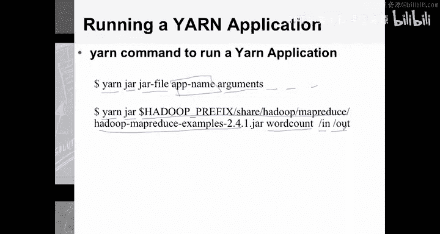

Here I am logged into my HD server as HD admin user ID。Let me do a GPS。I see the name node running。

 the secondary name node running， also the data node demons running。

I would like to start the yarn demon， the way you do that is start dash yarn。S， H。

That's going to start the yaon demon， it started the resource manager and started the node manager。

Let's go ahead and a JPS。And there it is， it started the resource manager and also started the node manager。

The two demons。I can also stop the demons， stop。Yarn3 age that should shut down the two demons。

And by the way， it's also showing you where the log files are going。

 which is in the Hadoop logs folder。嗯。Do a J。The demons have stopped。

 we only have the name node running， secondary name node running， and then the data node running。

Okay， let's go ahead and start each or of the demons separately， we could do that too。Yn dash demon。

 dot S H。 Start resource manager。 I'm going start the resource manager。

That starts the resource manager to a GPS resource manager is up and running。

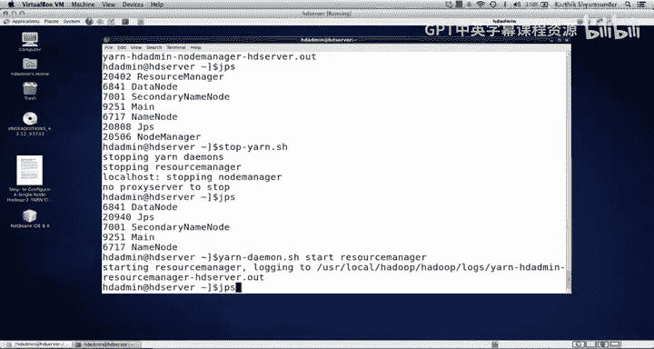

I can also say start node manager。And that should start the node manager。Do a GPS。

That started the node manager。There's a node manager Okay so now what I would like to do is go to my admin console we know the resource manager is running on port 8088 so I'm going to say local host 8088 so I can see the resource manager This is the resource manager admin console notice it has a list of all the applications that have run no applications I've run at this point。

A list of all the different statuses in which the applications are at。New， submitted， accepted。

 all the finished applications over year failed， killed all the different statuses。

Let's also look at the node manager admin console that would be 8042。So with local host。8ight is0，4。

2。That's where the node manager demon is running。It has information about the node manager。

 it keeps track of all the containers that it has。For ease of use。

 what I have done is bookmarked all my different admin consoles over here。

 So this is my Hadoop documentation page。 This is where my name node demon is running 50070 that's the admin console for that。

 This is for the secondary name node， which is running on 50090。 This is my application master。

And then this is my node manager， so I have all the different demons， admin console bookmarks。

 so whenever I have a problem， I can go directly to those demons and take a look at what is happening。

Okay， so here's what I want to do now。 I want to run a yarn application Okay。

 so I want to the way I run a yarn application is by typing in the command yarn by the name of followed by jar。

 followed by the pack of the jar file。

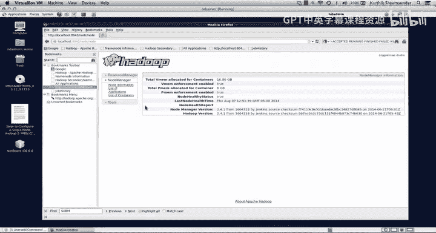

I do prefix， slash share。do map produceuce and what run a map produceuce application。

Followed by Hadoop。Examples。And the program I'm going to run is called word count。

The input directory。And the outputqua directory。Rightner。It's running the job。

It actually submitted the job and then it's running the job。It's running the map and reduce。States。

The map is done。Okay， the job is over， the job is done。

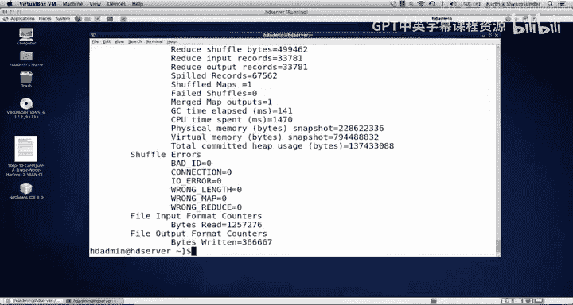

Let's see if the admin console has a record of this job， so let's go to the admin console。

Let's go to the resource manager。 there it is。 There is the。Application that we just ran。

 it's the word count application that we just ran。You can click on it。

One attempt that was done of the application。It was done on this note， click on that。

 that's the node manager information。Right， so click on this。So if I click on applications。

 that's the only application that has been run， if I click on failed， nothing has failed。

 if I click on finished， that's the one application that is finished。

 so the application was submitted and then it finished successfully。

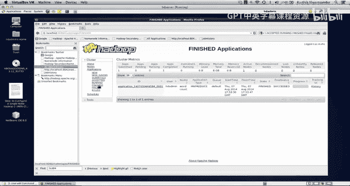

Let me go ahead and run the application again。嗯。Before I do that。

 I have to remove the output directory， Hadoop F S dash M dash R slash out。 and me remove the。

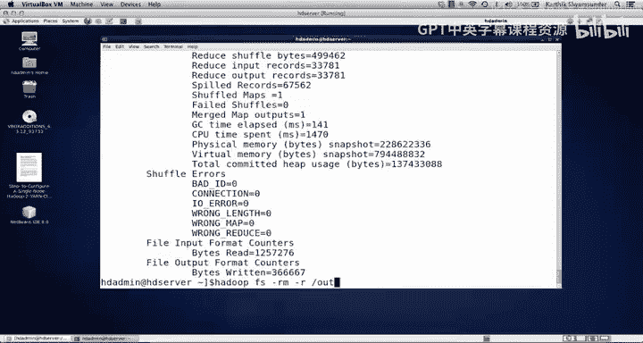

Directory。Okay， going the program again。The job is running。So running， running。

 So there they see in running。We see the job。And then in finished。We see job one。

This is one and running， let's see。Okay， it's finished now。 So if I go to finished， there it is。

 So this was the first job and this was the second job that I ran。 It finished successfully。

So as you can see， I can submit jobs and I can see it in my application admin Con this is the resource manager Con。

Every application has an ID associated with it， as you can see。

 the ID is the word application followed by the timetamp of when when the resource manager started。

And also the sequence number， which is one for the first job that was submitted。2 for the second job。

 and it would be three for the third job。Go ahead and submit it。六。Let me have to delete the file。

Run the program again。Submit it。Nothing it's probably running by this time。It's running。

It's not finished yet。 So I'm just hitting the finish button again and again。So， you can see。

As soon it's done， it'll come over here， finished， or there it is。 It's finished successfully now。

Okay。

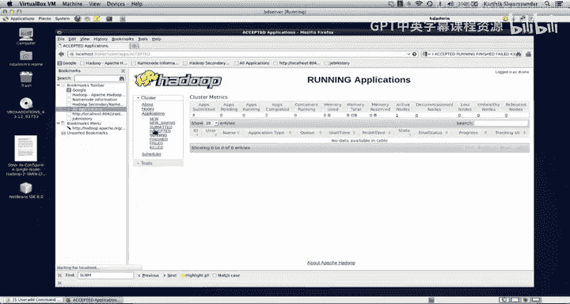

In this section， we looked at the architecture of yarn。

 we looked at the various components that the yarn architecture is made up of。

 We also learned about the various functionalities that are associated with these components and the interactions。

The complex interactions that are happening between these components。

 and then we learned how to start the yarn demons， shut down this yarn demons。

 and we also learned to submit a job to the resource manager。

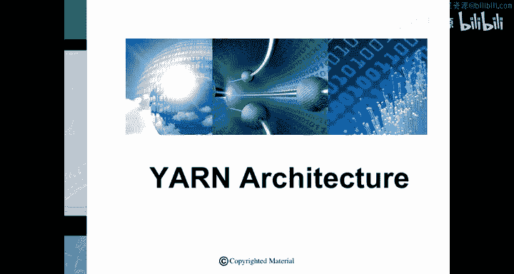