# 约翰霍普金斯大学《Hadoop大数据处理｜Big Data Processing Using Hadoop》中英字幕 - P42：2_YARN核心架构能力.zh_en - GPT中英字幕课程资源 - BV1g5u6zBExs

Beyond architectural capabilities。In this section， let us look at YN components。

 specifically the resource manager and node manager from various architectural capabilities perspective。

We look at various architectural capabilities like performance。

 how performance is the resource manager and node manager， how can we increase its performance？

How scalable is the resource manager a node manager， can we scale up， can we scale out？Availability。

 how available are they， what happens if the resource manager goes down。

 what happens if the node manager goes down？Installability， How easy is it to install。

Configurability， how configurable they are， how can we change the configuration parameters？

Opererability， how easy is it on operations， what kind of tools are available for operations。

 usability， usability and programability are kind of related usability from the perspective。

 how easy is it to use yarn， for example， how easy is it to submit a yarn job which we already saw was pretty straightforward。

 also programability， which is how easy is it to program， and then security， how secure is it。

Let's look at the yarn performance。Let's look at resource manager performance first。

 resource manager is a heavily utilized component。Don't forget that the resource manager maintains a complete map of all the resources that are in the cluster and keeps track of who's using them。

It is also constantly receiving heartbeats from both the node manager and the application master。

 and you may have thousands of node manager。Which means， you know。

 because it's maintaining map of resources， it could get memory and CPU intensive。

It may also get network intensive because resource Manager is getting heartbeats from both the node manager and application master from time to time。

 in fact， every few seconds。You can increase the performance of resource manager by getting bigger hardware。

 which means more memory and more CPU， you can also increase the threat counts。

 we'll talk about how to configure the threat counts in the section on configuration。

Note manager is a pretty lightweight process， it's really not much of a problem。

 usually it's pretty straightforward， it's very light because it's really a manager of the node。

 it doesn't really do any real work， all the real work in a node is being done by the various containers。

 whether it is regular containers or the application master which is a specialized container。

 also referred to as container zero。You can increase the performance of node manager if you want by getting bigger hardware and you can also increase the threat count again。

 you can configure the threat count in the configuration XML files。

So what about scalability when it comes to resource manager scaling up resource manager is not a problem you can get bigger hardware as far as scaling out is concerned you cannot you cannot scale out the resource manager because there is the only one resource manager that runs per cluster but it's really not a big concern for us because if you look at Hadoop 1 in Hadoop1。

 the job tracker was doing a lot of work， it was doing resource management and it was also doing the work of the various application master with Hadoop 2 yarn。

 the resource manager is not doing as much work as the job tracker so now with resource manager according to Yahoo Yahoo is running a resource manager that's managing a cluster of 40。

000 nodes so that's pretty good as far as I'm concerned。Notode manager。

 you can scale up node manager by getting bigger hardware。

 you can also scale out node manager by adding mode nodes so you can start with 20 nodes。

 then you can add 20 mode nodes， 40 nodes， you can take it to 100 nodes， 200 nodes。

 and as you add mode nodes， you're actually scaling out the node manager。

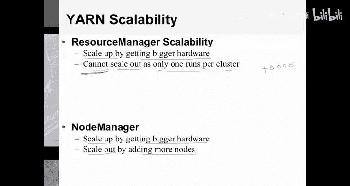

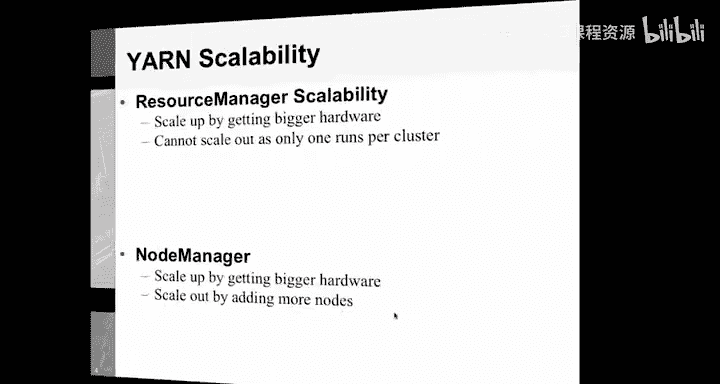

Yn availability， let's look at resource manager availability。If you recall。

 resource Manager is a very critical process in yarn。Clients submit jobs to the resource manager。

 node manager and the application masters are connected to it and are sending pings from time to time If the resource manager crashes then no new jobs can be submitted to the resource manager as far as existing jobs is concerned they are going to come to a halt so the application master basically tries to reconnect with the resource manager because the resource manager is diet。

 it's not able to connect to it so it's going to keep on trying it tries n number of times which is configurable I think the default is about 10 and if it cannot reconnect to the resource manager it'll basically shut down the application and so the application would have failed the resource manager can be set in what is called the HA mode which is the high availability mode for that you need to use zookeeper to maintain the state of the resource。

And to elect a new resource manager in such situations。

 what you do is you can figure HA capabilities for resource manager launching multiple resource managers。

 st the state in zookeeper and then when one of the resource manager crashes by the way there's only one that's running it's in the active standby mode only one of them is running and then when one of them crashes the other one will be elected as the leader and then clients can connect to it。

As far as the node manager availability is concerned， if you think about it。

 node manager is highly available， if the node manager crashes。

 then the resource manager cannot talk to the node manager and so the resource manager is going to say。

 oh， that means all the containers that are under the management of that particular node manager has to be redone。

 so the resource manager will simply launch other application masters elsewhere。

 and they will also launch containers elsewhere for those applications。

What about yan installsability？Manual installation for small cluster is okay。

 but when it comes to large scale clusters where you have hundreds of machines。

 you cannot install manually like the way we did it。

 you can use something like the Amri installer tool， which is an open source tool。

Organizations also write custom installs， they would write custom scripts using tools like puppet。

 Che and Cbel You can also use the Amazon Elastic map produceuce which is a VMbased installation where you really don't have to install anything all you have to say is I need a cluster with 40 nodes and these are the capabilities that I need you just go to the console you configure that and boom it launches all the different VMs for you but some Hadoop experts discourage from VMbased installation from my perspective Amazon has done a fairly good job in VMbased yarn。

Yeah。In terms of yan configurability， yan is highly configurable。

 it is an XmL based configuration system， you have yan default。xml。

 which is part of Hadoop J files which is loaded by default that has all the default properties for yarn that is also yan site。

 Xm that you can configure you can override the default properties。

 which is usually placed in Hadoop prefix Etsy Hadoop。

This is where you override all the default properties that's available as part of Co Hado。

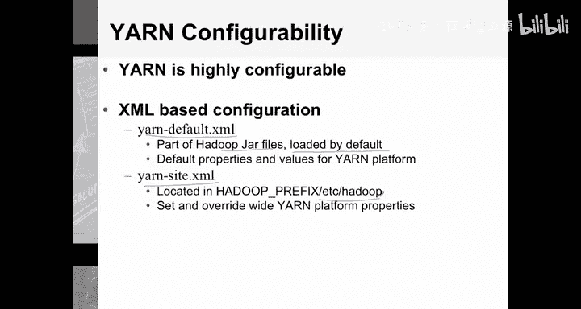

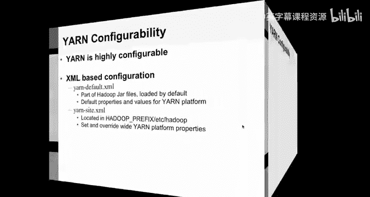

If you look at the Xml files， you'll notice that for resource manager。

 there's a lot of properties that start with yan do resource manager。

 you can configure any one of those properties， or you can override any one of those properties in your yan site do xml file you can configure memory service ports。

 application manager related information scheduler， failover。

 all kinds of things including threatcom that we talked about can be configured in the Xm file node manager configuration is also very similar the properties that are associated with node manager start with yan node manager So let's look at the properties。

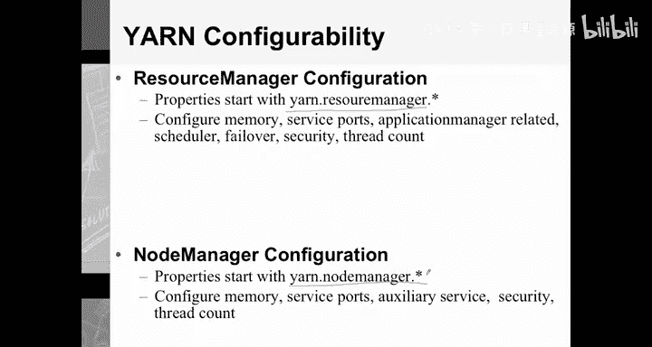

I'm in my Hadoop Apache documentation， if you look at the Hadooppache documentation。

 that is the yan default dot Xml right here， here's all the default properties。That yarn has。

Let's look at the node manager property， limit me do an F control F。

Or Apple F and Apple and do yarn dot resource manager。As you can see。

 there are close to 82 properties， 82 properties that are there。Host name， address， client T count。

 all these properties available in for yan resource manager。

 you can configure any one of these things by overriding it in yaons。 Xml。In the same way。

 there is also properties that are associated with node manager。Let's look at that。

 these are the properties associated with node manager that are close to 66 properties。

 as you can see over here。

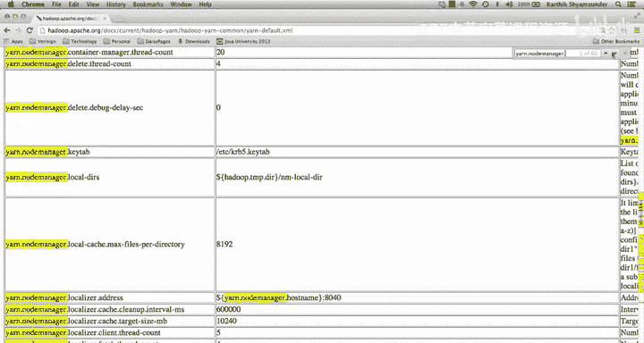

Okay， so as you can see， yarn is highly configurable and there are many properties available in yarn。

What about yaon Opability， from a operations perspective。

 the resource manager has an admin console which runs on port 8088。

 since we are running our resource manager on the local host。

 you can go to Local Host 8088 to look at the resource manager admin console。

There is also a command line tool available Yon RM admin is the command line tool which the system administrators use heavily。

As far as node manager Opability is concerned， there is an admin console for node Manager 2。

 which is running on port8042， there is also a command line tool available called yan node manager。

There are also several commercial products available。

 CloudEra has the Clouderra Manager map or has the He map。

 and of course there is the open source emBari that can be used for operations。

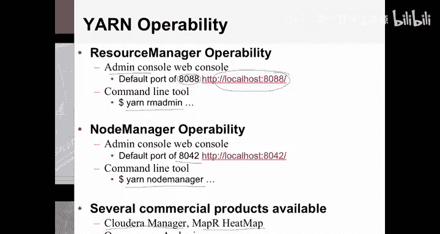

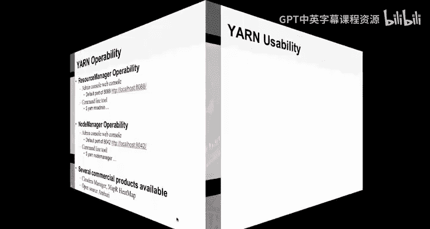

What about yarn usability， when I say yan usability， I mean submitting jobs。

 you can submit a job using the yarn command， yarn jar packed to the jar file and you can pass any argument that you want for your application。

What about yan programmability， there are two types of programmers， developers who write framework。

There are different frameworks that can run on yarn， mapreuces a framework。

 the mapreuce framework has already been written by the Hadoop guys and is part of the Hadoop yarn architecture。

There are other people who are writing frameworks。For example。

 the interactive framework phase is written on top of yarn。

 giraffe is another framework that is written on top of yarn， which is a graph oriented framework。

So you have developers who write framework and Java is the language of choice for writing these frameworks。

 then there are developers who use frameworks that run on yarn。

 all of you in this class are developers who are going to be using the yarn mapre framework。

And you can write your yan applications in many languages， you can write it in Shell。

 you can write it in Scala， you can write it in Java。

 it doesn't matter depending upon what you're doing， and also it kind of depends upon the framework。

 some frameworks only support certain languages， so it all depends， but it's quite programmable。

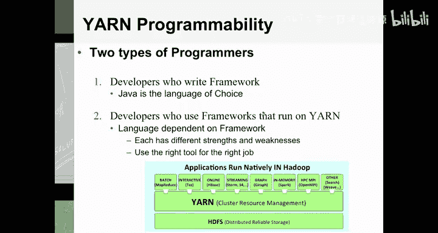

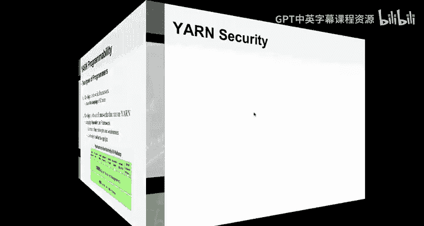

Yon security yan is pretty secure， there is mutual authentication that goes on in YN framework authenticates a user when the user submits a job to the resource manager。

 only authenticated users can submit modify or kill jobs。Also。

 applications run effectively as the user that submitted the job。

 which means if the user cannot access certain files and directories。

 the application that they have submitted cannot work on those files。

 remember when you are submitting a job into yaAN， you're making it do work and work on the data and the data is an HDFS。

 if the user cannot access the data in HDFS， then the YN process or the YN application that is running for that job cannot have access to it。

Yon also uses a lot of working directories， which are also protected from others。

It also has log files with only the user that submitted the job can see there is also schedulers to prevent abuse it's possible that a user can submit a job and take over the entire cluster so nobody else can use the job so for that reason they have these things called schedulers where you can configure how many course there are。

 how many containers there are， who has access to what containers how many containers can they use all kinds of scheduling can be done This is an entire deep section that the system administrators learn and enforce effectively there are two kinds of schedulers there is the fair scheduler and capacity scheduler。

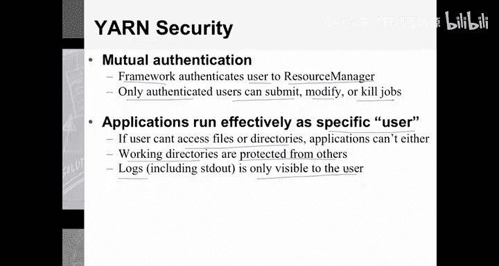

In this section we looked at yan architectural capabilities all the way from performance to configurability to security。

 in short we found yarn to be highly performant， highly available， scalable， configurable。

 and secure。