# 约翰霍普金斯大学《Hadoop大数据处理｜Big Data Processing Using Hadoop》中英字幕 - P43：3_YARN上的MapReduce框架.zh_en - GPT中英字幕课程资源 - BV1g5u6zBExs

Maap produce framework on yarn。In this section， we will look at the Mareduce framework and see how it is bolted onto the young platform。

What is Mareduce Mareduce is a model for processing lots of data to be precise。

 lots of data in parallel and on commodity hardware on lots of nodes。

It's derived from functional programming。In a sense that if you look at the word mapproduce。

 it's made up of two words。Map。And reduce。In functional programming languages。

Map and reduce our functions that are special functions which we will talk about later on。

So it's in a way， functional programming meets distributed programming with mapre framework。

 developers write map functions and reduce functions and it's these map and reduce functions that are applied to inputs。

Mapre programming can be implemented in multiple languages。

Java is the language of choice because there is a native Java API available。

 but you can surely do mapred programming in C++ using something called。Maapreduce pipepes。

 you can also do Mareduce programming in Ruby， Python。

 Pearl using something called Hadoop streaming or Mareduce streaming。

MapRuce technology is based upon Google's map Reduce paper。

 so let's quickly take a look at this paper。

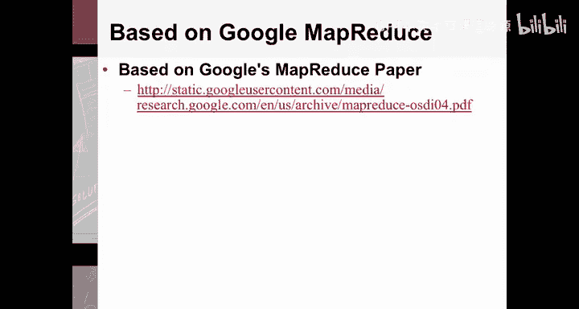

There's the paper written by Jeffrey Dean and Sanjaka Mat。

 I strongly recommend that you go to this URL， do a quick read and kind of get an idea although we are going to get into the weeds of this architecture in this class。

 but it would be a good idea to kind of look at this particular paper you can see how the input is broken into splits and these are different worker tasks that are running。

 these are the map tasks and there's this barrier which is where the shuffle and sort takes place and then these are the reduced tasks that are running and eventually the output comes out this entire architecture that we have in Hadoop。

 the Hadoop map reduce framework is based upon this paper。

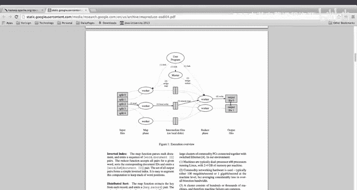

Don't forget， Ma produce framework runs on top of yarn。

In Hadooptu we have common built on top of common is HFS on top of HFS is yarn and yarn is actually a platform for distributor computing on top of which we have several frameworks Mare is just one of several frameworks。

 it's a very popular framework， it's a batch oriented framework。

 but there are other folks that are working on other frameworks too。

Map produceduce is built into Hadtop and it is distributed with Hadtop。That produced configuration。

If you recall Hadoop is highly configurable， Mareduce as a framework is also configurable。

 the XmL files for Mareduce are MaraD4。xm and Maras。xm。Mradefa。

xml is all the default properties that are mapproulated properties。

 it is part of the Hadoop jar files and is loaded by default。Maapre dashite。

Xm is the file where you override all the properties that you want and it's placed in the Hadoop prefix。

 which is the Hadoop installation folder Etsy Hadoop directory Let's look at the Mare dash default dotXM configuration and look at all the different properties that are there。

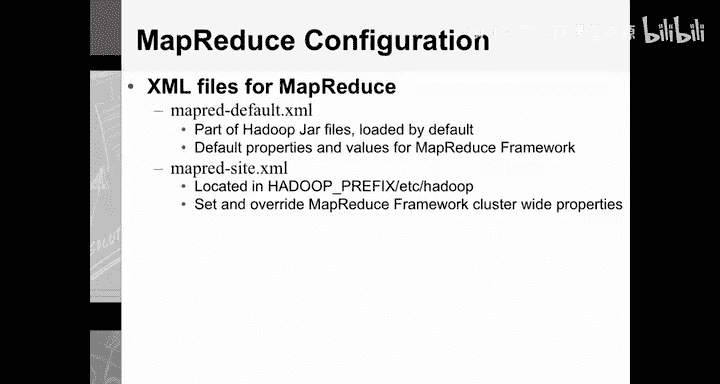

I'm in the Hadoop documentation。If you scroll down to the left， there is mapwaret4。xml。

It has all the properties listed。And the default values， of course。

 and the description of the property。So as you can see。

 there's a lot of properties over here and you're welcome to override them as you may。

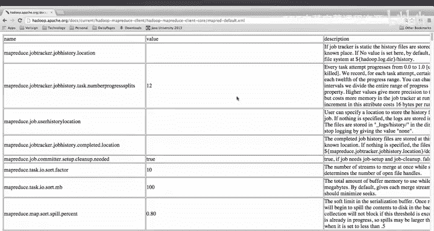

Well， if you look at our installation in our installation， we have Mare dashite。xml also。

 and what we have done in our installation in Mare dashite。

xm is have a property called mapreduced our framework。

 name and we have set it to yarn this is where we are saying to yarn that we are boarding the Mareduce framework on top of it。

 in other words we're telling Mare framework you're going to be running on top of yarn。

This property can take on one of three different values。It can be local。

 classic or yarn when you set it to local， the mapre job will run in a single machine in a single JVM。

 there will be no node manager， there will be no resource manager。

 there' will be no name node done of that stuff everything will run within the client JVM this is used for debugging purposes and testing purposes。

 when you run it on classic mode that's when you're running on Hadoop One mode。

 when you run it on yan， you're actually bolting it on top of the yaN framework which is what we are doing。

Well， this is the only property that we set， but we can set other properties in Mapperdesite。xml。

 which we will talk about when we get into more detailed Maredes programming later on。

So let's look at the processing with mapreduce。The framework breaks the input into splits。

We also call it input splits。The framework also breaks the processing into phases。

 it breaks it into what is called the map phase and the Red phase。

The programmer authors map function and reduce function packaged up into J files。

 and then that's what the programmer sends it as part of the job， the framework in the map face。

Uses the map function and in the reduce phase uses the reduce function。

The framework will apply the map function for every input that it gets。

And it'll apply the reduce function。For all the output from the map function。Each phase。

 whether it's the map phase or the reduce phase， uses key value pairs as input and output。

 the map phase takes input files， as you know， the input file is actually broken down into key value pair combinations。

 we will see later on how it breaks the input into keys and values because input could be a single line at a time。

The output of the map is a key value pair combination。

 and the output of the map is what is sent into the reduced phase and then reduce phase processes it and then sends the output。

The output of the map is actually processed by the framework before it is sent to the reduced phase。

So the input is taken into the map face， the map phase processes the input， produces output。

 the output of the map face is processed by the framework， and then a new output is produced。

 and then that becomes the input into the reduce phase。

 The point I I'm trying to make over here is that。The map produced framework is doing some processing on the map output。

And if you look at the yaonsite。xml in yaonite。xm， there is a property called yan。 nodemanager。

orgservice， this is something that we actually set in our yaon siteite。

xm and we set this value to Mareduce_ shuffle。The mapRuce shuffle is the special work that the framework does on the map input。

Now this is a bolt on on the yan framework so that it can do the shuffling。

 most frameworks don't have auxiliary services， but auxiliary services have been invented into yarn in order to support the map framework。

We will later on talk about the shuffle and sort framework。

 it will make more sense to that point right now， just remember that in order to bolt on mapreuce on top of yarn。

 we'll have to set the yarnsite。xmls yan。notemanage。org servicesice property to mapreduce_shuffle。

So what are the app use features that is built in parallelism。

 the framework breaks the inputs into splits， framework automatically breaks a job into tasks。

There's also failures that get handled automatically when tasks fail because the node crash or the tasks failed because the diskcraes。

 the framework automatically handles moving the tasks over to some other node and it actually does this with the help of the yaN platform if you notice we saw that in the yaN platform there are these things called containers and these containers are automatically relaunched that's exactly what is happening over here it also eases distributed processing if you have to do distributed processing and you have to manage all this data and synchronize all this data there's a lot of complex mechanisms that you need to execute in order to get the data process in the right way all that complicated locking mechanisms don't have to be managed by the developers anymore all the developer has to do is concentrate on the programming logic in fact concentrate on the business logic of the organization。

Map Reduce is good for processing large amounts of data in PaL。

 but don't forget that it's a batch oriented framework， it is great for batch processing systems。

It's great for large amounts of data and great for batch oriental processing。

 And the reason it's great for batch processing is because reading sequentially is very efficient rather than going between the various portions of the file and seeking and forwarding and backing back。

 That's very expensive。 The heads moving is very expensive。

 We talked about this in the HDFS architecture。 We also talked about this in the beginning the modern distributed computing architectures。

😊，Map produceduce is not so good for online data access， it's a batch processing framework。

 it's not good for quick answers with a few milliseconds or even a few seconds。

If you want quick random access， there is something called Hspace， which we will talk about later on。

Also， if you are trying to process only a small portion of a large data set。

Map produce is not good for that。 It's best if you want to read the entire file and process it。

 not for processing small set。It's not good for realtime or streambased processing。

 let's say you have data coming in into your system and you're trying to process this data in real time and get realtime analytics。

 you cannot do real-time analytics with mapre。 There are many newer frameworks that are being developed right now like storm which theres real-time processing but those frameworks are not really built on top of a tube now those frameworks are being converted to be run on Hadoop。

 especially run on yarn because yan allows you to run any framework。

Let's look at the map reduced terminologies。In Mapreduce， we use the term client。

 a client is a program， a standalone program that submits a job to be processed。

That begs the question， what is a job， a job is a full program， when I say a full program。

 a class with a main method and all these supporting classes including the map or class and the reducer class and any other libraries classes that you really need to process your data all packaged together in a jar file and then you submit this jar file as a job。

 a job also has a job ID associated with it， a task when the job runs。

 the job is broker into task and each task is run in a separate process。

 each task does either map task or the reduced task and so a task is really an execution of a mapper or execution of a reducer and it actually is working on a slice of data。

There is also this term calledTP， which is a task in progress。

 they also have this term called task attempt， a task attempt is a particular instance of an attempt to execute as task now why am I saying a particular attempt。

 it is possible that a task is executed multiple times and a task may be executed multiple times because the first time the task was executed it failed。

Or maybe it is getting executed multiple times because Mareduce realizes that this particular task is very slow and so it launches the same task on a different machine。

 this is what we call speculative execution we will talk about all these things as we go through Hadoop Mareduce over the next three to four modules。

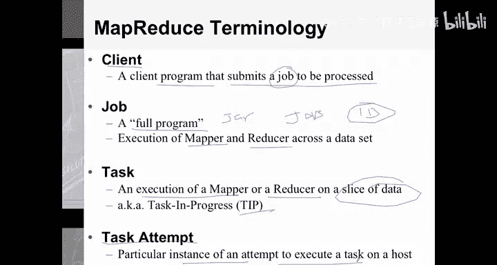

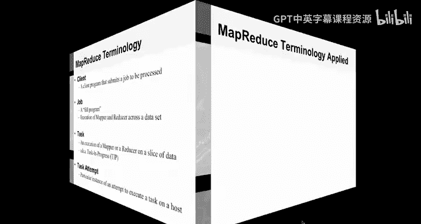

Ex client is a Java program packaged as a J file， a job is like running word count。accross 15 files。

 let's say we have 15 novels that we have downloaded and we want to find all the words that are unique across all the different books and get account of all these different words and a task is basically a map reduced tasks so the 15 input files are going to translate to 15 map tasks at a minimum each file becomes a map task Now if the files are large enough the files may be broken down into multiple blocks and each block will be run as a separate task let's keep it simple right now。

 15 files， 15 tasks。And then in terms of reduce， there are some number of reduced tasks that are going to run by default。

 there is going to be only one reducer， we can customize the reducers。

 which we'll talk about when we get into Mareuce programming and advanced Mareice programming。

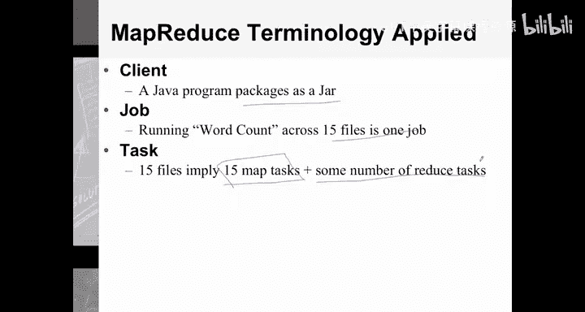

Task attempt every task is attempted at least once it may be attempted more than one time if it crashes and there are several reasons why a task may crash。

 it may crash because it got bad input and you can even configure the Mareduce framework to say。

 look， I got 1 billion records so what if 1% of the record is gone bad so you can even configure to say that if there is a portion or there is a proportion of records that is bad。

 let's go ahead and ignore it。So the point I'm trying to make here is that a task can be attempted more than once。

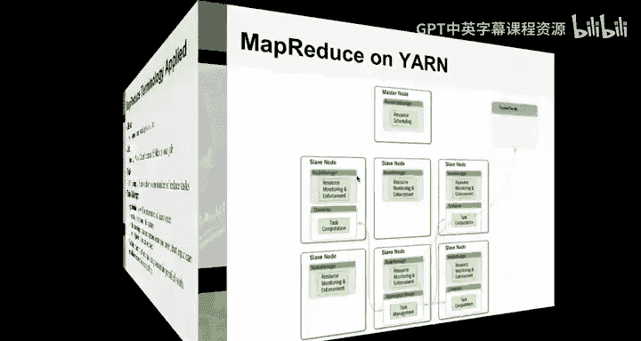

Let's look at the mapreduce architecture on yarn If you look at this diagram。

 it looks very similar to what you had seen before and that's intentionally done。

 it looks like the yarn architecture， The reason for that is I'm going to bolt the mapreduce architecture on top of the yarn architecture。

If you recall in the yan architecture， we can have a client and a client submits an application to the resource manager。

 the resource manager in turn launches an application master as a process or as container Ze to do the job that was submitted by the client。

In the case of Mareduce， the application master notice is actually an MR job。

And if you think about it， the application master actually communicates with the resource manager and as part of its communication。

 it is supposed to negotiate。The resources。It is supposed to negotiate resources， In other words。

 it's going to ask for containers that it needs so that it can execute the task。

Now this is mapreduce in mapreuce framework the data and the processing should be colocated。

 This is where the application master， which is the MR job master is going to communicate with the name node get a list of all the hosts all the machines where data is placed for this particular job and then it is going to go to the master node and ask for only those containers where the data is located That's the idea and that's where the colocation of data and business process happens in mapreuce This is not a feature of yarn This is more a feature of mapreuce The point I'm trying to make is the slave nodes they may not only be running the node manager and the various containers。

They may also be running the D node demon。Recall the data node demon。

 data node demons are the ones that manage the data within a node。

 so these slave nodes don't just have to be just the compute node they can also be data nodes。

 in such cases what happens is the task actually communicates with a local data node and is doing the collocation processing。

Okay， so now the Mareduce job has gotten all the containers。

And now the Ma produce job is going to launch the various tasks， in this case。

 it is launched three tasks on three different machines， as I said。

 these tasks are going to work on the local data。Once they are done processing。

The map reduce framework is now going to do some internal work。

 remember I said to you the output of the map gets processed by the framework。

 and then the framework is going to take the result and then launch a reduced task and so now it launches a reduced task in this case it launch a reduced task on that container。

Once the reduced task is done， then the reduced task goes away。

 the MR job goes away and then eventually entire job is complete。

So let's look at the Mareuce job flow in yarn。Client submits the job in step one。

 the resource manager takes the job， figures out where the application master needs to run。

 let's say in this example it picked this particular slave node to be the application master。

 so it goes through the node manager to launch an application master， which is the MR job。

And then the application master is going to communicate with the various node manager to launch the various containers。

 the various containers are going to process the map and reduce jobs。

 and then once the map and reduced jobs are done， of course it gets the containers by consulting the name node and then once the work is done。

 then it tells the resource manager that it has finished its work and then the application comes to an end。

The Mareduce framework on Yrn also introduced a new demon called the job history server。

 This is a brand new demon This is not part of the yan framework It is actually a mapreduce framework demon the idea behind job history server is that it is going to track all the Mareduce jobs that are in progress and gives you details about what is going on in the Mareduce job If you recall the resource manager manages the resources it doesn't give you application level status。

 it only gives you high-leve application status， not the details。

 the real details of the application level status it gotten from the job history server in the case of Mareduce framework。

The idea here is that in Yrn， the application master not only talks with a name node in order to get a list of all the data nodes where it should run its compute tasks。

 also it talks to this new server called the job history server。

 the job history server is where it actually submits all the information related to the job。

 and so there's a HtTP web console associated to the job history server。

 where you can get more details about your job， all the different map tasks。

 all the different reduced tasks， all the log files。

 all the information is available in the job history server。

So let's talk about starting and stopping job history server。

The way you start a job history server is by executing the MR jobb history De orSH command。

 passing to its start and history server as an argument that starts the job history server。

 and then the way you stop it is MR job history De orSH stop and History server。

 please note that when you launch the job history server。

 the term or the word that you use is history server and not job history server。

There is also a job history server console that's available for you。

 the default port for the console is 19888 because the job History server is running locally。

 you can go to LocalHost 19888 to look at the history of your job。So now let's go ahead。

 log into our VM and launch the job history server， launch a Ma job， and see the flow through。

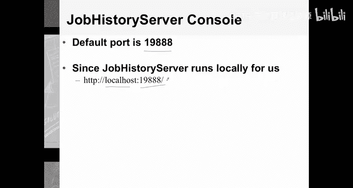

Okay， I'm logged into my HD server VM as HD admin。Let me do a J command。I have my name node running。

 I have my secondary name node running data node， that's my HDFS architecture。

 and then I have my node manager and the resource manager running from my yarn architecture and now it's time for me to bring the history server so the way I can launch the history server is m job history demonmon。

sh start。History server。That should launch the history server for me。

The history server should have started， let me do a JPS。And there's the history server， it's running。

 we also know that the history server has an admin console on port 19888， so let's do that。

I have already marked the history server right here。19888 there's the history server。

 and here's all the jobs that I have run up to this point。So these are all the different jobs。

 it's keeping track of all the various jobs that I have run， let me go ahead and set it to 100。

Let me go ahead and start a job right now。

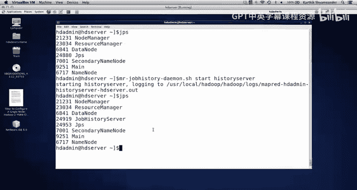

Start。A job， Okay， here's the yarn job that's going to do the map produced。Click on it。There it is。

 the job is running。And。Let's see if there's a job I。 Here's a job I right here。It。1305 underscore0。

01。Okay， let's go back。Refresh it。There it is 1305 underscore 001， so this is the job Id。

I can click on the job and it's going to give me details about the job。

 It's application specific it's going to tell me how many mappers ran， how many reduces ran。

 click on the map， and then it gives you details about that specific map task Now please understand that this is different from the from the resource manager's admin console let me go to the resource manager admin console。

This is the resource manager admin Con， let me go ahead and refresh it 1305 underscore 001 from the resource manager's perspective there was an application that was launched。

 it has been given an ID。Its application followed by a number， followed by a number one。 Now。

 if you were wondering as to what this number is， this is based upon the start time of the resource manager。

That's where the number over here is。 It's a timet。 and then number one is the sequence number。

 The next job will be number two， and then number three and so on and so forth。 So this is the。

Resource manager's view of that particular job that has been submitted or of that particular application that has been submitted by the client。

But then it then launches the application master， which is an MR job。

 which communicates with the job industry server to get。Information about the MR job itself。

 which is a different console that's this one right here。

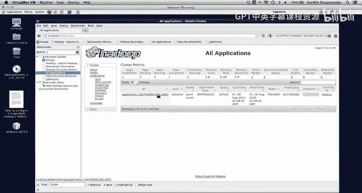

It has an ID also and its ID is very similar。 Its job rather than application followed by a number when the application。

Manager started， which is the resource manager started， followed by the number associated with that。

 Okay， right， you get the idea now。In this section。

 we looked at the Mareduce framework and we saw how the Mareuce platform is bolted on top of the yan architecture。

