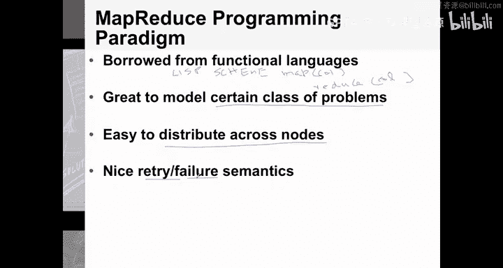
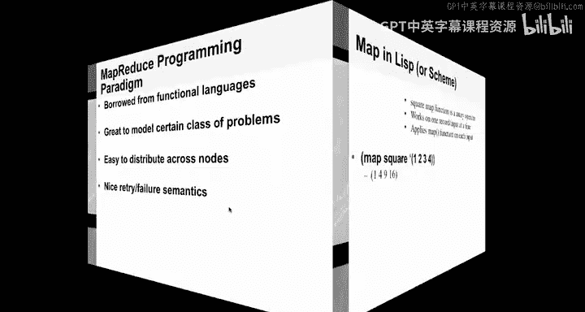
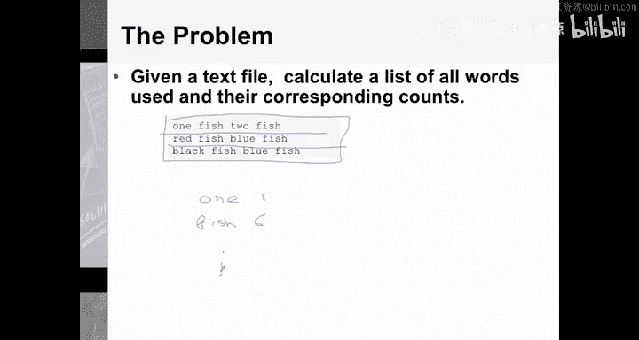
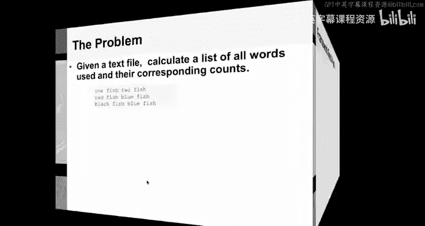
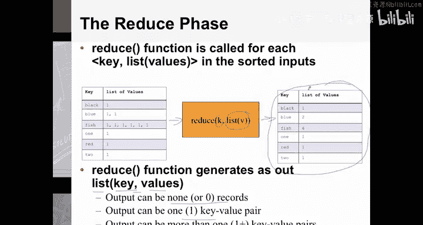
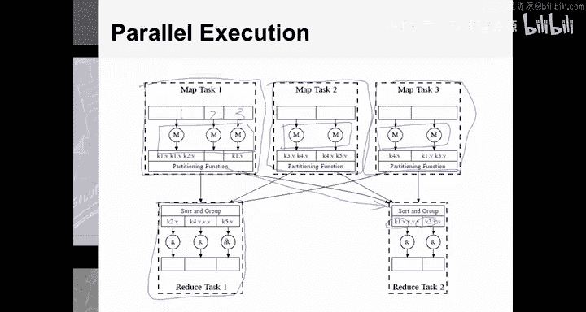
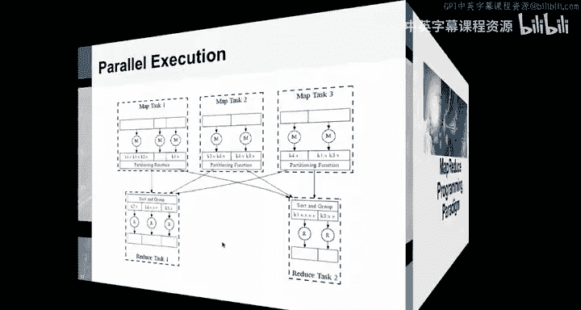

# 约翰霍普金斯大学《Hadoop大数据处理｜Big Data Processing Using Hadoop》中英字幕 - P44：4_MapReduce编程范式.zh_en - GPT中英字幕课程资源 - BV1g5u6zBExs

Maapre programming paradigm。In this section， we will look at the programming paradigm of mapreuce。

We will start by looking at the origins of the term map and reduce in functional languages and draw similarities between functional and distributed programming。

We will then look at the map produced programming model。

 including key value pairs as inputs and outputs to both the map and reduce phase。

 the framework shuffle and sword F， and the sequence of steps taken by the framework for a parallel execution of tasks in order to complete a job。

是的是。The map produced programming paradigm borrows the concept of map and reduce from functional languages like LispP and S。

If you look at these functional languages， they have functions called the map function or the Red function。

 these functions take a collection as the input and then they apply a function for every item in the collection。

 they would apply a function for every item， so what goes into the map function is a collection and some kind of a functionality is applied to every element in the collection and the resultant is some kind of a new collection or new result。

This kind of a programming paradigm is great for solving certain class of problems。

This programming paradigm is also easy to distribute across nodes。

 so when you write your program for a single machine。

 the same programming paradigm can be applied for 100 machines。

 and the Mareuce framework also has nice semantics in terms of retry and failure so when a task goes down because a node crashed。

 the same task can be executed on a different machine。

Map inlist or scheme。Here's a list statement that's invoking the map function。

 passing to it a square function， passing to it a list。

 and the resultsant is this right here All right， so let's see what is really happening。

What is it saying is that data is a function。Called the map function。

 which is really the square function。And what this map function is going to do is take as input a list of values。

 So in this case， it's going to take one，2，3， and4 as the list of values。

And the map function is going to map the square function for every input。 So these in other words。

 it's mapping the square function for every input。 So the square function will be mapped for1。

 So what is one squared， the resultant will be one2 squared。 the resultant will be4， three squared。

 the resultant will be 9 and four squared， the resultant will be 16。 You get the idea here。

 The idea here is take every entry that is available and apply the map function that has being passed as an argument。

And then get the result。It doesn't quite translate this way into map produce programming framework。

 but you get the idea where it's coming from so the map function takes input。

And then it applies some kind of a functionality on the input。

 and then it gives you some kind of an output。Okay。

Let's look at reduce inlist Here is the reduce function Red function takes as an argument。

 another function， which is the plus function or the plus operator it takes also a list as the list on which it needs to work and because the plus operator is a binary operator it is also passing zero as an argument so the reduce function takes the function that needs to be executed on these entries in the list and it also takes an extra parameter called zero so let's see what it's really doing What this is saying is reduce the list of values that I'm passing to one value。

 so here's the reduce function。There's the reduce function。

 the reduce function is the plus function which also has an extra zero associated with it。

 which we'll see in a few minutes that's for initialization purposes and what it's going to take as argument is a list of values149 and 16 and the reduced functions plus operator is saying that I'm going to take every entry that I have in my incoming list apply the plus operator and then I'm going to generate the resultant so because the plus operator is a binary operator it is going to take1 plus0 that'll give you one1 plus4 is 5 and then 5 plus9 is 14 and then 14 plus 16 is 30 and so what you get is 30 What you' have done is take a big list and reduce it to a new value by applying a reduced function to it。

So what the reduced function takes as input is a bunch of values and then reduces that value to a new value you'll see in Ma framework it's slightly different。

 but you get the idea。Okay so let's look at the mapreuce programming model in mapreduce programming model。

 it imposes the concept of key value for input and output In other words。

 both the map function and the reduce function takes as input key and a value and takes as output or produces key and value as the output it's all about taking key value as the input and key value as the output In fact it's a little bit more complicated than that。

 If you look at the map function， it says the map function will take as input key1 and value1 and what the map function will produce is really a list of key to and value2 so the map function may produce a list。

The reduce function will take a key and a list of values and what it will produce is a list of key value pair combinations。

 so as you can see it's all about key value pair combinations。The map function again。

 is taking key and value and producing a list of keys and values。

And the reduced function is taking a key and a list of values and then producing a list of key and value pair combinations。

Okay， it seems a little bit complicated， but don't worry about it。

 I'll go through an example so you can understand this better and as we go through more examples through the next two to three weeks。

 it'll be very clear to you。The other thing to note here is that I'm using these symbols like K1， K2。

 K3。And then V1， V2， and V3， so I'm using these symbols， well were these symbols。

 they're actually types。The map function will take input type T1 input type value1 these are all types and the point I'm trying to make is the types can be completely different once again don't worry about it。

 we will get into this when we get into the API and we get into the actual map reduced programming。

Alright， so let's try to understand this concept through a problem definition and working through the problem So let's say we are given a text file and we are asked to calculate a list of all the words that are used in the text file and the corresponding counts。

 So think of this as the text file It contains three lines。

And what we would like to do is produce as the output the word one and how many times did the word one appear。

 so in this case the word one appeared let's say one time the word fish。

 how many times did the word fish appear1，2，3，4，5，6。

6 times you get the idea that's what we need to produce Now you can surely write this program in regular Java or C or C+ class where you read the file。

 you process each one of the records， each one of the lines， you know tokenize it。

 you can do all those things in your normal program， but let's see how this is done in mapreduce。

In Mareduce framework the framework actually reached the input in this case。

 the input is read from an input source which can be a file or a database and of course in our case it's a file。

 it's a text file。And so it reached the text file。What it has to do is read the input and transform them into records。

 Okay， so each input record is parsed as what is called the key value pair combination。

 So what happens here is that this is something very specific to the text file in the case of the text file since it's not a key value pair file。

 but because it needs to translate into a key value pair combination， it uses the。

Bte offset as the key， and then the value is really the entire line。

 so when the input record is parsed， it uses in this case， so notice this is record1。

 this is record 2 and this is record 3 in this case the first record is at byte offset0 in the file and that's what this is。

And then we have the value， the value is this entire line， which is that entire line right there。

And then record2， if you go through is 01 to 345 up to 17， there is actually a slash n over here。

 and so there is a 17 and then 18 is over here and so 18 is the beginning of the next record and so 18 is right here。

 and so 18 gets placed as the key and then the value is redfish， bluefish。

And then 37 is the byte offset in the file for the third line。Typically in map produce programming。

 the input。K is of not much value because it's a byte offset unless if you recall we learned about sequence files before。

 which is file-based data structures where it stores key value pair combinations as input。

 then the key automatically gets mapped to one of the keys that's in the file。

 so that's why for Mare programming， the sequence files become important。Okay。

 so now we see how the framework reads the input and maps it into a key very pair combination。

These key value pair combinations are given to the map faces map function， So let's do that。

 the map function is going to be called for each key value pair combination。

 So you'll notice here's my input key value pair records and the map function is going to be called for each one of them and it's going to be called sequentially it's going to be called sequentially and then the map function is going to apply whatever functionality needs to apply to generate some kind of an output。

 Now that's the business logic that you have inside the map function。Okay。

 so let's see what can the map function do Well the map function generates output and this output is considered to be intermediate output。

 The reason it's intermediate output is because the output of the map is then processed by the framework and then the output of the framework is what actually gets sent to the reduce and then the reduce processes it and then generates the real output that we want to see。

The other important thing to remember here is that the map function， when it processes a record。

 it has several choices， in fact it has three choices， it may process a record， for example。

 it's going to process this first record， it may process the record and may decide to generate nothing as the output。

 no output at all， it may decide to do that， it may decide to generate one key value pair combination。

 or it may decide to generate more than one， in fact a list of key value pair combinations。

In this example， because we are going to be doing word count， what we want to do is generate。

Lots of records so here what I'm doing is that for the first record the map function is generating four records。

 these are the four records noticeice it' generating a list it'll generate a list of key and valuable combinations and so one fish two fish is getting translated by the map function as one one fish one。

2 one fish one in other it's saying I see the word one once。

 I see the word fish once2 once and I see the word fish once。Oh。

Now I could have been a little bit smarter and said。

 I see the word one once and I see the word fish twice， I could have done that， but for simplicity。

 I'm doing it this way。It'll still work， as you'll see。Okay。

 so that's the first record and then the second record gets processed and it generates in this case。

 again four records， and then the third record gets processed。

 and then it generates again four more records， as you can see。

 all I'm doing is taking each one of the words and putting the value as one。

 which is the number of times I see that word。Okay。

 so we see how the map function takes input key value pair combinations and may generate zero。

 one or more records in this case we generated more than。One record as the output。

Now the framework does what is called the shuffle and swordface as part of the shuffle and swordface。

 what it does is it groups by key the key value output of the map。

 we saw the key value output of the map， This is the output of the map that we saw in the previous slide what it's going to do is group it by the key。

When I say group it by the key is identify unique keys out of this。 So if you go through this。

 here's a list of all the unique keys。One， and then fish， and then two， well， we already got fish。

Red and then fish we already got fish and so what it's really doing is organizing them by this key。

 it's transforming it， this is where the grouping functionality is happening。

And then what is's generating as part of this group is the key and the list of values that particular key appeared。

 so one appeared once fish appeared in fact， once， twice， three times， four times。

 five times and six times， so it's listing all the values。1 by one by one as a list。

 So it's a pair of key。And a list of values now， that's what is being generated key and a list of values is being generated by the framework where it's not over yet。

It not only groups it， it also sorts it， so you'll notice that it is going through the sort phase now。

 it's sorting it and you'll see that whatever the grouping that was done。

 it's getting sorted and so now you see black blue fish。

 one red and2 all appear in this sorted order。This。

Grouped and sorted list is what is going to go into the reduceuce。

And so it passes the resultant into the reduced method。Let's see what happens in the reduce phase。

In the reduced phase we have the reduced function， so here's the reduce function。

 as you can see the reduced function is taking a key and a list of values perfect。

 that's exactly what we have over here， so the reduced function is going to take the key and a list of values and then it has the opportunity to do different things。

The reduced function as an output may generate。Zero or more records or one or more records or just one record。

 right it may generate any one of these things。If you look at our reduce function。

Let's see what it's doing。The reduce function， and by the way。

 the reduced function is going to generate a list of key value pair combinations。

 a list of key value pair combinations。So if you look at our reduce function， it's going to take。

The word black。One， and it's going to just transform it in this case。

 it really just wrote the input and to the output。It took blue 11 and did some transformation on it and added the two things together so it's reducing as you can see we saw the addition reduced reduction and so it added the two values so it puts out two and then for fish it puts out six。

 so key value pair combination and then one，1， red1 and 21。As you can see。

 now we have actually gotten as part of the output of the reduced phase， the real output for the job。

so that's map produce framework。Add its core， this is how everything works。

Now， what I'm going to do is going to show you a slightly different view。In this case。

 what I'm showing you is， let's say you have record and you have record one， record 2， record three。

 record 4， five， six， seven records。You'll notice that each record is being processed by the map function。

 so the first record is being processed by the map function。

 the second record is being processed by the map function， third one by the map function。

 and so on and so forth。When the first record， let's not worry about what is inside this record。

 what's important is that the map function took that record and it generated a bunch of key value pair combinations。

 it generated K1 v K1， v and K2 v key value， key value， key value， the key is K1， and the values V。

 the key is K1 and the values v the key is K2 and the values v， that's what for the first record。

 the map function generated。For the second record。The map function generated nothing。

 generated nothing， so a classic example of how map functions may generate a list of key value pair combination versus nothing versus here it's generating one key value pair combination。

And so on and so forth。Right， so all these different map functions are executed sequentially。

We have seven records， all these seven records are being executed sequentially。

 and then eventually it goes through the group by key functionality where I'm going to take the key。

 the keys are K1。K3， we also have K2， K4， K5， those are the keys。

 so you'll notice that it's grouped by key and it's also sorted by key。And so now you have K1。

 which is appearing ones。One's second time， third time。Fourth times， so K1 appeared four times。

 and so there it is。And then K2。Appears once here。 Ands right there， K 3， you get the idea。

 So it goes through this grouping， which is really。Grouping and sorting。

And then it passes it to the reducer notice when it passes it to the reducer it's actually passing it in the sorted order and that's why the sorting needs to take place。

 so it's sorting it and then it's basically passing it to the reducer and then the reducer can do whatever it needs to so this is the exact program that I showed you the workCon program except in a general fashion。

Okay so that's sequential execution take a look at this。

 there are seven records over here right and we have one mapper process。

 one mapper process that is going to work on all these seven records sequentially。

 but then we can add parallelism to this。And the way we add parallel to this is that we can have multiple map tasks。

 Each map task can be a process， each map task can run in a container。

 so now what you're seeing over here is the input 1，2 and3 will be handled by one map task。

And of course it'll handle all the records sequentially and then this is another demon that's running in a different machine。

 another demon that's running in a different machine。

 and they' are all working on their data locally and then they go through this map phase locally and then they have to be partition this is where the shuffle and copy and all those things take place all the keys have to be sent to the same reducer we have K1 V K1 V K1 v this is the third K1 v these are three K1 v's that have come out from this mapper。

And then there's a K1v over here， the partitioning function。

 which is part of distributed execution is going to send all the keys to the same reducer。

 The requirement is that all the keys will have to be sent to the same reducer so in this case it's partitioning and sending all the keys to the same reducer so if you notice K1 is going to this reducer K3 is going to this reducer and then K2。

 K4 and K5 are going to this reducer when you have multiple producers they get partitioned。

So there's a little bit more here， there's partitioning that's going on。

 there is combining that can happen， so there's a lot to this framework when it comes to parallel execution as we get into the details of parallel programming we start getting into this parallel execution model。

 but the most important thing to remember is that when you're doing Mapperdes programming。

 you do not have to worry about all this parallelism， it's all built into the framework。

So in this section， we looked at the programming paradigm of mapreuce。

We learned how mapre B's concepts from functional programming。

We also looked at the Mareduce programming model and we learned that Mareuce framework imposes key value concept all the way through starting from the map phase through the shuffle and sort phase into the reduce phase we also saw how the data flows from the input all the way to the output through the various phases Finally we saw that this programming model can be done in sequential way。

 or it can be done in a parallel way it's all done by the framework all you have to do is write the program and the framework actually takes care of the parallelism。

