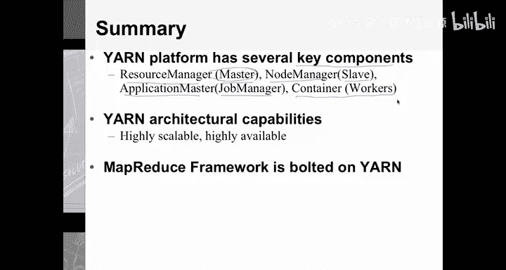

# 约翰霍普金斯大学《Hadoop大数据处理｜Big Data Processing Using Hadoop》中英字幕 - P45：5_YARN与MapReduce架构总结.zh_en - GPT中英字幕课程资源 - BV1g5u6zBExs

Yn mapp Prod architectureitecture summaryary。In summary。

We learned that Yon Platform has several key components。Including the resource manager。

 which is the master of the Yn architectureiture that is responsible for all the scheduling。

And then there is also the node manager， which is the slave of the master resource manager that is providing node health information to the resource manager。

Also there is the application master， which is the job manager for the job that is submitted to the resource manager。

And then there are also these containers， the containers are the real workers that are doing the real job on a separate JVM or on a separate process。

In terms of the yan architectural capabilities， we looked at several capabilities of yarn。

 including security availabilityvail， scalability， opability。

 and we found that yaN is highly scalable and highly available。

Maapreduce frameworkme is bolted on top of yarn there are two key components for the mapreduce framework。

 one is the Mareduce Frawork application master， which is responsible for negotiating all the various containers with the resource manager so that it can colocate the data and the processing。

There is also the job history server， which has been added into the Mareduce framework。

 which keeps track of all the application status information for a job since the resource manager doesn't really care about the application status。

We also looked at the map Red programming paradigm。

 we saw how a job is broken down into map and reduce tasks in the map and reduceuce phase。

 and all these different map and reduce tasks in the map and Reduce phase use key value as the basis of input and output into each phase。

