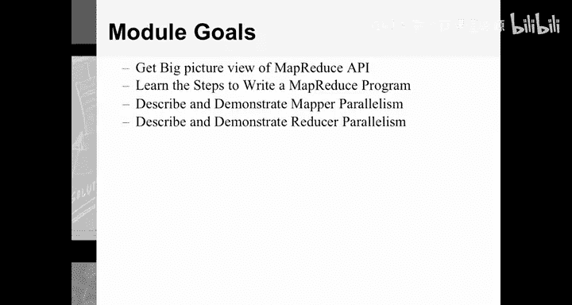

# 约翰霍普金斯大学《Hadoop大数据处理｜Big Data Processing Using Hadoop》中英字幕 - P46：6_MapReduce编程基础导论.zh_en - GPT中英字幕课程资源 - BV1g5u6zBExs

Welcome。Maap reduce programming basics。As the title suggests， in this module。

 we will learn the basics of Mareduce programming， including overview of the Mareduce API。

The steps to write a Mareuce program and achieving parallelism of mappers and producers for a job。

So what are the topics in this module， there are four sections in this module。

In this section on Mareduce programminging API， we will get a bird's eye view of key classes for Mareduce programming。

Then in the section on steps to write a Mareduce program。

 we'll walk through six steps to write a Mareduce program and submit a job。

Then we will look at Maper parallelism， where we will learn how multiple mapper tasks are launched and how to control the number of mappers。

Finally， in the section on reducer parallelism， we will learn how to set the number of reducers to have parallel the number of reducers for the job。

So what are theoral goals？To get a big picture view of the MaRuce API。

Learn the steps to write a map produced program。Describe and demonstrate map patism。

Describe and demonstrate thecer parallelism。

