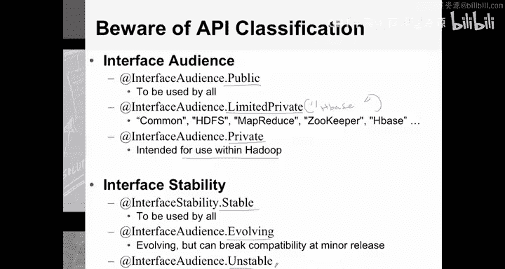
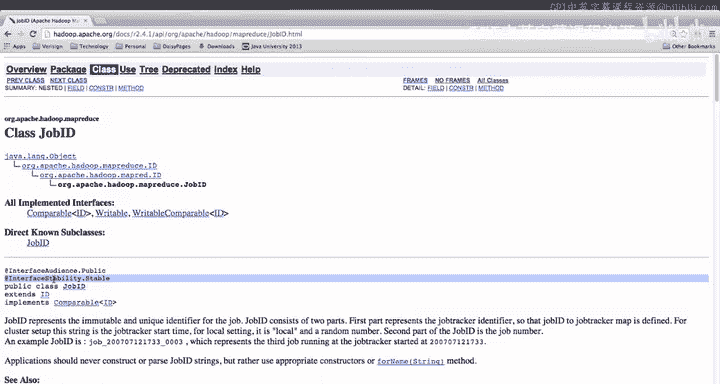
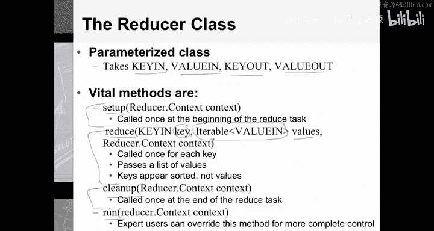
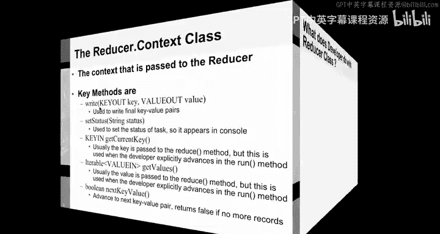
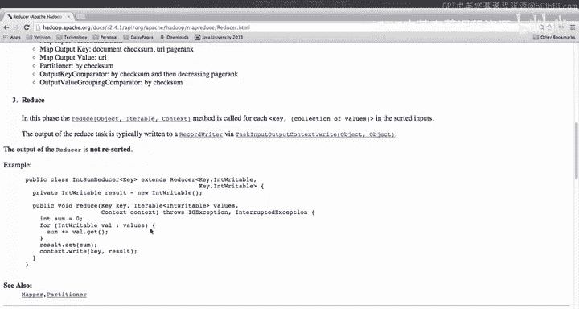
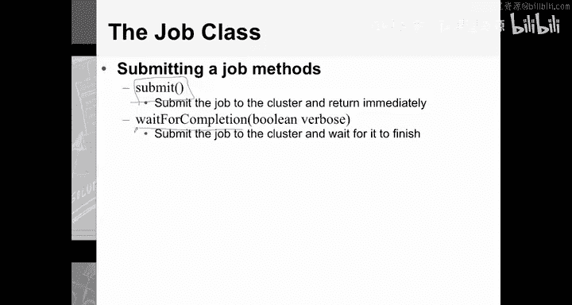
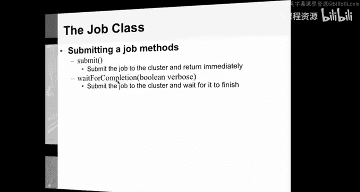
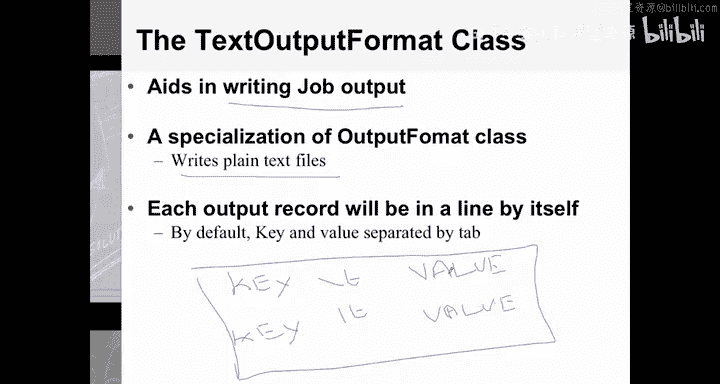
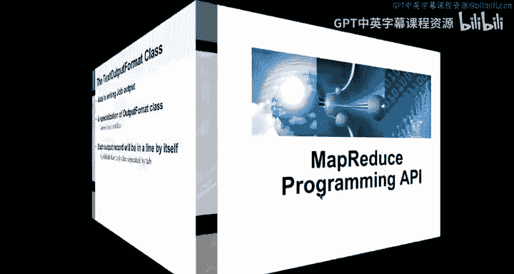

# 约翰霍普金斯大学《Hadoop大数据处理｜Big Data Processing Using Hadoop》中英字幕 - P47：7_MapReduce编程API解析.zh_en - GPT中英字幕课程资源 - BV1g5u6zBExs

MapRuce programming API overview。In this section， I am going to give you an overview of the MapRduce programming API。

 this will allow you to get yourels familiarized with the various important classes。

 interfaces and methods in the MapRduce library。是。Old versus the new API there are two flavors of the MapRduce API。

 there's the old package which is part of Oro Apache Hadoop Mare package。

 and there's the new package which is Oro Apache Hadoop Mareduce package， notice the difference。

We will be using the new API exclusively， which is this package over here。

So what you need to make sure is that you use all the classes from this package， the Mare package。

Because there are some classes that have exactly the same name as in the old package and the new package。

 when you import it， you have to be a little bit careful because if you try to mix the old classes and the new classes。

 you may get into trouble。The new API is redesigned a version of the old API and it's been redesigned for easier evolution in the future。

Why does the old API still exist， you may ask that's because the new classes depend upon the old classes。

 they haven't really completely migrated the old API into the new API。

 most of the stuff has been migrated but there are some things that are still not migrated and so the old API still exists。

Also， beware of API classification When you look at Hadoop source or Hadoop documentation。

 you will notice that there are some classes that have been annotated with something called interface audience。

Interfaceordience。public means that particular class or interface or method can be used by anyone。

If it says interfaceauudient。limittedpri， then it means it can be only used by a limited set of people and the folks that can use that class or those classes or interfaces or methods are marked with some value。

 you may see something like limited private and then within parentheses it would say something like H based。

 which means only the H based developers are allowed to use that。If you see any classes。

 interfaces or methods marked private， that means it is intended for use within Hadoop。

 so please refrain from using those classes interfaces or methods in the same way there is this concept called interface stability。

 the interface stability can be stable， which means you can use it， no problem。

 it can also be evolving， which means the class may break compatibility in the future。

 it may also be unstable， which means they are still working on it and there is no guarantee that this particular class or method or interface may exist in the future。

So let's look at the Hadoop API real quickly。 Here's the Hadoop API documentation。

 and I'm going to go show you the。Here's the map red package， is the map Red package。

 let's go to the map Red package。As you can see in the map pre package， there's the job class。

And if you look at the job class。This is。Evolving。And it's a public class right so it's a public class。

 but it's still evolving， they haven't completely changed it。If you look at the job ID class。

 it says it's public and it's stable， so job ID has no problem。

 as you can see how these classes have been annotated。

Okay。Here's the mapreuce API overview， this is a bird's eye view of all the classes that exist in the API that's important to us。

 there is the job ID class that represents the ID of a job。

There's the job class that represents a job that is going to be submitted。

 you typically instantiate a job object。And then automatically there's a job ID object associated with it。

 you never instant a job ID object。There is also a job configuration object which is associated with a job。

There is also a job context object which gives you information about that job。

 so when you instant a job object， there is also a job context associated with it。

 you typically don't use the job context directly， it gets used indirectly using the Maper context and the reducer context。

 which the Maper and reducer classes get as an argument。

You'll notice that there's a whole bunch of classes in between like the task attempt context and task output context and map context and reduce context。

 these are all some intermediate classes that you really don't have to worry too much about。

 I put it out there just to show you as part of the hierarchy。

 the ones that I'm marking with a rectangle are the ones that we care about。There is also。

The Mapper class， which is a very important class， this is probably one of the most important classes because you as the author of a Ma reduced job is going to be writing classes that is going to be extending from the Maper class are writing a class that is going to be extending from the reducer class。

 so my Maper and my reducer or the classes that you're going to write and you're going to override those classes methods。

There is also a class called input format。And a class called file input format。

 a file input format is a specialized kind of input format。

There are several kinds of input format a text input format is the most important input format class because it represents a plain text file and typically when you're doing。

Mapre programming， you use a plain text file， so this is a very important class now you can surely use a sequence file or a map file。

 all those classes kind of inherit from the file input format class。

So we don't really care too much about the file input format class directly or the input format class directly as there are intermediate classes now there are some methods here in file input format class that you would use in your text input format class。

There is also Db input format class that deals with H base input。

 So if you want to do map reduced programming on H base。

 you can do that and same thing over here for Db output format let's not worry about the output format for now let's worry about the text output format that again deals with plain text files plain text files right so plain text input and plain text output I wish they had called this。

File text input format， see they called it input format here and then file input format over here。

 I guess text file input format would have been a better name and text file output format would have been a better name over here。

Anyway， that's what they called it Okay， so that pretty much covers all the classes from a high level perspective now let's look at some of these important classes and look at those methods that are associated with them。

Here's the job I class， the G of ID class represents a unique identifier for a job。

 the job ID is immutable。The identifier for a job has the format of the word job followed by the start time of the server followed by the sequence number so you whenever you launch a job。

 this is how the job ID gets generated and so the next job will get the job ID of six。At the end。

 which is the sequence number and seven and so on and so forth。

So the job ID object is the one that has the piece of information。

 you may want to use the job ID to print log messages out so that you can track your job and also you can use your job ID to go to the job history server and look at the details of that particular job。

Applications should never instantiate a job ID object。

 in fact it is automatically instantd for you when you submit a job Now if you do have a string job ID。

 there is a factory style get method。Call the for name。 that'll allow you to get an instance of。

Job I object， but you rarely use that。Then there is the job context class。

 the job context class is the context view of a job or the contextual view of a job。

 it's a read only view， in other words you cannot change anything about the context of the job。

Applications should not instant share a job context object， should not in share a job context object。

But the job context object will be passed to the applications， in fact。

 when I say applications in the case of mapR it's your Maper and reducer that's running。

 so the Maper and the reducer tasks or automatically passed the job context object。

 but interestingly it doesn't get passed as a job context object。

 it gets passed as a Maper context object or the reducer context object which is in a way a class that inhalits from the job context object。

But the important thing is that once you have a context object in your hand。

 which is either a Maper context or a reducer context， since it also is a job context。

 you can get information about a job， you can get the job ID。

 that's how you figure out what the job ID is， you can get the job name and the job was created and submitted it。

 it was given a name， you can get the configuration information associated of the job。

 you can also get Maper key class， the reducer key class， the output key class， output value class。

 all the different classes for the keys and values can also be gotten these get methods return。

 actually a class type。Like I said， the job context class is actually the base class for Maper context and reducer context。

 which is very critical for us because the Mapers map method and the reducer reduce method both get the Maper context in the reducer context which has a very。

 very important method for us called the right method so let's look at the Maper class now。

The Mapper class。Is one of the key classes is one of the key classes in the Hadoop API。

The Maper class bumpmer deals with。Input key。Input value， output key and output value。

 and so appropriately it takes in key in， value N， key out and value of types for the various parameterization that it needs to go through。

The Maper class。Has a few important methods， it has a method called the setup method。

Wwhich gets called once and so this is like your in it method。

 this is where you do your initialization， and then the most important method for the mapper class is the map method noticeice it gets the key。

And it gets a value and is also getting a context object。

 This is where you do the real work of transformation， transforming the input into the output。

And then there is the cleanup method， this is where you clean up the map or task。

 so any kind of deinitialization that you need to do or any kind of cleanup that you really need to do。

 you end up doing in this particular method。Then there is also a method called the run method。

 this is used by some expert users in case of multithreading。

 so you can actually control the input coming in， typically you don't do this。

 you typically use the map method for doing your processing where the map method is being called automatically by the framework。

As I mentioned， the Maper context class is an important class that gives you the context to the Maper。

 working in a context， it gives you the Maper context， which is also a job context。Now。

 if you go back to the previous slide on the Mapper class。

 you'll notice that the Maper class's map method gets a context object。

Even the setup method gets a context object and the cleanup method gets a context object。

 so the context objects is very important， it has information about the job， don't forget。

A job may be broken down into tasks and tasks may be running across multiple machines and so each task will have to kind of know what exactly are they doing。

 what is the context， what is my job context。And that's what the Maper context is。

 Maper context gives you the information about the Maper and also gives you information about the job itself。

The mapper context has a very important method and the method is called the right method。

 the right method takes a key and a value， this is what the map method uses to write the output as the intermediate key value output so this is an extremely important method for us。

 this is what we will be using continuously when we write the map method。

Then there is also a method called set status where you can set the status of your mapre job。

 if you set the status， then it appears in the admin console in the UI console。

 so it's pretty useful from that perspective。And then there are three methods over here which says get current key and get current value and next value once again。

 if you want to control getting the next record and the next record and the next record then you would use these methods。

 but you typically don't do that， you typically are given the key and the value in the map method。

 and so that's good enough for you， that's how you do your processing。嗯。

So what does a developer do with a map class This is the most important class。

 The developer has to map the input key value pairs to a set of intermediate key value pairs。

 that's what the developer has to do， which means what the developer has to do is extend the map class。

Override the setup method for initializing the map as you maybe look up a database or look up some kind of a reference data。

 whatever you want to do， you have to do in the setup method。

Then you override the map method and this is where you perform all your business logic。

 the actual art of transforming the input records into the intermediate records is being done in this method。

Don't forget that an input key value pair may map out to zero output key value pairs or one output key value pair or more than one output key value pair。

 and exactly what it maps to depends upon how many times you're going to call the right method on the context object。

Also， the intermediate records that you're generating。

Remember you're getting the key and the value into the mapper and then you're going to be generating this intermediate key value pair。

 the intermediate key value pairs don't have to be the same type。

 they do not have to be the same type， and that is the reason why you end up taking key in value in key out and value out as the four parameter types when you define your mapper class。

Just get the big picture right now。 And then you will when we start looking at the。

Corode samples will start making more sense to you。Right。

 the next step that the developer has to do is override the cleanup method for cleaning up any resources。

Before I get into what does the framework do with a map class。

 let's quickly look at the documentation。So I'm going to look at the map Maper class。

 here's the Maper class。Notice I said， the Maper class takes key in value in key out and value out as the parameterized types。

An when。Write the Maper class， you'll notice that when you write the Maper class。

 you're actually passing the parameterization， This is your key in value in key out value out。

And notice in this case， all you're doing is overriding the map method。

 you're not overriding the setup method or the cleanup method。

You don't have to the map method is the most important method。

 so you're overriding the map method here， the map method takes a key and a value and a context object。

 and it's the context object that you use to write your output so notice the context object has a method called right。

 and that's what you use to write your output。And the output type has to be the text type。

And the inflatable type output key type has to be text type。

 and output value type has to be inflatable type。Okay。

 so what does the framework do with the map class you just wrote a map class。

 what does the framework do well the framework's job is to pass the input key value pairs to the mapper。

So the framework actually instantiates a map object that's the mapper class that you wrote。

And then it calls the setup method once， this is where the initialization for the mapper has to be done。

 and then the map method gets scored for each key value pair in the input split。

 so it just keeps on calling the map method and that's where you do all your business logic。

And then once it's done， it calls the cleanup method。And then we are done。Okay。

 so that was the mapper Now let's look at the reducer once again， it's a very similar story。

 the reducer is a parameterized class。It takes as input， key in， value in， key out， value R。

 these are the various data types。That it takes input。 It's got the。Set up method。

And the reduce method， the cleanup method and the run method setup method is where you do initialization for the reducer。

 the reduce method is the most important method， this is where you're going to be generating your output and the cleanup method is the method where you're going to do any cleanup work that you need to do it's very similar to what we have in the map class。

The most important thing to remember over here is that the reduced method is the key method and the reduce method takes a key。

And a list of values that was one thing that was different。 Notice it takes a list of values。

 It's taking an iterable value N， which is a list of values。So once you get the key。

And the list of values， you can decide to do whatever you want to do。 If you recall。

 when we did the scenario for。The word count example。

 we saw that we were getting a list of all the numbers， we were getting the word fish as 11111。

 and this will be that list。

And so you have to go through this list and add them up。

 and that's what you're going to be doing in the reduce method。

Then there is the reducer context class， it's very similar to the Maper context class。

 the reducer context class has a method called the right method。

 which is what you use to write a key value pair combination out。

And then it also has a method called the search status method so you can set the status of a job。

And then of course， if you want to control your own getting keys and values。

 you can use the get current key and get values method for that。

Most of the time we are playing around with these two， especially only the right method。

 that's what we care about。

So what does the developer do with the reducer class。

 the developer is responsible for taking the intermediate key value pair combinations and generating the final key value pairs that becomes the part of output so the developer has to extend the reducer class overwride the setup method again this is where you do all your initialization and then overwride the reduce method。

 this is where you do all your business logic， this is where you do your reduction logic and then as part of the reduction logic transform the input records into the final output records don't forget that the transformed record types may not be the same as the input types and eventually do the cleanup for the reducer。

So what does the framework do with the reducer class once again， before we look at that。

 let's go ahead and look at the documentation。

So let's look at the reducer class。There's the reducer right there。Good that。

We talked about the shuffle and the sword。So here's the reducer class。

 notice the reducer class takes key in value in key out value of and that's your parameterized types right there。

 the reduce method， the reduce method takes a key， it also takes an itable list of values。

 key and values and also is taking the context object。And then it's kind of iterating through。

 this is the classic word count example， which we will talk about next。

Okay。So what does the framework do with the reduce class that you wrote。

 the framework is supposed to pass intermediate key value pairs to the reduce。

And so the framework will instantiate a reducer object and then it will call the setup method。

 this is where you can do your initialization， and then it'll end up calling the reduce method。

 this is the most important method and when it calls the reduced method it will pass as part of the reduced method key in the list of values and then once it's done it'll end up calling the cleanup method once it's done with all the input records。

Then there's the job class， the job class is a very important class because when you want to submit a job to the Hadoop framework。

 you need to instantiate a job object， so it represents the job submit's view of the job。

 it allows the user to configure a job so the idea is that you instantiate a job object。

 you can configure it， you can submit， you can also control its execution。

 you can in other words you can kill the job if you want。

 you can query the state of the job you can see what state the job is at， it has several set methods。

 set methods work only until the job is submitted if you try to call the set method after the job is submitted。

 it'll throw you an exception called the illegal state exception so you set before you submit the job。

So let's look at some of the methods， there's a lot of methods in the job object。

 but some of the important methods are the job name。

 you can set the job name so that it is available with the right name in the admin console。

Then you can also set the jar class， this is something we'll talk about in the next section。

 then you can also set the input format， the Maper class， the reducer class， the output key class。

 the output value class， what is the output key and output value。

 notice you're not setting the input key and input value。

The reason for that is it gets that information based upon the file， if it's the text input file。

 it automatically knows that the key is the byte offset。

 which is treated as longriable and the value is a string so it becomes a text。

Notice I'm using these words like text， longriable and inriable。

 that's because these keys and values have to be Hadoop serialization types once again we will talk more about this in the next section。

Okay， so you said the output key class， output value class。

 partition class is a whole bunch of things that you can set。

 we will discuss all these different things later on as part of Hadoop Mareice programming。

You can also get the progress of a job， what is the progress of setup。

 which is when you submitted the job。You can also figure out the map progress。

 you can figure out the reduced progress， how far has the reduced been done when you run a map reduced reduced job you'll notice it says 10% done 20% done 30% done these are those values when you do it using your program you're welcome to make these calls and get information rather than looking at the log output file。

 maybe you have an admin console of your own that you want to populate with this data。是。

You can also figure out if a job is complete。If a job is successful。

 so there's a lot of information about the status of the job that you can query。

And here's a very important method once you install she a job object。Set the configuration。

 you have to submit it， when you submit it， it returns immediately。

 and so now you can query the job object to see what is going on in the job or you can involveke the weight for completion method。

And then wait until the job is completed， so this would be a method where you're basically blocking until the method until the job is completed。

As I said， you can control jobs execution， you can kill a job， you can also kill a task if you want。

 if you know where the task is， you're welcome to kill the task。Okay file input format class。

 the file input format class is the base class for all file based inputs， for example。

 text input format class extends from the file input format class。

 same thing with sequence files and map files the key methods over here or mechanisms by which you can add the input path。

 it's the file input format class that has a bunch of static method that allow you to say for this particular job。

 here's the input file， and you can say here's the directory， you can give a list of directories。

 there are many， many ways by which you can pass the input directory。

 don't forget this is map produce programming， which is batch or input programming。

 built on top of HDFS and so your input is really a directory and you're actually using the file input format classes add input method or the set input paths method to say what the input directory is。

The text input format is an extremely important class because that's the one that represents a text file。

 it's a plain text representation， it ins from the file input format class。

 each line is considered to be a record， and we already saw how it takes a line and translates into a record by taking the byte offset or the file offset as the key and then the line as the value。

Then there is the file output format class that represents the file output format。

 it is a specialized version of the output format class， the key method here is the set output path。

 it's a very important method， whenever you're running a job you need to say where the output is going to go and so this is how you set the output notice it says set output path。

Wwhich takes a directory notice it doesn't say add output path。

 that's because you cannot have multiple directories as the output。

 you can have multiple directories as input for a job。

 but you cannot have multiple directories as output for a job。

You can also control the compression as you can see over here。

 you can set the compression output and you can also say what kind of a compressor you want once again we will be talking about headduop and mapreduce and compression in one of the later sections。

Then there is the text output format class。The text output format class aids in writing the output for a job and of course it's a text file。

 it writes plain text for us and the important thing what I want you to remember here is that when you write a text output format。

 it has got to write a key and a value。Key。And a value， it's got to write key and values as output。

So the question is， how does it write the key in value？

It writes the key in value with a tab separation between the two， it separates it with a tab。

 so key for tab value， key tab value， so the output of a map reduced job。

 if it is a text file is going to be a key value pair combination where the output key and the output value is separated by a tab。

So in this section we got an overview of the Mareduce programming API。

 hopefully this gave you an idea of the key classes。

 interfaces and methods in the MapRduce API and how they are all connected。

As we go through the next few modules learning to program in Ma produce。

 hopefully these classes will begin to start making sense to you。

