# 约翰霍普金斯大学《Hadoop大数据处理｜Big Data Processing Using Hadoop》中英字幕 - P48：8_MapReduce程序开发步骤.zh_en - GPT中英字幕课程资源 - BV1g5u6zBExs

Steps to write a mapreuce program。Now that we have gotten an overview of the Hadoop MapRuce API。

In this section， let us walk through the steps necessary to write a map reduced program。

In order to learn the steps to write a Mapper program， let's work through a problem scenario。

So given a directory。callled slashIN in HDFS that contains a bunch of great books as text files list all the unique words used in all the books and their respective accounts that's the problem。

Okay， so the idea here is that there is a folder called slash IN in HFS。And it has several books。

Book1。 TxD。Book2。txt， all these are text file books。Until book N。t Txt。

And what we are expected to do is take all these text files， process them。

 and then generate an output， and that output should list out all the words with the respective counts across all the books。

Now， in computer science， we always say that every problem can be broken down into input。Process。

 output。So we have our input。We have our process。And then we have our output。In this case。

 we have a job， the job has an input。And the job has an output。The input is of course text files。

 text files are basically made up of lines， and each line is a record。

 so what needs to go into the process is really a record and then the process will process each one of these records and generate the output we know that in terms of processing there are two things in map produceuce。

 there is the map process and there is the reduce process。And there is also the framework。

That's out there， which is the mapre framework。The input records go into Mapper。

The mapper processes it generates output， which is picked up by the framework。

 The framework does some work on it， gives the。Reduccer the input。

The reduce it as the processing generates the output that goes into the output file。

 so that's the highle design that we want to process。

 which means we need to think about what is our job input， what is our job output。

 what is our process in terms of what is our process。

 what is the mapper process and what is the mapper input， what is the mapper output。

 what is the reducer process， what is the reducer input and what is the reducer output That's what we need to do。

So let's design the solution， here's the job input。

 the job input is a folder called slash IN in HDFS。

 which is going to have a list of books and the books are in text format。

So the input format is really lines of text and since it's a text file。

 we looked at several input classes， we said that text input format is a class that represents text files。

 and so that's what I would input is。That's the input class。

And then every input gets translated into a record so it can be processed by the Mareduce program since it's a text input format。

 the key is going to be longriable according to text input format。

 which is the offset in the file and then the value is going to be the text。

 so that's going to be the job input from the files。

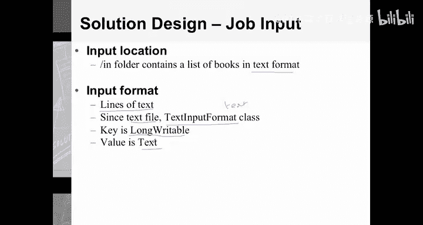

Let's look at the mapper design in terms of the mapper， the mapper has got to have an input。

 the input key to the mapper is really the byte offset because that's what is coming from the file。

 which is of type long writeritable and then the value into the mapper is going to be the line of text which is the text type。

 notice I'm using longriable and text， that's because Hadoop mapreuce requires all the data types to be ridriable or writeriable compatible and that's why I'm using these longriable and text types。

The map process basically in the case of the mapper for word count is going to ignore the key。

 it doesn't really need the key， what is it going to do with this byte offset so it ignores it in terms of the value that's the line of text it is going to parse the line and then for each word it's going to print out the word and count of one so if the line says once upon a time it is going to print out once1 upon1 a1 time1 that's what is going to print out and for that it's going to use the context object if you recall the context object is passed into the mappers map method。

In terms of the map output， it is going to generate a key and a value。

 the key if you notice is a text and the value is inritable which is the number one。

 that's what we have。Now let's look at the reducer， the reducer has an input for the reducer。

 the key is going to be the word and then the value is going to be a list of numbers。

 it's going to be the list of ones， and so the value is going to be an iterable of inriable。

And then the reduced processing is basically it's going to go through this list of ones， add them up。

 and put it into a variable called count。And then the reduce output is going to use the reducer context object。

In order to write the key value output where the key is a word followed by the count and the key type is text and the value type is inriable。

As far as the job output is concerned， the job output will be placed in a folder call out。

 which will be something that we will pass into our program in fact。

 we will also pass the input into our program。As far as the output format is concerned。

 the output format， we want it to be a text file， and so we can actually use the text output format class。

And if you use the text output format class， then lines of text makes the record and each record will have a key value pair combination。

 the key is the word and the value is the count， and so the key and the value will be separated by a tab that's because by default。

 the text output format class does that。

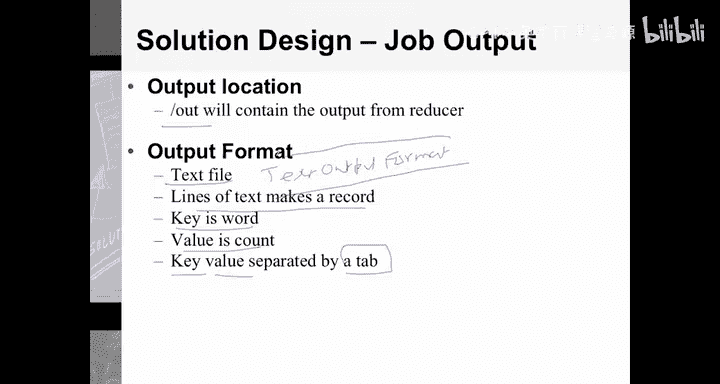

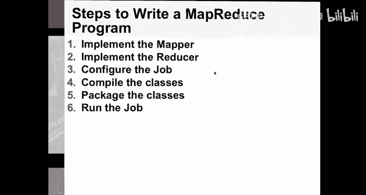

Okay， so now that we have the complete idea of what the job is going to do and we have some design。

 let's go ahead and implement it。The steps that we need to do are to implement the Ma class。

Implement the reducer class， implement。And configure a job object， compile the classes。

 package them up and run the job。 These are the six steps that we need to do。

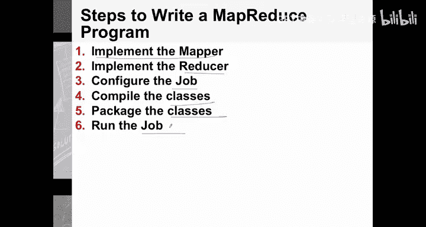

Implement the map。In terms of implementing the mapper。

 the first thing we need to do is create a class which extends the Maper class and we know that the Maper class is a parameterized class and there are four parameters that it takes。

 it takes the map input key， map input value type， map output key type， map output value type。

 we already know what the map input key type is， it is long writeriable。

 that's the map input key type。We know the map input value is going to be text。

 that's the line of text。 the map output key should be the same thing as what is going to go into the reducer。

 which is really the word。So that is going to be text。

That's the output and also the amount output value is going to be a number and it's going to be one all the time。

 so in our case it's going to be inriable okay。Now it's important to recognize that whatever comes out of the Maper。

 which is the map output key。😡，Is going to be consumed by the framework and then the framework has to go through and the framework has to go through the grouping and the sorting。

 all the shuffle and sortface for that the map output key has got to be ridriable compatible and it so happens that the text class。

Is actually a writeable comparable class。 And so we are in good shape there。 The rest of the classes。

 the input key。The input value and then the output value don't really have to be writeriable compatible。

 They just at a minimum have to be writeriable， but it so happens that all the ridriable classes in Hadoop HFs are automatically writeriable andcomp because they may be at different points used as keys and values。

 Now， we need to overwrite the。Implement method in our derived class so if you recall in the map method we are past input key and input value。

 we are also past a context object， all we have to do is write the business logic and for us the business logic is going through the entire line parsing it and getting every word and printing out the number one out。

Okay， so here's what the Ma class looks like。I am writing a class called word count Maper which extends the Maper class。

 these are the four parameters as you can see the parameter type。

 so we have the long writeable which is the byte offset within the file which we don't really care about that's the line of text this is going to be the output that you're going to generate for the map which is going to be a word followed by a number which is what the inriable type is If you look at the mapper class in the Maper class we have a map method。

The map method is the most important method in the mapper class notice it takes the key and the value that matches this key and this value right here。

 these are your keys and values for the input。And it's also taking a context object。

 which is what we' are going to be using to write the output of the mapper What we are doing in terms of business logic is taking the value。

 which is a text type notice it's really not a string it is kind of a writeriable comparable version of a string so we need to get a string out of that in order to do string calculations or string manipulation So I'm going to go to the value object which is a text object invoke the two string method on it to get a string and then I'm going to use a string tokenizer tokenize the line so that I can get the words and as I iterate through the words I'm going to write out the word followed by the number one notice the right method takes a key value pair combination and the right method key value pair combination has got to be text and inriable as we see over here and so if you look at the right method here's the text type。

Wwhich is the word and here's the inrightable type which is going to be a number and what I have done is for efficiency purposes rather than instantiating the number one which is an inrightable object again and again and again in my Mapers map method。

 I declared it as an instance variable instantiated it once and then I'm passing to it every time into the right method。

 so that's the Maper class。Now let's implement the reducer in terms of the reducer。

 we have to write a reducer class that extends of course， the reducer with four parameters。

 reduce input key reduce input value reduce output key reduce output value Okay so what is the key into the reducer the key into the reducer is a word and so it's going to be text the value is going to be the inritable type because it's going to get the value one inriable。

In fact， it's going to be a list of inriables。The reduced output is going to be a word。

 and so it's going to be text。And then reduce output value is going to be a number which is the count let's make that also an intriable that was part of our design notice that the input key class。

 which is this class right here should be ridriable compatible and the only reason for that is because the map output key class was ridriable compatible and the reason it had to beriable compatible was because it had to go through the group I and sort functionality。

Okay， let's implement the reducer in terms of implementing the reducer logic。

 we need to implement the reduce method， the reduce method is given a key and a list of values。

 notice by the time you get to the reducer， you're going to get a list of values。

 so you're going to get an iterable type， it's going to be an iterable list of values。

 if going to be iterable of inriable in our case。And then you write the logic。

 the logic for us is going to be simply adding up all the values that we have in the iterable list。

 and then we are going to use the past context object。

 a context object is also passed into the reducerss reduce method。

 we are going to use the right method of the reducer context object in order to write the key value out。

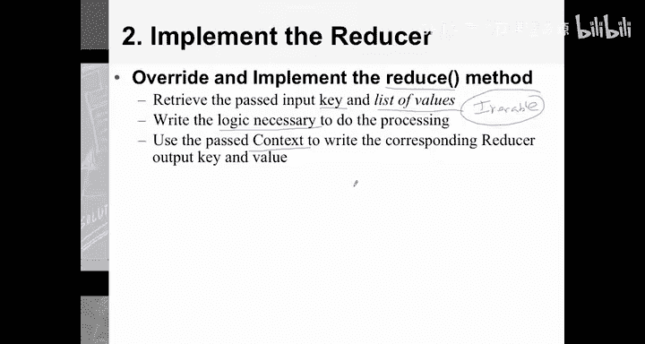

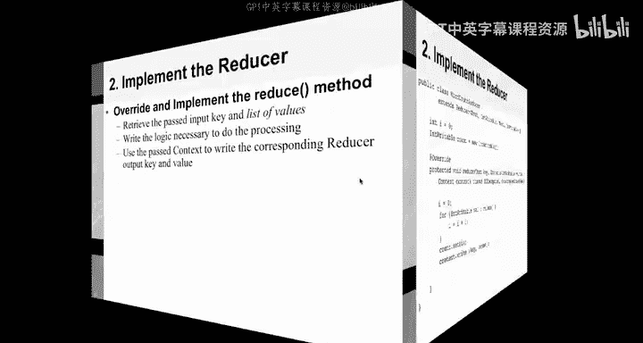

Yes。So let's implement the reducer， notice the reducer class extends the reducer。

 the input key is text， which is the word input value is inritable。

 which is going to be a list of inriables， and then the output key is going to be a text。

Wwhich is the word and the output value is going to be inriable， which is the count。

 If you look at the reduce method in the reduce method， I have the input key， which is the text。

 which is the word and then I have a list of values a list of inriable objects basically it's going to be a bunch of once and then I also have a context object what I'm going to do is iterate through my inriables add them up I have a local variable called I I just keep adding them up and then I want to write the output。

 the output is going to be of course the key which is going to be the word and then the count So the key is the text and then the count and so here's what I'm writing out So what it will end up writing is maybe the word dog appearing 17 times so that's what it is going to be written out。

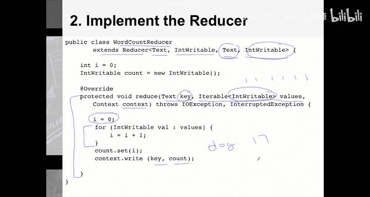

Now it's time to configure the job in order to configure the job we need to write a driver class。

 instantiate a job object and submit the job so let's go ahead。

 instantiate the job object in order to instantiate a job object there are several factoryt methods available you can go to the job class and invoke the get instance method which will give you a job object or you can go to the job class and call the get instance method which will take a configuration object or you can go to the job class and call the get instances method passing into the configuration and also the job name it's probably a good idea to pass the job name because it allows you to track the job in the admin console It's also possible to later on set the job name by calling job。

et name method。Okay， now we need to specify the input path。

 the input path is the location where the job is going to get its input in this case our input is going to be a directory。

 just one directory， it could be more than one directory。Because it's only one directory。

 we can simply call the add input path method in the text input format class。

 which is a static method。We could call this method several times for different input directories。

 but we have only one directory， so this should do it for us。

We also have to specify the input data format， the input data format is text file。

 and so we need to explicitly say that we are going to be using text input format we designed if you recall we talked about all these things earlier we actually designed our job but now we are actually implementing the job so this is where we are explicitly telling the job。

 what the input format and what the output format， all those different things are Okay so we go to the job object and invoke the set input format class passing into it the name of the input format class。

Now it's time for us to set the Maper in the reducer class and the way you set the mapper in the reducer class is by going to the job object in working the set Maper class method。

 passing through the Maper class。In our case， it's going to be word count Maper。Dot class。

That's what we pass and then we go to the job object and said the reduce class， in our case。

 of course it's going to be word count reducer。Dot class， that's going to be the die class。

And then we specify in which jar。or the map and reduce class is found for the job。

 and so for that we need to say job object set job by class。

 typically you can just say get class if you're going to be in the main method if you say get class that means the current class that should do the work for you。

Now we need to specify the output pack。The output patch should be a directory。

 the output directory should not exist if it exists。

 the Hadoop framework will verify that and if it does。

 it'll throw an exception and the job will come to an end。

The way you said the output directory is by going to the file output format class。

And invoking the static method on it called set output path， that takes a path。

 which is an HDFS directory。 You have to specify the output data format。

 We have decided that the output file is going to be a text file and if it's a text file。

 we know that the text output format class is the class that we should use so we go to the job object invo the set output format class method passing to a text output format or class。

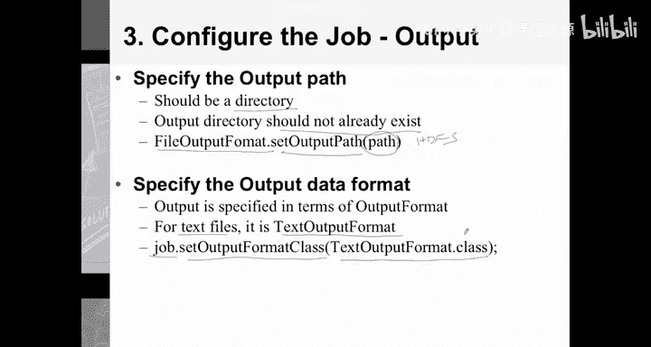

We also have to specify the output key value class， the output key is going to be the key class。

 which in our case is going to be the text， and then the output value class is going to be inritable。

So we specify that。Right right， so let's go ahead and configure the job here I have a class called word count。

 it contains the main method， I'm declaring a variable called word count job going to the job class。

 getting an instance of a job passing to it a configuration object。

 passing to it the name of the job， and then I have to specify the input path。

 I go to the file input format class， invoke the static method called add input path， passing to it。

 the word count job， the job that I just created， also passing to it。

 an argument that came to me as a also passing to it a parameter that came to me。As an argument。

A value that came to me as as of zero， which is really the inputtroductctorory that is passed as an argument。

And then setting the input format， so going to the wordcon job object。

 setting the input format class， which is text input format class。

 now I need to set my mapper in the reducer， so setting the mapper class。

 setting the reducer class word count mapper word count reducer this is what I'm saying to the Hado framework that the jar file that needs to be used for distributing across different machines for this particular job is the same jar file where you can find word count do class。

 which is the current class， I could have also said get class over here that would have also worked Now I need to set the output path。

 the output path is a directory so I invoke the file output format class static method called set output path passing to it the job also passing to it orgs of one which which is an argument that is being passed to the program indicating which directory the output has to go to。

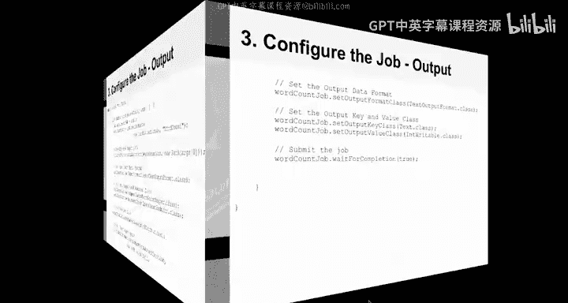

Then I aim to set the output format class， which is the text output format class。

 I need to set the output key class and then the output value class。

 which is the text class and the inritable class。And then eventually I need to submit the job and the way I'm submitting the job over here is by going to the word count job object and invoking the wait for completion method。

 passing to it true， saying that I would like to wait for completion。

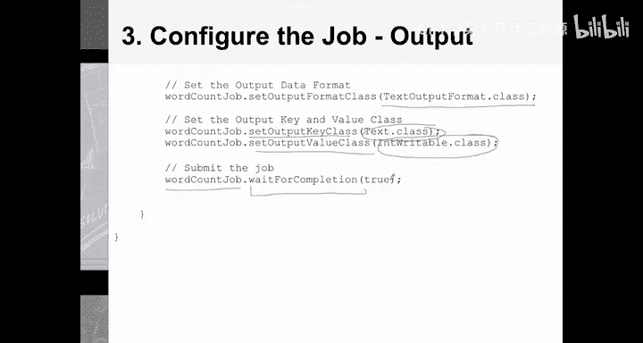

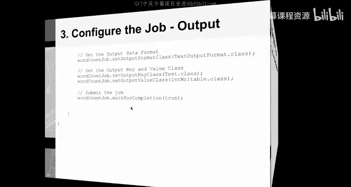

Once I've done that， I would have to compile my classes。Clearly， I need to compile my Mapper class。

 the reducer class， and the main job class。In order to compile。

 I need to include all the Hadoop jar files and all the dependent jar files that are in the lip folder for Hadoop。

I may have to include any app dependent jar files in my class path too。

 it's possible that for my business logic， I have some special jar files that I'm using。

 I need to bring those jar files to。Now we need to package the classes。

 Hadoop requires that all the jobs are packaged as a single jar file。

 that's because the framework is going to distribute the J file to the nodes。If you recall。

 Hadoop framework takes advantage of the fact that it can col locatecate the data and the processing。

And so in this case we are going to be taking the jar files and shipping it to all the different data nodes so that the data processing can be done that's the idea and so it needs to know where the jar file is and the way we do that is by going to the job object and invoking the set jar by class method。

If we also have dependent jar files， then they should be packaged within the big jar file under the Lib folder。

 you can include a Lib folder inside the jar file。Now it's time for us to run the job。

 there are two ways to run the program。The first way is the traditional Java command if you use the traditional Java command you need to set the Hadoop Classpa but we know that the Hadoop Classpa is a long list of J files if you want you're welcome to use the example that I showed you in the HDF section where in the Shell program I showed you how to set up all your classpa variables。

You can set the classpa and then you simply say Java dash classpa passing to it， all the jar files。

Passing to it， the name of the class that contains the main method， passing to it as orgs of zero。

 the input directory， and the output directory， that's our application logic。

Or you can use the more convenient yarn command。Yn command's advantage is that it adds the Hadoop's library to ClassPad automatically。

That simplifies your running of the code。You sayryrn， jar。

 the name of the jar that contains the main method， of course this need to be a path。

 a complete path to the jar file if it's not in the local directory。

 followed by the name of the class that contains the main method。

 followed by any arguments in this case， slash in and slash out or the arguments。

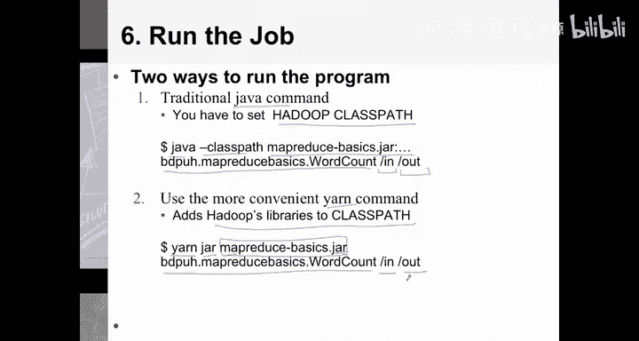

Once the job runs。

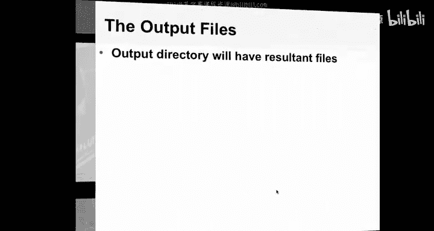

We need to look at the output the output is in a directory in our case we specified the directory as the slash out directory as an argument and so the output would go to the directory if you look at the directory there will be a file called underscore success this is a marker file which means it's a file with 0 bytes itll have no text in it if that file exists then that means the job was successful if that file did not exist that means the job failed What about the actual output the actual output is in a file called port or nnnnn that's the format of the file where nnnn is an integer representing the reducer number if you have one reducer then it will be part or 00000 if you have three reduces it will be port or0000000001 00002。

are the three different part files that will be generated notice that the part files are zero based in other words。

 it starts with zero Okay， so now let's go ahead and try this out。

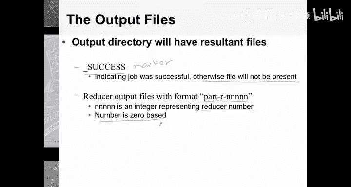

Here I am logged into the VM， I have a project in Netbe called MapRuce basicsics。

 where I have the Word count or Java main class， we have the Word count Mapper class。

 and then the Word count reducer class。

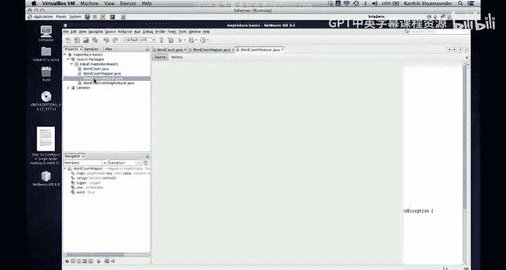

Let's go ahead and look at the word count Mapper class。

You'll see that the wordCon Mapper class extends the Maper taking into a key in value in key out value out。

 it's also getting an instance of the logger， this is where I'm instantiating an initeable object with the value one so that I can keep writing one every time for efficiency purposes。

Here's a text object。Call word。I also have a setup method that I've overwrittenden。

I get the context object and in the setup method I have a lot of information in the context object。

 I can figure out what the。Task attempt ideas， figure out the name of the file that is being worked on。

 so' a lot of information in the context object。Here's the most important method for us。

Whi is the Maper method， the Maper method takes key and the value。

 the key is the by offset in the file。 we don't really care about it。

 The value is where the line of text is so I'm going to take the value convert it to a string and then here I'm doing a little bit more processing basically I'm removing all the punctuations in the line so I'm doing a little bit extra processing using the tokenizer which is the string tokenizer parsing it and then writing my output。

Here's my reducer， extends the reducer。It has its key end value and keyote value out。

I have the inritable count which is where the result is going to go here I am iterating through all the iterable values that I have。

 I have an iterable of inriables adding all of them up and then eventually writing it out Let's go ahead and look at the word count do Java。

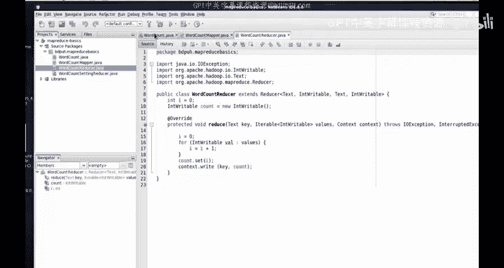

If you look at word count or Java here I have declared a variable called word count。

In instantating a configuration object。And then。Going to the job class。

 getting an instance of the job object passing to it， the configuration object。

 and also passing to it the name of the job， adding the file input path。

 basically where the input is， that would be the ags of zero that is slash in the directory where the input files are going to be located。

Setting the Maper class， setting the reducer class。Setting the jar class。Setting the output path。

 which is slash out， setting the output format class， which is text output format。

 setting the output key class， output value class， and then waiting for the job to be completed。

Let's go ahead and run。So here I am in my map produced our Space Exper。

 let me show you what the input directly looks like， it's Hadoop。F S， Dutch Alices。lash I am。

 the input directory has one file called MobiDasht。txt。That's the file that we are going to process。

We need to make sure that the output folder doesn't exist。Haop， a first dash。OrM dashboard slash out。

 let's delete the output folder if it exists， okay， it doesn't exist， so we are good。

Now I'm going to run the program。I already have a command set up。Go ahead and run that right here。

 yarn jar， the name of the jar file。In fact， it's the complete patch to the jar file。The class name。

 the fully qualified class name， and then the arguments， which is the input folder。

Which is where the input directory is located。And the output folder。

 which is where the output should go。Run the command。

There it is submitted the job to the application。Maaster， and then which went to the。

Job history server， registering of the job history server， all that stuff is happening right now。

 the Ma use job is running。Mapping is done， reducing is done。So if I look at Hadoop。F， S dash Alice。

 slash out。Should be Hadoop。There it is， there's my success file。

 which indicates that my job is successful and there's my output。Which is this part or 00，00。

 there's only one reducer that Ram。If I do Hadoop， F S dash cat。Slulash out， slash。Part。Dash are。

It guyss 0，0，0， zero。That should give me the list of all the outputs。There's the output。

 it's actually in the key value pair combination。What I'm going to do is copy the file locally。

 Hadoop， AirF。There's copy。To local slash out， slash。Part star to dot， copy it to my local directory。

And let me open up the file。If I open the file up。If I do set list。

It'll actually show me how it's been separated， you see this little control eye character that's the tab character indicating to me that it's key value pair combination。

Is all the key and the value。Also， do a more part。Resol the key and value。

Which is basically the word and the count。Grab- I family。Part。

 we see the word family appear 11 times， families one time， family less one time。

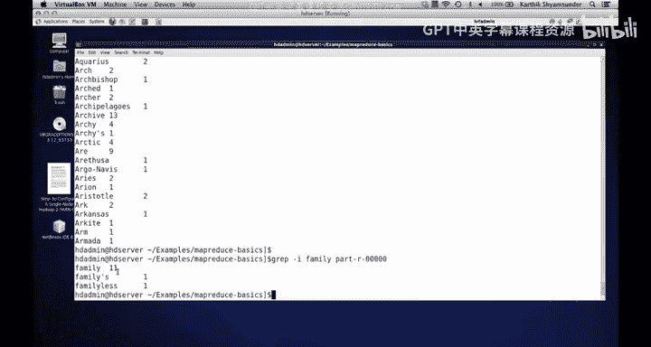

If I go to my。Resource manager。And resource manager， I'll see my job。

Open it up I've run a whole bunch of jobs as you can see here， so this is the job that I ran。

 click on it， the job is being completed， there is really no information related to mappers and reduces it's a map produced job but there is no information on that for that you need to go to the job history server。

So here's the job history server。We reload the page， that's the job number 12， click on it。

As you can see， there was one map and one reduced process that was done。The map process。

And then the reduced process。You'll also see that when you go to the MA process。

 this is the concept of task attempt that I talked about。This is the task attempt zero。

 the task had to be attempted only once。And it runs successfully。

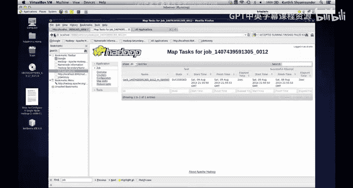

Same thing with the reducer。It ran successfully。Coect。😊，That's my map produced program。

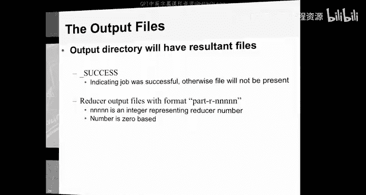

So in this section， we learned the steps to write a map program。

 We said there are six steps that you need to take to write a map reduced program。

 You need to first implement the mapper class by extending the mapper class and overriding the。

Map method， and then you need to implement the reducer class by extending the reducer class and overriding the reduce method。

 and then you need to configure the job in a driver program so for that you write a class with a main method。

 you instant a job object， configure the job， setting the input directory。

 the output directory input class name output class name。

 all the mappers and the reduces all the different parameters， and then eventually you run the job。

And then once the job is done， you can go to the output folder in the output folder。You。

So in this section， we learned the steps to write a map reduce program。There are six steps First。

 you implement the。Maapppper， which is for which you need to write a class that extends the Maper class in which you overwride the map method and then you need to implement the reducer in which you write a class that extends the reducer class。

 and overwride the reduce method， then you configure the job in a main class so you write a class with a main method。

 you instantiate a job object， set all the job parameters by invoking several set methods。

 including the Maper class， the reducer class， the input directory， the output directory。

 the input format， the output format。And then you compile the Java classes， which is the Maper class。

 the reducer class and the main class， and then you package all the classes into a J file。

 and then you run the J file with the yarn command， once you run the program， if it's successful。

 it puts the output in a directory， and then in the output directory。

 if you see the underscore success file which is a marker file。

 then you know the Java was successful， and then the results are in the directory with the results are in a file。

 and then the results are in a file。Patterned。And then the results are placed in a file with a file pattern name。

Partort dash or dash and number， the number starts from zero all the way up to n。

 depending upon how many reducers you have by default， you only have one reducer。

