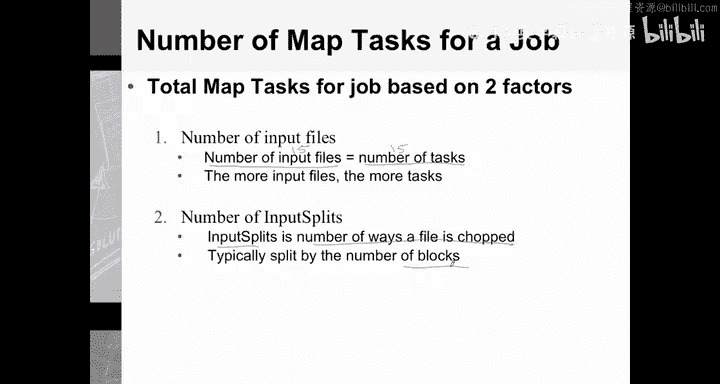
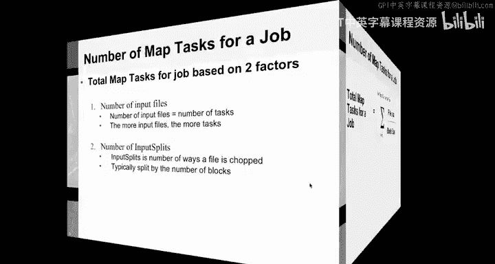
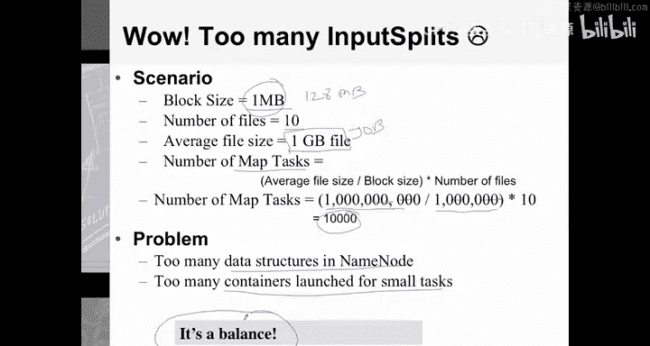
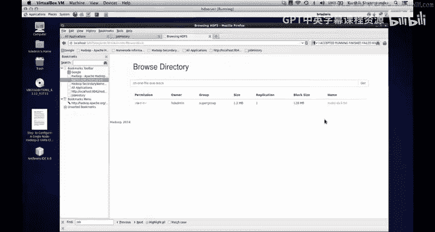
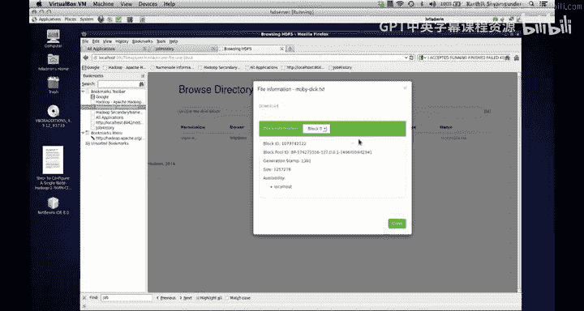
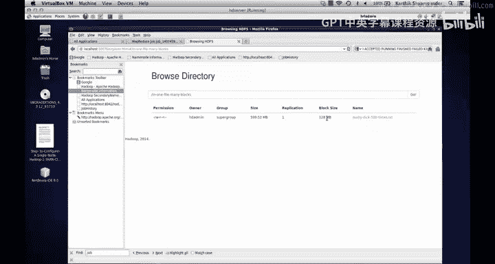
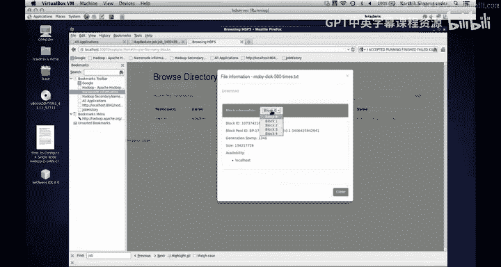
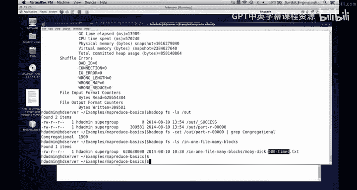

# 约翰霍普金斯大学《Hadoop大数据处理｜Big Data Processing Using Hadoop》中英字幕 - P49：9_Mapper并行机制.zh_en - GPT中英字幕课程资源 - BV1g5u6zBExs

Mapper parallelism。Up to this point， we have learned how to write a Mareduce job。

Let us now look at parallelism。😡，In this section， we will look at how Maper parallelism is achieved and controlled for a job。

In order to understand Maper parallelism， let's work through the Mareduce framework in Mareduce framework you have input files and here's all my input the input files can be processed by multiple Mapers up to this point we've been looking at only one Maper。

 we can have more than one Maper， we have Maper1 Maper2 Maper3 Maper4 mappers。

 they could be running within the same machine， they could be running across multiple machines。

The input is broken down into different pieces and different mappers can work on the different pieces of input and then they produce their own output eventually the output from the mapper is sent to the shuffle and sword phase of the Hadoop framework which then gets sent to the reducer let's not worry about the reduces at this point。

 let's worry about the mapper。Let's figure out how the input files are broken down into multiple pieces so that multiple mappers can work on different pieces。

So the question is， how is the number of maps defined or determined for a job。

 the total number of map tasks for a job is based on two factors。

First it's the number of input files， the number of input files is equal to the number of map tasks。

So if you have 15 input files， then there'll be 15 map tasks for that particular job。

 so you can always argue that the more input files there are。

 there'll be more parallelism because there'll be more tasks that'll be running in parallel。

The second factor is the number of input splits。Input splits is the number of ways by which a file is chopped。

 typicallyy a file is split by the number of blocks it has。

 so if you have a file that has seven blocks in it。

 then that means there'll be seven map tasks that will be running。

So these are the two factors that determine the number of map tasks for the job now these two factors kind of work together so we need to come up with a formula that brings the two things together。

So let's look at the formula The number of map tasks for a job is really a summation of the number of files that are there and for each file。

 the number of blocks that's there， so for each file you' have to figure out how many blocks there are so you take the file size。

 break it down by the block size that'll give you the number of blocks and then you add up the number of blocks for every one of these files that gives you the total map tasks that are going to be executed for that job。

The point I'm trying to make is you you cannot directly set the number of map tasks for the job。

 it is actually calculated indirectly by the framework based upon the input that you have。

 in other words， based upon the number of files you have and the number of blocks per file。😡。

So let's look at a few scenarios if you are going to run Word count with one file and one block as input。

 so there's one file， one block that would be one map task。

If you are going to run Word count with 10 files as input， and each file is one block。

 then there is going to be 10 map tasks。If you are going to run Word count with one file。

But the file is five blocks big， then you are going to have five map tasks if you are going to run Word count with two files。

 one file is three blocks and the other file is six blocks， then it's3 plus6。

 itll be total of nine map tasks。Well， then。You can get into this problem of too many input files。

 so let me show you a scenario。Let's say that your block size is 128 megabytes， and by the way。

 that's the default block size。And let's say that your average file size is 10 megabytes。

 as you can see here your file size is far lesser than the blog size， which is not a good idea。

 but let's say that's the situation we have that's how we brought the files in into HDFS。

And let's say that we have 10，000 files。For a job and each file， of course， is 10 megabytes。

Which means there are going to be 10，000 map tasks that are going to be launched。

 which means there are going to be 10，000 processes that are going to be launched。

So the problem with too many input files， in this case we have 10，000 very small。

 less than one block input files is that too many data structures in the name node。

 we already saw that's a problem with HDFS， but then we have with map produceuce one more problem。

 which is too many containers are being launched for very small tasks， so in this case 10，000 JVMs。

 10，000 child processes， 10，000 containers are going to be launched across multiple machines in order to execute your job。

Then there is this issue of too many input splits also。

 so I'm going to kind of simulate a scenario for you， let's say that the block size is one megabyte。

Now I know you don't set your block size to one megabyte that's too small， like I said to you。

 the default block size is 128 megabytes。And let's say that the number of files is 10。

 so we have very few number of files。 the average file size is one gigabyte。

So we have 101 gigabyte file for a job so let's see how many map tasks we are going to have well each file is about one gigabte right so  one gigabte that's 1 gigabyte divided by the block size which is going to be 1 million I'm actually estimating 1 MBabyte to be about 1 million rather than 1024 times 1024。

That gives me100 because this gets cut with this， this gets cut with this。

 and so we have 1 thousand00 multiply by 10 that gives me 10，000 map tasks。 Once again。

 too many input splits can also cause a problem and too many input splits could also be based upon block size。

 there's a few of that things that too many input splits can be based upon later on。

 I will talk about how input splits are done inside the mapbri framework for different input formats。

At that time， you'll understand more about it， but just understand that you could get into a situation with when there are too many input splits。

 you may end up having too many map tasks。So the problem here is too many data structures in the name node again and too many containers that are being launched。

So it's all a balance。You have to think about how you're going to bring the data in and how you're going to store the data。

 and that's why I actually went deep into the HDFS section and asked you to think about how you may want to design your systems。

All right， let's go ahead and log into an HD server as HD admin and do some demos。

Here I am logged into my VM HD server as HD admin user ID so first I would like to show you what my HDFS file system has in my HDFS file system I have a directory called in one file one block so it's an input directory that has one file and it's one block wide and then I have another directory called in 10 files one blocklock each so in this directory I have 10 files and each file is one block each。

And in this directory in one file， many blocks， I have one file it has many blocks inside it。

 so these are the three different scenarios that I'm going to run。

 so let's run the first scenario which is one file one block in a directory。

So let me do a Hadoop Fs dash Ls slash I one file， one block。Okay， there's the folder， one file。

 one block。That contains 1500 called Mobid dot Txt。 If I do an Ls minus L H， you can see。

That it is about 1。2 megabyte。If I go to my file system1 file 1 block， 1。2 mebyte。

 the block size is 128 megabyte， if I click on it， it indicates to me that it's only one block。

 which makes a lot of sense it's in fact far less than one block okay now I would like to run my Mareuce program。

Before that I need to clean up the directory so let me go ahead and clean up the directory。

 the out directory now I'm going to run the Mare program here's the Mare program。

 I'm going to run yarn jar， the jar file and then this is the wordcom program I'm going to run and what I'm passing to it as the input is in one file one block which contains one file and that's only one block which means the number of mappers it's going to take is going to be just one mapper and that's what we should be looking for now let's go ahead and run it。

Total number of patch is one， number of splits is one and so it's going to be only one mapper the mapper face is done。

 the reduce face is done and the program is over。And so now let's go ahead and look at the output directory。

 Hadoop。F， S dash L， slash out。We have the success， we have the part。

The program is working and what I can do is kind of show you the output of once again。

 Hadoop Fs dash cat slash out slash port。It's cat it。Make sure。Our program ran。Yep， the program rh。

And then what I'm going to do is do a grip。So we do this part dash or dash 0，0，0，0，0。

 And let's do a grip on the word。Congregational。H enter。That's no output。

There's the word congregational， it appeared three times in my output。

 there's one reducer that ran and there's one output。Okay， so here's what I would like to do。

I would like to look at the job history server， let me see what is the name of the job that I run if I scroll up a little bit。

You can see the job， the job ID is 22， search 22， 1305 underscore 0022。

Let's see what the map produced job looks like in the history server。Here's my history server。

 we do a reload， there's 22 right there。Click on it。You can see that there is one map task that ran。

 and you can see that there was one reduced task that ran。 and we saw the output。

 That's the standard stuff。 You've seen this。Okay， so now what I would like to do is show you the next scenario。

 let me clear the screen， the next scenario is one directory with 10 files in it。

 one megabyte each okay， so that means it's 10 files， 10 blocks so do。

FS Ls slash IN in 10 files1 block each So it's 10 files， one block each there it is。

 there are 10 files and they are actually 10 copies of the Moby dick text if I do an Ls minus Lh you can see that there are101。

2 megabyte file if I look at my file system in 10 files one block each there are 10 files01 through 10 and they are one block each because it's 1。

2 megabyte less than a block size。 So now what I would like to do is run the program。

But before I run the program， I need to clean out the output directory。

 so let me go ahead and clean out the output directory， which I did。I would like to run my program。

 The only difference in my program is my input folder。 So it's going to be in 10 files。

So the input folder contains 10 files and one block each， so according to the formula。

 since it's 10 files and they're all one block each， that should take 10 mappers。

So let's go ahead and run this There it is total input pads is 10 and the number of split is 10 and so it's going to be 10 different mappers that are going to be running there they are running while they're running let me just do a JPS If you do a JPS notice you're seeing these processes called yaon childild they are the containers this is the node manager。

 this is the data node， this is the MR app master that's the container zero and then these are the different child nodes that are being brought up and they're getting executed。

There's going to be 10 map tasks that are going to run。

 so eventually there are going to be 10 different processes that are going to be launched if it's in this case it's all running within the same machine。

 but if you have multi machine architecture， then it would run on multiple machines。

The program is over， the job finished， that was job。23。

Let's go back and verify that because they run 22 before this。That's job 23。

Let's go ahead and look at the history server here I am in the history server， refresh it。

Click on it。there it is map，10 map tasks were run。 Click on it。

 Here are the 10 map tasks that were run。 There were 10 different containers that were launched。

And they were done in parallello。In terms of the reducer， it's still one。Okay。

 so let's go back and look at the output。Heoop Fs Ls slash out， there's the output。

 there's one file because there's only one reducer。There one father was generated。

Now what I'm going to do is do a grip for congregational Hado FS。

 dashcat slash out slash part dash or dash 0，0，00。And then， grab for congregational。

There it is congregational appeared 30 times congregational appeared 30 times in this case in the previous case。

 congregational appeared three times in this case I have 10 different files。

 That's the reason why it's 30 times。 just to prove to you that the previous time it was three times let me go ahead and run the previous job again。

 So had do。F， S， dash， autumn dash or。Slash out and then I'm going run the previous job。

The previous job is in one file， one block。That's job 24。So in this case。

 I'm generating a new output。And it should have only three times the word congregation。 So Hadoop。

 F S dash。Ells， slash out。And then， if I look at the。If we do a grip on it。Of the output。

 it should only be three。 There it is。 It's only three。 So when you have one file， it's 3。

 when you have 10 copies of the file， it's 10 different mappers。

But then you ended up getting 30 because the reducers are coming in and putting everything together the count together。

 we haven't got into the reducer portion yet， but I wanted to kind of make a point here。

The other thing I wanted you to note。Let me go ahead and do a Hadoop FS dash cat。Slulash out。

 slash part dash or dash 0，0，0，0。You'll also notice that the output is actually sorted first the uppercase a through Z and then the lowercase a through Z。

 so the output is actually sorted。So now I'm going to show you the third scenario。

 which is I have one file。And more than one block in it。So let's look at that folder。

 it would be Hadoop， FS， Ls。Slulash in dash。1 file， Many blocks。So I have one file， it's many blocks。

 let me do an LS minus Lh。That's 599 MBby， which leads me to believe that it's going to be about 5 blocks because 1 28 MBby gives me a block。

 But let's verify that。 I'm going to go to the H TF S。

Browser and I'm going to look at in one file many blocks， 599 megabytes， 120 megabytes each。

 click on the file。

And here are the five different blocks that I have， okay， so that is five blocks。

Right so now what I would like to do is run this program， So Hadoop， F RM。Or。Slash out。

And then I would like to run the same program。Except this time， I'm going to say it's one file。

Many blocks。Run the program。So let's think about this。fiive blocks， each block is 128 megabytes。

 so I'm going to have five different JViums that are going to be running and each JVM is going to be working on a block which is about 128 megabytes。

 and then they will all be combined using during the shuffle and sword phase which will be sent to the reducer。

Let's talk about Maper parallelism right now， we'll talk about reduce parallelism in the next section。

RightSo let's go ahead and run this。 This is going to be quite computationally intensive only because I have a lot of data and I have one simple laptop that's running over heres so it's going to take some time let's go ahead and run this。

All right， so there is there it is input splits is5。

So there are going to be five different tasks that are going to be running。There it is。

Let me do a GPS。One， two， three， four， five， those are the five different tasks that are running。

So I have the name node， the data node。That's my HDFS。

And then I also have secondary name node as part of HDFS， those are the three demons。

And then I have the node manager。And the resource manager， the demons for the yan framework。

And then I have the history server that supports the map reduce framework， of course。

The yan framework also supports the map reduced framework。 and then in this case， I have five。

Processes that are running， that are doing the work right now， so there's going to be five map tasks。

And they are running。Each map task is working on about 128 megabytes of the data and so it is doing a lot of processing。

 each one of them is reading a line at a time， parsing the line， pulling out the words。

 and then writing it into the map output， the word followed by the number one。

The word followed by the number one， the word followed by the number one and so on and so forth。

 and then eventually it'll go into de shuffle and sword face。This is going to be running for a while。

 so I'm going to pause and come back in a few minutes。Okay， the job is done。Let me just go。

Backwards here。There is。So this is job number 25。F input splits。

That's because we have one file that contains five blocks， so the mapper keeps running。

 there are about five map tasks that were launched。Which is the yawn childil。And then over here。

 you notice that the mapper has not completed yet。The mappper has not completed yet。

 but then reuse says that it hits 7% done， it's not because the reducer has started。

 the reducer hasn't really started yet， it's the shuffle in sword face that's happening and because the shuffle and sword face is considered to be part of the reduce phase。

 you're seeing that in action that's all。And then once the map is 100% done。

 then the reducer kicks in， there is actually a barrier between the map and the reduce phase。

 the reduce phase cannot work until the map phase is done。

The program is over if I do Hadoop Fsls s out。I should see the output。There's the output right there。

 and what I'm going to do now is do the cat。And then do a graph。For congregational。Slulash out。

 slulash。Part dash bar。来000。So I'm going to grab for congregational and see what I get。I get 1，500。

If I do Hadoop F S dash L slash in。Dash。1 file。Many blocks。I wanted to show you what the file is。

 It's actually the Mobi dig text。500 times I basically concatenated the book 500 times over here。

 we saw the word congregational appear three times。

When we had one file and then now we have 500 times， so it's  three times 500。

 that's why you see the 1500 as the total count for congregational。

Let's go ahead and look at the job history server， here's the job history server， job 25。

 click on it。

You'll notice that there were five map tasks notice each one of the map tasks ran for about nine minutes but one of them ran for only six minutes that's probably the one that had the least size for the block。

 which is probably the fifth block or block number four。So in this section。

 we looked at how parallelism is controlled for mapper tasks for the job。

 we learned that we cannot directly control the parallelism of map tasks。

 it is indirectly controlled by the number of files and the number of blocks per file。

