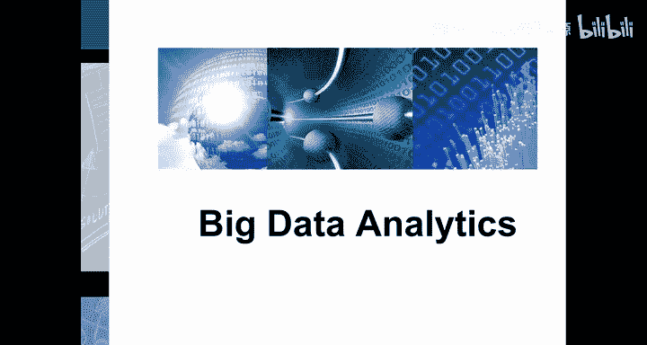
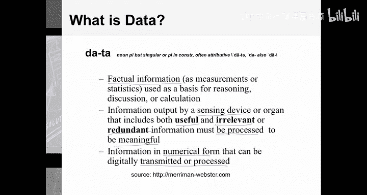
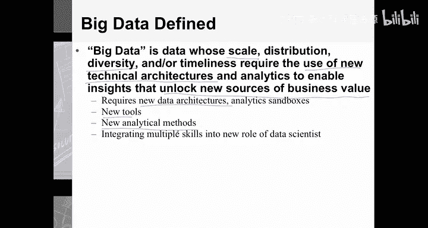
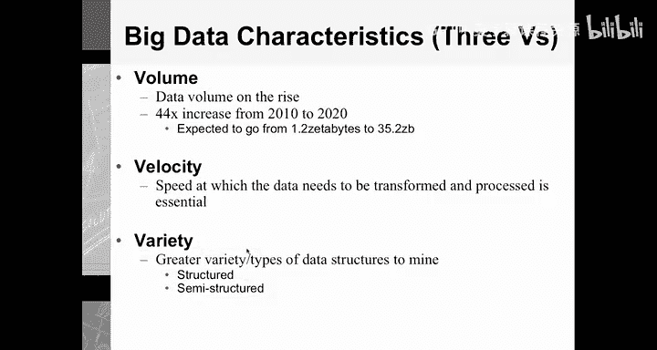
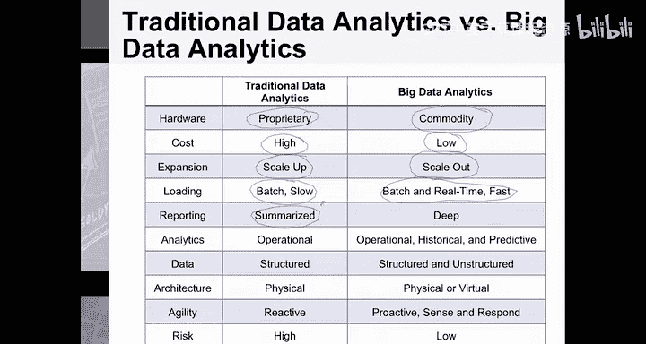
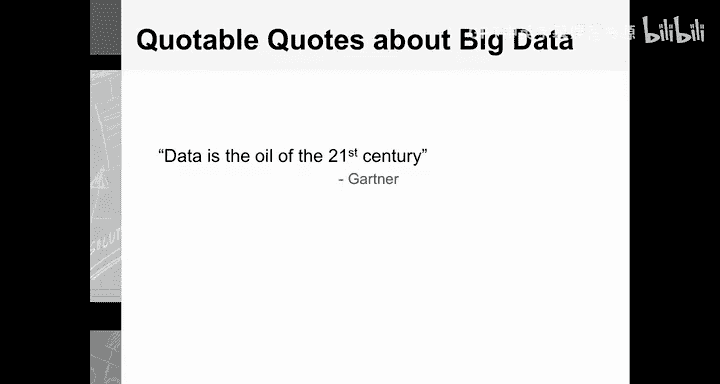
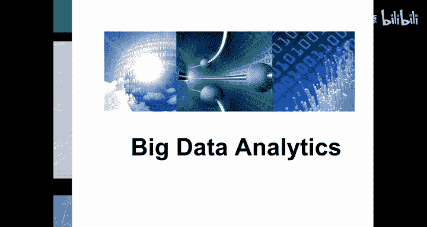

# 约翰霍普金斯大学《Hadoop大数据处理｜Big Data Processing Using Hadoop》中英字幕 - P4：3_大数据分析.zh_en - GPT中英字幕课程资源 - BV1g5u6zBExs

Big data， analytics。In this section， we will formally define data。Big data。

 traditional data analytics。And discuss how it is different from big data analytics。

So what is data？I know you' have been working with data for a while now。

 but I thought I will go to the Merriment Web Tractionary to look at the definition of data and see how it makes sense for the modern world。

The first definition that I got was factual information as measurements or statistics used as a basis for reasoning。

 discussion or calculation。The key here is factual information， so when you think of data。

 you think of factual information， think of databases， databases that store customer information。

 product information， sales information， user information。

 so they' are all factual information that is being stored in your database。

The second definition was information output by a sensing device or organ that includes both useful and irrelevant or redundant information that must be processed to be meaningful。

Now， that's a mouthful。 So it's important for us to kind of take this and break it down。

 It says important information output by a sensing device。

 That's an important thing or organ that includes both useful。

Irrelevant or redundant information that must be processed to be meaningful。

The best way to understand this is through an example。 So for example。

 I mentioned to you that I work for Vericign at Verine， we get about 65 billion queries a day。

 asking for domain names whose I addresses we need to return。 Now。

 we have DN servers that are serving these requests all over the world at oured sites。

 and so you can think of these things as sensing devices that are getting these requests and sending responses back to the client。

But all these requests are then logged and we process those logs。 if you think about it。

 those logs contain useful information for Verign because we are now able to figure it out what are the domains that are popular and who's asking for those domains。

 you may say it's irrelevant from the perspective that you know what we're not really making any money out of that。

 It's just log information。 you may also say that it's redundant because every34，5。

10 seconds popular websites are consistently asked for their IP addresses。

 So there's a lot of redundant information that's out there。

 but the important thing is that all these data must be processed to be made meaningful and that's what we do。

 we try to do analytics to be precise big data analytics on this data to make sense or of this。

Information in numerical form that can be digital transmitted or processed。

 that's the third definition。 so let's look at this information in numerical form。

 which means it is being stored in some kind of a digital form that must be transmitted or processed so data is something that is stored。

 transmitted and processed when you think of this think of this as a compute cluster as a distributed computing environment that processes all this particular data。

Okay， so let's define big data formally big data is data whose scale， distribution。

 diversity and or timeliness requires the use of new technical architectures and analytics to enable insights that unlock new sources of business value once again that's a very mouthful definition so let's take a look at this thing。

It's says big data is who scale is important so scale is important when it comes to big data diversity or variety also becomes very important in big data The other interesting thing is the use of new technical architectures clearly indicating that existing data analytics technologies are not going to work we need new technical architectures so that we can process the data and unlock new sources of business value right that's really the definition of big data some of the key things here again is that requires new data architectures to technically slightly different architecture we need for this new tools and new analytical methods and you'll see this thing throughout this particular course。

Here are the characteristics of big data， it's also called the three Vs of big data。

 as defined by the Gartner group。One of the first characteristics is volume。

 we already saw that the data volumes are on the rise in 2010 it was expected that we had 1。

20abytes of the data growing up to 35。20abytes by the year 2020。

 so volume is a very very important characteristics of big data processing and the definition of big data。

The second important thing about big data is velocity。

 velocity is the speed at which the data is being ingested or the data that is coming in and also the speed at which you need to process this particular data。

Let me give you an example， so for example at Verign again we get 65 billion queries a day on an average we get about 1 million queries per second during the peak times。

 but then during the attack times we end up getting 3，4，5，6。

 20 million queries today so you know sometimes our DNAN systems get attacked by hackers and they try to do distributed denial attacks。

 so query goes up so that's an example of peak data velocity and we need to process that particular data。

There is also variety which makes up big data， variety is different kinds of data。

 different kinds of data can be in terms of types， for example。

 it could be structured type semistructured type quasi structure type so you have JSON data。

 XML data， structured oldTP data have that， but there is also variety that matters。

 you may have Twitter data， you may have registration data you may have blog data。

 you may have traffic data and you want to kind of bring all these things together so there's a variety of data that you need to work together with so the three big characteristics of big data again is volume velocity and variety。

Once again， big data estimated that by 2010 we had 1。20ytes with the data and 1。20ytes is 1。

2 trillion gigabytes and they are estimating that by 2020 the world would see about 350ytes with the data so there's a lot of data that's coming in the marketplace all the stuff needs to be processed and made sense of and that's what the data economy is all about anyway。

And here are examples of companies that continue to generate large amounts of data， Facebook。

 6 billion messages per day， eBay， 2 billion page views per day。

 which generates about9 petabytes of storage， satellite images by Skybox imaging。

 one terabyte of data per day， so once again in the digital universe。

 there's a lot of data being generated。Let's look at the big data characteristics from the data structure perspective。

There are several kinds of data that we need to process when it comes to big data The first is structure data When I say structure data。

 it's data that has a defined data type format and structure that makes it easy to parse typical examples of structured data is data coming from an OLTP database or an overlapL system。

 which is the online analytical processing systems。

 then there is semistructured data semistructure data is textual data with discernible pattern which means it can be processed examples of semistructured data is XmL data files or JSO files there are self-decrib or may have a schema associated with it for example in XML there is an XM schema that can be associated with it。

Then there is also quasi structure data quasi structure data is checkual data with erratic data format examples could be web clickstream data every time you click an item on your webp page。

 there is the clickstream access log that's generated all these data or then collect it and then processed now think about it if you're a company with a lot of web servers across different parts of the world。

 then all this clickstream data has to be brought together。

 data that's in the East Coast versus the West Coast versus the data that's in Europe。

 the access log， they may have different time zones， there might be some redundancy over there。

 there might be some errors over there， you may have to do some transformations。

 that's what we mean by quasi structure data。Then there is also unstructured data。

 unstructured data is data that has no inherent structure， but are stored in files， for example。

 plain text documents， PDFs， images， videos and things like that。

 so when it comes to big data processing youll have to deal with all these different kinds of data structures。

So what are the business drivers for data analytics。

 Many business problems provide opportunities for organizations to become more analytical and data drivenriven For example。

 as a driver， there may be a desire to optimize business operations So the organization may want to look at sales。

 data， pricing data， profitability data and kind of start affecting these things。 For example。

 Amazon。 co， Walmart， they may want to take a look at all these different things on their websites and on the retail stores to figure out how they can affect sales and pricing and profitability and so on and so forth。

There could be a desire to identify business risk， for example。

 insurance companies and banking companies may want to figure out if there is fraud that's going on customer churn。

 for example， I think it was Netflix Netflix wanted to know why they were losing customers so there's a lot of business risk that they may want to manage by looking at the data there's also predicting new business opportunities。

 organizations may want to upsell or cross sellll or maybe even want to launch a new stores somewhere so they will have to look at the data and try to make some sense of this。

Comply with laws or regulatory requirements， banks and financial organizations may have to generate reports indicating that there is no money laundering that's going on。

 there is fair lending practice that's going on， so there is again data that they will have to form and process and give reports back to the government agencies。

 so there are different reasons why data analytics gets done。

How is traditional data analytics different from big data analytics It's really important for you to understand this because many times in organizations you already have a team that does data analytics using traditional data warehouse datas and they would often ask you what is the difference between big data analytics and data analytics Well let's look at that in traditional data analytics you're often dealing with clean data whereas in big data analytics you're dealing clearly with clean data。

 but you may be dealing with messy data， noisy data。

 this is where those quasi structure data clickstream data starts coming into play。

In traditional analyticss， you're typically dealing with terabytes with the data。

 whereas in big data analyticstics you're dealing with petabytes with the data。

 so it's a lot of data， big data in traditional analyticstics。

 you often know in advance the questions that are going to be asked by the business。

 and so you design your BI or data warehouse solutions around the questions they ask you。

Whereas in big D analytics， you often don't know the questions that they are going to ask。

 so what are you to do when it comes to design， you simply take the data and store it in flat files in no specific normal form and then process it as it's needed。

 so two different approaches there。In traditional data analytics。

 the architecture does not lend for high computation。

 you are more interested in sting the data in a structured format in a nice normalized format so you can do queries。

 but you cannot really do much computation on it， so really take the data and return the data back to the users。

 maybe a little bit of reporting that's about it。Whereas in the big data analytics。

 you need an environment that can lend for distributed storage and high computation， you know。

 something like Hadoop may have to be used over there， which we'll talk about next week。

Typically the answers are factual in traditional data analytics， whereas in big data analytics。

 the answers could be probabilistic in nature。 What is the probability that this particular customer of mine。

 let's say auto insurance company， what is the property that he's going to crash his car or she's going to crash your car So probabilistic in nature is what we are looking at over here。

 recommendation engines In traditional data analytics。

 you're dealing with structured data in big data analytics as we studied before。

 we deal with structured and unstructured data In traditional analytics。

 you're also dealing with one to two domains when I say one to two domains it's business domains that you're dealing with whereas in big data analytics。

 you're dealing with dozens of domain data sets the classic example I can give you is again。

 at very sign， I do big data analytics， big data processing and I do it for internet domains like ABC do co and Xyz do co because we。

the docom and the donet DNS registry Now for that I need to understand DNS I need to understand EppP domain registration。

 I need to understand how websites are being created， how they are being utilized。

 download that content， understand HV protocol so there's a lot of different things that I need to understand to make sense of the of the domain industry that I'm involved in so no matter what industry you take whether it's biotechnology or finance or manufacturing you may have to deal with multiple sets of domain in order to do big data analytics that's one of the things that happens。

Now let's look at traditional data analytics versus big data analytics。

 you know from a slightly different perspective， hardware cost， expansion， loading。

 reporting analytics， data architecture， agility and risk perspective。

 so in traditional data analytics， you typically use proprietary hardware。

 whereas in big data analytics， you use commodity hardware， which means，In traditional analytics。

 your cost is higher because you're dealing with proprietary hardware and even proprietary software in some cases。

 whereas in big data analytics you're dealing with low cost because the commodity hardwares are cheaper and also even in terms of software you're dealing with open source software。

In traditional data analytics you typically scale up which is expensive。

 you cannot really add more and more systems and scale it that way， whereas in big data analyticss。

 you work with systems that do scale out， which is much better in traditional analytics。

 you're dealing with batch processing which could be very， very slow when it comes to big data。

 whereas in big data analytics we deal with batch realtime processing and we try to make it faster we can do that by adding more CPUs and more and battery and more machines and things like that。

In traditional data analytics， we do summarization， whereas in big data analytics。

 we keep all the data deep and so we can do deep analysis whenever we want to。

In traditional analytics it's typically all along the operational aspects of your business whereas in bigd analyticss we are dealing with operational improvement。

 we also want to understand historical growth and changes。

 we also want to predict the future we will also want to know how our industry is going to change so there's also predictive or recommendation aspect of it that we deal with。

In traditional ditics， like I said， we deal with structured data in big datatics。

 we deal with structured and instructured data。And then it comes to architecture in traditional data analytics。

 you typically use physical hardware coming from the vendor， very proprietary hardware。

 whereas in big data analytics， you could use physical hardware。

 you could also use virtual hardware if you want， so cloud environment can be used in traditional data analytics。

 you're dealing with reactive reporting， whereas in big data analytics， you're being proactive。

 you want a sense and respond， so there is a sense of prediction and recommendation that's going on。

Traditional data analytics are a little bit risk because you're actually putting your money on a vendor。

 buying their product， buying their software， whereas in big D analytics， it's low cost。

 commodity servers， and so it is definitely a lower cost alternative when it comes to big data analytics。

So let's look at data analytics in an organization I don't want to say that traditional data analytics and traditional data warehouse is gone It's dead that has to exist and the new field of big data analytics which is also called data science I'm going to talk more about data science in the next section they both have to exist so I want to say that when it comes to data analytics in an organization of course in the past we did data warehouse and business intelligence which we are going to continue to do but the future seems to be pointing towards a field called data science in data warehouse business intelligence。

 the typical techniques and data types are standard ad hoc reports and alerts on structured data and the typical questions are around what happened in the last quarter right it's the past how many widgets did we sell or where is the problem right whereas if you look at the field of data science the field。

Of data science typical techniques and data types are optimization， maybe even predictive modeling。

 forecasting and of course you're dealing with structured unstructured data and the common questions are not what happened last quarter but what if we do this or can we recommend something like this what may happen if we do something along these lines what is the optimal scenario that we can do so it's more along the prediction side。

There is a wonderful quoable quote from Gartner which says data is the oil of the 21st century。

 you know I would like to change this to say that data is the crude oil of the 21st century。

 and then you have to process this particular data to get the oil。

 it's almost like saying take crude oil and get petroleum out of it in the same way we take data。

 you know process it and get information out of it。

So in this section on big data analytics， we defined data， we defined big data。

 we also talked about traditional data analytics， and discussed how it is different from big data analytics。

