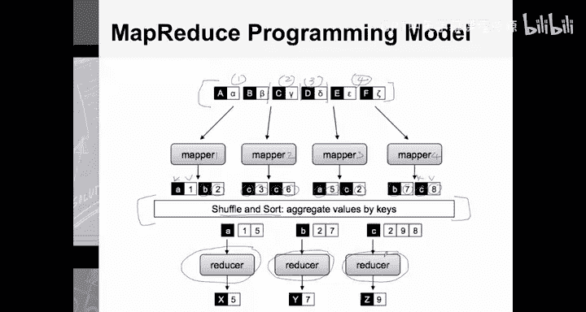
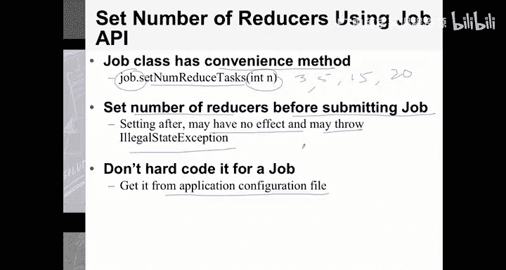
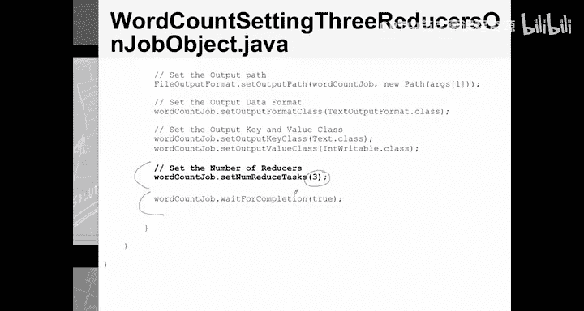
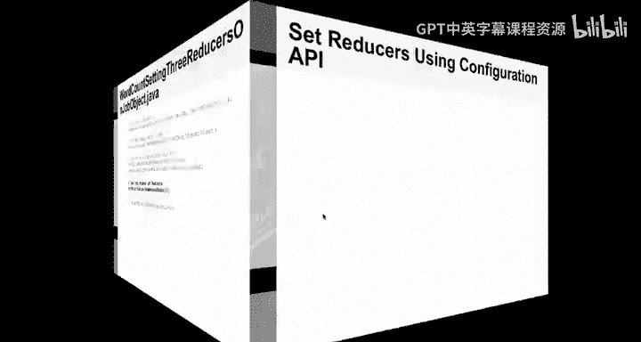
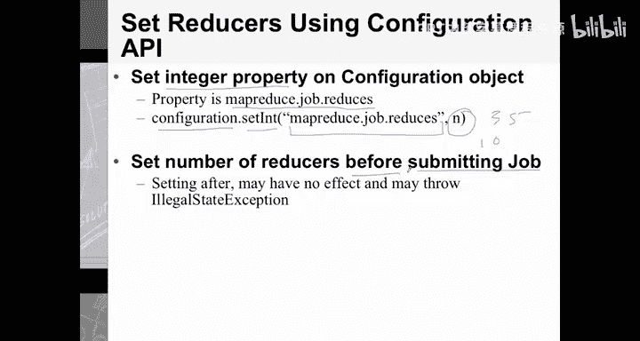
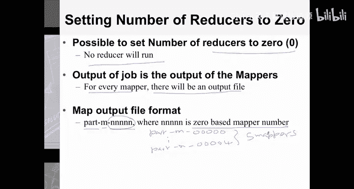
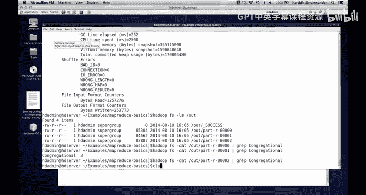
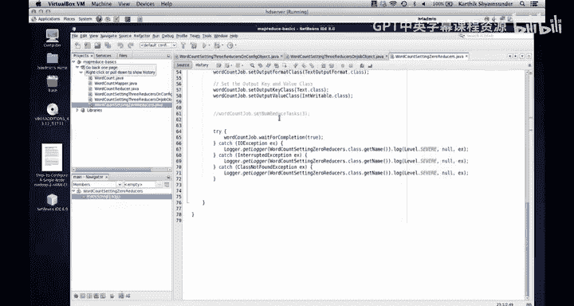
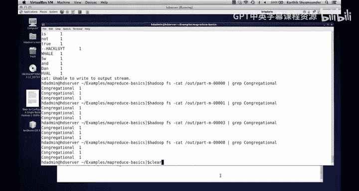

# 约翰霍普金斯大学《Hadoop大数据处理｜Big Data Processing Using Hadoop》中英字幕 - P50：10_Reducer并行机制.zh_en - GPT中英字幕课程资源 - BV1g5u6zBExs

Rduccer parallelism。In this section， we will look at how reducer parallelism is achieved and controlled for a job。

In order to understand reducer parallelism， let's review the Ma reduce programming model。

If you recall in mapreduce programming， there is input。Input is split into input splits。 Let's say。

 in this case， we have。Four input splits，1，2，3， and4 Each input split is processed by a Maper。

 let's say we have Maper 1 Maper2， Mapper 3 and Maper 4 these are the four mappers that may be working within the same machine or across multiple machines that are going to be working on the four input splits and they'll be working on it parallelly but within a Maper of course。

 the data will be processed sequentially let's say Maper one generated as key value pair combinations key A and value 1 and another key S B and value2 Mapper 2 generated key S C value 3 C6。

And then a5 C2 by Maper 3 and Maper4 generated as the Maper output B7 and C8。

 So these are the key value pair combinations that are being generated by each mapper Now each mapper is generating its output separately。

The output of the mapper gets processed by the framework。

 which is what we refer to as the shuffle and sword face。 This is the shuffle and sword face。

You can have one reducer， you can have two reduces， you can have 15 reduces。

 you may even have zero reduces if you want。U to this point。

 we've been seeing a situation where there is only one reducer now we are saying that we can have more than one reducer。

If you have more than one producer， in this case， we have three reduces running parallelly。

 there are a couple of things that the shuffle and sort framework guarantees。

So in terms of the reduce input by the framework。No two reduce will see the same key。

And all the keys presented to a reducer will be in sorted order。

 These are the two things that are being guaranteed by the framework。

 The framework says that if you have two reducers。Both the reducers will see different sets of keys。

 that's what I mean by saying no two reducer will see the same key and all the keys presented to a reducer when a reducer is getting its keys。

 itll get the keys in sorted order。Okay， so let's look at parallel execution。

Let's say we have map taskask1， map taskask2， and map task3， working on different splits。

 this is working on split number one， which is three records， 1，2 and3。

 record 4 and record5 is processed by map taskask2 and record 6 and record 7 processed by map taskask 3。

Each map task is processing the records sequentially， so one， two and  three。

 these are the various sequential processing that's going on inside a single map task process。

Each map task is generating key value pair combinations noticeice is generating K1 v K1 v， K2 v。

 and then again K1 v， So different map tasks are generating different key value pair combinations and you see that different map tasks are generating the same key like this one map taskask one is generating K1 with a value v this map task is also generating K1 with a value v。

We have another K1 with a value v generated from the first map task。

 so different map tasks are generating different keys and values if you recall in the previous slide I said no two reducer will see the same key in this case we have two reducers running we have reducer task1 we have reducer task2。

 you'll see that no two reducer will see the same key。So reducer1 is seeing only key2。K 4。And K5。

 which is K2， K4 and K5 reducer2， seeing K1 and K3。

And you'll also notice that when a reducer gets its keys and values。

 in other words it's actually getting key and a list of values， key and a list of values。

 when a reducer is presented the key and a list of values they are presented in sorted order so it'll first see K2 then it'll see K4 that it'll see K5 for the reducer task1 for reducer task2 you'll see that K1 is presented first and K3 is presented I'm assuming here of course that K1 is less than K2 is lesser than K3 is less than K4 is less than K5 that's the idea。

没。The default number of reducers。By default， a job has one reducer if you recall we never set any reducers in any of our jobs。

 so by default we get one reducer。One reducer produces one output file。

 and we've been seeing that one output file， that one output file has the name part R 00，000。

It is possible for you to set the number of reducers for your job and you can do that by using the job API。

 The job class has a convenience method called set number reduced tasks which takes an integer so using the job object。

 you can set the number of reducers that you want for your job you can set it to any integer value。

 you can set it to 35，15，20， whatever you want if you set it to 20 that means you're going to have 20 reducer tasks running in parallel。

 ensure that when you set the number of reducers， you set it before submitting a job setting it after may have no effect on the job and in fact may throw an legal state exception as the job would have already started so make sure that you set the number of reducers before you submit the job。

Also， don't hard code the number of reduces for a job in your program。

 you may want to get it from some kind of an application configuration file like maybe the properties file。

 some kind of a dot properties file， or even some kind of an XML config file that you may have for your program。

Every reducer produces a part file， so if you have five reduces。

 then it's going to be five different port files， the part file name is part dash or dash n n n andN where nn n andN is a0 based reducer number which means if you have five reduces。

 then the first part file will be part dash or dash00000 and then the last one will be port dash or 00004 those are the5 reducer files that youre going to get in the output。

Here I'm showing you a program called Word count setting three reduces on job object。

 you notice here I'm instantiating a configuration object。

 I'm also getting an instance of my job object and then I do a whole bunch of things on the job object trying to configure my job。

And then eventually I set the number of reducers on my job object to three。

 and then I submit the job and now when the job runs， the job is going to have three reducers。

You can also set the reducers or the number of reducers using the configuration API。

If you recall we have a configuration object in the configuration object。

 you have a set integer property which you can set the property is mapreuc or job do reduces。

 so you can go to your configuration object， and invoke the set inte method passing to it。

 the name of the property which is mapre or job reduces， passing to it as the argument。

 the number of reduces， which is an integer could be three could be5 could be 10， whatever you want。

 whatever the number of reduces you want for your reduce， parallelism。Don't forget。

 you need to set the number of producers before submitting the job。Otherwise。

 you'll get an exception and don't forget that you should not be hard coding if this is a best practice。

Don't hardco the number of reduces。 You may want to get it from some kind of a properties file。

 In fact， a better approach would be to have an Xmlbased configuration file。

 If you recall in the section on Hadoop common， I talked about the configuration object。

 how you can have your own application configuration object how you can go to the configuration class and invoke the add resource method passing to it the Xm file。

 all those things are still true you can use the same approach to set the configuration to set the mappro job reduces property Once again。

 every reducer produces a part file which is part dash R dash N and and N。Now。

 the important thing to remember here is that it doesn't matter which way you set。

The number of reduces， whether you go to the job object and set the number of reduces by invoking the set number reduces method or by going to the configuration object and setting the in property map reduced or job dot reduces。

 in both situations， it works exactly the same way， which is when you submit the job。

 there'll be that many number of reduces that will be launched。

Here in this program I'm showing you the second way。

 which is setting three reducers on the configuration object。

 you notice I have the configuration object created。

 I'm going to the configuration object and setting the in property map reduced or job dot reduces。

 passing to it three， hence setting the number of reducers。And then I configured my job。

And eventually submit the job right here。It's also possible for you to set the number of producers to be zero。

If you set the number of producers to be zero， then you're saying that you don't want any reducer to run。

Well， then the question is， if you don't want any reducer to run。

 then what is going to be the output of the job， Well。

 then the output of the job is really the output of the mappers。If you have five mappers。

 then every one of the mapper output is going to become the output of the job for every mapper。

 there'll be an output file。The map output file format is port dash M dash nN N NN。

 where the Nn NNN is the 0 based mapper number， so if you have five mappers that we' running。

 then you're going to see five of these files starting from part dash M 00000 all the way up to port M 0000445 mappers we already talked about how you can set the number of mappers based upon the input file and the block splits。

The other thing to recall about the map output is that if you think about the map output。

 the map output is a key value pair combination and the key value pair combination is not in sorted fashion because youre producing the map output as it goes through the map input and so the output of the map is not going to be in a sorted fashion because it is not going to go through the sort and shuffle face that only happens when the reducer runs because the shuffle and sort face is really considered to be part of the reducer so you need to make sure you understand that the output of the mapper will have the same key appearing more than once because there is no reducer yet and so there is no shuffle and sort face at this point。

Okay in order for you to understand all the concepts related to the reducers。

 I'm going to show you three scenarios in the first scenario I'm going to show you an example where I set the number of reducers to three using the configuration object then I'm going to show you a scenario where I'm going to set the number of reducers using the job objects set number reduces method and then eventually I'm going to show you a scenario where I set zero reduces and I'll have 10 mappers that are'm going to be running so you will see 10 map output files and zero reducer files so let's go ahead and log into our VM as HD admin user ID and price some of these things out。

Here I am logged into my HD server VM as HD admin， I would like to show you three programs。

 the first one is word count。

Setting three reduces on the config object。In this program。

 I'm showing you how I instantd a configuration object and then and I'm invoking the set method on the configuration object to set the number of producers。

And then I， of course。Instiiate my job object， set all the different parameters for the job object。

 and eventually run the job right here。When the job runs。

 it's going to have three reducers because I set the number of reducers to be three on the configuration object。

So let's go ahead and run that program。Haop。F first。Dash or。Dash bar slash out，3D output。

Now I would like to show you the input， Hadoop Fs dash L S slash in。The input contains one file。

 Mobi dasht dot TH3。 It's 1。2。Mgabytes big。To a human readable version of it less than a block。

 And so it's really one block。 Let's go ahead and run the program。

So the program I want to run is run it on the configuration object， so there it is yarn， jar。

 the jar file。And then this is the class， which is basically setting the reducers on the configuration object。

Run the program。The program runs， in this case， I'm going to have one mapper task。As you can see。

 the total number of splits is one。And it's going to have three reduced tasks。

As soon as the program is done， we can look at the output folder， we should see three。

Rduce the outputs if I do hitbe F Ls slash out。I'll see three reducer outputs， which I did。

If I do Hadoop F catt， slash。Out slash power dash power dash 0，00， which is the first reduces output。

And do a mood on it。You'll notice that all the key value pell combinations are in sorted order。

The same thing will be true for the second output。And then the same thing will be true for the third output for the third reducer。

 oops it should be really two。So let me change the to two。T is。Now if I do a grab。Let me do a grab。

 I'm looking for the word congregational， if I do a grab。Congregational。I don't see in part zero。

So see if I see it in one， yep， I see it one and it's three， that's what we saw last time too。

If I look for it in number two， I should not see it in number two。And the reason for that is。

Hao Premore guarantees that every reducer is going to see key value pair combinations in sorted order。

 and that's why the output is in sorted order because basically my reducer's logic is simply taking the key and the value and printing it out except the value is really the count of all the numbers added up。

And so it's sorted and then the Hadoop framework also guarantees that no two producer will see the same key。

 no two producer will see the same key， and that's the reason why I don't see congregational anywhere else。

Let me go to the job history server。To a reload， here's the program that I ran word count setting three reduces on Config object。

 click on that。And there it is， it's got one mapper and three reduces。

Here are the three reducers that ran0，0，0，0，01，0，02。Okay。

 so now I would like to show you the second program， which is。Work count setting on the job object。

In this case， I'm instantiating a configuration object。 Then I'm instantiating a job object。

 Now I'm going to use a different API。 So after I set the。

Pararameterters for the job object like the input data， the output data， the jar file。

All the different parameters I eventually set the number of reduced tasks。

This is the other approach that we have， and I need to do this before I learn the job。

 this is where I'm running the job。Okay， so let's go ahead and run this program。For that。

 let me go ahead and do a cleanup， I do dash Rm slash out。I deleted the output folder。

 and now I would like to run the。Other program。Which would be setting the reduces on the job object。

On job object。It should be the same program， the in terms of results。

 it's going to be pretty much the same one mapper and three reduces。Maapper is done。

Produccer is done。Let's go back and look at the job history server。To reload。There is。

On the job object setting it up on the job object。Click on the job。There it is。 I have one map task。

And three reduced tasks。Click on the reduced tasks and those are the reduced tasks that ran。Okay。

 go back。Do Hadoop。F， S dash L slash out。I see the three output files， and I can also。

Do the Gr just to make sure let's do that。Grab， congregational。It's not in For zero。It's in part two。

Actually， part one， which is really reduce two。And it's not in three。Okay， you get the idea there。

Now I would like to show you the third one， the last one， this is an interesting one。In this case。

 I'm going to be running word counts， setting zero reducers。

 I'm going to set the number of reducers to zero as you can see。

 I'm going to the configuration object and setting the number of reduces to zero。

And then I run my job。Okay。Studing the number of producers to zero right here。Okay， let's do that。

Sotu F dash or， dash4 to。Out， delete it。 Okay， run the program。 and that would be。Sitting。

Bord count setting。Zero to userss， that's the name of the program。

I could have passed all these things as a parameter too。Okay the program run。

 there's going to be zero reducers in this case， and then the real question is what is the output going to be？

Since there are going to be no reducers in this case， there will be no part R files。

But there will be a part M file。 So if I do Hado。F， S dash L。Slulash out。I see a part M file。

If I do Hadoop。F， S dash cat slash out slash car dash M dash0，0，0。And do a。も onね。

I'll see the entries， but notice in the case of the map， the map output is not sorted。

 it's the shuffle and sort phase that is actually sorting it。As you can see。

 all the entries are just appearing in the order， the mapper sent it out。So if you do in LS again。

 the point I'm making is that there are no reduce files。

 there are only map output in this case there was only one mapper and the output of the map simply has all the output that the mapper sent out。

 it's basically being streamed out into the file。Okay。

 so what I'm going to do is delete the output to something very interesting here。

We'm going to delete the output。She。A do。F， S dash or dash or slashed out。And then in this case。

 I'm going to run on 10 files， so let's go ahead and run the same program。

Except the input is going to be in。Let's go back and look at the folder if I look at the。

HDF S folder。 its there's a folder here called in 10 files one block H。

 This is a folder that contains。10 files。10 files， one block each， so in。10 files。1 block， each。

So in this case， because there are 10 files and they are one block each。

 there's going to be 10 mappers。And when I finished running the program。

 because I'm running zero reduces， I should see 10 outputs。

There it is 10 mappers should be running at this point。

 they're working parallelly Now in this case I'm going to see for the 10 mappers。

 10 output files because there are no reducers， every mapper is going to generate a QV pair combination。

It will not be sorted because the output of the mapper is not sorted。So， Hadoop。F， S dash L。

 slash out。There it is all the port files。Let me go ahead and do a cat on slash out slash part M 000。

And mode it。Mispetting part。There it is。As you can see， it's not shortered。

Now let me do one more thing。 Let me do a grab and congregational。We know that in one input。

 there is three congregational words appearing， right， three times the congregational word appears。

 so if you have 10， it should be 30。Now， let's see what happens here。

 If I do a grip on congregational。And do a more， I'm going to do it on the first one。

We don't have to do more。Let's see。Okay， congregation appeared three times。In this mapper output。

Will it appear in the second one too？Well it appear into the second one， too。

P it at the end of the third one。Yeah， will it appear in the8 one or the  ninth？

As you can see everybody has congregation everybodys having a value of one。

 This is simply the raw mapper output， as you can see。

 and then this is where the shuffle and sort kicks in and combines all the different entries from across all the different mappers and then presents it to the reducer in an insertsorted fashion with a list of all the ones in this case with the list of all the values。

 which will be the list of all the ones。

Let me go to the job history server。And show you this last job that we ran。As you can see。

 10 mappers。And zero reducers。In this section we saw how reduce paradigm is achieved and controlled for the job。

 we learned that by default there is only one reducer per job。

 if we want we can set the number of reducers by one of two different mechanisms。

 one would be by going to the job object and setting the number of reducers and the other one would be by going to the configuration object and setting the number of reducers on the configuration object as a property。

And we also found out that you don't really have to have a reducer。

 if you don't have a reducer by setting the number of reduces to zero。

 then there'll be no reducer that will be running in such a case the Maper output becomes the output in the slash output or the output folder。

