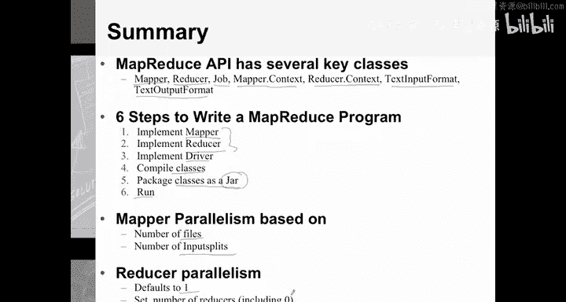

# 约翰霍普金斯大学《Hadoop大数据处理｜Big Data Processing Using Hadoop》中英字幕 - P51：11_MapReduce编程基础总结.zh_en - GPT中英字幕课程资源 - BV1g5u6zBExs

Map Pro Program basics summaryum。In summary， we looked at the MapRduce API and identified several key classes in the MaRuce API。

 including the Maper class and the Redr class， which is the base class from which we extend in order to write our own Maper class and Redr class。

The job class， which is the object that we instantiate in order to configure and submit a job。

The Maper context and the reducer context， which are two objects that are automatically instantiated and pass to the map method and the reduce method for the Maper and the reducer。

 so we get contextual information about the job and the task。

And then the text input format and the text output format class that represents plain input file。

 plain text input file。We also looked at six steps to write a mapre program。

 first we implement the Maper class by extending the Maper class。

 then we implement our own reducer class by extending the reducer class， in both these cases。

 we overwrite the map method and the reduce method。

 and then we implement the driver class where we instantiate the job object and configure the job and submit the job。

 then we compile the classes， the three key classes， and any dependent classes。

 and then we package the classes as a J file， it needs to be packaged as a J file because Hadoop has to distribute it to all the different nodes that are running the different tasks。

 and then eventually we run it using the yarn command。

We also looked at mapper paraism and we found out that the mapper paraism is based upon two factors。

 it's based upon the number of files that we have and the number of input splits。

 it's actually a combination of the two。And then we also looked at reduce powerism。

We learned that the default number of reducers that we have per job is one。

 it is always possible to set the number of reducers to whatever value you want， including zero。

 in which case there will be no reducers run for the program。

