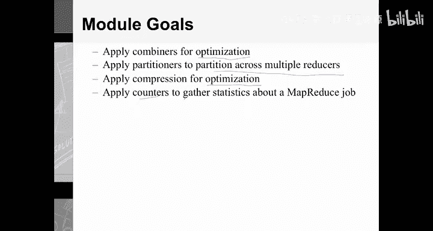
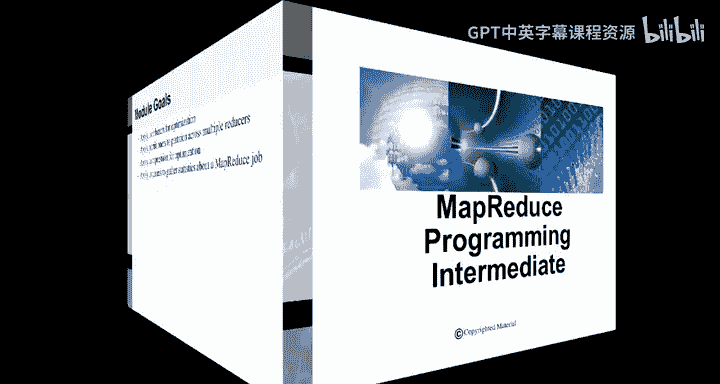

# 约翰霍普金斯大学《Hadoop大数据处理｜Big Data Processing Using Hadoop》中英字幕 - P52：12_MapReduce中级编程导论.zh_en - GPT中英字幕课程资源 - BV1g5u6zBExs

Welcome。MapR programming Inter。In this module， we will get into the nitty gritty details of the Mareuce API。

 such as combiners， partitioners， compression， and counters。So what are the topics in this module？

There are four sections in this module。In the section on Comers。

We will learn the concept behind combiners， how they work and apply combiners as a performance optimization technique。

Then in the section on partitioners， we will learn how we can control the partitioning of map output so we have better control over as to which reducer the map output will be shipped to。

Then we will look at how compression can be applied in map produce。We learned about HDFS compression。

 now we will see how mapre can take advantage of compression。Finally， in the section on counters。

 we will learn about built encounters and how we can develop our own custom counters。

So what are the module goals， learn about combiners and apply combiners for optimization。

 IU optimization and distributed computing optimization？

Learn about partitioners and apply parters to partition across multiple reducers so we can control which reducer our map output can be sent to。

Apply compression， HDFS compression on map produceuce for optimization purposes。And then finally。

 apply the concept of counters so that we can gather statistics about a map reduced job。

