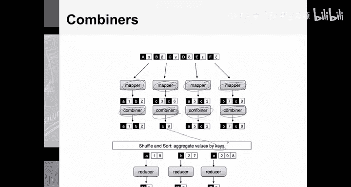
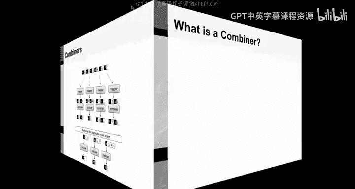
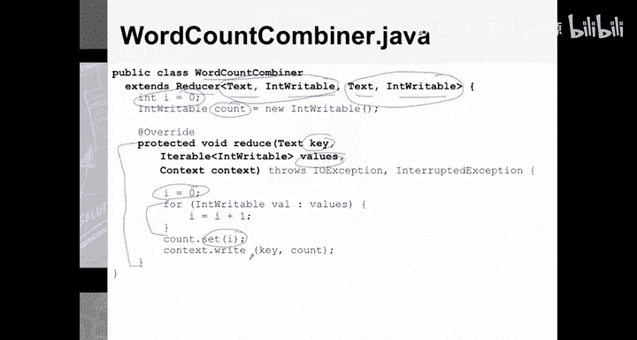
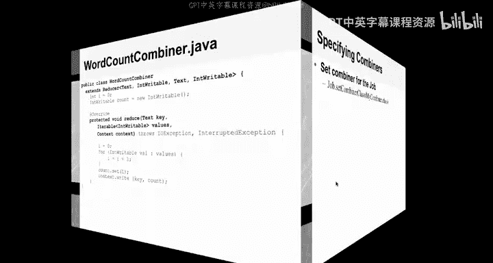
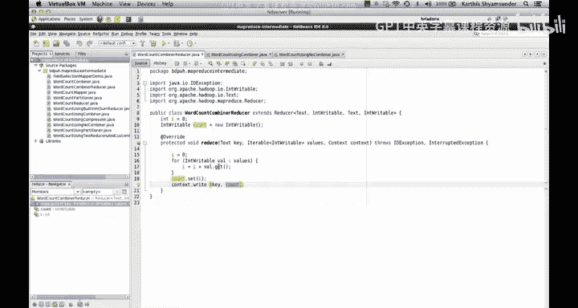
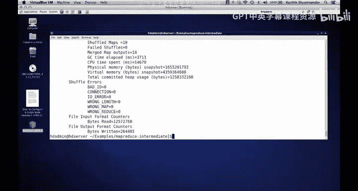

# 约翰霍普金斯大学《Hadoop大数据处理｜Big Data Processing Using Hadoop》中英字幕 - P53：13_组合器应用.zh_en - GPT中英字幕课程资源 - BV1g5u6zBExs

嗯。

Combiners in this section， we will learn about combiners A combiner is a function that is part of map produced framework。

 which kicks in during the map phase。In this section， as part of understanding combiners。

 we will look at how to implement combiners， how to set a combiner for a job。

 and what benefits a combiner provides for a Mareduce job。

Let's look at this mapreduce flow carefully。You've seen this picture before here we have the input。

And the input is split， let's say into four input splits。

 input split 1 input split 2 input split3 and input split 4 We know that each input split is processed by a Maper。

 so we have Mapper one， Mapper2， Mapper3 and Mapper4 each working on each input split。

 so Mapper1 is working on input split 1 Mapper2 is working on input split 2。

 Mapper 3 is working on input split 3 and Mapper 4 is working on input split4。

Each input split may have multiple records coming in into the mapper。

 and then the mapper processes the input records and generates the output key value pair combinations。

 Of course the input is also key value pair combinations let's not worry too much about what is the business logic of the Maper let's say that Mapper1 takes a alpha as input and generates a1 and B2 has key value pair combination records。

So Mapper1 is generating two records， A1 and B2 as key value pair combinations。

 Similarlyly Mapper 2 is working on B beta and C Y as two inputs and is generating C3 and C6。

 so that's your key value pair combinations for Ma2， that's the output。

Mpper3 is generating A5 and C2， Maa 4 is generating B7 and C8。

So as you can see all the mappers are working on its corresponding inputs and generating the corresponding outputs。

 we know that the output of the mapper is going to go to the reducer。

 in our case we have three reducers， reducer1， reducer2 and reducer 3 we know that every key will be designated a reducer。

So let's say that Redr one is going to handle key A， Redr 2 is going to handle keyb。

 and Redr 3 is going to handle keyC during the shuff in sort phase。A1 will be sent to reducer 1。

 so reducer 1 will actually see a1。B2 will be sent to。Rduccer 2， so B2 goes to Redcer 2。

C3 will be sent to Redr 3， so Redr 3 will see C3。C6 will also go to Redr 3， it will C C6。

A5 will go to the use of 1， so it will see a5。C2 will be sent to Redr 3， youll see C2。

B7 will be sent to Redr2， so Redr 2 will see B7。And C8 will go to reducer3。So reducer 3 will see C8。

Now by the time the reducer actually sees the key value pair combinations。

 all the keys are the same type or combined， and so what the reducer really sees is for every key a list of values since we have two A's。

 what the reducer will see is a15， so that's good。In the case of Redr 2， because we have B2 and B7。

 what the reducer 2 will see is B27。Has the list。In the case of Redr 3， we have C3， C6， C2， and C8。

 so technically speaking it's supposed to see C3628。

 but notice what the reducer is actually seeing the reducer is actually seeing C298， we see the two。

 we see the8， but what about the nine？It so happens the C3 and C6 have been combined to be SC9。Well。

 C3 and C6 were actually coming from Maer two。Somehow they got combined to become C9 and that's what was being sent to reducer 3。

 So the question is， how did this happen once again， let me say this。

Note how this reduce 3 is seeing 298 rather than 3628， and that's where the combiners are kicking in。

In this picture， I'm introducing the concept of a combiner and you notice that for every mapper there is a corresponding combiner。

 so for Mapper one， there is Comer one， for Mapper 2， there's Comer 2， for Mapper 3， there's Comer3。

 and for Mapper4， there's Comer4。The output of the mapper is being sent to the combiner。

 the combiner processes and generates the output， and that's the output that goes through the shuffle and sort face。

As you can see， in the case of Ma2 and Comer2。We see C3， C6 got combined to C9。

 and that's what was sent to Redr3， and that's the idea behind a combiner。

So。

What is a combiner formally， a combiner kicks in after the mapper， in fact， for every mapper。

 there is a combiner。It has to be explicitly set when you set a job at that point。

 you have to explicitly set the combineer class。The combiner processes the output from a single mapper where of course each mapper is processing a single split。

 so every split is sent to the mapper， the mapper processes it generates the output and every mapper's output is going to go to a combiner。

The combiner runs on the output of the mapper， of course。

 before the reduce phase a little bit more about it is the fact that the combiner produces the output for the reducer phase rather than the mapper producing the output for the reducer phase Now the combiner is the one that is going to produce the output for the reduce phase。

 which means there's a couple of things that's happening。

 The input to the combiner is going to be the same as the input to the reducer because it can be inserted in between and then the output of the combiner is going to be the same as the output of the mapper We'll see this more when we get into the implementation of a combiner。

Combiners are really great for optimization。It reduces your map output Io。 If you think about it。

 the mappers generally write output， which gets written to the disk so you can go through the shuffle and sort。

 But when a combiner kicks in， the combiner is。Combining a bunch of mapper outputs into one map output。

 so rather than writing the map value map value multiple times， you're writing map。😡。

And then only one value， so since you're combining them you're not writing as many records。

 so it's much better in terms of map output IO， which also reduces the shuffle network IO after the output is written。

 the key value pair combinations have to be sent to the right reducer and that's network IO even the network IO will be reduced because you're not writing as many records out so it's really great for optimization。

I would like to get into the internals of the combiner a little bit more。

Because then you'll understand some of the caveats associated with the combiners。

As a mapper writes the output， it is serialized and placed into an in memory buffer。😡。

It's not that the mappers output is written to the disk and then the combiner is reading from the desk。

 it's actually being placed in memory， so if I may draw a picture over here。We have input split。

 I'm going to call it I1 input split is given to the Maper， I'm going to call it M1。

 the mapper generates the output， which is going to be picked up by the combiner C1。

But it doesn't really get sent to the compiler directly， it gets placed into an in memorydy buffer。

So this is a buffer to which it gets placed。When the buffer fills， when this buffer is filled。

Then the framework sort the buffer and then gives it to the combiner。

If the application had specified a combiner for that map produced job。

 then the combiner kicks in and then the output of the combiner is what is sent out What that means is from time to time the Mapers output is being put into the buffer and the combiner is being run again and again and again for a subset of the map output。

给。The point I'm trying to make is the framework may choose not to run a combiner if it determines that it will be more efficient not to。

 the framework might do that。And also， in spite of a combiner。

 a mapper output may contain the same key multiple times since it's really working on a buffer at a time。

 So let's say that the mapper output。😡，Was put into a buffer and the combiner kicked in and it generated C9。

Well there may be another version of the buffer that was filled up。

 which gets run through the combiner and it may generate C16 as another set of output values。

So the point I'm trying to make is don't think that the combiner is going to make sure that there's only one C。

Will be generated， there can be more than1 C in the case of ABC example that we saw in the previous scenario。

 there can be more than one key of the same type that will be generated out in the output。

 so just beware of that。How to implement a combiner？In order to implement a combiner。

 all you need to do is write a class that extends the reducer class。

 notice there is nothing called the Comer class， it's all a reducer。

And then in the reduce method of the reducer class is where you write the combiner logic。

 so the most important thing to remember is that there is no class called the combiner class。

 the combiner is really a reducer。Okay then the question is。

 what is the key value input and key value output of the combine class that you're going to be writing？

Well， if you think about it。The combiner is something that is being inserted between the mapper and the reducer。

What the reducer sees is。K2 and a list of values。The combiner has got to see the same thing as its input。

 So you notice that the combiner's input is also K to in the list of values。 So input to the。

Combinder is the same thing as the input to the reducer。

As far as the output of the combineer is concerned。

The output of the combiner has got to be the same thing as the output of the mapper。

 so you'll notice that these two types are exactly the same。😡。

So that's the connection between the two so the way you write a combiner in terms of the key value types。

 which is K1， v1 and K2 V2 is that the combiner's input is going to be the same thing as the reducer's input and the combiner's output is going to be the same thing as the maprs output。

Let's go ahead and write a combiner for the word count。

 so in order to write the word count combiner notice that I'm writing a class。

That extends the reduce。And you'll notice that the key value pair combinations that I have is the same thing as the mappers output。

Which is really the output of the combiner and in reducer's input， which is really the。

Input to the combiner。We need to do the reduce method in the reduce method is where we write the business logic。

 So the reduce method now for the combiner is really the same thing as what we have been doing in the reduction for a word con problem。

 which is really adding all the。All the ones so so if you look at this example in the previous method。

 we are getting the key and we're getting a list of values and really what I'm doing is declaring a variable called I。

Which I'm declaring as an instance variable， initializing it to0。 And I'm going through and adding。

All the ones that are there， and then eventually creating another variable called count。

 which is an instance variable setting its value to be this count that I've calculated。

 which is the running count。And then writing into the output， one final key and account。😡。

The way you set a combiner for the job is pretty straightforward。

 all you need to do is go to the job object called the set Combiner class method and pass the Comer class。

 which is the class that you wrote。Let's look at the combiner in action， the complete picture。

 here I have my configuration object instantiated。And then I have my job object。😡，Right here。

 word count using combiner， I specify my input path， I specify my input data format。

 and then I specify my mapper， my reduce， but the most important thing now is that I'm also specifying my combiner。

 which is the class that I wrote in the previous slide， which is the word count combiner。

So the output of the mapper is going to be picked up by the combiner now。

And that's all you need to do， so the combiner will be in action now。

You can surely write your own combiner， but many times it's possible to have your reducer to be your combiner It's only possible if the reduce function that you have for your Mare job is both commutative and associative if you recall addition is commutative and associative and if you recall what we're doing in word count is really addition counting and so we might be able to use the reducer for the word count problem to be a combiner to get a little bit more about the associative and commutative if you recall from your pre-algebraase。

Associative is when you can say x plus y plus z is the same thing as x plus y plus z that's associative。

 It doesn't matter in which order you add these things in the same way it's commutative when x plus y is the same thing as y plus X and because we have this property for addition and because for the word con problem all we are doing is addition we might be able to use a reducer to be a combiner。

 please note that if you're going to be calculating average then this is not going to work so you have to think about this。

 you have to see when a reducer can be used as a combiner。

But the reducer that we have ordered up to this point is not a good reducer。

Let's look a little bit more into this。😡，If you look at the current reducer。

 the way the current reduce has been written is it's a reducer that extends the reducer class。

 it has a variable called I， which is where the count is going to be done。

 and then there's also an inriable count object which is what we need to use to write out the key value pair output for the reducer。

Now this i variable gets initialized to zero and we simply go through the for loop and I keep on counting a list of all the values that's there。

 so I'm really taking the number of values that are that notice the values that's coming in is really a list of values which is an iterable and all I'm doing is iterating through the list and adding one to my counter which is I figuring out as to how many。

Values came in。 And then that's what I assume to be the count。 Now。

 this is not a good implementation in the case of the combiner being used for our map reduced job。

 because by that before in the previous examples， we used to get a 1， a1。

 a1 multiple times and we could simply go through a with a list of ones that we are getting in and then figure out how many ones we had and get the count。

 But now we are going to end up getting something like a 3， A 6， A2 or C4 and C6。

 because things are being combined in the combine phase。

 which means we cannot simply add one to our variable。 Think about this。 the right way to do this。

Would be to actually get the values itself so notice in this example the way I'm writing the reducer now this is a much better reducer。

 I'm initializing this variable I to0 and then rather than simply adding one to it。

 I'm actually iterating through the values and I'm getting the value and adding the value in so that I can actually get the count done by looking at the values now this is a much better implementation。

Now that I have this word count combiner implementation。

 I can use this word count combiner reducer as both a combiner and a reducer。

So now let's look at combiners in action， I would like to do two demos。

 first a demo with combiners and a demo with no combiners。

 and then we will see how combiners can increase efficiency。

So let's go ahead and log into our VM。Here I am logged into my HD server VM as HD admin Use ID。

I have three classes that I would like to show you。First is word count combiner reducer。

The word count combine reducer is the modified reducer that can be used as a combiner also。

Youll notice that there are two instance variables， one is called I。

 which is where the count is going to be accumulated， and then there's a variable called count。

 which is an inritable that will be used to write out into the map output。

But in this particular case， the combine output or the reducer output。Here's the reducer method。

Gets the key and the list of values。In my reduced method。

 I go through the for loop iterating through all the values。

 accumulating it into this variable called I by the time I'm done I have a complete count of all the values。

And then I set the value I to the count object。And then eventually I write out the key and the count object。

So that's my WorkG combine reduce class that can be used both as a reduce and as a combiner。

 as you can see， it's adding all the values getting account and writing it out。

Here's a class card。Word count using Comr， this is the class that contains the main method。

Notice when I instantiate the job object， I'm giving the job a description of Word count using Comr。

 so when we go to the job history server we can identify this instance。Or this job instance。Right。

 so I instantd the job object right here on this line。

And then let's follow through setting my input path。And then setting the input data format。

Then I'm setting the Maper class， the reducer class。

 and most importantly now I'm setting the combine class。

 which is the word count combiner reducer class that we just ordered。And then I set my jar file。

 the output path， the normal stuff that I do， eventually I submit the job and wait for completion。

So this is my program。Word count using Com。And then I have another one。

 which is called Word count using no Comr， as you can see， I have a job object。

It's going to be doing the word count using no combiner and will prove to you that I'm not having a combiner。

As you can see， work on job selling the Maper。Setting the reducer。

 but setting the combiner is commented out so there's no combiner What I would like to do is run both the examples I'm going to run word count using combiner。

Example and I'm also going to run Word count using no combiner example， generate the output。

 and then we'll look at the job history server and see the difference in their performance and we will primarily look at the number of records that were taken in by the producer we have one reducer in this example for each run。

And we will see that the number of records that the reducer took in is much lesser in the case of the example where we had the combiner run。

Okay， here I'm my terminal。 I would like to run the。Haoop Mareduce program with the Comr。

Here is the program yarn J mapreuce intermediate do jar， that's the jar file that I'm including。

 here's the class that contains the main method， which is the word comp using combiner class。

And then this is the input directory， which is in 10 files， one block each， so there are 10 files。

 they are all one block each， these are your Mobitic files， 10 copies of it。

There is also the out directory which is slash out slash with Comr let's go ahead run this program which is going to work on 10 input files。

 10 copies of Mobyde in the input directory generate the word count in the out with combiner directory and when it runs it it's going to be running it with a combiner because there are 10 input files that are going to be 10 mappers and so there are going to be 10 combiners thatll be launching in let's go ahead and run that。

There are 10 input files， so there are 10 splits， so there are going to be 10 mappers。

The mapper is kicking in once the mapper is done。It's going to go through the combiner phase。

 of course each one of them is going to go through the combiner Comr is really not a phase。

 It's just an aspect of the mapper， it's just a functionality that is been appended into the mapper。

10 mappers， each having its own combiner and the combiners are being。Called upon for each case。

And then the output is written out into the disk， which is considered to be the map output。

 which will be read by the。I do framework。which will do the shuffle and sort and eventually will be passed to the right producer in this case we only have one producer。

 so we run the program， I would like to run the same program。Except this time， without the combiner。

So let me go back and change it to using no combiner。

 as you can see I'm using no combiner as the class。

 so there'll be no combiners and it's going to go work on the same directory input file。

Which is in1 files one black。Each。Basically a directory that contains 10 Mobiic files。

 which are one block each and the output is going to go to slash out with no combiner Okay run that。

 So the most important thing is same input。Different output directory， more importantly。

 no combiners。 So 10 input files。10 mappers， no combiners are going to kick in。

 The mappers output goes into the shuffle sort framework， which then sends to the reducer。

The reducer will see all the records。The most important thing now。

 once the two programs are run is to go to the job industry server and see what the difference between the two runs are。

So let's wait for the output of this program， okay， the program is done。

Let's go ahead and let's look at the history server。So this is the job history server。

 Let me do a refresh。As you can see now。That there are two programs that are being run。

 Word count using Com and Word count using no combine。

 this is the word count without losing the combiner。So。Let's go in， click on that。As you can see。

 there are 10 mappers and one reduce， that's the statistics there。

Every job has something called counters， which we'll talk about in the future section。

 counters has information about the Mareduce job and different counters indicating what was happening in the Mareduce program they are like statistics information about the mapRduce job。

 click on the counters。This is the job with no combiner and if you look at the counter you'll see that the reduce input records。

 which is this line right here， reduce input records。

 the reducer saw 2151190 records that's what the reducer saw because the maps output was sent to the shuffle and swordface which sent it to the appropriate reducer which in this case is only one。

Okay， so 2 million records was seen by the reducer。

Now what I would like to do is go to the job where I do have a combiner that would be this job right here。

 click on it， again working on 10 input files， so 10 maps。It also has its counter。

 click on the counter， and if you look a little bit carefully in the counter。

You will see that the reduced input records in this case is only 226，000。Not 2 million， only 226。

000 there is a 90% reduction in this case， the number of records that a reduce is seeing as input。

This is because the combiner kicked in and combined a whole bunch of ans and the or's and the ins and the adds。

 the common words， and even some of the other words like beautiful and having where there may have been multiple occurrences of those words and combines them and then sends it to the shuffle and swordface。

 you've actually reduced the number of records that you're sending out。

Which also reduces the bandwidth， and so this is clearly much more efficient。

In this section we learned that a combiner is a function that is part of mapreduce framework which kicks in during the map phase Comers work on the output of the mapper。

 in fact when the mapper generates the output it actually puts it into a buffer and then from time to time combiners are called on the buffer combiners are a great way to improve disk IO and network efficiency Finally we learned that a reducer can be used as a combiner。

 provided the functionality is associative and commutative and because addition is commutative and associative。

 we would able to use the reducer as a combiner for the word count program。

