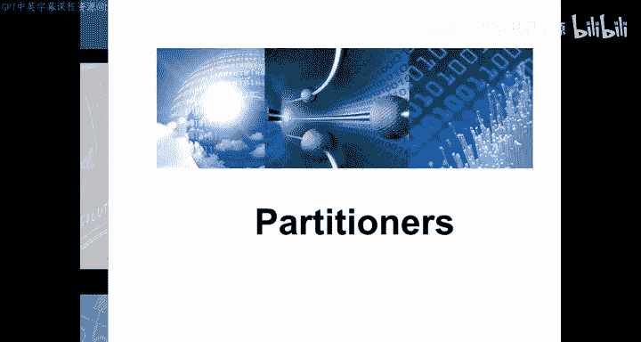
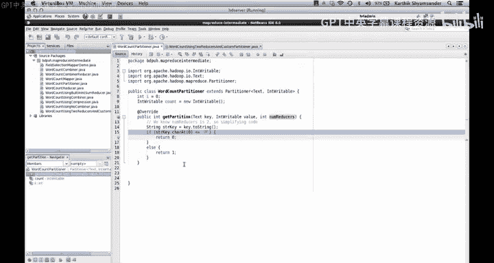
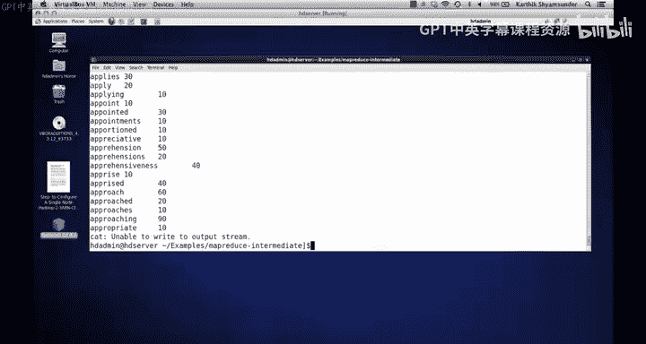
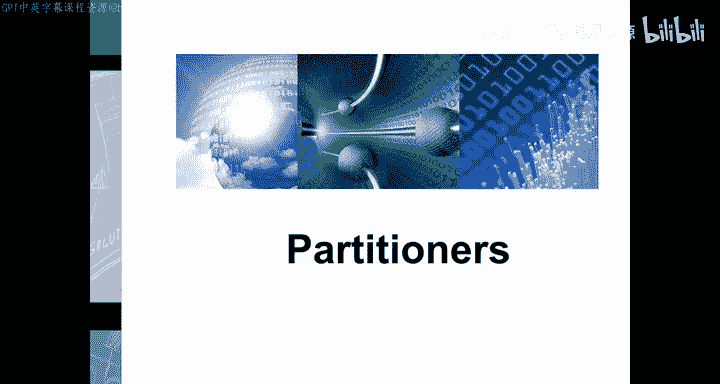

# 约翰霍普金斯大学《Hadoop大数据处理｜Big Data Processing Using Hadoop》中英字幕 - P54：14_分区器实现原理.zh_en - GPT中英字幕课程资源 - BV1g5u6zBExs

So。

Ptitioners parttitioners simply help determine which reducer a map output should go to。

In this section， we will learn about partitioners， the concept of default partitioner and how to write a custom partitioner and set the custom partitioner for a job。

Let's review the Mareduce flow that we have learned up to this point and see how partitioners kick in。

Here we have our input。We know that input is broken into splits。

 so let's say that we have four splits， input split one， input split two。

 input with three and input split four。Each input split is managed by a mapper。

 so there's a mapper associated with each one of them， so there's Maper  one， Mapper2。

 Mapper 3 and Maper4。Each working on each one of the input splits。

The mappers take the input split data， process them。

 and generate the output which if there is a combiner associated with the job will be given to the combiner and then the combiner will generate its output as you can see for each mapper there's a combiner for each mapper again there's a combiner here for each another map mapper。

 there's a combiner and for each mapper there's a combiner and that chain is going through。Finally。

 whether the mapper generates the output or the compiler generates the output， the output of the map。

 this entire thing is really the map phase， and so the output of the map has to be sent through the shuffle and sword phase so it can get to the appropriate reduce。

You may have noted that。How every Red gets unique keys。😡，In this case， we have three reduces。

 reducer one。Two and three， I'm actually going to name them as reducer zero。

 reducer1 and reducer two， and this is for a specific reason。

We learned that the shuffle and sword framework will simply send the key value pair combinations to the appropriate reducer because each key will be handled by a specific reducer。

 all the A's will have to go to the same reducer， all the Bs will have to go to the same reducer。

 all the Cs will have to go to the same reducer so each mapper has to independently determine which reducer it needs to go to as you can see a1 is sent to reducer zero。

B2 is sent to reducer 1， C 9 is sent to Redr 2。I'm using the numbers that are over here。

 I'm going to start using zero base reduce numbers now。Same way C9 is going to go to the dieel 2。

A5 to reducer 0， C2 to reducer 2， B7 to reducer1 and C8 to reducer2。So the question is。

How are these different mappers？Independently determining as to which reducer they need to send the key value pair outputs to。

And that's where the petitioners kick in。So each input split。We know gets handled by a mapper。

 whose output gets handled by a combiner， whose output before running through the shuffle and sword phase is actually going to go through what is called the partitioner。

 so every mapper output。If there is no combiner or every combiner output。

 if there is a combiner will go through the parter phase to determine which one of the reducers。

The shuffle in salt we will have to send the key value pair combination to。So what is the parter？

A parter runs on map output。I said map output， but it's also a combiner output if it was executed。

 don't forget a combiner may not get executed， even if it is set。

Sometimes it may not be set at all anyway， so it runs on the map output or the compiler output before the reduced phase。

The petitioner determines which reducer number to send a map output key variable pair combination to。

If you recall after the map comes the combiner， after the combiner comes the partitioner。

 and then the reducer kicks in， and so the parter takes as input a K2 v2。

But why is it taking a K2 V2 type that's because a parter has to kick in in the output of the mapper or in the output of the combiner and notice that the Maper output and the combiner output are all the same types。

 which is K2 V2 types， so it takes a K2 V2 type and it also takes the number of reduces。

 which is the total number of reduces set for the job。

 and finally it produces an integer value which is the reducer number。So if you had five reduces。

 it would produce an integer value that's between 0 and4，0，1，2，3。

 or4 would be the five values that it will produce if the number of reduces。

 if the total number of reduces was actually a5。And finally。

 don't forget that the parter is applied on each map output or combiner output so that it can determine to which reducer to send the key value pair。

A few things about the parter implementation， the partition implementation directs the key value pairs to the proper reducer task。

And a partition is processed by a reduced task。 So if you have five。Porditions。

Then you must to have five reduced tasks。TheNumb of partitions equals the number of reduced tasks。

Now， you may be wondering。We haven't had a parter yet， so how is it really working right now Well。

 that's because there is something called the default partitioner。

The default parter has a default strategy of using the hash key。

Of the key or the hash code of the key to determine which partition it needs to go to。

So what I'm showing you here is the class called hash partitioner。

 which takes a key value pair combination， you'll notice that the hash partitioner has a method called get partition that takes a key and a value and the number of reduced tasks。

 which is the total number of reduced tasks set for the job and what it will return back is an integer which is the reducer number a value between0 and n minus1。

 where n is the number of reduced tasks that is set。

And if you look at the default partition implementation。

 you'll see that what it's doing is that it's taking the key。callling the hash code method。

 the hash code method returns to you an integer hash code for that particular data and ends it which is the bitwise and with integer do max value because the hash code is an integer it is going to end it with the max value which will make sure that this value that you get after ending is a positive value once it gets a positive value it is random the modulus operator which is the remainder operator passing to it the number of reduced tasks so that we can figure out which partition or the reducer number it needs to go to so the idea here is that let's say the key do hash code was 17 and the number of reduced tasks was5 so 17 mod5 is going to be2 and so itll end up going to reducer number two。

Assuming that reducers start from zero， remember we can have reducer zero all the way up to reducer four when you have five total number of reduces。

So that's the idea behind the default partitioner and how it works behind the scene。If you want。

 you can have your own custom partitioner and the idea is to have mood reduces and partition based upon whatever the business need may be。

 and I'm going to show you an example for custom partitioner in a few more slides。

But let's look at the implementation of a custom parter。In order to implement a custom partitioner。

 all you need to do is write a class that extends the partitioner class。

Override the get partition method， the get partition method takes a key and the value and the number of producers and returns an integer。

The logic here should be whatever business logic you want to produce， you can take the key。

 you can take the value， you can take the number of producers and come up with your own concoction of what the process should be and generate the reducer number。

What I would like to show you is a word count petitioner that I have ordered for the word count example。

What I've done over here is written a wordCon partitioner class that extends the parter。

 overrote the get partition method， and let's see what I'm doing here， I take the key。

 I take the value， take the number of producers。And in this example。

 what I'm going to do is I'm going to set the number of users to two， I know that。

But it is also being passed to me as an argument。Now what I would like to do is take the key。

 convert it into a string so that I can invoke the carrot method on it。

 so basically what I'm doing is taking the key， which is really a word in the case of word count。

And I'm checking to see if the first letter is lesser than or equal to M。

 if the first letter is lesser than or equal to M， then I'm going to return as0。

 which means it's going to be reducer number zero， otherwise I'm going to return reducer。Number one。

So if the key is lesser than or equal to M， then it's going to go to reducer zero。

 otherwise it's going to go to reducer1 since I know that there are going to be two reducers。Okay。

 specifying parters， the way you specify a parter is by going to the job object and calling the set partition class method。

 passing to the partition class。Here's a program that uses the partitioner。

 I instantiate the configuration object， I have a job object， I do my normal setup。

 the most important method I want to show you is the set partitioner class。

 I'm setting the partitioner class to the parter class that I wrote。And then I submit the job。

Notice before I submit the job， I'm setting the number of reducers。To two。

 so we have two reducers and the parter that's going to partition on the letter M。

So let's go ahead and log into our VM HD server as HD admin user ID。And see petitioners in action。

Here Im logged into my VM。I have a parter author over here， here's the word con partitioner。

 notice that extends the partitioner class。I have the get partition method。

 the get partition method gets a key。A value and the number of producers。

And what I'm doing here is taking the key， converting it into a string。

And then looking at the first character。If the first character is lesser than or equal to M。

 then I'm going to return to zero， otherwise I'm going to return one。

I'm returning zero or one as a hard coded value because I know that there are two reduces I'm just simplifying the code for now。

 ideally you may not know the number of reduces in which case you have to do some more complicated business logic over here。

 but I'm trying to show you how to use a reducer right now so I'm trying to keep it simple let's go ahead and look at the word count using two reduces class。

 which is the class that contains the main method This is the driver。

I have my configuration object。I have my job object。

And the most important thing that I want to show you here is how I am setting my partitioner that I am。

I'm setting my petitioner。Right here， which is the word count parter。

 and then I'm also setting the number of reduced tasks to be2。

 So this is the program word count using two reducers and a custom partitioner。

Let's go ahead and run this program。The way I'm going to run this program。Is by。

callling Yn jar disk Mareduce Intermedia。 jarr， BP Mareduce Intermediate Word count using two reducers and custom partitioner。

 passing to it a directlyy that contains 10 input files， which is 10 copies of Mobi deckck。

And the output goes into the art directory。Let me go ahead and run this。There are 10 input files。

 so there'll be 10 mappers， and so there'll be 10 combiners if there are any combiners set。

And then the mapper output will be generated。Which will run through the partitioners。

 We know we set a parter in this case。And then it'll partition across two reducers。

 We know we set two reducers in our code2， So I expect to see actually two part files。

 two reducer part files in the output directory， and I'm hoping that the first reducer part file will have all the words that's lesser than or equal to M and the second reducer output file will have everything that's。

And or about。Okay， the program is done， and we do Hadoop Fs Ls slash out。

 I hope to see two reduce our output。Here are the two outputs， part r 0000 and r 0001。

 this is reducer 0， this is reducer number one。Okay， Hadoop， FS dash。Cat。Slash out， slash part。

 dash or dash 0，0，0，0。I doは more on it。What you'll see is any record that is lesser than M uppercase M。

So any word that's lesser than M。 So as you can see in numbers， digits。

 these digits are all lesser than M in the ASI order list。You are seeing the uppercase As。

 uppercase Bs， uppercase Cs。And if I just keep going。You will see all the Ms and we are done。

 So we see in port0 everything that's m or below。If I change this to reducer1。Yes。

You will notice that it starts with n and continues on。And then it is going to go through Z。

And then it is going to go into lowercase A's and B's。

 that's because the lowercase A's and B's are actually greater than uppercase letters。

 that's the reason why you're seeing this so you get the idea here we have two partitioners。

 one partitioner is handling everything lesser than M and the other partitioner is handling everything greater than M which is n or about。

In this section， we learned about partitioners， we learned that partitioners help determine which reducer a map output should go to。

We also learned that by default， there is a partitioner called the hash partitioner。

 which partitions based on the hash code of the key modulus the number of reducers。

We also learned that if the default partitioner does not suffice。

 we can author our own custom partitioner by extending the partitioner class and overriding the get partition method and executing whatever business logic we want。

So that we can send different pieces of data to different reducers。

