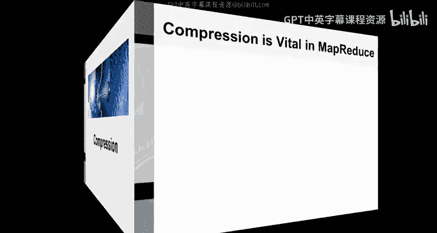
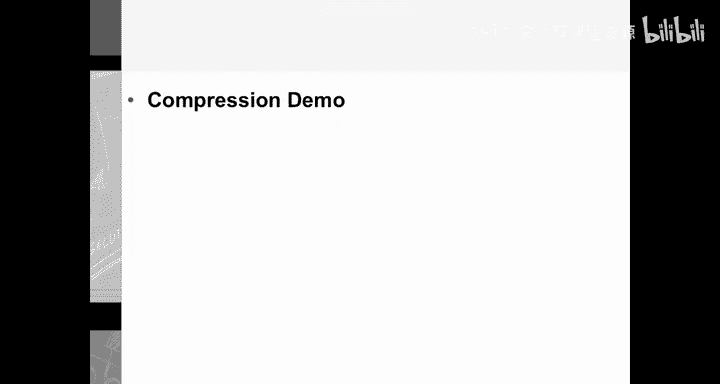
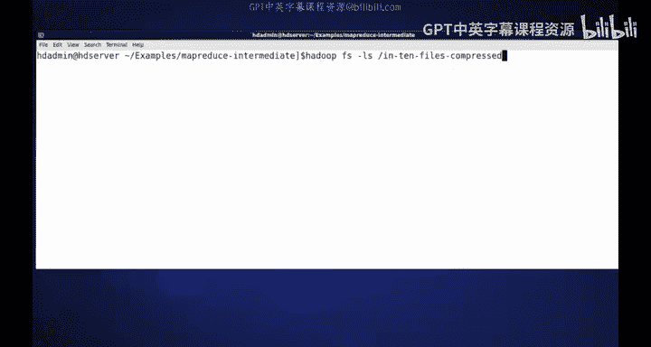
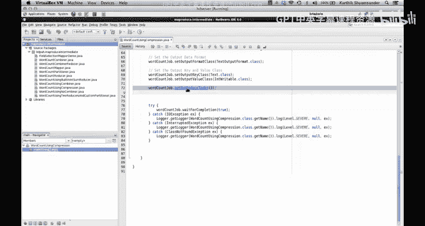
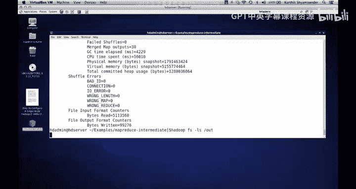
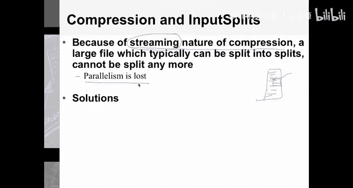
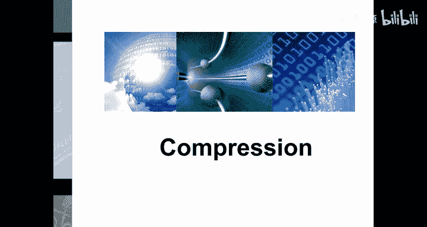

# 约翰霍普金斯大学《Hadoop大数据处理｜Big Data Processing Using Hadoop》中英字幕 - P55：15_压缩技术集成.zh_en - GPT中英字幕课程资源 - BV1g5u6zBExs

Compression in this section。We will look at how we can apply compression to mapreduce jobs。

If you recall， we discussed compression as part of Hadoop Common and Hadoop HDFS。

Now we will see how map reduced compression builds upon Hadoop common and HDFS compression in order to achieve performance。

Compression is vital in Mareduce Mareduce is meant to work on large amounts of data。

 and so compression is vital。Mapreuce compression is built on core Hadoop。

 which means it's built upon the core common module for compression and also the Hadoop HDFS module that supports file compression。

MaapRduce compression comes into play in Hadoop in three cases first its job input compression a mapre job that you may have may have input files that can be compressed files job output compression when a mapreduce job runs the output of the mapreduce job which are usually the part R 000 and 0001 files those output files can also be compressed。

Intermediate Maper and reduce compression When the Ma or reduce job runs。

 the mappers generate output which go into these intermediate temporary files that get processed by the shuffle and sort phase。

 those files can also be compressed， which can improve performance。

Let's talk about job input compression。The job input compression is managed by a property called Io。

compress。 codex。By default， this property is defined in code ort XmL and by default。

 its value is a comma separated list of all the codex that are supported by Hadoop。

 So if you look at the default value property， you'll see that it affords what is called the default codeak。

 which is a kind of codeak supports the G zip codeak， the B zipip 2 codedak。

And the snappy Koak so by default the job input compression can handle any one of these four different formats The point I'm trying to make is input compression as long as the input files are any one of these four different formats。

 then input compression kicks in automatically。The only time you need to modify the Io。

 compressionpress。 codeex property。Is if you decide to use a different compression such as the LG compression。

 which is not supported by Hadoop by default， then you love to bring in the jar files for LG compression and then take the codeak class and add the codex class into this comma separated list of property values for the IO compressionpress。

 codeak in order to support this new compression。If you want to set job output compression。

 then you can do this in one of two ways。First way is by using the configuration properties in the configuration object for a job。

 you can set a boolean property called mapreduce。 output file output format do compress it's a boolean property you set that value to true if you do that then you're saying that you want your job output to be compressed you also need to set another property。

 do set strings， the property is mapproduce。 output do file output format compress Koak which is really a method that takes a string codeak class which is the codeak class that is going to do the compression and decompression for the job output so that's one way by which you can set the job output compression。

The other way by which you can do that is by going to the output format class and invoking a couple of methods on it。

 the first method is set compressed output passing to it。

 the job object and the Boolean compressed if you set the Boolean compressed to be true and you pass the job object and you invoke the set compressed output method which is a static method on the output format class。

 then you're saying that you want your output for the job to be compressed but then how should it be compressed。

 what should be the compressor introduced， but that depends upon another method that you can call upon on the output format class。

 which is called set output compressor class， you can pass to it again。

 the job object and the codeak or the compression codeak class once again this is a static method on the output format class and now once you call these two methods then your output will be compressed and it'll be compressed using the compressor codeta class that you passed as an argument。

So that's how you enable job output compression。Comppression can be used internally by the mappers and reducers also。

If you recall， the map output is sent to files and those files are processed by the shuffle and surface before it gets sent to the reducer。

 it is possible for you to apply compression on the map output files。

If you apply compression on the map output files， which are those intermediate files。

 then it can save network and transfer time。The way you can set the mapper output compression is by going to the configuration object and setting the Boolean property。

 mapproduce。com。m。 output and set that value to true so you're saying your map output should be compressed you can also set the compression codeak by going into the configuration object and setting the string property mapproduce do map。

 outputput。compress codeak passing to it， the string representation of the fully qualified compression codeta class and that compression codeta class would be used to compress the intermediate files and decompress the intermediate files。

Here's a program called word counter using compression in this example I'm going to show you how to do job input compression。

 job output compression， and also the intermediate Maper reduce compression。

If you recall there is really not much you need to do for job input compression because by default job input compression is turned on if your input file is compressed then automatically it'll use the appropriate codeak to decompress the input file and process it。

 but if you decide to ever explicitly set job input compression。

 all you need to do is go to the configuration object and invoke the set strings method passing to it Io。

 compression。 codeex， passing to it， the codeex class that you want to use for input compression。

 you don't really have to do it because the GSU codeak is automatically built in the only time you really need to do this is if you're using something like LG codeak which is not part of the Hadoop framework so in that case you would bring in the LG codeak jar files and then you can basically pass as an argument in this case the LG codeak class。

The job output compression can be achieved in one of two ways as I mentioned to you earlier。

 one would be by going to the configuration object。

 the other one would be by going to the output format。

 here I'm going to the configuration object and working on it the configuration object was instantiated before so I'm going to the configuration object and setting the Boolean property mapreduce。

 output。com， setting it to true， saying that I want my mapreduce frameworks output for this particular job to be compressed and you also set the second property。

 which is mapred output。 compression。 codeak， which is the compression that should be used。

 and so this is saying that since the output compression codeak is GZ codeak。

 the output file that will be generated will be a dot GZ file。

You can also set the intermediate mapper and reduce compression by setting the Boolean property mapproduce。

com。m。 output， setting that to be true， indicates that you want the Maper output to be compressed and the compression codeak that you want to use is set by the property mapreduce。

m。 output。 compression。 Koak and you can pass the name of the class， which is the codeak。

 which is the kind of compression that you want to use。

 so all the intermediate files will be using dotgz as the compression format。

It depends as to which compression format you want， as we discussed in the section on compression。

There is a spacetime trade off between different compression algorithms。

 and you may want to choose one over the other。So let's go ahead。

 log into our HD server VM and do a demo on compression here I am logged into my HD server VM。

I have a class here called word count using compression if you notice I'm inating a configuration object。

And then as far as job input compression is concerned。

I can if I wanted to go to the configuration object and set the property set strings io。compression。

corex to be Gev codeak， but I'm not really doing it， I've commented it out because I know by default。

 Io。compression。 codeex already includes this Gsev codeak file which will kick into place。

 and so I really don't have to do anything for job input compression。

As far as job output compression is concerned for job output compression。

 we have a couple of properties that we need to set one is。mapreduced。 outputput。

fi output format do compress setting it to true on the configuration object saying that I want my mapred output to be compressed and then I'm also indicating what kind of compression we want to use we want to use the G codeak。

 which means we're going to be generating dot GZ files as the reducer output files and then I'm also compressing the intermediate files。

 the intermediate files are going to be compressed because I'm setting the configuration property mapreduced or compressed map。

 output to be true and I'm saying that I wanted to use the Gep codec also you don't really have to use the Gep codeak for all three of them you can use different codex for different aspects of your application。

But in this case， for simplicity reason， I'm using the Gsep codedak。

Let's go ahead and try to run this program before I run the program。

 I wanted to show you my input folder， my input folder is slash in 10 files compressed。

Which is a folder that contains 10 Mobid files， and notice they are all compressed files。

I want to run my Mareduce job， here's the Mareduce job， Word count using compression。

 it's going to read the input directory slash in1 files compressed which contains 10 compressed files。

 decompress them， process them and generate the output， the output is also going to be compressed。

 and also any of the intermediate files that it is going to generate。

 they are also going to be compressed。I just wanted to quickly show you one more thing in my Maerdes program。

 I've said the number of reducer tasks to be three。

 which means there are going to be three output files that be generated。

 which are the three reducer part files that will be generated so we should see all the three files compressed when you run the program。

So let's go ahead and run the program。Here we are running the program， 10 input files。

Which are compressed files， which means 10 input splits。So all the 10 input。

 let's take 10 different mappers。They're being decompressed automatically。

 which is the job input compression， which is default。And there's a default codeak。

 which is the GZ codeak that knows how to decompress it。 So the decompression is taking place。

 and then it'll get processed and then。The intermediate files will be generated。

 which is the map output file will also be compressed。And then' will be sent across the network。

 and then itll be decompressed before the reducer picks it up， and then it'll be processed。

 and then when the reducer produces the output， all the reducer output files should also be compressed。

 which are the three output files。Here's the map phase that's done。Right。

 the reduce phase is also done。 Now if I do do Fs dash Ls slash out。

You will notice that the output part files are compressed， so the input file was compressed。

 the output file has been compressed， all the intermediate files will also be compressed now。

You don't really see the intermediate files， but it's important to note that the intermediate files that were generated where generated as compressed fashion and so if you actually go back and look at the job history server and look at the counters in the job history server on the number of bytes written out and the number of bytes read from。

 you notice it would make a dramatic difference when you turn compression on because the number of bytes written out and read from would have been much less for the map output and the reduceive input。

 so this is where you need to think about the spacetime tradeoff。

 if you have compression of course it's great for network transmit but also there is the CPU time it takes and the CPU processing power it takes in order to compress and decompressed files。

 especially if you're going to be running the same map reduced program several times a day。

 sometimes it may not be worth compressing， so it's a call that you'll have to make depending upon what is it that you're trying to。

Cve in your application。Let's talk about compression and input splits。

Because of streaming nature of compression， when I say streaming nature of compression。

 when you have a file compressed。Then you really cannot read the file in the middle and then try to make sense of it。

 The reason for that is when you compress a file， it's compressed as a stream and so when it's compress as a stream it has to be read in a decompressed fashion through the stream so when you're doing map produceuce programming。

 if you have a really large file， let's say you have you know a one gigabyte file and you have a 256 mebyte block size。

 which means it should be broken down into four blockss now youll get into a situation where because you're using compression。

 you not be able to split the file and if you cannot split the file then you're going to lose parallelism so the point I'm trying to make is if you have compressed input files。

 the compressed input files typically cannot be split and so you lose parallelism when you're doing compression。

If you want parallelism， in other words， if you want the files to be splitable。

 then there are a couple of options that you have。 The first option that you have is the block compressed sequence files if you recall we talked about sequence files and if you recall we talked about something called block compressed sequence files where what you do is you write a block and you compress press just that block you write under the block and you compress press just that block you write under block you compress that block and each of the blocks are also separated using what is called sync markers so you can figure out where one block ends than the other block beginss and so when you use block compressed sequence files。

 it's easier to split a file into different portions because each block is compressed separately so this would be one way by which you can solve the problem of having compressed input files but still have it splitable the other way by which you can do that is there is a。

Compress called the LG compression LG compression cannot be distributed as part of Hado because of the license mechanism associated with it。

 and so if you want to use LG compression， you're welcome to download it and install it and use it the LG compression has something called splitable LG compression which allows you to take a file and split it。

 and the way they do this is because they have LG index for every file that's generated using this LG index they can figure out where a block begins and where a block ends So this is another way by which you can achieve compression in Hadoop map job using input splits。

In this section， we looked at how we can apply compression to mapist jobs。

We saw how easy it is to apply compression， we can apply input compression。

 output compression and intermediate compression in fact for the input compression you really do not have to do anything it's already built in for output compression all you have to do is set the output compression property which is a boolean property to true and you also need to set the output codeta class so it knows what kind of compression to use in the output you can also do intermediate mapper reduce the compression so that the Maper output is compressed and then the reducer input knows how to decompress that Maper output。

 this reduces your bandwidth and the space that is taken by map reduce programs。

 but also if you think about the whole compression concept in compression you have the spacetime trade off you should really think about before you apply compression。

In general， compression is a pretty good idea when it comes to Hadoop Mareice programming。

