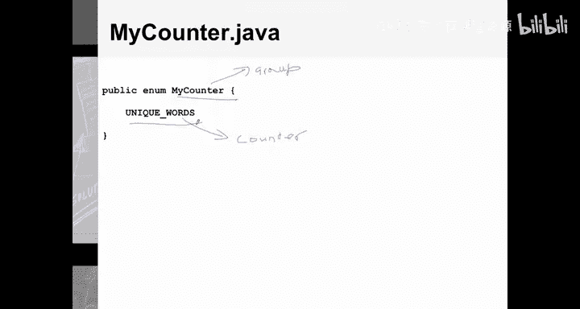
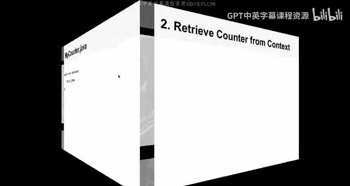
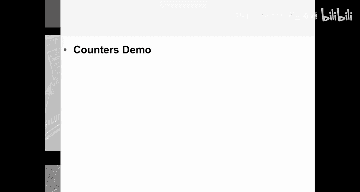
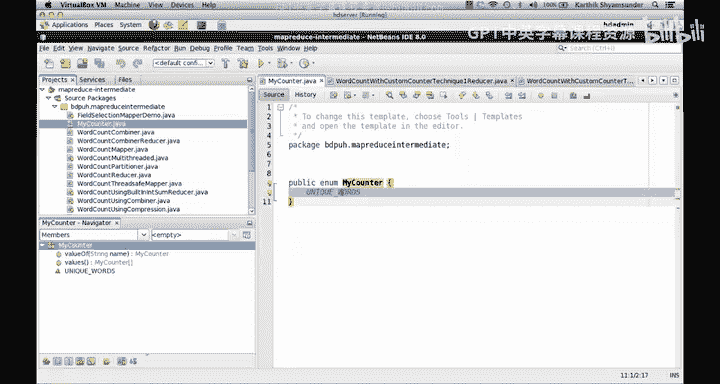
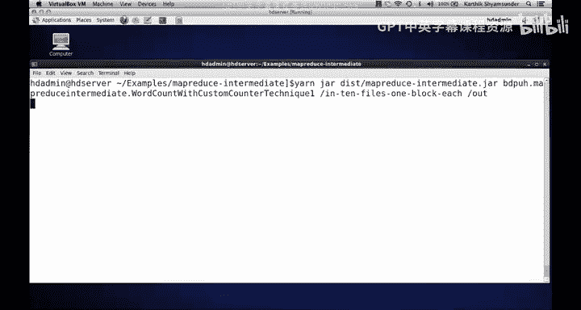
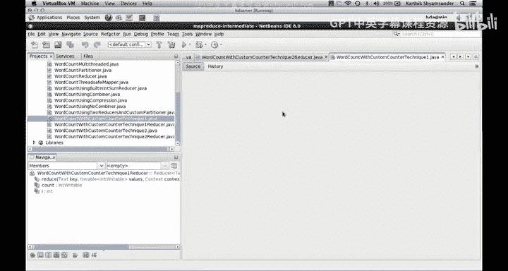
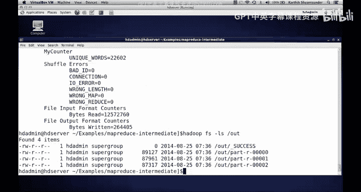
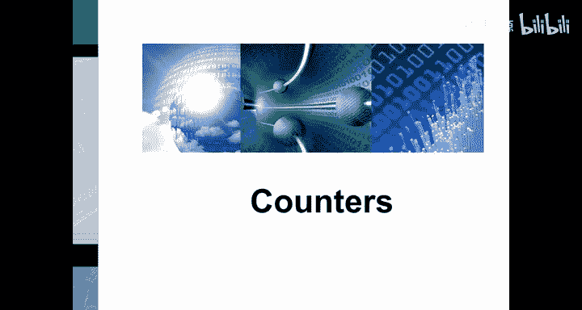

# 约翰霍普金斯大学《Hadoop大数据处理｜Big Data Processing Using Hadoop》中英字幕 - P56：16_计数器机制.zh_en - GPT中英字幕课程资源 - BV1g5u6zBExs

Counters counters are a facility to instrument map produced jobs for statistics。In this section。

 we will learn about counters， how to create and set countervalues。

 how to read countervalues both programmatically and through the History server UI。Finally。

 we will also learn about groups of built encounters and learn to create our own user defined counters。

Counters simply put， maintain and sum up counts for a job。

 they are used to instrument a jobs metrics When I say jobs metrics。

 I mean things like gathering statistics about a job， For example。

 you may want to know how many bytes were read by a job， how many bytes were written out by a job。

 how many records were processed by a job。It can also be used for quality control。

 you may want to confirm that your job did process 120 million records diagnostics。

 you may want to track if there were any errors in the job。

The framework provides several builtin metrics as counters， for example。

 you can track the total number of mappers that were created and the number of reduces that were created。

 you can track the number of bytes that were processed by the job and the output generated by the job。

 you can also create your own counters， maybe you want to create counters that track the number of unique records that were consumed by the job。

 or the number of some special applicationspec errors or warnings that you may want to track for the job。

Finally， counters are divided into groups， so every counter actually belongs to a group。

There are several built encounters， in fact there are several groups of built encounters that are available since every counter belongs to a group。

You have job counters which document the number of mapreduce tasks launched。

 then there is file system counters that track the number of bytes read or written out。

 then there is mapreduce framework counters which tracks the mapper。

 reducer and combiner input records and output records and the time it took for them to process at different phases。

 shuffle errors， number of errors that were related to shuffle and sort of the data。

 file input format counters， the number of bytes that were read and file output format counters。

 the number of bytes that were written out。If you recall， I said there are many groups。

 these are the groups， job counters， file system counters， map framework， shuffle errors。

 file input format counters and file output format counters。

 they are all the various groups that we talked about and inside those groups that are different counters。

The history server Webgui exposes these counters， so let's go ahead。

 log into an HD server VM and look at the counters。I'm logged into my VM。

 here's my job history server， I'm going to pick up a job。

 let's say I pick up this word count using compression job。

 click on that and when you look at the details about a job you notice something called counters on the left hand side。

You can click on the counters when you click on the counters。

 you get the list of all the built encounters， as you can see we have the counter group and then we have the counters associated with that particular group。

 so file system counters， job counters，And then if you scroll down。

 you have map produced framework counters。Shuffle error counters。

 these are the counters that I talked about in the previous slide and then file input format counters and file output format counters。

 these are all the various counter groups that are there and if you recall in each one of the counter groupss。

 these are the actual counters that are there， so file system counters has number of bytes read。

 number of bytes written number of large read operations and then the actual counter values are over here。

So these are the built encounters that are available as part of a job。

If the built encounters are not good enough for your application。

 it is possible for you to create your own new application specific counters。

Using these application specific counters， you can increment them in your mappers， combiners。

 and reducer classes。The framework accurately sums up all the counts in the various stages and produces the totals。

 so if you have 15 mappers and in the mapper phase， you're adding these counters。

 then it'll make sure that all the different mapper counters are aggregated together so that it can show you the final total in the job history server or you can access it through an API too。

So how do you implement user defined counters？First。

 you define a counter and you do it by using the enum type。This is the type safefe approach。

 you don't really have to do this， we'll talk about this later on。Then once you defined the counter。

 you can retrieve the counter from the context object and then you can increment the counter's value。

 it's pretty straightforward。How do you define a counter the way you define an counter is by simply writing an enum class。

 the name of the enum class becomes the name of the group， if you recall every counter has a group。

 the name of the enum class becomes the name of the group。

 and then the enum states or values actually become the individual counters。

Here I have a counter called my counter and has one state called unique words， so this is your group。

That's your group。And that's your counter right here so my counter is the group and unique words is the counter and my goal is to count the number of unique words that were processed by the job this is for the word count application。

是。Now let's retreat the counter so that we can increment its value。In order to retrieve a counter。

 you can utilize the context object that is passed as an argument in the map and Red method。

 if you recall the map method and the Red method， take a context object。

 you can use this context object to retrieve your counter。

There are two ways to retrieve counters on the context object technique number one involves going to the context object and invoking the get counter method which will take a group name and a counter name and what it will return you back is a counter object that you can later on use to increment the counter。

Now this technique， since it takes a string group name and a string counter name。

 the question is what do you pass， when you have an enum。

 you pass the enum class name as the group name and then you pass the actual enum instance variables as the counternames。

Now this technique is very dynamic as you can even create new counters on the fly。

 even if you did not define a enum variable you can pass a new one and willll create a new counter for you the same thing is true for the group too so it's a very dynamic way。

 but also it's very error prone as mispillings can actually create new counters so you have to be a little bit careful about this。

The second approach is to go to the context object and invoke the get counter method on the context object。

 but this time you actually pass the enum counter name。

 so for example you can go to the context object and say get counter and then you can pass my counter dot unique words and that would give you back a counter object。

We will see examples of this in just a few more slides。Once you have a counter object in your head。

 you can increment or even set the value， you can go to the counter object and you can call the set value method passing to it a long number。

 and then you can also increment by 1 or 15 or 20 or 30 or 100 whatever you want。

 you can increment the value of the counter。Here's a program called Word count with custom counter Tech One Redr In this class I'm going to show you how the reducer is going to instrument a counter。

 If you look at the reduce method， the reduce method takes a key and a list of values and also takes the context object it does its normal business processing Now it goes to the context object that was passed as an argument。

Here's the context object， invokes the get counter method on it， passing to it。

 the string my counter， which is the enum class， and then the string unique words。

 which is then variable inside the enum class。And then goes to the counter object。

 which it retrieved and invokes the increment one so you can add one to that counter。

The second technique。As we discussed once again is a reducer。

A reduced method that takes a context object， but this time goes to the context object invokes the get counter method。

 passing to it a type safefe， My counter dot unique words， this is typeafe。Technique。

You cannot make a mistake in this technique。And then， you get。A counter object。

 when you invoke the get counter method， now you take the counter objectject and increment by one。

Now that you have instrumented your reducer with the counter object。

 you can run your program and then you can retrieve the counter using the History server WebI。

 the History Ser WebI shows you all the counters， you can also use the Java API。

To get your counters and maybe you want to write log files out or maybe you want to store it in a database。

 you can do all those different things by retrieving the counters through an API。

How do you retrieve the counters and print the counters after the job is done？Well。

 you can use the get counters method for that， the get counters method that can get a list of all the counters。

 and then you can print the values out。Here is a program called word count with retrieving counters where I have a job object。

 I have a configuration object and I do all the things necessary to submit the job。

 here's wait for completion。 I submitted the job， I wait for it and then once I'm done I go to the word count job object and invoke the get counters method on the word count job object that gives me back a counters object notice it's not a counter object。

 it's a counters object which is a list of counters and then now what I can do is go through。

A for loop in this case， I am going through a list of group names because the counters object gives me a list of group names。

I iterate through the list of group names and for every group。

 I again iterate through the list of each counter and then I print the counters out。

That's another way to do this。So let's go ahead and do a quick demo on counters using our HD server VM。

Here I am logged into my HD server VM， I wanted to show you the counter code。

 here's the My counter Enum。My counter inam that has one counternet called unique words。

And then I need to instrument my reducer so I can instrument the job So here's word count with counter technique one reducer do Java。

 where I'm going to show you technique number one， where if you recall， I take the。

Context object that is passed to me and the context object has a method called get counter what I'm passing to get counter is the counter group name and then the counter name。

 the counter group name is the Enum class， which is my counter and the counter name is unique words。

There it is en class and unique words， once I get the counter in my hand， I increment the counter。

The other technique is。Technique number two， let me show you that。

Technique number two technique basically says go to the context object。

 invoke the get counter method， but this time rather than passing strings to it。

Passt the typea my counter dot unique words。 and what is my counter dot unique words。

 which is right here， that's my counter dot unique words。 So technique2 is really more type safe。

As I mentioned to you。In technique one， you have to be a little bit careful。

 while there is advantage and disadvantage， the advantage is that you can create your own counter on the fly。

 you can pass whatever name you want。And for the counter group。

 you can pass in whatever the name you want for the counter。

Actual counter itself and so in this case you end up creating a brand new counter group called my counterWWW and a counter called unique words WW So the point I'm trying to make is this is quite dynamic。

Let me go ahead and change that。Let's go ahead and build this program。And let's go ahead and run it。

Here's my program yan J disk map Reduce Intermedia J。

 and I'm going to be running word count with custom counter technique one。

 I'm going to take in 10 input files and I'm going to generate the output。

If you recall there's 10 input files so that means there'll be 10 mappers。

 there are no counters in this case for the mappers。

 we only have counters in this case for the reducers， let's quickly see how many reducers we have。So。

 if I go to。Technique one may method。是。

It's a little bit slow because my Mapperties program is running。And if you look at the。

 there are three reduces， So there are three reduces and each reducer is instrumenting。

The unique words by the time I'm done， there would be 10 mappers。

3 reducers and the reduces as they are encountering the unique words。

They are adding one to the counter， if you recall three reduces。

 they'll all see unique words and they are all adding to this one counter。Okay， the program is done。

If I do Hadoop F dash Els， slash out。Three output files Let me go to the job history server。

Click on job history。Refresh it。There's word count with custom counter technique one， click on that。

 click on the counters， there's all these built encounters that's there。

And now I have my own counter called my counter。With one。Counter inside it。

 this is the counter group， my counter with one counter inside it called unique words that say 22602。

 So there were 22602 unique words that were present in the Mobidic novel Okay。

 so now you see how counters work。In this section， we learned that counters are a facility to instrument Mareduce jobs for statistics。

 there are several built encounters for the job as we saw。

 which is available as part of the Mareduce framework if we need application specific counters we can create user defineded counters to meet the needs of the application。

In terms of accessing the counters and incrementing them， there are two techniques。

 first technique involved using string counter namess which is not typeafe but is quite dynamic。

 the second technique is using an enum。The InM technique is typeafe， but not dynamic。

The counter information is also available through the job history server GuUI as well as programmatically。

 in summary， counters are a great way to instrument and gather information about a job。

