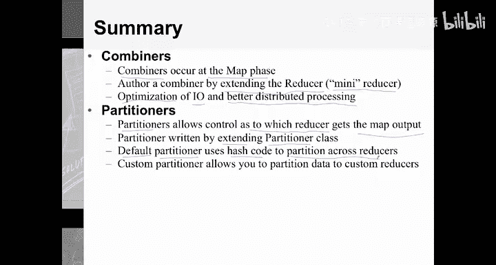

# 约翰霍普金斯大学《Hadoop大数据处理｜Big Data Processing Using Hadoop》中英字幕 - P57：17_MapReduce中级编程总结.zh_en - GPT中英字幕课程资源 - BV1g5u6zBExs

Yeah。

Matreduce programming intermediate summary。In summary， we learned about combiners。

 combineers are special functions that occur at the map phase。

You order a combiner by extending the reducer and setting that as part of the job。

 and that's why a combiner is often referred to as a mini reducer。

A combiner is really an optimization mechanism because it optimizes your IO。

 your map output is optimized now because you're writing less data as part of the map output。

And also the sort and the shuffle phase doesn't have to sort as data and shuffle ass data。

 so it's better IO from that perspective， network IIio and thisIO。

 and it's also better for distributed processing because part of the reducer logic is being done in the map phase itself。

We also learned about partitioners， Proitioners allow control as to which reducer your map output is going to see。

The partitioner is written by extending the partitioner class and overriding the get partition method。

There is a default partitioner that's available as part of mapRuce that uses hash code to partition the data across the different producers。

 but if you want to control that， youre welcome to write your own custom partitioner that allows you to partition the data so that you can send the data to custom producers。

We also learned about compression， we learned about compression in the HDFS section。

 and now we learned about how to apply compression for the mapre job。

 we learned that mapre jobs can take as input compressed files。

 you don't really have to do much better than to say that it can handle compressed files。

And then mapre jobs can also generate output compress files。

Compression can also be applied on intermediate files。

 don't forget that the map output is actually written to locals and then it goes through the sort and the shuffle phase and then is sent across the other side。

 so even that intermediate map output can also be compressed。Yeah。And finally。

 we learned about counters， counters are used for gathering job statistics。

There are several built encounters that's available， but if you want。

 you can write your own user defined counters for your own application。

 and the way you author a counter is by using an enum， which is strong typing。

 and or you can use simple string counternames and increment their values。

