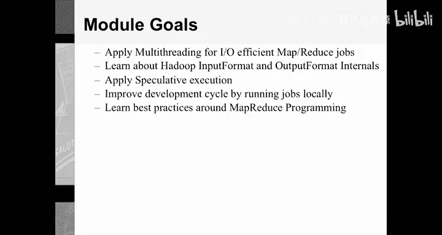

# 约翰霍普金斯大学《Hadoop大数据处理｜Big Data Processing Using Hadoop》中英字幕 - P58：18_MapReduce高级编程导论.zh_en - GPT中英字幕课程资源 - BV1g5u6zBExs

Welcome。Mapre programming advanced in this module， we will look at some of the advanced map produce concepts and development best practices。

So what are the topics in this module？We'll start with multithreading which is how to write a multithreaded mapper。

 then we'll look at the input and output format internals。

 then we'll look at an interesting concept called speculative execution that is by default turned on in Hadoop Mareduce。

 then we'll look at the concept of running a job locally without having to use a resource manager or a node manager or a history server this helps in debugging。

 and then we'll finally look at 11 mapreduce antipans and correspondinging best practices。

So what are the module goals？Apply multi threading for I efficientffic reproduce jobs。

Learn about how input format and output format internals work。

 learn when and where to apply the concept of speculative execution。

 improve the development cycle by running jobs locally。

 learn best practices around mapre programming。

