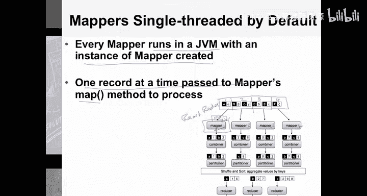
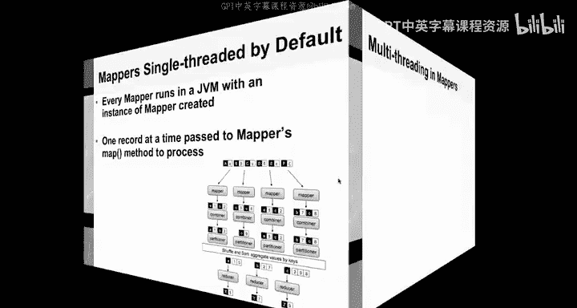
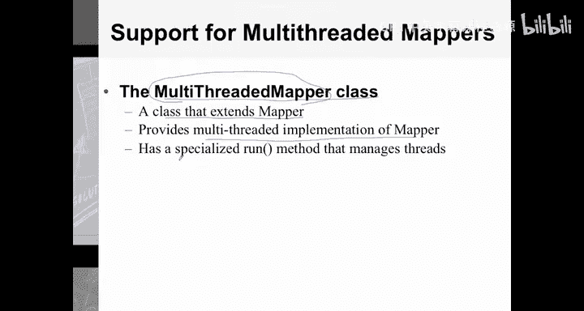
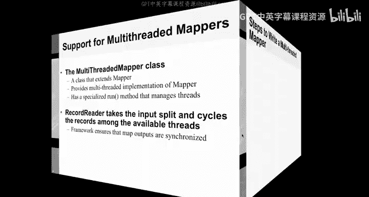
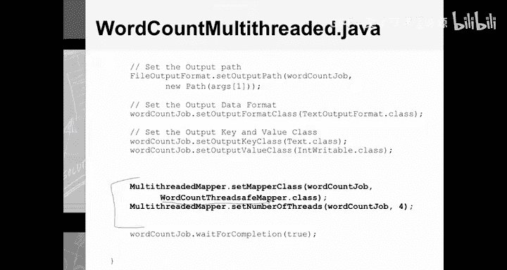
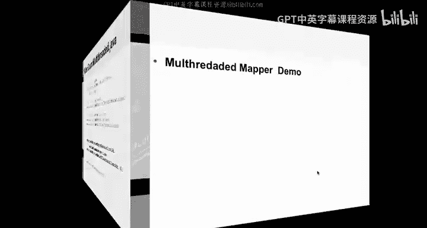
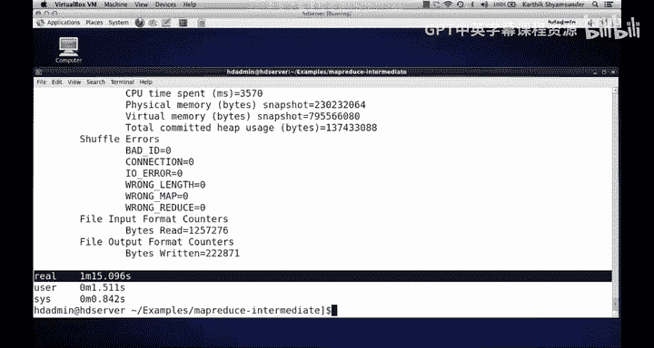

# 约翰霍普金斯大学《Hadoop大数据处理｜Big Data Processing Using Hadoop》中英字幕 - P59：19_多线程优化技术.zh_en - GPT中英字幕课程资源 - BV1g5u6zBExs

Mti threading in mapreduce。We know that MaRduce supports multitasking。

 which is multiple processes running within the same machine to complete a job。

 even multi machine architecture， which is multiple machines working together in order to complete a job。

 but what about multi threading？In this section， we will look at when and how we can take advantage of multi threading in Mareduce。

In order to understand multi threadreading， we need to understand what is happening in Maper by default by default。

 mappers are single threaded every mapper runs in a JVM with an instance of the mapper created。

And one record at a time is passed to the mapper from the input split。 What do I mean by this。

 Let me try to explain this to you。 You've seen this diagram before。

 let's say we have our input input is broken down into input splits。

 let's say it's broken down into four splits input split123 and4 for each one of the split there is a mapper。

 there's Maper1 Mapper2 Mapper3 and Maper4 we know that the four mappers are working in parallel but within a mapper。

 the records are processed in a serial fashion that is actually something called the record reader。

 the record reader The record reader is the one that passes one record at a time to the Maper so the Maper can do the work and generate the output。

The idea behind multithreading in mappers is the ability to process multiple records using multithreading this is typically not done but there are certain cases when this kind of multithreading may be suitableable the multithreaded mapper is useful when mappers or IO bound。

 for example， if the mapper in the map method has to fetch web pages which has more latency than of course local IO or maybe call upon some kind of a network service like the IP geolocation service anytime the mapper has to wait on some kind of processing or weight on some kind of an IO then multithreaded mapper can be useful。

In such cases， of course， multi thread helps since as one thread is blocked on a single network。

 others can continue and work on。Haadoop Maproduce does support multi threadroed mappers。

There is something called the multi threaded Maper class， it's a class that extends the Maper。

 this is the same mapper class that we extend in order to write our own Maper。

 but there is already a class called multithreaded Maper。

 which provides multi threaded implementation of the Maper。

 it has a very specialized run method that manages the threads。

Also， the framework supports multi threadreading by making sure that the record reader can take the input and then cycle the records among the available threads that are there in the map task。

Let's look at these steps to write a multi threadreaded mapper。

 and then I'll go through an example of Word count where we can use multi threadreading and demonstrate when and how it can be useful to us。

In order to write a multithed mapper， you need to make sure that you write a threadafe map class if you recall thread safety means instance variables need to be synchronized and static variables also should be synchronized you also need to set the Maper to be a multithreaded mapper if you recall when you're doing single threadreaded mappers。

 which is the default you write your Maper class and you set that mapper class as the Maper class but when you're doing multithreaded Maper what you're really setting as the Maper class is the multithed mapper class well then what you do with the threadsSafe map class that you write。

Well， the threadhsSafe map class that you write will be set by going to the multithroed Maper class and setting the Maper class on the multithreaded Maper class。

 which is a static method passing to it the job object and your own Maper class。

 which is the multithed Maper class。And it's the multitroded Maper classes static method that you call upon called the set number of threads passing through the job and you say how many threads you want the multitroded Maper to handle。

This will become much clear to you when we go through an example。

Here's a class called the word count threadsSaafe Maper remember I said to you you need to write a threadsSafe Maper class What I've done is that I've taken the existing mapper class that I had and I called it a threadsafe Maper the reason I called it a threadsafe Maper is because I'm going to use multi-threading in the case of mappers and when I say threadsSafe I need to make sure that if there is any instance variable I'm using I make them into local variables or synchronize them I used to have an instance variable within the class called text word but I made that into a local variable so we don't have to worry about any thread safety issues。

I didn't have to worry about that for one because that's a read only object anyway。

And the reason I'm doing multi thread here iss the real reason when I。I'm processing the map method。

 I'm actually making an external call， I'm actually simulating an external call in this make external call。

 I actually do a thread IO sleep for about 10 milliseconds just trying to simulate an IO scenario here the point I'm trying to make is if you ever write a mapper where you make external calls that spend time on IO than your mapper processing is going to be pretty slow I'm going to show you how without having a multithreaded mapper。

 it takes much longer than with multithreaded Maper。All right， so this is a word count Tafe mapper。

Now I have a main class called WordCon Multithreaded which has the main method once again I wanted to show you I have a config object。

 I have the new job object and I do all these setups。

 the most important thing is when I set the Maper class rather than setting my business logic Maper class I set the multithreaded Maper class which is a built-in class as part of Hadoop framework。

And then。I use the multi threadreaded Maper classes static method to actually set my Maper。

 which is going to be a threadafe mapper and then set the number of threads really what's happening in this case is when the inputs split。

Is read by the record reader。 The record reader actually launches multiple threads。

And then it ends up calling the Mac method for each one of the records。

All these different threads are reading one record at a time and then calling the map method in a Mar credit fashion。

In fact， I've set up four threads。

So let's go ahead and do a demo。Here I am logged into my HD server VM as HD admin user ID。

I would like to demonstrate multi threaded mappers。Let me show you the word count multitro Maper。

 here's the multitro Maper。And the reason I want to make it multi threadreaded is because the map method。

Is making an external call I'm really not making an external call。

 I just want to simulate the Io weighting scenario over here。

 The point I'm trying to make is the map method。Wwhich gets caught upon for every record is going to wait at least 10 milliseconds。

 So if you have to process a million records， that's going to be a million times 10 milliseconds wait。

 There's a lot of delay that's happening。 So there's a lot of waiting that you're doing inside your mapper in order to prevent that from happening。

 What I would like to do is use multithread mappers。

 So for that I'm going to write my mapper to be a threadsafe mapper。

 notice I used to have an instance variable over here。

 called text word which I've now made into a local variable so I don't need to worry about any multithreading and things like that thread safety So there's the text word。

 and then I'm doing my work。 This is a threadsafe mapper。

 I don't want to get into what it means to write a threadsafe program。 You're all Java programmers。

 you know how to write a threadsafe program。 This mapper has got to be threadsafe。 That's the idea。

In my main， which is where I'm going to be using the multi threaded Maper。

I instantiate the configuration object， I get an instance of the job object。

 I do my setup for the job， but notice。When I set the Maper class rather than setting the Mapper class to be the word count threadSafe Maper。

 which is the Maper class that you typically write and set。

I'm actually setting the Maper class to be multithroed Maper multi threadroed Maper is a builtin Hadoop framework class。

 so I'm using the standard Hadoop framework class to be the Maper well then the question is where is the business logic class being set？

Well， that's where I go to the multithreaded Maper class and invoke the set Maper class method。

 passing to the word count job and passing to it the word count threadsSafe Maper。

 this is where we are actually saying the real Maper class is this word count threadsSafe Maper class and then we are also setting the number of threads to be four。

I also wanted to show you one more class， I have another class。Called word count， not multi threaded。

Basically here I'm setting my mapper to be the word count Tsafe Maper。

 well it doesn't really matter to make it threadsa because it's really single threaded right now。

 but anyway， the business logic works。And then。I just run the program。

 so what I would like to demonstrate to you is run two versions of the program。

 run one version of the program where it's not running in multithroed way。

 and then run the other version of the program where it is running in a multithroed way。Okay。

 so let's go ahead and build it。是。I would like to run a version which is not multithreading。

 so here's what I'm trying to do。 I'm trying to run word count， That's not multithreaded。

 which is the normal way。 I'm reading the Mobid file from in folderer doing the word count and generating the output over here Now think about it the mapper when it runs it's going to read one line at a time and every time it reads one line at a time。

 it's going to take 10 milliseconds for it to wait on some kind of an external IO So what you'll find in this example is a program that is going to take some amount of time and that amount of time we will cut short by using multithing What I've done is execute this program using the time command。

 which will tell me how much time it's going to take to process this program So let's go ahead and run the program。

So at this point， we're running the word count program， which is not multi threadreaded。

 Every call to the map method is taking 10 milliseconds。

Extra because it's doing some kind of waiting because we are waiting artificially right now。

And so it's going to take some time to process it。And what you're seeing is it's。Taking his time。

 you know，1% done，2% done，3% done，4% done， So it's going to be a while before we get to where we want to What I'll do is I'll come back in a few minutes once it's done and then we'll take it from there but then we'll also know how long would have elapsed So let me pause and come back。

Okay， it's done that took about four minutes and 11 seconds to process。

Now this is where the magic begins。 What I would like to do is run。

The word count in a multi threadreaded fashion。 and I'm going to have four threads so。

As the records are coming in， there are going to be four threads in every mapper that is going to process it。

 and let's see if we can actually cut down the time by four times。

So I'm going to now run the multitroed version of the program before that。

 let me go ahead and delete the output file。The output folder。

And now what I would like to do is run word count multi threaded。

And let's see how much time it takes for it to run same work。

 except it's running in a multi threaded fashion。OkayIn this program。

 what's happening is we have one input file， we have one mapper。

 the mapper is going to read the input records as it reads the input records。

 it is going to have four threads that are going to be reading the input records and calling upon the map method in the mapper so as you can see this is going to be four times faster。

The last one took about four minutes， I would guess that this will take about one minute because we have four threads in this case。

Just an approximation， youre about 59% done。The mappers are done， not the reduce。

And that took about one minute and 15 seconds。 So， yeah， the last one was about 4 minutes and some。

Seconds， let's see。 those 4 minutes and 11 seconds。

That was the the one without multi threading and the one with multi threading is about one minute and 15 seconds。

 it's about you one fourth the time。So you can see how multi threadreading does help when your mappers are doing some kind of an external call or some kind of an iobound activity。

 then multi threadreading is a great way to have in your mappers。

The only caveat that I want to say to you is that there is no concept of multi threaded reduces。

 there's only multi threadreaded mappers。

In this section we learned about multithreading in mapRuce。

 we learned that we can have multithreaded mappers。

 Hadoop framework supports for multithreading by providing a very special class called multithreaded Maper that allows us to read multiple records at the same time and process them within a Maper and don't forget there is nothing called a multithreaded reducer Mapers are the only ones that can be multithreaded。

