# 约翰霍普金斯大学《Hadoop大数据处理｜Big Data Processing Using Hadoop》中英字幕 - P5：4_数据科学.zh_en - GPT中英字幕课程资源 - BV1g5u6zBExs

Data science。In this section， we will look at the emerging field of data science。

What makes a data scientist and some of the tools and techniques that a data scientist uses to accomplish his or her task？

Although this is not a course on data science， you as a Hadoop developer。

 may closely work with a data scientist or may yourself aspire to become a data scientist。

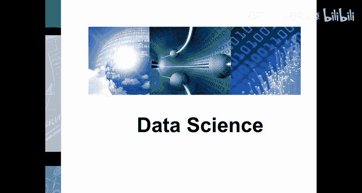

So what is data science， here's a formal definition。

Using multiple data elements in clever ways to solve iterative data problems that when combined。

 achieve business goals， that might otherwise be intractable。 Now that's a mouthful。

 So let's break it down here。Using multiple data elements so a data scientist works with multiple data elements in the field of data science in clever ways using intuition to solve iterative data problems。

 so they are solving data problems and they are doing it in an iterative fashion。

To achieve common business goals， so they are working very closely with the business。

That might otherwise be intractable， so this is where the inside aspect of it comes into play。

That's a formal definition of data science。 Let me give you another definition。

 a definition that I like from Drew Conway， this is actually coming from Drew Conway's website。

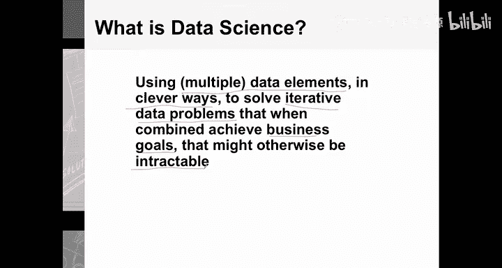

Drew Conway takes the field of data sign and he says that it's actually a combination of three things。

Hocking skills， which is programming。Domain expertise。

 which is expertise in a specific industry like biology， finance， education， manufacturing。

Math and statistics knowledge。So the idea here is that if you have math statistics knowledge and you're able to combine that with your domain expertise。

 you get traditional research。People do this all the time。

 people have been doing this over centuries。If you can combine the hacking skills or programming skills and domain expertise。

 that's when Drew Conway calls that it's danger zone， in other words。

 just because you know how to program and just because you have expertise in that particular domain doesn't really make you a data scientist。

If you're able to combine your hacking skills or programming skills with math and statistics knowledge。

 then you can do machine learning。According to Drew Conway。

 if you are able to combine all three of these skills。

Both programming skills and doing expertise and added to it， the math and statistics knowledge。

 then that would be the field of data science。

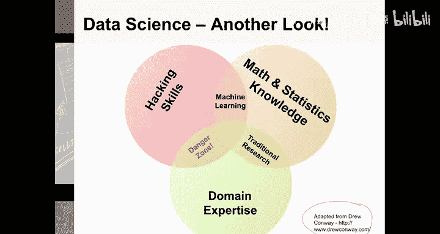

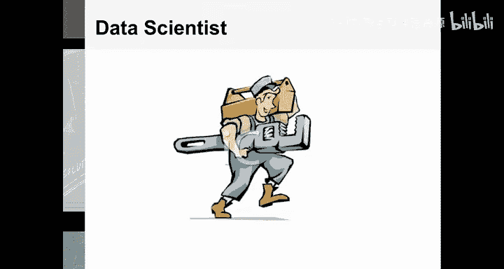

So what makes a data scientist？I want to define data scientists from the perspective of the tools that the data scientist works with。

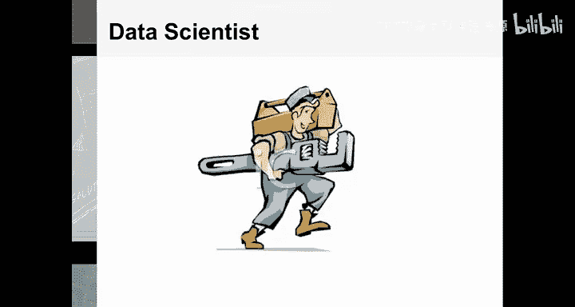

A data scientist would be a person that would work with multiple languages， they know many languages。

 they may not be expert in all the languages， but they know many languages so they can program in Java。

 Python， a little bit of She programming， a little bit of pearl programming。

They also need to understand distributed computing， Hadoop， HDFS， Mareuce。

Which is skill that you're going to learn in this class。

They also should be able to work with4GL languages like PG and hive。

 which is something that you'll be learning in this class， they are Hadoop related products。

 or is another data science language， we won't be studying that in this class， also SQL。

 many of you probably know that。They should also be able to do machine learning。

 at least learn to use machine learning algorithms like Mahat and WeA。

 they should also understand traditional data warehouse and traditional analytics such as Oracle data warehouse。

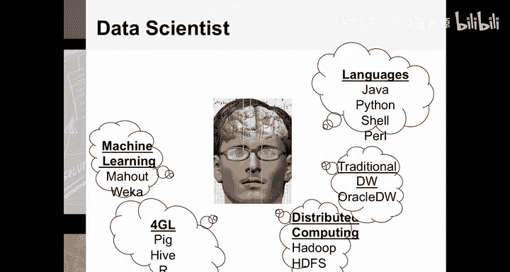

They should also be able to tell a story visually so they should learn to use visualizations tools like GffL and highchars and D3 JS or even MAlibb so if you're able to combine all these different skills。

 then you could be a data scientist now after finishing this particular class you would have gained at least 50% of these skills so you're actually moving towards the field of data science。

 so if you want to， you can become a data scientist going forward。So what makes a data scientist。

 a data scientist is somebody who should be curious。Who has intuition。

 these are two non technical skills， these are skills that are very critical。

 but they are non technicalnical skills， the rest of the skills like data gathering and standardization and statistics。

 modeling， visualization are more technical skills。

 but when you combine all these skills that makes you a data scientist。

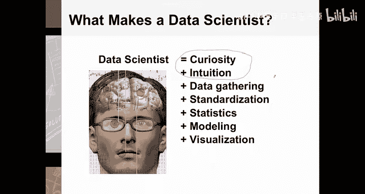

So you may ask how do I become a data scientist， there' is a really nice website resource that I have over here。

 you might want to visit that， but I've kind of summarized some of the things from that particular article。

 if you want to be a data scientist you need to know about distributor computing which you're going to learn in this class you also need to understand matrix factorizations。

 statistical analysis。Optimization， machine learning。

 these are things we're not going to talk about in this class。

 but there are other courses at Johns Hopkins University that you can take that has those topics covered。

 information retrieval， signal detection， master algorithms and data structures。

 so you need to kind of know all these different things in order to call yourself a data scientist。

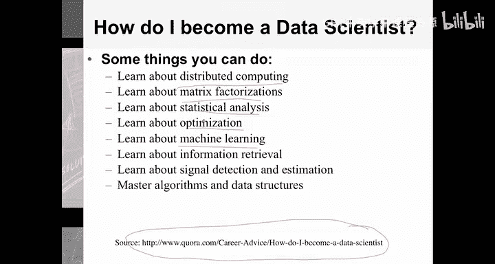

One of the most important tasks that a data scientist must do for themselves and for the sake of others is documenting data sets。

Data scientists often work with data， and they often work with other people's data。

 So it's important that as a data scientist one documents data sets。

 every data set should have a title， an abstract。Data source who are the original owners of this particular data。

 data type， what kind of data is it， is it multivariate data， is it relational data。

 is it time series data， you know different kinds of data， right what is the data format。

 the data structure， how is it stored， and even data characteristics such as how was the data collected？

When was the data collected are there any systematic biases associated with this particular data。

 and also data access， is it sensitive data， what is the data access policy。

 all these things need to be documented for yourself and for others。In this class。

 we will be working with MoL data， which is really well documented and you'll be looking at that documentation to understand the movie lens data as you're doing your assignments。

The other important task as a data scientist is also documenting the data science tests。

Because once you document it either people can take the results of what you have done and work on top of that or may want to do the experiments slightly differently。

 and so there are lots of reasons why you want to document your data science tasks so for every data science task that you do you must document what was the data that was used and there might be more than one indicate the task that you did and also define the problem description and the results so write this thing into a document so other people can use it。

One of the key aspects of data science is going from data to wisdom。

 let's say you have a website users interact with this particular website， you get clickstream data。

 then you parse that particular data to get normalized data which is what we call information。

 you can take that information， run reports on them to generate knowledge or to gain knowledge。

But what if you can take this knowledge？And gain insights and act upon this particular knowledge。

 and that's what we call wisdom。So the point I'm trying to make is with data science。

 you often go from the data， which is the raw data that you have all the way through to wisdom。

Let me explain this with a real life scenario。At Netflix。You know， customers come to Netflix。

They go to the website， they browse movies， they watch movies， all the data is collected。

 all this interaction is collected and that's normalized data that's what they did The Netflix took this particular data。

 generated reports out of that and so they got knowledge knowledge as to who are the users that are watching the movies。

 what movies are they watching， what movies are popular and so on and so forth。

While they were looking at this particular data， they had some insight and the insight that they had was people who watched movies were good long term customers。

And so they actually put that insight into practice and so what they did was they changed their website so that any time you browse a movie。

 you would see a button that says add to queue or add to streaming view right add to DVDQ or add to streaming view Q and what they realized was when they did this change on their website more and more people started adding movies into their queue and they started becoming long-ter customers and so what you're seeing over here is how Netflix took data。

Got reportport out of that， which is knowledge and got an insight out of that and make a change in their product so that they can keep their customers for a long term。

So that's an example of going from data to wisdom， and for this。

 you have to do a lot of data science work。One of the other important aspects of data science is also machine learning。

Now， this is not a class on machine learning， but I wanted to give you a quick introduction to what it is。

Machine learning， according to Arthur Samuel， is a field of study that gives computers the ability to learn without being explicitly programmed。

What Arthur Samuel did was he actually wrote a checkers program that played checkers with itself tens of thousands of times。

 keeping track of the positions that led to wins and keeping track of positions that went to losses so in the process learning the game of checkers。

 to the extent that it actually beat Arthur Samuel at the end of the end of。

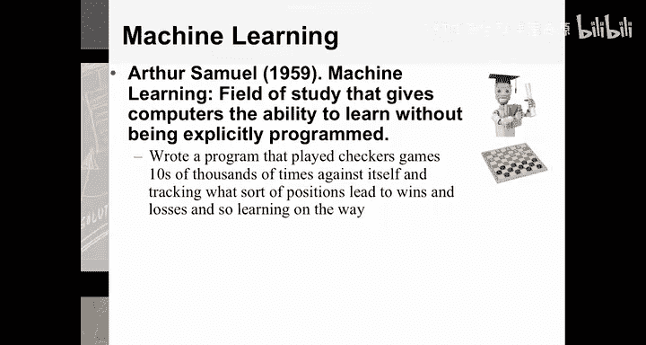

Tom Mitchell in 1998 gave a much more formal definition in which he said that it is a computer program that is set to learn from Expedience E with respect to some task T and some performance measure P if it' performance measure on T as measure by P improves with Expedience E now that's a mouthful that's a very very complex textbook like definition。

 what I would like to say is that machine learning is a scientific discipline that is really concerned with the design and development of algorithms which allows computers to learn behaviors based on some kind of empirical data such as data from sensors or even data from databases this is a field on its own like I said this class is not geared towards machine learning。

 but you can implement machine learning algorithms on Hadoop。

 in that sense you may be working with machine learning。

Specialists to implement the algorithms on big data。

 you may want to take a class on machine learning in the future。

Where is machine learning used well it's used in internet search clustering。

 it is used in knowledge management systems， social network mapping and social networking analysis。

 taxonomy of data， marketing analytics， recommender systems are another great place for using machine learning。

 log analysis， spam filtering， fraud detection so there's a whole slew of domains that use machine learning if you're interested there is also a free machine learning course offered by Stanford professors at this particular site you may want to check out that particular site。

A word of caution about machine learning， Let me read this to you。

 A father decides to teach his son what a sports guard is。Finding it difficult to explain in words。

 he decides to give some examples。They stand on a motorway bridge， and as each car passes underneath。

 the father cries out， that's a sports car when a sports car passes by。After 10 minutes。

 the father asks his son if he's understood what a sports score is， the son says， yeah， sure。

 it's easy。An old red VW beetle passes by and the sun shouts that's a sports car。Dejected。

 the father asked， why do you say that。Because all sports cars are red， replies the sun。

This is a classic example of machine learning going wrong。

Many times when you're doing machine learning， you may get into a situation where the algorithm comes to wrong conclusions based upon this data。

 so there's a lot of training that needs to be done。

 there's a lot of verification that needs to be done in machine learning and in order to do that。

 you could use another field called crowdsourcing。Amazon Web Services has something called the Amazon Mechanical Turk where they offer crowdsurourcing services。

The basic idea here is that you define what is called hitS， which is human intelligent tasks。

 these are tasks that you can form out to people all over the world and folks from all over the world for a few cents will categorize data for you will identify whether something is a upon site or not。

 so you're actually using humans to do your learning or to do your classification or to do your categorization。

So people use machine learning in conjunction with Amazon Mechanical Turk in order to prove that machine learning algorithms are viable or valid right so that is something that you might want to experiment with when it comes to big data and recommend systems。

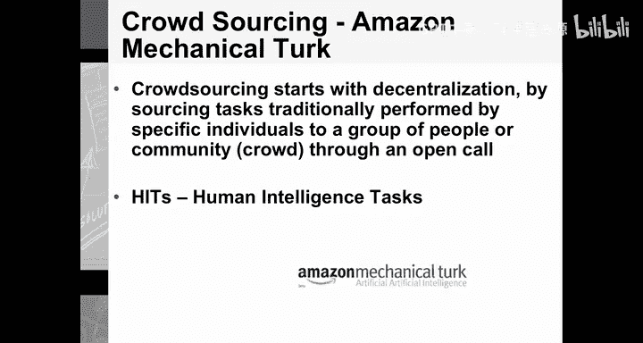

So in summary， in this section， we looked at the emerging field of data science。

 what makes a data scientist and some of the tools and techniques that a data scientist uses to accomplish his or her task。

Although this is not a course on data science， you as a developer as part of ordering Hadoop programs may surely work with the data scientists to implement their algorithms。

 or you may yourself aspiy to become a data scientist because you already would have learn 50% of the skills。

 which is big data processing using Hadoop in this particular class。

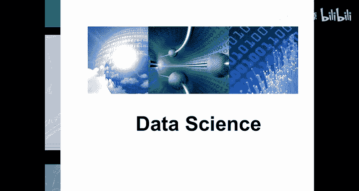