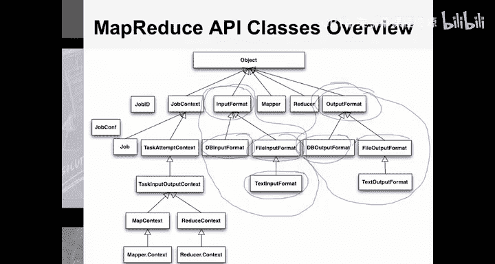
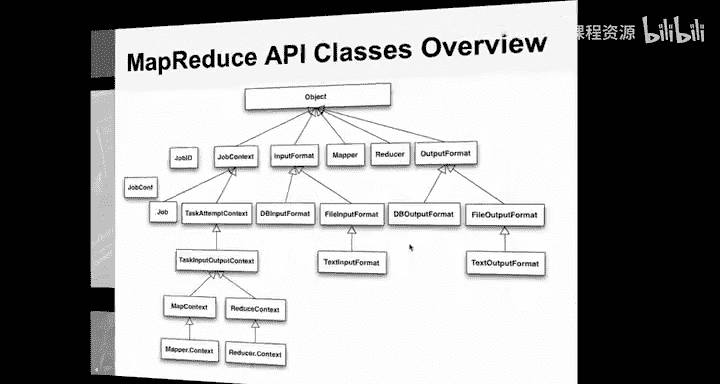
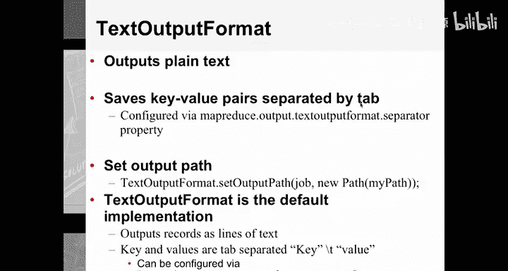

# 约翰霍普金斯大学《Hadoop大数据处理｜Big Data Processing Using Hadoop》中英字幕 - P60：20_输入输出格式内部机制.zh_en - GPT中英字幕课程资源 - BV1g5u6zBExs

Input and output format internals。In this section， we are going to look at some of the inner workings of the input and output formats。

In order to understand the internals of input format and output format。

 we need to first understand the concept of an input split。So what is an input split？

A map produced job can take input from a file or can take input from a database。

Now all along in all the demos that I have done and the assignment that you've been working on。

 we've been taking input from a text file， which is a plain text file。

The input can also come from a sequence file， it can also come from map file。

If you recall a sequence file in a map file or special files that can store key value pair combinations。

You can also take input from a database， it can be from a relational database or from a no SQR database like HBase。

Typically， we don't really write mapred jobs that take from a relational database。

Because if you have your data in a relational database。

 then you can always use SQL or PSQl to process that data。If your data is in a NoAQ database。

 such as HBase， it's probably because relational databases are not able to handle the load and process the data。

 so map produceuce can be used in conjunction with a NoAQ database like HBase to process the records from a NoAQ database。

But anyway， the point I'm trying to make is Mares job can take input from different kinds of data。

 file or database， and text files are the most prevalent one。Now， when you have an input file。

Let's say you have an input file right here。The input file is made up of the lines。

Each line is probably a record， record one， record two， record three， record4。

 and so on and so forth， although way up to maybe record 1 million。

Splits are a set of logically arranged records， so you can take a sequence of records。

And make it into a split that would become an input split， in this case， input split1。

And then you have input split2 and then you have input split  three， so in this case。

 you took a group of records and made it as a split。

 another group of records and made it into another split。

 another group of records and made it into a third split。Now if these were records in a database。

 then E split can be rows in a database table， right this first 100，000 rows become a split。

 the second 100，000 rows become the second split and so on and so forth。Why are splits important。

 Because each instance of the mapper can process a single split？

And because mappers can run in parallel， we may have one mapper processing an input split1。

 another mapper processing input split 2 and a third mapper processing input split 3。

 The point I'm trying to make is your input is actually broken into splits。

And each split can be worked separately by different mappers simultaneously。Now， within a map itself。

 the records will be read in sequential order。So notice map instance plus one record at a time。

And so for every record， the map method will be called with the key and the value。

A little bit more on input splits splits are implemented by extending the input split class。

 this is a built in class in Hadoop。You don't really have to write your own input split class or anything like that。

 the framework provides many options for input split implementations and it's actually done based upon the input format。

 which I'll talk about in just a few more minutes。The important thing to remember is that there are different kinds of input splits。

 that is the Hadoop's file split which we talked about。

 and there's also the DB split which we talked about。

So we don't usually need to deal with splits directly because the input format's responsibility is to do that。

Now let's look at the map Reduce API classes。You have seen this picture and we went through the MaRduce API overview。

 but at this point I would like to concentrate on input format class。And the output format class。

The input format class also has a couple of subclasses as you can see。

 the DB input format that deals with database input format。

And the file input format that deals with the file input format。

And a specialized file input format called the text input format。

Now there are other input format classes that inherit from D input format and file input format。

 but I've kind of kept it simple for now， the most important thing for you to remember is that there is a class called the input format that deals with the input format for a job。

And don't forget， input format for a job deals with the input to the Mareduce job。

Then there is the output format class， the output format class deals with the output of the job。

 so there's the output format class， and there are a few classes that inherit from it。

 DB output format that deals with the databases and file output format that deals with outputting file as output。

Then there is text output format， which is really a text file output format that deals with writing text file as the output。

The input format class and the output format class are both abstract classes。

 and the derived classes actually implement some of the key abstract methods available。

In the input format， the output format classes。

So let's look at input format。Input format is a higher level class that works with input splits。

 input format is the specification for reading the data for a job。

 It creates input splits from the input files or from the input database it is primarily used to break the work into chunks input format also specifies how to read each split by having an implementation of the record reader class What I'm showing you over here is the input format class as defining the Hadoop API It's actually from the Hadoop source code itself Notice the input format class is an abstract class It's got a couple of abstract methods like get splits and create record reader and get splits is returning a list of input splits。

And create record reader returns a record reader object that the mapper can use to read a record at a time。

So how does the input format and the input split and the job all those things fit in？

So here's the frameworks usage of the input format implementation。 Don't forget input format is a。

Base abstract class。There are a specialized version of input format class like text input format or Db input format that deal with the details of an input format。

Let's say we deal with text input format， which is a text file input format。

What you're seeing here is data that needs to be processed。These could be。Rs or lines of records。

 record one， record2， record 3， record 4， all the way up to record 1 million。You'll notice。

That the input format first job is to generate the splits。 So in this case。

 it actually broke it into split one。Input split 1。It broke it into input split2。

And then input split three。And the reason it's able to generate the splits is because it actually ends up calling the method get splits。

 which has an implementation in the drive class， so it's polymorphically calling that method and getting a list of all the splits。

For each split， it will generate a record reader。So there's a record reader that's generators for each split。

And each rack is associated to a mapper。The point I'm trying to make is if you have a file。

Let's say with 3000 lines and the generate splits breaks 1000 lights to be each split and we'll talk about how the splits are done in just a few more minutes。

There are three 1000 lines， each one of the 100 lines becomes a split， which has a record reader。

 which has a mapper， so there are three maps that will be created for the three record readers for the three input splits。

Each mapper will process the records in its input split， so Mapper 1。

 Maper 2 and Maper3 are all executing in parallel and Mapper  one will read record1 Mapper2 will read its rendition of record 1 which is whatever the record it is in this case it'll be 1001 and Maper 2 will read 2001 and then 2002 and 2003 and so on and so forth as you can see how input format splits the input data into these different splits and is mapping to the Maper。

Hadoop framework is packaged with many input format subclasses。That is the text input format。

 which we saw， which is the most popular input format， almost everybody uses text input format。

Then there is also endline input format， which is the number of lines per input format。

 you can say 1000 lines make input format or 10000 lines make up in input format。

 then there is also key value text input format， which is an input file where the key and value separated by a tab。

 then there is sequence file input format you've talked about sequence files before where you have a key value per combination in a binary format file so that's the sequence file input format。

 then there is DB input format to deal with the racial databases。

 table input format to deal with No SQL H based database and stream input format for Hadoop streaming jobs。

So as you can see there are different kinds of input formats。

 the default input format for a job is text input format， and that is the most popular one。

You can always configure a jobs input format by going to the job object and setting the input format for that particular job by invoking the set input format class to be whatever the input format class。

 which could be one of these different things and the reason I have Xxx over here is Xxx can be text or end line or key value or in sequence file any one of those things。

Now let's look at the text input format。Text input format is actually a plain text input format and it is the default input format for a map producedd job。

It's the default for all jobs unless you explicitly set the input format to whatever you want。

So the question is， how are the splits？Records and the key value done in a text input format I've kind of informally talked about this before。

 now I'm going to talk formally as to how the input file。

 which is the text input file is broken down。So let's say you have an input file。

 which is a text input file。There are lines of records each separated by a slash n， slash n。

 slash n and so on and so forth。That's a text input format。

How is the split done in a text input format， it's based upon the block， based upon the block。

We know that。A file is broken down into blocks， a text input format basically takes one block。

 so let's say that's a block， one block。And then let's say this is the second block。One block。

And let's say this is the third block。One block， but maybe in this case it's less than a block。

There are three blocks， each block will become an input split。So that's an input split。

That's an input split。And。That's an input split。 So what I mean by that is you have an input split here。

 you have an input split here， and then you have an input split over here。For each input split。

 there'll be a mapper， Maper， Maper， mapper， and they'll be working it on the records sequentially for that input split。

So what is a record， a record is a single line of text。

 and of course the line feed determines a record， so when you have a slash in that determines the end of that particular record。

Then you have a key and a value， the key is the longriable offset。The offset。

 so this will be zero and then this will be 127 and so on and so forth。

 there'll be a long readtable offset。And the value is the line of text。

Now when you have text input format， that is one other interesting thing that you need to be。

 you don't need to really worry about it， but you kind of need to know is that what would happen if you have a block here and you have another block here and a record starts。

But does it really end until。The next block， let's say record starts and keeps going and then it kind of continues on and it ends over here in the next block。

So now you have。An input split， which has a record， that is a partial record。

 the record started over here kind of went and then is actually moving into the second input split。

In such situations the input split that had the beginning of the record is responsible for completing that record and processing that particular record so when input split2 comes in it will actually ignore the first few bytes until the slash n and then pick up the first record after the slash n because it wants to map this slash n to the previous record of the previous block All these complications are already handled by the text input format and that's what we mean by input splits the input split implementation of the text input format handles all these situations for you what I'm showing you here is how some of the internals work。

So now let's look at the output format。The output format is the specification for writing out data for a job。

 clearly it is the other side or the opposite side of the input format。

And one of the things that the output format does is that it validates the output specification for the job。

If you recall you may have seen those annoying messages that says the output directory already exists Well。

 who puts out that message， it's the output format class。

 the output format class checks to see if the output directory already exists， and if it is。

 then it shuts the job down。The output for class is also responsible for creating an implementation of what is called a record writer A record writer is the one that is responsible for actually writing the data out if you recall when you are writing your Marate program。

 you never read from a file explicitly and you never write to a file explicitly all those things are handled for you by the Hadoop framework and so just like the record reader handles the reading of the records by the framework in the same way the record writer internally handles the writing of the record into the files into the output file which are your part R 000 files and part R 0001 file so the reducer output files。

In order to do that， it also creates an implementation of what is called an output committer。

 and the output committer is the one that is really responsible for setup and cleanup of a jobs tasks in the artifacts。

So for example， the output directory that needs to be created and any kind of cleanup that needs to be done if the job fails。

 deleting the directory， all that work is done by the output committer。

Just like we looked at the input format interface， let's look at the output format interface。

 The output format has three methods in it， get record writer check output specs and get output committer get record writer returns a record writer object so that the map layer and the reduced layer can actually write its output the check output specs checks to make sure that the output directory is created。

 the output commituter is the one that is responsible for writing out the actual files with the appropriate names and also deleting the files if the job was unsuccessful。

 you shouldn't really see anything in the output folder if the job was not successful。

Let's look at Hadoop's output formats， the Hadoop ecosystem is packaged with many output format class。

 just like the Hadoop's ecosystem or Hadoop framework had many input format classes。

 you have text output format， which is the most important output format。

Whi is the text file output format， and then you have the DB output format for relational databases。

 table output format for HBase map file output format for writing map files out。

 sequence file output format， for writing sequence files out。

 and if you don't want to have any output at all for your job。

 you can set the output format to be an null output format。

You can configure a jobs output format by going to the job object and by invoking the set output format class。

 passing to it the name of the output format class， again。

 XXX represents text or D or table or map file， and then you can also set the output key class to be whatever the key classes and the output value class to be whatever the output value classes。

 Hadoop framework as part of the job will automatically serialize those objects into the output string。

Let's look at the text output format， text output format is a concrete implementation of the output format class。

 it's a very important class because it's really a text file output format class。

 the output of a job is usually a text file although it doesn't have to be but that's the most popular use case。

Whenever a text outputperformer writes a key value pair。

 it writes the key value pair as something that's separated by a tab。

If you want the separation to be a different character， then you can use mapred output。

text output format separator property， you can change this particular property in your configuration object to whatever character you want。

 and that's what would be used to separate the key and the value of the job output。

There is also a method called set output path， you can go to the text output format class and set the output path and you can say for this particular job。

 this is what my output path is going to be and that's what defines what the output folder is going to be for your job。

The text format。As I mentioned to you is the default implementation of a Hadoop job。

 the output records are placed as lines of text with keys and values separated by a tab。

 key tab value， of course you have the option to change it。

So in this section， we looked at some of the inner workings of the input and output format。

We saw how input format creates input splits and how each split is associated with a mapper to process the records sequentially。

We also saw how there are so many different input formats。

 each with its own algorithm for determining the splits defined by the method get splits。

We also learned about the output format class。And we saw that there are different kinds of output format class。

 we also learned that for the output format， there is an output writer。

 there is also an output commuter which is responsible for writing the output and also making sure that all the content is out all the directorories are cleaned out and there's also a method called check output specs to make sure that the output directory existed hopefully this section gave you some of the internals or inner workings of the Hadoop map reduced job from the IO perspective。

