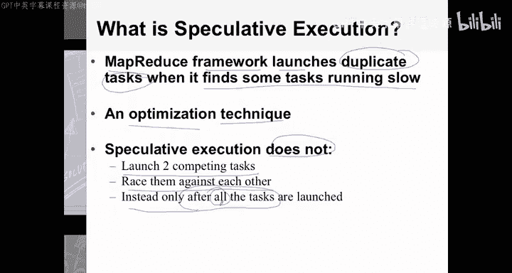
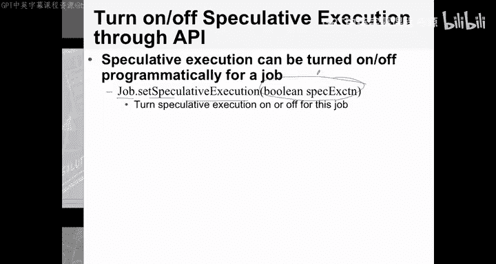

# 约翰霍普金斯大学《Hadoop大数据处理｜Big Data Processing Using Hadoop》中英字幕 - P61：21_推测执行策略.zh_en - GPT中英字幕课程资源 - BV1g5u6zBExs

Speculative execution。

In this section， we will discuss speculative execution。

In order to understand speculative execution， we need to understand how a distributed computing framework can deal with slow running tasks。

If you think about it， a job is actually decomposed into small tasks。

And these small tasks may be map tasks， or they may be reduced tasks。

And so a job is as fast as the slowest task。Now， given a job may be broken down into hundreds or even thousands of tasks across several machines。

 there are many reasons why some of the tasks may run very slowly， it could be hardware issues。

 for example， it could be a disc issue。It could be an IO issue。It could be。A Ramish you。

It could also be that there may be other activities that are running on that machine， for example。

 other processes are running or other map tasks that are running that are taking the CPU or the IO or the RA。

It also is possible that the configuration of the machine itself is bad。

Which is the operating system configuration， so there are many reasons why a task may be running slowly。

Now the framework could resolve the slowrun task by spawning the same task on a different machine Now we know that in Hadoop HFS。

 when you write a file out， there is replication and so that file is replicated across multiple machines now what you could do is when a map task is working on a block then maybe a copy of the block on a different machine so the same map taskask can be launched on a different machine and we can compare the two things so that's really the idea behind speculative execution。

So formally， what is speculative execution？Spectulative to execution is when the mapreduce framework launches duplicate tasks when it finds that some of the tasks are running slow。

This is clearly an optimization technique and not really a functional improvement。

It's important to realize that speculative execution does not launch two competing tasks and raise them against each other instead it only launches the task。

 the speculative tasks after all the tasks have been launched right so it's not just launching two tasks of the same coin on two different machines and making them race against each other。

So when does speculative execution really kick in， speculative execution kicks in when all of the following conditions are met first。

 if you have a job that is broken down into tasks， all the tasks have been started。

A task has been running for an extended period of time， typically over a minute。

And then a specific task did not make significant progress as compared to the rest of the task。

 So for example， let's say your job was broken down into map 3 map tasks， map taskask 1。

 Ma taskask 2 and Ma task 3 so I'm going to say M1 M2 and M3 and let's say it's running on three different machines H1 H2 and H3。

3 different host machines Now it's possible that M1 is processing at the rate of。

30 records per second。M3 is processing a rate of maybe 32 records per second。

 and M2 is processing a rate of two records per secondClearly M2 is a bit slow。In such situations。

 the Hadoop framework may launch another task， let's say， M4。And ask it to work on the same data set。

On the same data set that M2 is working on， and so M4 will be working on pretty much the same data set。

 well， how is that possible Well whatever the data copy that was here in M2 is probably replicated in M4 machine。

And so it goes to that machine and launches this new task。And then as to the work。

 and if it finds that this is now operating at rate of 25 or 30 records per second， you know。

 everything is good in such situation， you would simply。

Kill the previous task that was slow and continue with the M4 task。

 so that's what speculative execution is all about。

You can turn on or of speculative execution through configuration。

It so happens that the speculative execution is turned on by default in your configuration if you want to turn it on or off。

 you can do that by setting certain properties to true or false in mapre dashite。xm for example。

 in Mare dashite。xm you can set a property mapreducuce。 map。

 speculative to false that would turn speculative execution off if you say mapreduc or reduced speculative to be true that would turn speculative execution on for reduced tasks so you can control this at the map level or at the reduced level in your configuration file。

Note that speculative execution is not a replacement for poorly written code。

 if your system is performing poorly or if your process is performing poorly or your job is performing poorly。

 you have to see what is really going on and not simply turn speculative execution on。

Turn on of speculative execution through the API， you can also do this programmatically。

 for example you can go to the job object and say set speculative execution and you can set it to true or false。

 that will set speculative execution for both map and reduce。

 you can also do it programmatically at the map or or the reducer level where you can say set map。

 speculative execution to be true or false， set reduce speculative execution to be true or false。

 that would control at the map or level or the reducer level。

In this section we learned how speculative execution is used by the mapreduce framework to deal with slow running tasks based on environmental issues speculative execution is turned on by default。

 speculative execution can be turned off， many system administrators actually turn speculative execution off because they like to know when the systems are bad。

And poor job execution is probably a good reason to figure out that the system is bad。

Speculative execution can be turned on or off through configuration or through programmatic API。

 you can even turn speculative execution for map only tasks or reduce only tasks。

