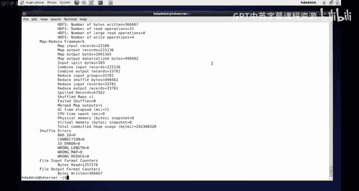

# 约翰霍普金斯大学《Hadoop大数据处理｜Big Data Processing Using Hadoop》中英字幕 - P62：22_本地作业运行模式.zh_en - GPT中英字幕课程资源 - BV1g5u6zBExs

Running jobs locally。In this section， I'm going to show you how you can run a job locally in the client VM rather than running a job under the control of yarn demons。

This technique greatly helps during Hadoop program development and testing。

Running jobs locally。It is possible to run a map producedd job locally。Well， what does that mean。

 that means the entire Mareduce code execution will happen on the client。

 the same class that contains the main method， the JVM under which the main is running。

 the Mareduce code will also run under the same context in the same VM。

This technique is also called running Hadoop Mareuce in local mode or standalone mode。

In such situations there is no need to run all the demons。

 especially there is no need to run the yarn demons。

 you still will have to run the HDFS demons though。

 the reason is your Ma reduced job will be reading from HDFS to process the data and writing out to HDS to write out the data。

 but all the Maper and the reducer logic will be running inside the client VM。

This technique greatly aids in the development and testing of jobs locally。

How do you configure a job to run locally， There are two techniques。

Technique number one involves going to where Hadoop is installed and Etsy Hadoop folder。

 where there's a file called Matight。xml you're only familiar with this file in our case it's in/users/Locus/ Hadoop/ Hadoop2。

4。1/ etcc/ Hadoop。In the future releases it may be in a different location。

 but the important thing is you go to this file Ma。ide dot Xml。

 which had this value initially this is all it had。

 it had Ma use dot framework dot name to be yarn that's the value it had Now you're going to change that from yarn to local once you do that you can run Hado in local mode。

The second approach is to override the default config properties in your main。

Remember the configuration object that you have， you can set it by changing the property value mapreduce。

t framework。t name to local， once you do that you're overriding whatever the value was in the Maard Dar ci or Xml and that would also do the work so you can either use technique number one or technique number two。

What are the advantages of local mode？Well， it simplifies the development process。

 especially inside the IDE Now you can simply step through the debugger and run in the debugger and see what is going on in your Mareice program to debug business logic。

There are some disadvantages of local mode， some functionalities。

 especially some map reduce functionality。Don't work， for example。

 you cannot set more than one reducer in the local mode Also there is this concept called distributed cache where you can add jar files on the fly to be run inside the map or in the reducer and you can also pass some reference files those kind of distributed functionality what is called distributed cache functionality that doesn't work in the local mode。

Also， some distributed computing bugs may not be caught since everything is running。😡。

In a single machine， there is no powerism that is going on， so it's great for testing。

 functionality and debugging functionality， but it doesn't allow you to debug your distributed computing functionality。

Let's go ahead and do a demo of running jobs locally。

Okay， here I am logged into my Hadoop PMM HD server as HD amin user ID What I would like to do is run the WordCon program。

 I would like to first run the WordCon program normally with the resource manager and job history server and everything so it's running under the Yn demons。

 so let's do that。So for that。I need to execute the。Yn command， so yarn jar。

 here's the Mareduce wood count program and then slash I is the input folder。

 slash out is the output folder， so let's go ahead and run that。The mapper is running。

The reducer is running。And then you'll get the output。 right。 So if I do Hadoop F S dash L S s I N。

And we see the input directly， which contains one file， if I do a slash out。

 that would be the output folder that contains one file， which is the reduced output。

So that ran successfully。 What I would like to do is show you the。Resource manager。

 and if you look at the resource manager， we saw a job， job 38 created。

which is the application 38 and if you go to the history server， you will see that 38 was created。

 which is the job 38。Not what I would like to do。Is change my setup。

I would like to open the file mappper dash cytot Xml， change this value from yarn。

To local basically saying that I don't want to use the resource manager and the history server and things like that。

So now I would like to run the program， but before I do that。

 I would have to clean up my output directory。Notice it created a file that's 366 k。

And I would like to run the program now。When I run the program now。

 my client program is not going to talk to the resource manager to get an application ID is's not going to work with the node manager and history server and things like that。

 everything is going to run locally in my client VM。Right， so go ahead and run that。

So the program branch， notice it's actually running everything locally。

There is no communication with the resource manager。

 no communication with the resource manager whatsoever。 so all running locally。

 So in order to prove to you that it did not communicate with the resource manager or anything like that。

 we were at 38。We were 38 to reload。We're still at 38。No records in the application resource manager。

And no records in the job history server， right is still the same as job 38。

Illustrating to you that the job actually ran locally Now。

 if you're able to run this thing inside your IDdeE， you can actually debug through this。

 this entire thing is working within the current JVM within the client JVM so you can actually run your job locally。

So in this section， we learned how to run a job locally in the client VM rather than running a job under the control of the yarn demons。

This technique greatly helps during the Hadoop software development and testing functionality。

