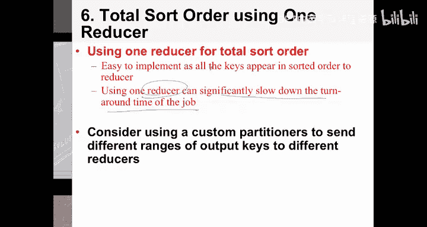
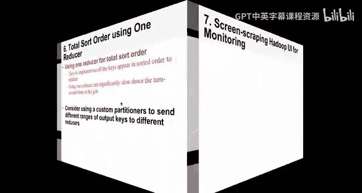
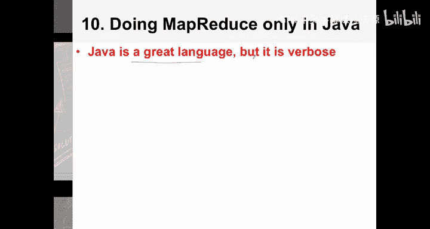
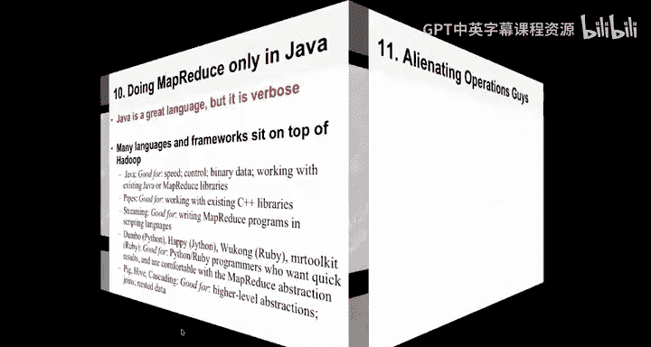
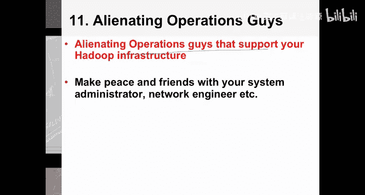

# 约翰霍普金斯大学《Hadoop大数据处理｜Big Data Processing Using Hadoop》中英字幕 - P63：23_MapReduce反模式解析.zh_en - GPT中英字幕课程资源 - BV1g5u6zBExs

Maap produce anti patternss。In this section， we will look at 11 different Mareduce antipatterns that Hadoop Mareduce developers tend to do。

 and as part of each antipan， we will look at ways to avoid them。

Developing with big data set。When developers are told to work with data。

 they tend to work with the complete data set from production for their development purposes。

The problem with this is that it increases your development run times and it may not be very productive。

 For example， think about what you may have done in assignment number 3 and even in assignment number4。

 I give you 100000 record sets。 Did you work with all the 100000 record set。

Or did you take a representative sample from the 100000 records set。

 What if I had given you 10 million records for you to process。

 Would you have written a program to process 10 million records all while doing the development time。

 If you did that， you would actually increase your development run times。

A better approach is to try to bring in a representative small data set and work with the representative small data from the big data for your development purposes。

This actually decreases your development runtime because when you're doing your development。

 that you're consistently writing code， compiling and running， writing code， compiling， running。

 writing code， compiling and running， your runtime， you don't want it to be four or five minutes。

Also， bringing the representative sample set also helps in testing various quo cases。

That may exist in your data。If you're doing data science activity。

 then represented a small data set is also good because that will give you an idea as to what kind of results you may be expecting when you're actually working on the big data set。

Making external network calls。When you're writing your map reduced programs in your map and reduce functions。

Making external calls， when I say external calls， I mean external network calls or HtTP calls or TCP calls。

 any kind of network calls for accessing the data or accessing more data so that you can process them in maps or reduces is a bad idea in other words。

 inside your map function and the reduce function do not make network calls right an example would be to call a geolocation service for an IP address that you get。

Or crawling a website in your mapper。Making network calls makes the mapper of the reducer slower because you're doing IO operation。

Although you could use multit Maper。It's generally a good idea not to use network calls because when you're using your cluster。

 let's say your clusters 100 machines， while you're using your cluster。

 somebody else cannot use your cluster or maybe they can use part of the cluster because there is something called the fair scheduler and capacity scheduler which allow you to share cluster with somebody else。

 but while your process is running， you may be using part of the computational capacity or the cluster when somebody else may not be able to use that particular cluster there may be four or five people that want to share your cluster。

They may not all be able to share your cluster The point I'm trying to make is you want to use your Hadoop cluster efficiently。

 so if you're interested in joining dataset if you're interested in bringing different data sets at the time of map and reduce for joining purposes。

 you make sure that you have all the data available together as part of your job。

 and then you can use something like mapside join or reduce side join to join the data and when it comes to crawling you may want to crawl all the data from your website before you do any kind of processing on them。

Data types developers tend to not think about the data sites before writing their map reduced programs。

For example， developers to use strings for pretty much everything。

 I noticed this in your assignment number three。 Many of you chose string as the mechanism for reading rating or for reading the movie ID does it really have to be a string you have to think about this and also in the same way sometimes you use an integer for everything you have to think about this。

 should it be an integer or should it be a long or should it be a byte if it's an integer it's four bytes。

 if it's a long， it's eight bytes in some situations long maybe better idea， for example。

 if you're going to be using counting and if you're going to be counting millions of records or even billions of records using a long may not be a bad idea So the point I'm trying to make here is that you have to think about the type。

 you have to think about the data type before using it in your map programs because this affects your memory this affects the over。

or underflow of the data， so you have to think about the size of the data you have to think about how big a value can this particular data type take。

 how much memory is this data is this data set going to take The reason I say this is because you're working with big data when you're working with big data any small error only magnifies so you have to really think before choosing your data types。

Not using combiners straightforward aggregation without the use of the combiner is a bad idea Hadoop is very very popular for counting purposes。

 any kind of calculation so if you're going to be doing counting or aggregation not using the combiner is a bad idea。

Local aggregation is one of the basic algorithm in Hadoop and distributed computing。

 and so consider using combiners whenever possible。Not using more than one reducer。

The default reducer in Haddoop is one and developers tend to forget that developers tend to take the default reducer to be one reducer。

 don't forget if you have 500 input files then all the 500 input files will make up 500 different mappers and if you have 20 slots for the mapper then you know 20 mappers will run at a time and then eventually all the 500 mappers will finish but then all this data will have to end up going to the reducer and so what you really want to do is think about setting more than one reducer for your application。

Of course， when using more than one reduce， consider using a good parter or partition algorithm。

Total salt order using one reduce。Many times developers， when they're working with the data set。

 they want the resultant output to be sorted。 So what many times the。

Developers do it they set the number of producers to one， which will automatically have a sort order。

 which is a total sort order now that's an easy approach to take。

 but then once again using one reducer can significantly slow down the turnaround time for the job。

And so the recommendation here is to consider using a custom partitioner to send different ranges of output keys to different reducers and of course。

 use many reduces like what we talked about in the previous anti patternttern。

Screen scrapping Hadoop UI for monitoring。In order to satisfy the monitoring requirements in an enterprise。

 many developers tend to screen scrappe the resource manager or job histor server UI When they say screen scrappe。

 they would write some kind of a program thatll basically go to the website download the content from the website which is an HD on page and then parse set and then maybe put the information about the statusus of the job into a database or maybe displayed in some kind of an admin console The point I'm trying to make is don't do that because the job histor server UI and the resource manager UI may change in the next release What you really want to do is consider using an API to get information So Hadoop Java has a restful API that's available for you to get information about your job Also the yan command has an application parameter which also takes a dash statusus and the application I an argument to give。

Information about the status of a job。Applications using tens or hundreds of counters per job。

 Many times Hadoop developers want statistics about their job。

 So Hadoop developers start using counters because they realize that counters are great for tracking but should not be overused as they have to be synchronized if you use a counter。

If you have 50，60， 7000 mappers， all the 100 mappers are going to be going back to the central application master in order to update the counter because you have to increment the counter and the counters have to be inemented in a synchronized fashion。

 so if you have 500 mappers that are running parallelly because you have a really large cluster then they're all going to send information back to the application master and that is going to dedost the application master。

The idea here is that yes you can use counters but you have to use it effectively。

 so what you do is you increment at regular intervals， if you go back and look at the counter API。

 you can increment by one or you can increment at regular intervals incrementing by 100 or 200。

 that's what I mean by saying increment in chunks， you might want to do the two things regular intervals and in chunks。

Short and quick map jobs applications with tens of thousands of map jobs with very small runtime。

 for example，5 to 10 seconds are a bad idea。 If you have let's say。

 10000 files and each file is only two mags or three mags。

 now you have a situation where for every file that will be a mapper that will be launched。

And launching a Maper means launching a process， launching a reducer means launching a process since launching a process is a slow proposition that can slow down your processing of your job。

So what you want to do is consider using larger files with larger block size。

You can also look into a feature of yarn， which is a newer feature called Uber tasks。

 you may want to look into Uber tasks where you can reuse an existing JVM。Doing mapre only in Java。

For the last four weeks， we've been talking about Mareice programming in Java。

 Java is surely a great language， but it is also a verbo programming language。

There are many languages and frameworks that sit on top of Hadoop of course Java is one。

 it's great for speed control， binary data processing and also working with existing Java or mapreduce libraries because Hadoop itself is written in Java it's a nice integration so Java is definitely good。

 but then there are also other techniques for Hadoop mapred programming there's something called Hadoop pipes。

There' is also something called Hadoop streaming Hadooppipes allows you to write map and programs in C++ libraries using C++ API。

 also streaming allows you to write map produced programs in scripting languages， you can use Python。

 you can use Ruby， you can use Python， any of these different toolkits or scripting languages can be used for doing map produced programming。

And also， when it comes to。Higher level programming。

 there are things like pig and hive and cascading， these are higher level declarative programming languages that you can take advantage of when you're doing Mapperd programming so we will be talking about pipes a little bit streaming a little bit and a lot about P and hive as part of the next few weeks。

And finally， I want to tell you that when you're working with Hadoop in a corporate environment。

 you don't want to alienate your operation skies。 Of course in this class I made you the system administrator so you were able to install Hadoop configure Hadoop and also I made you a developer but in reality you may be a developer and then maybe a system administrator that is actually providing you the Hadoop environment。

 you want to have a good relationship with your system administrator because they are the ones that are going to give you the quota to do your big data processing。

 they are the ones that are going to help you when there are any issues with Hadoop or when you have any issues with your application running within the Hadoop environment。

 lots of things that can go wrong and so you really。

 really really want to be friends with your system administrator and of course the network engineer because system administrators and network。

Eineers work closely with each other。In this section we looked at 11 antipatterns。

