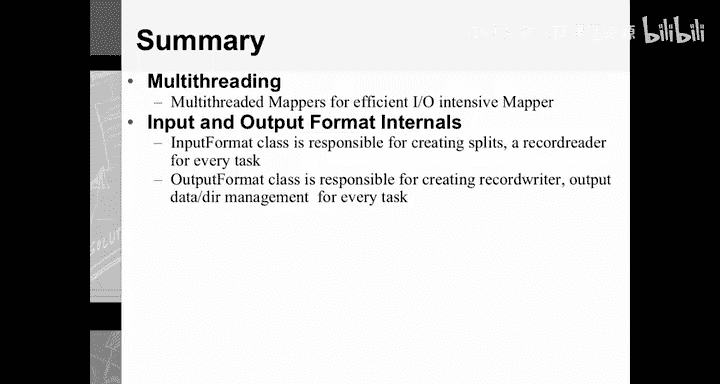

# 约翰霍普金斯大学《Hadoop大数据处理｜Big Data Processing Using Hadoop》中英字幕 - P64：24_MapReduce高级编程总结.zh_en - GPT中英字幕课程资源 - BV1g5u6zBExs

Maap produced programming Adv summaryary。In this section。

 we learned about multi threading in mappers for efficient IO intensive Maper processing。

We learned how if you're going to be writing a mapper that is going to be making network calls。

 from that perspective， it's IO intensivetensive in such situations how you can have a multithreaded mapper and how you should be concerned about threat safety when you're writing about a multithreaded mapper。

We also looked at the internals of the input and output format classes。

 and we saw how the input format class is responsible for creating the splits and a record reader for every task。

 we also saw how the output format class is responsible for creating the record writer which is used to write the data out of the job and how the output data and directory management for every task is managed by the output format。

Then we also looked at the concept of speculative execution speculative execution is when the Hadoop framework launches the same task on a different host when it finds that task is running slowly due to multitude of reasons could be hardware it could be because some of the processes running of the same machine This feature is turned on by default。

 and we learned how you can turn on or off this feature including how to explicitly turning it on for a map phase or the reduce phase。

 Then we looked at how to。Run jobs locally rather than running jobs under the control of a resource manager。

 node manager and history server， this is great for testing purposes and debugging purposes。

Then finally， we looked at mapreduce antiparts， we looked at 11 mapreduce antiparttterns and corresponding best practices。

