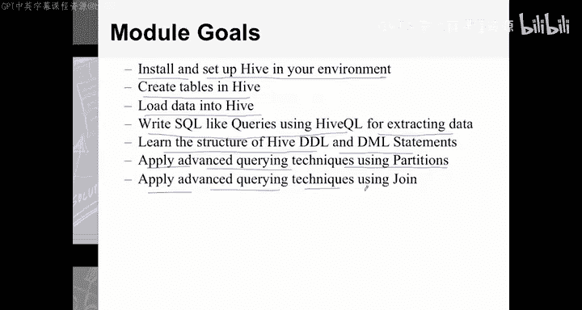

# 约翰霍普金斯大学《Hadoop大数据处理｜Big Data Processing Using Hadoop》中英字幕 - P65：0_Hive导论.zh_en - GPT中英字幕课程资源 - BV1g5u6zBExs

Welcome。Data analysis using hive。We spent the last 10 modules learning about Hadoop architecture。

 HDFS architecture， HDFS programming， yarn Mareduce architecture， yan Mareduce programming。

 and in the process got into nitty grty details of Mareduce programming using the Java API。

In this module， we will look at how we can use a higher level programming language called Hve to perform big data analysis in Hadoop。

So what are the topics in this module first we will go through the hive concepts and look at the hive architecture。

Then we will learn to set up hive in our Hadoop environment。

Then we'll look at a simple hive example where we're able to create a table。

 load the data into the table， write hiveQL command in order to extract data。

 then we will look at how we can load data into Hadoop。

 there are different strategies to loading data into Hadoop， then we'll look at hive statements。

 the different kinds of hive statements that we have， how do you create a database。

 how do you create a table， how do you create a column and there are different data types。

 and then we'll talk about partitions in hive that allow you to manage big data and finally we'll see how easy it is to do join。

So what are the module goals after completing this module you'll be able to install and set up hive in your environment。

 you'll also be able to create tables in Hve， load data into Hve using one of three different strategies。

Write SQL like queries using HiQL for extracting the data。Also。

 learn the structure of hi DDL and DL statements so you can create your own tables with the appropriate column types。

And apply advanced querying techniques using partitions for big data and apply advanced queryerating techniques using join。

