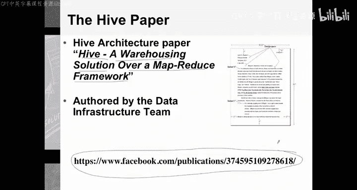
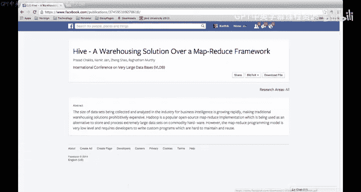
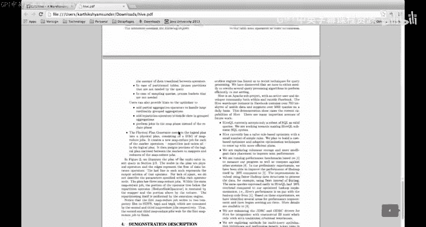
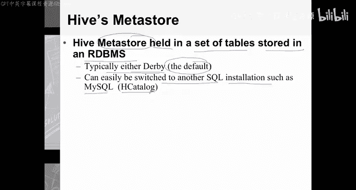
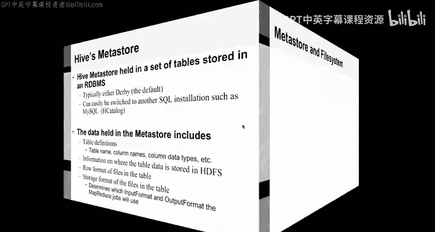
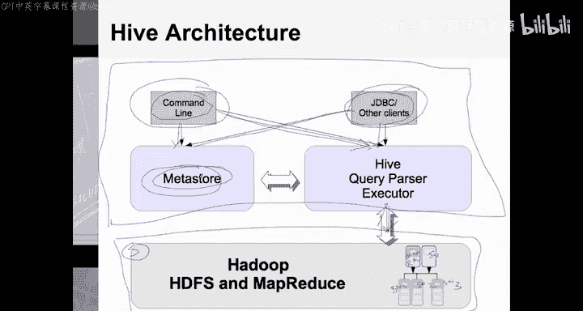

# 约翰霍普金斯大学《Hadoop大数据处理｜Big Data Processing Using Hadoop》中英字幕 - P66：1_Hive架构与核心概念.zh_en - GPT中英字幕课程资源 - BV1g5u6zBExs

Hive overview and architectureect。As the title suggests， I will give you an overview of Hve。

 including what is hive， the motivation behind Hve， its origins， concepts， and the architecture。

What are the challenges with Maredus？For the past four weeks。

 we've been working on mapreduce programming。But what are the challenges behind Mare？

Mapre programming in Java is hard。It actually requires someone who knows how to write Java programs。

 of course。Also， Marety's programming paradigm itself is different。

 it's different from traditional structured programming or object oriented programming or procedure oriented programming。

It actually requires someone who understands this newly distributed computing paradigm of map and reduce。

 sending outputs from maps in a certain format so the reduce can pick it up in a certain format and writing algorithms on top of that。

Themaice programming takes longer time to write。It requires someone to write programs using the Hadoop API and then they have to compile their code and then they have to run their code。

 so even to write a very simple count program， a word count like program。

 it would take hundreds of lines of code， as you may have noticed。

So let's look at hi history Facebook needed a way to allow nonJa programmers which are their data scientists。

 data analysts， access the data in HDFS to perform big data analysis。

 so their target audience were data scientists and data analysts who did not know the Java programming language。

In the process what Facebook did was they developed hive hive is a language that would fit their data analyst' needs。

 and the idea was to have a language that would be based on SQL because the data scientists and the data analyst knew traditional data warehouse and traditional SQL language fairly well。

 and so it would be easier to learn and easily to use and that would make the data that's on the cluster easily accessible and easily process So this is what Facebook they developed hive today。

 Facebook and a few other organizations use hive extensively for their data analysis needs。

So what is Hve， Hve is a data warehouse infrastructure that is actually built on top of Hadoop。

It allows you to do query processing which is selecting records。

 you can also do data summarization which is basically your accounting。

 you can also do some data analysis work Hive supports queries expressed in a SQL like language which is a Declarative programming language and they call this SQL like language hiveQL which stands for the hiive query language now hive is an open source project managed by the Apache So Foundation。

So let's look at the hive concepts， hive reusees or rehashs concepts from relational database management systems。

If you think about it in RDBMS， you have the concept of a database。

 which is really something that holds a set of tables used for name conflict resolution。

We have this concept of a database in hive。Table table is a set of rows that have the same schema。

 they have the same columns， so we have a concept of a table in hive 2。R， arrow is a single record。

Which contains a set of columns， we have the concept of a row in hive。A column。

 a column provides a value and a type for a single value type。

We have the concept of a column in hive2 Partitions when tables become really big each table is broken down into multiple partitions that allow you to manage your data we have the concept of partitions in hive2 The interesting thing about hive is the concept of database table row column partitions theyre all mapped as directories and files in the HFS file system so all the concepts that we have in RDBMS are available and they' are available in terms of directorories and subdirectories and files and contents of a file。

Hive is not an RDBMS。ADVMS， which is relational database management systems， have many strengths。

They have very fast response times typically in subsequents when you do a query it may take only 20 milliseconds。

 100 millisecond maybe 300 milliseconds， it can handle thousands of simultaneous connections to the users a relation database also supports modifying existing records and relation database also support acid transactions which is your atomic consistent isolation durable transactions Hve does not please understand that Hve does not transform Hadoop into relational database management systems。

When I start showing you the hive concept and you start writing SQL like queries， you feel like oh。

 it's like a database， but it's really not a database。

 but I do want to tell you that there are some people that are trying to make hive into an noQL like database and it might happen but right now hive is not a database the hive interpreter converts the hiveQL queries into mapreuce programs so whenever you write something in hive whenever you write a select statement in hive。

 it simply converts that select statement into a mapreduce program so really hive is a higherlel abstraction for writing Mareduce programs。

In very rare cases does high will fetch the data from Hadoop without Mareduce for example。

 if you do select star from a table， then you're really not selecting any specific columns or any specific rows with a warehouse clause in that case。

 hi will say， okay， I'll just go ahead and stream the data out and just simply read the data from HFS。

But in almost all case， it will simply go convert your SQL into a Mareice program even a simple query in hive will take many seconds or more to produce results because your hive query will have to be translated into a Mareuce program and that Mareuce program has to be submitted into a job and so when didn't submits the Mareice program and to a job。

 we know it takes time to talk to the resource manager talk to the node manager to talk to HDF name node and things like that it takes time so we're talking about seconds when it comes to very simple hive statements too。

Hve is primarilyly used for querying， but updates can be done but it can be done as appendance to existing files。

 so if you want to update all you do is add data so if you're bringing in data into hive perfect you just keep on adding data into the existing files or you end up adding new files into specific directories later on we will see how hive database and tables are mapped into directories and files and so bringing in data which is updating the data is really updating the files。

Let's compare hive to RDBMS SQL。And let's compare it in terms of language， the update capabilities。

 the transactional capability， latency， indexes， and data size。When it comes to language。

 in traditional data analytics， we use SQL 92， which is a standard for writing SQL。

In terms of hive big data analytics， we use a subset of SQL 92 and then there are also some hive specific extensions。

 so the point I'm trying to make is don't think that everything that you can do in SQL 92 can be done in hive QL because hiveQL is really a subset of SQL 92 and it has its own syntax hive specific extensions on top of it too。

In terms of update capabilities， in traditional data analytics， you have insert statements。

 update statements and delete statements， whereas in hive。

 you can do what is called an insert overwrite， which is basically if you have files if you have records in a table。

 you can say I want to overwrite this particular table with this new set of data so can that's what we call insert overwrite。

 there is no update or delete capability well you can say there is update capability or insert capability by adding new files in or replacing an existing file。

In terms of transactions in traditional databases， we have asset transactions， whereas in hive。

 there is no transactions。In terms of latency。ADBM systems have subsequent。Latency， in other words。

 within a few milliseconds we'll get the results， whereas in hive。

 it may take seconds or even minutes depending an egg upon how big your map reduced job is。

In relational database systems， you can have any number of indexes and indexes are very important for performance。

 whereas in big data analyticsts we've learned that scanning the data is much more efficient rather than creating indices。

 so there is really no concept of an index， data is always scanned。

 of course in parallel using mapind tasks。When it comes to data size。

 we also know that relational databases， which is what data warehouses are。

 they can handle terabytes with the data when it comes to terabytes with the data。

 they don't really do a good job whereas，Data analytics tools， big data analytics tools such as Hve。

 can handle petabytes worth of data。If you recall， Google published a GFS paper in 2003。

 they published the Mareduce paper in 2004 in the same way the data infrastructure team at Facebook also produced an hive architecture paper called hive a warehousing solution over a mapreduce framework。

 you can find this paper at this URL， let's go ahead and take a look at this paper。

 so here's the paper let's go ahead and download the file。

So here's the paper hive， a warehousing solution over MaRuce， its primary author is Ashshs Tusso。

 who is also the primary architect for Hve。There is the introduction， the data model that they use。

 the concept of tables。In the concept of partitions and buckets。

 the query language is the high of queryity language。

 how it gets translated from highQl to map produce， the high of architecture。The concept of database。

 table and partitions。The concept of a hive compiler that takes your hivequile and compiles it into mapre jobs and then the concept of a metstore for storing metadata information。

 it's a pretty good paper。 I strongly suggest that you take a look at this paper， read it。

 It's only four pages。

Long， so take a look at it。As I mentioned to you earlier。

 Hve translates the hiveQL statements into a set of mapreuce jobs which are then executed on the Hadoop cluster。

 so let's say you have a Hadoop cluster。All you have to do is in your client machine， install Hve。

 and then you use the HiQL， which is the hive query language to create your schema。

 which is your tables， and then you simply execute your select statements those select statements are given to Hve hive then translates them into mapreduce jobs and those mapreduce jobs are executed in the Du cluster and then the resultant comes back to the client so that's the general hive architecture。

They hive metastore。Hve has a metastore and the Hives metastore is held in a set of tables stored in a relational and database management system。

Typically the hive Metastore is stored in Derby， which is the default。

 but it can also be stored in other databases such as the MySQL database。

 and you can also store the hive Metastore in H catalog， which is the Hadoop catalog。

Hve Mestore before you use hive， you have to create the concept of a database。

 the concept of a table， the concept of columns in that particular table where the data is located all this information is stored in Hve's Mestore。

The hive metatastore is actually held in a set of tables in a relational database management systems。

 it's typically stored in Derby database， which is the default if you don't do anything out of the box。

 it uses the Derby database to store the hive metastore information。

It can easily be switched to another SQL installation such as the MyosQ database。

 we're not going to use the MyosQ database， but it's possible for you to do that there is also another subproject in Hadoop called H catalog。

 which is the Hadoop catalog， you can also store the Hive Mestore in H catalog。

The data held in the metastore includes table definitions， so what is the table name。

 what is the column name， what is the column data type。

 which database does this particular table belong to。

 all that information is stored in the hi metastore。

Information on where the table data is stored in HDFS is also stored in the hive Me Store。

There is also information on the row format of the files If you're going to be storing data in HDFS which represents the data for a table。

 then you also need to store the row format information and that is also stored in the hive metastore the storage format of the file in the table also determines which input format and output format that the mapreduce jobs will use if you think about it the hive queries are getting translated into mapreduce programs and so it has to figure out how it has to read the data and how it has to write the data out so the input format and output format become important for mapreduce jobs and so that information is available in the metastore metastore is something that is working behind the scenes for you。

 what is important for you to understand is that it's available and that's where all your metadata information is stored as we go through the rest of the module you will see how you can create schemas and that particular schema gets stored in the metastore。

Which is the Derby database locally。

Meta store and file system。Hve layers database definition into a directory， which means in hive。

 when you say create database MyDB， that's actually a directory in HDFS hive layers a table definition onto a directory。

 so when you say create table blog or create table customer。

 basically that's a directory inside another directory which is the database schema directory。

The table definition， which is stored in the metastore， describes the layout of the data files。

Typically， the table definition is really text file delimited using comms or tabs or any other character。

But if you want， you can also use binary files and if you do that。

 then you have to use your own custom serializer and decializer， which is what we call3D。

 so it's possible for you to use plain text files or you can use specialized files with your own custom serializer decializer。

The table definition is held in Hve's metatastore， which by default is stored in a Derby database under the current folder。

 once again， when we actually go through the hive installation and running hive queries。

 you will see that there is a folder that is created under which the metastore information is placed。

The folder is actually a Derby database folder， so everything in hive is pretty much by default。

 HDFS directories and regular file system directories。Hive execution environments。

Once you have installed Hve， then you can execute Hve in command line interface。

There's a command called the hiive command， so you just go to your command prompt and you type in hive and hit carriage turn。

 and you will be in a hive interpreter where you can write select statements。You can do that。

 that's the command line interface。You can also use a hive web interface here is a link to the confluence that talks about how you can create a web interface for hive。

You can also have。JaA database connectivity， which is the JDBC interface， In other words。

 you can actually write。Java programs that uses JDBC driver。

 which is the highest JDBC driver in order to access the content in HDFS using the hive syntax。

 This is a pretty cool technology， too。And I've given you links for how to do that right here in terms of using JDBC as a hive client。

So hopefully by this time you have a pretty good idea as to what the hi architecture is。

With Hve you have Hadoop at its foundation and that's where you have your name node。

 resource manager and secondary name node as the master and secondary master demons and then in your slave data nodes。

 so these are your slave nodes SN1 and SN2 and SN3。

 these slave nodes will run the node manager and they will run the data node demons across all these different boxes and then of course your history server will also run over here so that's your basic Hadoop architecture。

And then when you want to use Hadoop， all you have to do is go to your client machine and install hive。

 and when you run the hive command line， it simply first consults the hive metastore because if you write a select statement。

 it has to consult the metastore to make sure that you're using the right column names and the right column type and things like that。

 and then it submits your query to the hive parser which translates your hive query into Mareduce jobs and submits the Mareduce jobs。

So really that's your Hadoop cluster which is really your server and your client is nothing other than a command line interface。

 which is consulting the metastore and then submitting the job through the Hive query and parser or it could be a Java JDBC client consulting the metastore submitting your query through the hive query parel and executor which translates it to a Hadoop mapreduce job The point I'm trying to make is you can have command line interface。

 you can write Java programs a JDBC driver， of course you can also have web interface which I also mentioned to you。

 whatever you do anything that you do whenever you write your select statements in hive。

 they are getting translated into mapreduce jobs， of course the metastore is being consulted because if you're referring to a column that doesn't exist in the metastore then we have a problem。

In this section we got an overview of Hve， we learned that Hve is a higherlevel programming paradigm developed by Facebook to help data scientists and data analysts access data and process data in HDFS rather than writing their own map programs。

 we also learned that Hve reusees or rehashes many of the concepts from RDBMS systems。

 and what it really does is takes all those concepts of a database table column and translates into directorories and subdirectories and files in HDFS we also learned that the hive query languages called hiveQL。

 which is really a subset of the SQL 92 query language and it also has its own extensions so everything that you can do in SQL 92 cannot be done in hiveQL we also learned that Hve is not a relational database management system。

 although it looks like one but it cannot do transactions and it cannot do subsequent queries。

And finally we learned that hive is built on top of Hadoop， whenever you write your hive statements。

 those hive statements are consulting the metastore and then submit the job to Hadoop。

 the Hadoop job gets executed and the results are sent back to the client。

 so really when you install hive， what you're really doing is this infrastructure that gives you metastore access and also a hive compiler and query parser that translates your query into Mareduce jobs。

