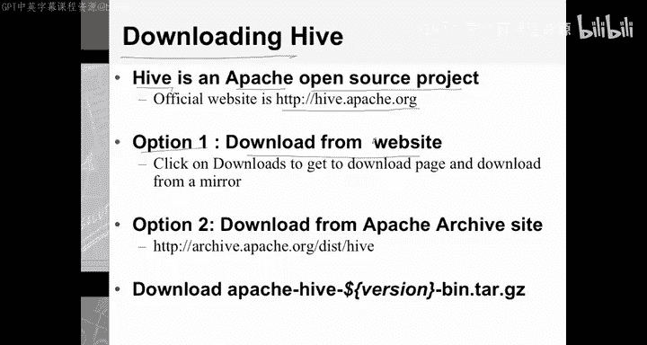
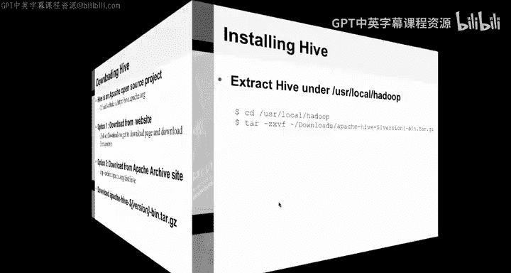
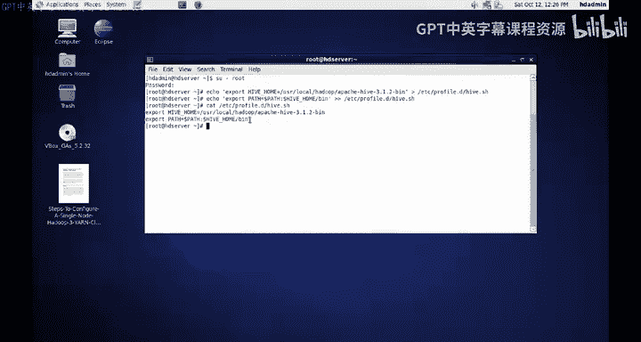
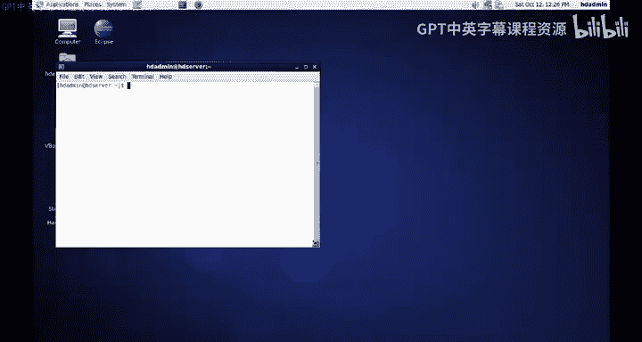
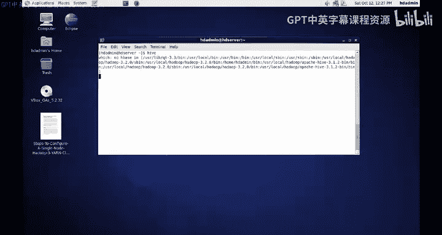
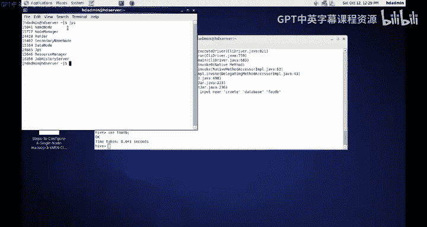

# 约翰霍普金斯大学《Hadoop大数据处理｜Big Data Processing Using Hadoop》中英字幕 - P67：2_Hive环境配置.zh_en - GPT中英字幕课程资源 - BV1g5u6zBExs

Setting up hive in this section， I'm going to show you how you can download， install， configure。

 and run hive using the command line interface。

One of the first things you have to do is to download hive。Hve is an Apache open source project。

 and so the official website is hive。appacache。org。In order to download hive。

 there are a couple of options， option one is to download from the website itself， which is hive。

apacache。org。

Once you get to that site， you click on downloads to get to the download page and then download from one of the mirror sites。

What you'll download is a file called Apache hive version number。

 which could be whatever the latest version number that you want to work with，bin。tor。gz file。

Option number two is to download from the Apache archive site， you can simply go to archive。appache。

org/di/hive that's going to take you to a folder that contains the various versions。

 you can go download the version that you care about。

Installing hive is as simple as extracting hive under Use local Hadoop。

 so all you have to do is CD to slash user/lashLocus/lash Hadoop。

 which is where we are installing Hadoop and several of the sub projectsjects。

 we already install Hadoop underneath it。Now all we have to do is execute the tarAR command with the appropriate options Z saying that it's a compressed file that you want to uncompress X is extract V forward both and F for the file that you want to extract。

 and that would be the fully qualified file name of the tarR or GZ file for Apache hive once you do that hive will be extracted under user local Hadoop folder and now that means you have installed hive。

It's a good idea to explore the hive installation directory。

 the hive installation directory has a folder record bin。

 which contains a very important command line program called hive。

 that's the command line program that allows you to run the hive interpreter。

There is also a folder called Conf， which contains configuration files for HF setup。

 there is one major configuration file， which is in template format。

 all you have to do is copy that template file to the absolute configuration file and make any changes that you want to make。

The out of the box configuration is good enough for what we need for this class there is also folder called H catalog which contains the information regarding the Hadoop catalog metadata server。

 which is the Hadoop H catalog project if you want to integrate your hive to H catalog。

 you would use this directory information from this directory we're not going be doing that so we're going to ignore that the examples folder contains some sample hiveQL examples if you want to look at some of the samples。

Liip folder contains the core hive jar files and several of the dependent jar files in order to run the hiiveve command line tool。

 so the hive command line tool that's located in the bin directory would refer to many of the jar files that's in the Lib folder。

The scriptris folder contains SQL scripts that are needed to be executed in the RDBMS for the hive metastore setup again。

 we' are not going to be using that because we are going to be using the Derby builtin database in order for us to have our metastore。

Once you have installed， hive。It's time to add hive to your path and in order to do that you need to set the high winterco home variable and also the path environment variable you can do this thing in your dot batchsh profile file。

 so I'm setting up my high winterco home environment variable to fully qualified path of location where hive is installed。

I'm also going to set my path environment variable to include hi home/lash bin and all these things should be done in your bash profile file。

 which is your dot profile file。Once you have installed hive， it's important to tell hive。

Where Hadoop runs and you kind of do this thing indirectly by setting up an environment variable called Hadoop underscore prefix。

 making it point to the location where Hadoop is installed at the time of this video creation Hadoop 241 is what we were working with。

 but the important thing is your Hadoop underscore prefix environment variable should be pointing to wherever Hadoop is installed basically the hive command looks at this environment variable and then goes to the appropriate Hadoop installation folder looks at the Ey s。

Haadoop directory to get access to all the Hadoop configuration files to figure out where the name node is where the resource manager is in order for it to submit jobs to the appropriate location。

 don't forget when you write hive queries， you're actually communicating with the resource manager to submit a job。

The other way by which Hy can also figure out where Hadoop is installed is if Hadoop command line tool itself is available in your path somewhere。

 which is really in Hadoop bin directory， then it would use that to the best approach is use the Hadoop prefix option。

 which is what we are going to do in this class。If you recall I said that hive tables are actually directories in HDFS。

When you create a hive table， it actually gets created under a very special director in HDF called/lash user/ hive/ warehouse。

 so every database that you create in hive， every table that you create within that particular database。

 all those things are placed under this folder in HDF。

Hve also uses a temp folder which is s temp this is the default configuration there's really not much you need to do in order to set these directorories。

 this information is already there in the hive configuration file if you want hive to be used by multiple users then you may want to do something like this。

 which is make the temp folder make the user high warehouse folder and give them group ridable permissions and of course that means all the users who are going to be working with hive should belong to that particular group。

So that's something that you can do， we are not going to do that in this class because we only have a single node installation and high being used by the HD admin user ID。

 that's perfectly fine。Configuring hive。If you recall， I said that there is a directory called Conf。

 which is located under Hive Home。Under this directory there is a template configuration file that has all the hive configurations and this file is called defaultxml。

 template even though it's a template it's actually built into hive If you look at this file you'll see a lot of configuration parameters or properties。

This has a lot of default high properties and default values。

 most to the default values are good except for one。

 which is the default value for the metato connection。

So what we need to do is we need to create a file called hivesite。

xml and we need to put this entry in there and if you look at the entry it says it's Javax。jdo。

option。 connection URL， which is really the URL connection to the metastore and what it's really pointing to is the Jdbc embeddedbed derby database which will be located in susers/Locus/ Hado/ hive metastore directory and the database file will be metastore underscore Db anyway。

 so this is the connection that we need to set in hiveite。xml so that we can have a metastore。

Now that was just the configuration now we need to initialize it。

 we need to create the database in order to do that。

 we need to use this tool called the schema tool the schema tool is located in the Hi home slash bin directory。

So we run the schema tool command with Init schema and DB type as Derby and what it'll do is it'll use the configuration file to initialize the metatastore database。

 I just want to tell you that the metastore database can be any kind of database it can be relational databases like MySQL or Postgres or it could be the Derby server database but for simplicity we're going to be using the Derby embedded database。

Once you have installed hive， then it's time to runve as a command line tool All you have to do is simply type hive in the terminal assuming you path this set or you can go to the bin folder and run the hive command when you type in the hive command which is also called the hi Ci the command line interface comes up and gives you a small prompt that says hive grade then sign and this is where you actually enter all your hive commands it's almost as if like you are in a SQL interpreter if you want to create databases if you want to create tables if you want and I'm talking about hive databases and hive tables which you are going to learn in the next section if you're going to want to do those things you would do it in this interpreter and all the metadata information about the database and the tables and where the data files are located are all kept in the hive metastore and then finally if you want。

ToQuit this hive terminal， then you can hit C D or quit semicolon or exit semicolon。

 and itll allow you to exit the hive interpreter。At this point。

 I would like to do a hands on installation demo on the hive software。

Here I am logged into my H server VM as H admin user ID and I would like to install hive software at this point I have already gone to the website and downloaded the hive installation Td or Gz file。

 So let me show you that file if I do an Ls minus L。Tilda downloads， Tilda slash downloads。Apache。

 hi， there it is。 that's the。Hive file that I have downloaded。

Now what I would like to do is do an installation， so what I'm going to do is Cd2 slash user local Hadoop。

 this is where we installed Hadoop， this is where I would like to install hype。

 so all I have to do is tar Zx VF。Tilda， which is my home directory slash downloads。

That's the folder bit where the hive download is Apache hive。And then he enter。

And that is actually extracting the Apache hive。Tor file。

 so you can say that at this point hive is installed。

Now let me go to the hive installation folder by to a PwD。You see that Apache hive is installed。

 let's go to the hive installation and let's do an LS As you can see。

 these are all the different folders that are there bin folder。

 which is where the hive command is found。Con folder which is where the configuration files are going to be kept So if I do an LS bin you'll see that it has the hive interpreter command and it also has a command called schema tool that we are going to use in order to initialize our schema。

If I do an Ls conf。Then you're going to see the several configuration files and one of them is hived4。

xml。 template， and we are going to create a new one called hive dashite。 xml All right。

 so let's do this， let's go to the configuration folder。And let me do a cat on hive。

Dash default dot Xml。As you can see， it has a lot of properties。

 maybe a better option would be to do a more。So that I can kind of show you there it is。

 it's an Xml file， and as you can see， there's a lot of properties here。

Name of the property and the value， name of the property and the value。 So for example。

 here's a property。That says hive。exec。cratter， this is where the scratch director is。

 slash time slash hive。So there's a lot of properties that's already there and one of the properties there is also the hiive metastore。

 which we want to overwride and the way we want to do that is by creating a file called hivesite。xml。

And inside that file， we need to put in。The entry that I showed you。Which relates to。

The metastore information。So I had a copy of it in my notes。So that I don't have to type it in。

 all right there it is， the property says Javax。jdo。option。 connection URL。

 which is basically saying what is the connection URL to the hive metastore？

And it says it's a JDBC connection based upon the Derby database。

 and the database is actually located right here in this folder。

User local Hadoop hive metastore and there's a file in there called metastore underscore Db and the database name is going to be called metastore underscore Db and it says create equals true。

 which the schema tool is going to use to create the metastore so I save it。

 I just wanted to do Ls again so notice that I have created a file called hive site。xml。

 I can do CA hive site。xml。And the file is right there， I can also do。XML W F。

 which is the well formed check for the XmL， and I can do hi dash site or Xml。

 make sure that there is no XmL error。 Okay， we're all set now at this point。So， now。

We need to do the next thing， which is really to initialize the schema。 Now， if you look at the。

Configuration file， it says that the schema is going to be placed in user Local Hadtobe hive Mestore and the file is going to be called Mestore underscore DB Let me do an Ls minus L on user local Hadtoop。

I misspell that， so user local hitoop right there， notice that there is no folder called hive metastore over there。

Well， it is going to get created as soon as I do the schema tool to initialize the metastore schema。

 so I'm going to go to my bin folder。So notice I'm in the Apache hive bin folder。And if I do an Ls。

 there is the hive command， there is also the schemeche or tool command。So at this point。

 I'm going to execute the schema tool command。Dot scheme or tool dot means pick it up on the local folder。

 dash in it。しキマ？Dash Db。type。Derby。Here enter。And now it's doing the initialization。

Of the meta store， which is based upon。Hve embedded database。

 Now let me go ahead and do an Ls minus L。And you'll notice that it created a folder called hive metastore。

If I actually look in the folder hive metastore， you'll see that there's a file or actually a directory called metastore Db。

That's actually where the meta store。Database is going to be stored。

 which is an embedded hive database。Okay， so at this point we have not only installed hive。

 we have also configured hive， now we need to make sure that we can run hive command from anywhere。

Okay， so now we need to set the path。So that we can execute the hive command from anywhere from any directory。

There are a couple of ways to do this。 One way to do this is to set the path environment variable in。

Dotbsh underscore profile file。The other way to do this is to create a file called hive。

tsh in Esy/profile。d folder， which is actually owned by root we're going to take the ladder approach So let's do that I need to become root for that S dash root。

Root root is the password。Now， what I'm going to do is echo single code， export， hive。

Underco home equals the complete path to where hive is installed， which is slash user， slash local。

 slash Hadoop slash。Apache， dash， hive， dash 3 dot 1 dot 2 dash bin。

So highway to Sc home is the complete path to where highway is installed。Single code。

Greater than slash。Edsy slash profile dot D。Slash hive dot H。 So I'm basically creating a file。

Call hiiveorage that has this one entry in it。Hit enter， and then another line echo。

Export Pat equals dollar Pat， which is the current value of Pat that includes the Hadoop installation bin folder。

Colon， app penduit， dollar， hive， underscore home。Which is where hive is installed， slash bin。

Single code greater than greater than because we want append it to the file， Esy slash profile。

Dot D slash5 dot message。Okay， now if I do CA slash ETC s profilefile。 D。Slash hive dot S， H。

You will notice that。The two lines have been placed in that file。

Now， let me exit out of root， exit out of the terminal。 If I launch a new terminal again。

You will notice that if I do an echo。

On。Dollar high。 underscore home。You see it is set to the right value if I do an Ls minus L dollar hive underscore home。

You will notice that it is doing an L minus L of the patchy hive directory， perfect。

Let me clear the screen。Okay， if I type an E dollar path。

You will notice that user local Hadoop Apache hive 312 dash bin slash bin is in the path perfect。

 So that means I can actually execute hive command。 So what I'm going to do is。

Type in the hive command， which is launching the hive command line。Interpreter。

There it is launching the hive command。And at this point。

 what it's doing is looking at the hive dash side dot Xml file， which is where the。

Information on metatores and we know that it's in user， local Hadoop， hive dashash metastore。

 and so it's connected to the metastore if I say show databases there is actually a default database and that's right there。

 I can execute the hive commands as you can see I can also do create database。Foo DB。

 semicolon that's supposed to create a database， but it failed。

And if I go back and look at it as to why it failed， that's because I miss theelled。Create。

 so let's do that， create。Database。Fu D B semicolon。Did I spellit it again， oh。

 I misspelled it again。Right， create。Daabase， full。D B， semicolon， There it is。 that's created。

 If I say show databases。You'll notice that food Db is created。

 Now you can go ahead and create tables inside food Db。 You can say use food Db。

So you can do all kinds of things All right， so what I'm showing you here is how to launch the hi interpreter in the next section。

 we are going to start using the hi interpreter more effectively to create databases。

 to create tables to load records into the tables， and then to make select statements。

 which is going to execute。Haadoop now one of the key things is that Hadoop should be running when you're doing all these things。

 you'll notice that if I do JPS。The Hadoop demons are running。

 The Hadoop demons need to be running when you're executing hive。

 The other important thing I wanted to point out is that since we are using the embedded。

Derby database， you cannot launch two hive terminals。

At the same time and execute your statements if you wanted to do that。

 you would have to install MyosQR database as the metastore， but to keep it simple。

 we have decided to go with the Derby embed Db just to kind of show you。

 let's say that I launch another terminal and then I type in hive。And I hit enter。

It's now launching the higher command line interface， and it's trying to connect to the embedded。

Derby Mestore。At this point， and it should eventually fail， it's going to time out。

I'm waiting for it right now， that's because there's already one terminal that's connected。Now。

 although the hyp interpreter has come up。It took some time for it to come up。

 It actually could not get the connection to the metastore。 So if I say show databases。

Let's see what happens。It is trying to connect to the hive metastore。

And is trying to get a list of all the databases， of course， we know that two databases are there。

 one is a default database and the other one is the F Db database that we created。

Let's see what it's going to return now。There it is， you notice that it's giving you。

An exception unable to instantiate org Apache， Hadoop high QL metadata， session high metasto client。

 So it's not able to establish。A connection to the metastore。

 so that's the point I was trying to make so I'm going to do a control C。

 get out of that so that we only have one hive running right now the way you quit out of hive is you type in quit。

Semicolon。And you can get out， you can also open a hive。And then。

You can do exit semicolon that will get to you out。

Or you can do control D and that also brings you out of the hi temperatureer One last thing that I wanted to show you was when I created the database called4 Db。

 it actually was placed under slash user， local Haddoop。Hive dash meta store。There is a metastore Db。

And this is where it is maintaining all the information， all right， and the actual database。

Folder where the data will be placed will be in HDFS， and that's why HDFS should be running。

 Hadoop should be running， Mare demon should be running in order for Hve to work for you。Okay。

 so that's the installation。Configuration。And running the hive interpreter So in this section I showed you how to download。

 install， configure， hive， and also run the hive interpreter。

 and now at this point you're ready to create tables， load data into hive。

 and then start making queries just like what you would do in a relational database。

