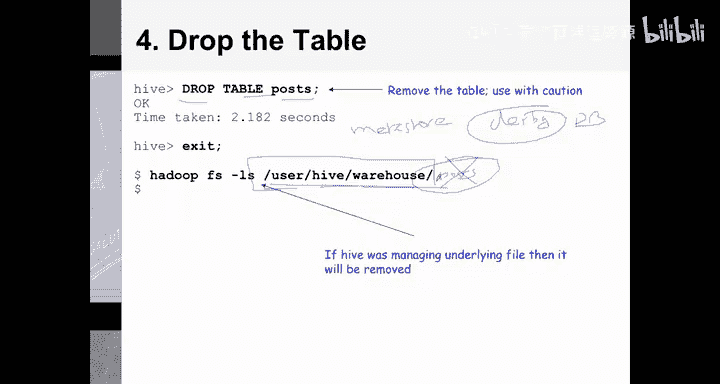
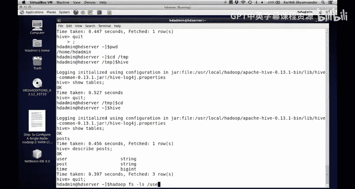

# 约翰霍普金斯大学《Hadoop大数据处理｜Big Data Processing Using Hadoop》中英字幕 - P68：3_Hive基础应用示例.zh_en - GPT中英字幕课程资源 - BV1g5u6zBExs

Simple， hive example。In this section， we will look at a simple hive example。As part of the example。

 I'm going to show you how to create a table in hive， load the data into the table。

And then query the data and then eventually drop the table as part of this section。

 you'll also understand some of the internals of how when you create a table what happens。

 when you load the data， what happens in HDFS， when you query what happens in Hadoop mapre。

 and then also when you drop the table， what happens in HDFS。

Okay， so four steps that we're going to go through creating the table， loading the data into a table。

 query the data and drop the table， create a table。

 I would like to create a table in hive and then store some data in that particular table Well let's look at the data off of the home directory there's a folder called examples。

Which has a folder called hive underneath it， there's a file called user post。txt。

These are the user's blog posts that I have as a THD file。

What I would like to do is look at this file from the hive interpreter itself。

 so I typed in C enter that puts me into my home directory。

 I type in hive that brings into my hive interpreter， once I get to my hive interpreter。

 notice how I use the bang option。You can say bang， and then you can give any UniX command。

And you can give the relative power the absolute path of the file followed by a semicolon。

 So really what I'm doing is escaping into my Uni shell by typing in bang and executing the CAD command and showing you the contents of user posts Now I could have shown you this at the Unix prompt itself but I wanted to kind of show you how in hive you can escape into your local shell and what it' showing you here is the contents of that file user post That's what I want to load into my hive database for that I need to create a table The other interesting thing to note here is that this file user post contains three columns。

The user ID， the blog post， and the time when the blog was posted。All separated by a comma。

This is important because we're going to use this as the foundation to create the table。Right。

 in order to create the table in hive， we need to execute the C table command very similar to executing the C table command in MySQL。

You say create table， post， the name of the table posts within parentheses。

 you're saying that three different columns， we have three columns， the user ID。Wwhich is the string。

 the post title， which is the string， and then the time when it was posted， that would be a big。

 these are the column names and then the corresponding data types。That's the first line。

You hit Cart's return after typing that create statement that will take you to the next line this is continuing the same hive command。

Row format delimd by the second line and the third line fields term by indicate how the underlying file should be parsed。

 so what you're saying is you have data that will be coming in as a text file and be stored as a text file and it's row format delim which is basically every row will be a record and the columns will be separated by a comma。

 that's what you're saying over here。You create the table， when you create the table。

 the important thing to remember is that it's actually creating the table in the hive Mestore。

 which is in the Derby database。It also creates a folder called post underneath the user hive warehouse HDF directory。

We'll see that in just a few more minutes， you say show tables。

It says that you have a table called pose。You say describe posts。

It'll tell you the columns that are there in that post， it's very similar to what you have in my SQL。

Okay， now that we have created the table， let's go ahead and load data into the table in order to load data into the table。

 we're going to use the load command， the load command takes data as one of the parameters。

And then the file that we really want to load is a file that is located in the UniX directory off of my home directory called examples。

 if you recall we talked about this under the examples folder there's a photo called hive。

 there's a file called userPo or TxT that's the file that I want to load so you say load data local impact which is a local file which is the UniX file and you give the fully qualified path to that file or relative path to that file and then you say overrite。

Which basically says， overwrite the existing records that are there in the table pose。

Override it with a new set of records that's coming from the user post directly。Now。

 the interesting thing about HDFS is that when you load data into a table。

 all it's really doing is copying file into that particular directory because the table is a directory and records are simply files where each row is basically a record。

So you'll notice that what it's really doing is copying from your local directory。

 the user posts and putting it to HDFS well where is it really putting it。

 it's going to put it under slashus/ hive/ warehouse/ postdirecty in HDFS I can prove this to you because if you go back to your command line and then you type in Hadoopfscat and you give the fully qualified path to the file。

 you'll see that it is placed under user hi warehouse post which is the directory which is really the table name underneath it the file is placed you'll notice that it's showing you the full records that are there in that file。

So at this point I would like to query the data from the hive database in order to query the data I would execute a select statement。

 so I'm here saying select count star from post， I would like to know how many records are there in that file。

 we know that that file contains only four records。

 but I wanted to illustrate the point of what's really happening behind the scene when you do the select count star it's actually going to launch jobs in this case it's going to launch one job。

 youll notice that it is also telling you what are some ways by which you can set the number of maximum producers。

 the number of maximum mappers and things like that。

The important thing is that when you execute this command line。

 it is actually launching a job and that's the job ID。

And that's the URL as to where you can check the status for your job。

It also tells you how you can kill a job。And by the way。

 the job has started to run when the job runs。You see it's going through the map phase。

 finishes the map phase and then gets into the reduce phase and then finishes to the reduce phase。

 and then the resultant is generated， which is。The output which is4 select count star from post should return you4 because there are four records in the file post so as you can see when you're writing a hiveqL that hiveQl is getting transformed into a map produceduce job。

Here's another query that I'm executing。I say select star from post where user equals user2 it's going to give me one record right there I put a bunch of dot dot dots over here indicating that that's where the job information is given to you。

 I'm also having another query over here， let's say select star from post give me all the columns from post where time is lesser than。

First time right here， the time is Unis long time， and I'm asking it to give me all the records where the time。

 which is the third column is lesser than this particular value。

 and I'm asking it to limit the results by two， so I should get only two results。In this case。

 I'm getting the two results right here。 I wanted to point out that you can also do a limit。

And finally， once you're done， you can drop the table。

You can drop the table by typing in drop table posts and when you drop the table。

 basically what it's doing is that it's going to go to user high warehouse。

 there was a folder called posts， it's going to delete that particular folder and it's also going to remove information from metastore which is in the Derby database to illustrate my point that it is going to delete that folder。

 if you do a Hadoop Fs Ls and to give the fully qualified path to the warehouse folder you will see that the post folder is actually missing。

All right， so at this point what I would like to do is do a demo of hive QL。

Alright， here I am logged into my HD server Vm as HD admin user ID。

 Let's go ahead and go through the simple hive example right， so if I do an Ls over here。

 you'll notice that I have a folder call examples， if I do Ls minusL examples and if I do。H。

User pose。You will see that there's a file called user posts touch in my Uni file system。

I can do CA examples。系。User post will show me the contents of the file。So there it is。

 shows me the contents of the file。 Now what I would like to do is execute the hive command。

There's the hi command right there， launching hive， I launch hive。

 I would like to demonstrate to you that you can use the B option to execute Uniix shell scripts or Uni scripts。

Cat examples。Hve。User post， so that is going to give me the user post file or concatenate the user post file。

 something went wrong there。Let me go ahead and put the right pad。Examples have user posts or THD。

 of course， that's what it is。There it is。It gave me the output as the contents of the user post file for the semicolon so I can come back to my hive interpreter。

At this point， what I would like to do is create a table。

 but before that I would like to show you that there are no tables so do show tables。

 so type show tables。Notice there are no tables， let me quit this。

Let me do a Hadoop F S dash L S s user。Hi warehouse and prove to you that there is nothing in that directory。

Let me go back to hive， launched hive。I would like to show。Tables。There are no tables and by the way。

 if I create a table that information will be kept in the metastore and where is the metastore。

 let me quit this again to an Ls minus L， you'll notice that there's a file called Derby。t log。

 which is where the Derby log files go and then you also notice there's a folder called metastore underscore DB。

That is where the Derby database stores all the metastore information， this is an embedded database。

So that's where we have that。If I type in hive and hit enter I'm back， all right。

 so now I would like to show tables again。There are no tables， let me create a table， create。

Cable called posts。The first column is going to be called string user string type。Post string type。

And then the time it was posted， which is going to be a big end enter when I hit enter over the create table is not complete yet。

 that's why it's giving me a greater than symbol saying you need to complete it。

 so I say row format delimed， hit enter feels terminated by single code come as single code。

 hit enter stored as text file。Semicolon that completes my create table。

I created a table called post where I'm saying the first column is called user which is a string。

 second column is called post， which is a string， and then the third column is the timest as to when it was posted。

 it is row format file， in other words every row is basically a record and the fields are terminated by a comma so comma is the separator and it's stored as a text file were dealing with a text file if I say show tables now you will see that the table post has been created。

Okay， so we have the table created and we can also do describe posts that's going to describe the post table that has three columns in it。

 user post and time， excellent。So now let's go ahead。And try to load data into the table。

 But before I load the data into the table， let me go ahead and quit。

To Hadoop F S dash L S slash user hive warehouse and show you。

That not only did it create information about the table in metadata。

It also created a folder called post in HDFS。 and that's where all the data is going to be placed in this folder called post。

 So when we load the data into the post table， it really is going to put it as a file in the post directory。

 That's what I mean by saying that hive actually overlays your table。As H ofstructies， and your。

Records as files and your columns are really fields within that particular file。Okay。

 so let's get back to hive。 now I would like to load the data and loading the data is really copying the data into the HDFS。

 but we can use the load command， load data， local， the local file。

Examples slash hi slash user dash post do THD， and then I say overrite into table posts。

 So I'm saying the contents of this file should be loaded into the table post。

 and if it has any data in it， overwrite it。You must spell this overwr， hit enter， error there。

 run this again， hit enter， and it's overrite into table pose。 I know what I'm missing。

 It's load data。Local impact。What is the input path。It enter。And then， all right。

 that should do the work for us， there it is。It now copied the file。

 it's always fun to make mistakes and you make a mistake you kind of learn as to what is going on All right。

 so if you notice it's actually saying it's copying the file user posts into the HD first file system and I can prove this to you。

Quick if I do Hadoop afe D Els before when we did this。We didn't have any files。

 Notice when I did this a few seconds ago， we didn't have any files。

 Let's see if there are any files now。 there it is。 So user post or THD got copied over here。

 So really bringing in data into hive data warehouses。

 really copying files into that particular director。 In fact。

 if you had directly copied files into that directory。 That would be perfectly fine。

 And you can query that particular table， not a problem at all。 Okay， so let's get back to hive。

 We saw that we were able to load the data into hive。

 Now I would like to query in order to do the query， I would like to execute a select statement。

 I want to know how many records are there。 And don't forget。

 select statement is really a map reduced job。 So select。Count store from post。

I want to know how many records there are。It enter。

This is where I'm actually running my Ma produced job。The name of the job is job underscore 1408。

 that's the job ID， the tracking URL is given to me。

 it's running the Mareuce job clearly indicating to you that when you are running hi queries it's a Mareduce job and there's the output right there。

 it generated the output， which is four rows。To illustrate my point。

 I can also run another command in this case， I'm going to run with the let's say I'm going to run with the ver clause so select star from To where user equals user2。

 I could do that and then put the semico in。Good ahead with the semicolon。

 So it's only going to give me records。 There are user two records。

 It's going through the map produce stage and it gave me one record， which is the user2 record。

 There's only one record that matches user2。 I can also do select star from post where。Time。

 which is a big end， which is a long， is lesser than equal to 1，3，4，1。One，3，4。3，1。8，2，1。3，3。8，3，9。

Smi golden。It doinging them a reduced reduced job。And there were two records that were lesser than that particular timestamp。

 I can also do limit one that will show me only one record。It show me one record at this point， Okay。

 so now I would like to drop the table。Drop。Table post， I drop the table。 What does that really mean。

Well， if I do show tables。Sorry。Well， it's a mistake。 short tables。 There are no tables right there。

 The post table is gone， which means the information about the post table from metadata。

 which is in the deerby databases there no more， but it also deleted。The directory。

 So if I do Hadoop FS LS user post， you'll notice that the directory doesn't exist。

And there's nothing underneath it So every table that you create is really going to go right underneath user high warehouse as a directory。

Now because you have not created a database concept yet or the concept of a schema。

 everything goes right under user high warehouse， but if you have a database like a schema and then put tables underneath that schema。

 then the schema would be a directory under warehouse and then underneath that there'll be directories for each of the tables which we'll see in the next section in this section we looked at how we can create a table。

 low data into the table， query the data and finally drop the table as part of this example we also saw some of the inner working software tube in terms of how metastore stores information about the schema which is really your table name and all the column information and of course that data itself gets stored in HDFS so really creating a table is like creating a directory in HDFS and loading the data into the table is like copying files into HDFs into that special directory and queryting the table is really all about。

Some kind of a Mare program and you don't even write the Mareice program。

 the hilayer automatically creates mapre program and submits that as part of the job。

