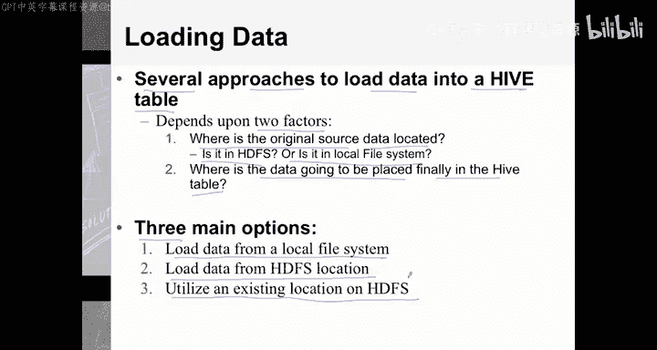
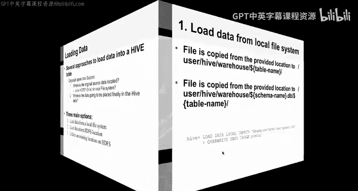
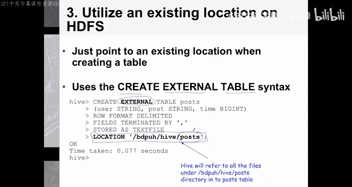
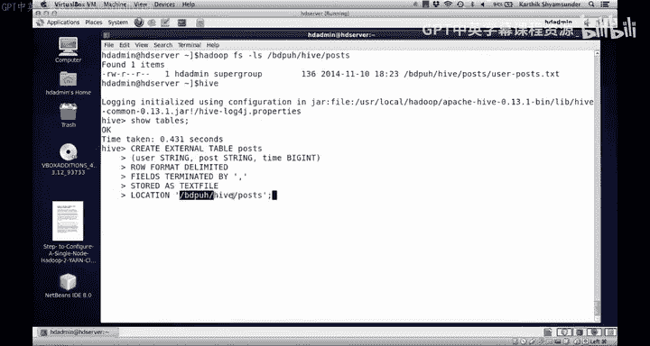
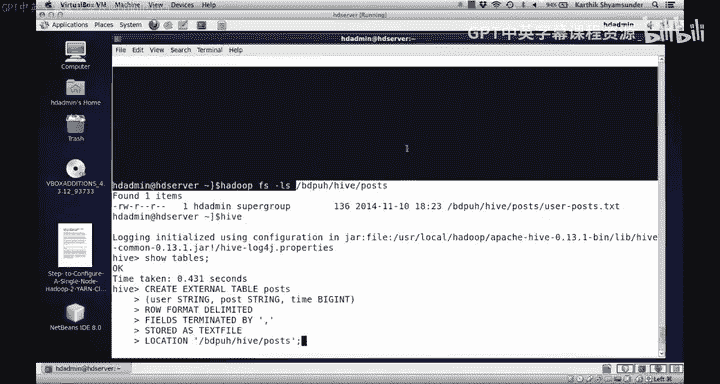
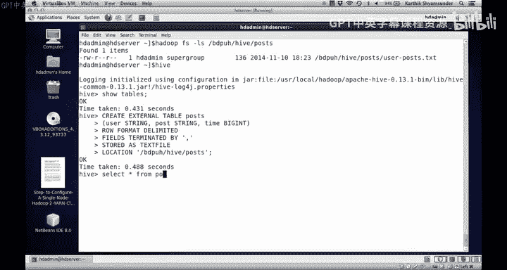

# 约翰霍普金斯大学《Hadoop大数据处理｜Big Data Processing Using Hadoop》中英字幕 - P69：4_数据加载策略.zh_en - GPT中英字幕课程资源 - BV1g5u6zBExs

Loading data in this section， we are going to look at approaches to loading data into a hive table。

There are several approaches that are available to load data into a hive table。

And it actually depends upon two factors。The first factor is where is the original source data located？

Is the file that you want to load into hive table already in HDFS or is it in local file system。

 that's one consideration， the second consideration is where is the data going to be placed finally in the hive table。

We saw before that whenever you load data into the hive table。

 it gets placed by default under slash user sH s warehouse slash table name。

 and that's where the files get copied。Based upon these two considerations。

 there are three main options that we have， one would be to load data from a local file system into the hive table。

 the second would be to load data from HDFS location， the data is already in HDFS。

And then the third word would be to utilize an existing location on HFS and don't really do any kind of a copy。

Let's look at all three options。

Let's look at option one， which is to load data from the local file system。

Let's assume that the data is located in the local file system under examples high user posts of my home directory。

So if you want to load data from the local file system into the hive table， which is the post table。

 then you use the load syntax that says load data local indicating that the file is locally located and the path which is really represented by inputpath。

 which is the input path to be the local file system path， it could be relative or absolute。

That will load this file， which is the user post file， which is locally located into table pose。

 which means it's really going to copy the file into slash user slash hive slash warehouse。

Slash table name， in this case it's posts assuming that it doesn't belong to any specific schema。

So the point I'm trying to make is it automatically loads into the table name。

Directy under user Hi warehouse， that's assuming that there is no schema。

 and if there is a database schema， then it would be under slash user s hive/ warehouse schema name。

db/ databasease table name。Don't worry too much about the schema schema is coming in the next section。

The second approach is to load data from HDFS location The idea here is that if you already have the data in HDFS。

 then you want to load data from HDFS into the hive table so the syntax there is load data impact notice the word local is missing the word local is missing and because local is not there the path to the file is really the HDFS file so what you're saying is hey this is the file that I want to load and I want to load that file into the post table so let me it would copy this file。

 which is BDP hive post user dash post which is already in HDFS into slash user hive warehouse the table name which will be the post table。

If it is part of the schema， then it would load it up into the schema name do Db slash table name folder。

The third option is a very interesting option。 The third option basically says。

That if you already have the files in HDFS and in the right location。

 then rather than copying it from local to HDFs or from HDFs to HDFs let's go ahead just point to that particular folder so the idea here is when you create a table。

 you use a syntax called the create external table syntax and the important thing here is that when you do that。

 you don't simply end with stored as text file， you extend it to say what the location of the data is going to be in this case slash BDpo/lash hive/lash post is the location where the data already exists。

If the data already exists in that particular folder， you just want to point to that folder。

 so this would be another option。The other advantage of this is。

Besides the fact that you're not really doing any copying that if you decide to drop the table。

 it doesn't really delete the data， the data is still going to be there in that external location。

So there's a lot of advantages to using the external table syntax。

Let's go ahead and try the external tables andt because the other two are pretty straightforward。

 it's copying from the local file system to the HDFS directory and the second one is copying from HDFs to HDFS that's also pretty straightforward This is an interesting one so let's go ahead and look at this。

Here I am logged into my HD server VM as HD admin user ID。At this point。

 I would like to do a demo of the Create external table concept。Before I do that。

 let me show you the actual directory with the file in HDFS。Haadoop F。

 S dash Els slash B D pull slash hive。Slulash post。This directory contains a file called userPo。 Txt。

 the data is already there。Now I would like to launch hive。

And I would like to create a table called Post。Show tables。

 Let's make sure there's no table called pose。Let me go ahead and create the table post here I am creating a table called post notice I'm using the word external over here saying that this table post is going to point to data that's located in slash Bd s hive slash posts。

 which we already know exists and has。

The files over there。

Okay， so here enter the table is created now if I go in and do select star from post。

 I didn't even load any data if I just say select star from post。

Notice how it's showing me all the records from that particular file。

 indicating to you that it's pointing to that particular directory。

The other interesting thing to note here is notice when I did a select star it didn't really launch a Hadoop Mareuce job。

 when you do a select star from post it realizes that it's really a streaming of data so it simply streams all the data into the standard output。

 it doesn't really run a Mareduce job， which if I had done select count star that would actually launch a Mareuce job。

Bless， it launched a Mare job for me。And if you actually go to the resource manager and look at the job history server。

 you'll actually see this particular job launched。All right， anyway。

 the main point I wanted to show you was the create external。

 and in this case it pointed to an existing folder。

The idea here is that it's possible for you to bring in data into HDFS and organize the data in a certain way so that when you create these external tables。

 you can simply point to those directories and it goes back to original concept that we talked about when we brought in data into HDFS and we had several discussions on it where we basically said that you may want to think about how you organize your data because if you organize your data in the right way then you can simply have hive tables just overly on top of that and be able to access the data using hiveQL that's a pretty powerful concept by the way I also wanted to show you that if you drop the table posts。

It will drop the table， but it will not drop the data， it will not delete any data。So， if I quit。

And if I do Hadoop FSLS on the post folder， you'll see the file will still be there。

 versus if you have taken option one and option two。

 which is really to load the data into a special directory， then in that case， if you drop the table。

 it'll actually drop the files underneath that folder。So in this section。

 we looked at three different approaches to loading data into a hive table。

 we said that we could load data from a local file system into the hive table in which case the data gets copied into the HDFS file system。

You can also load data from HDFS location into the HDF first location for the table。

Or you can utilize an existing location by using the createate external concept。

