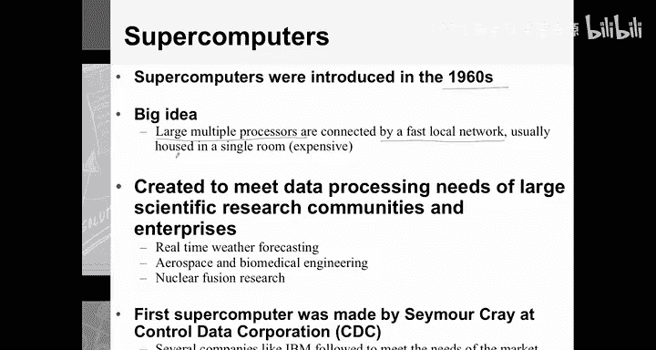
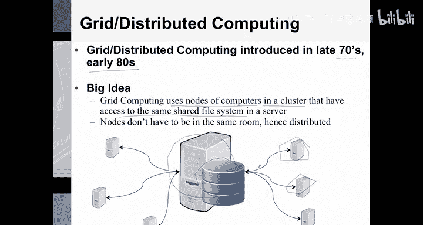
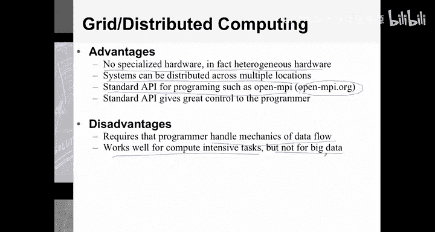
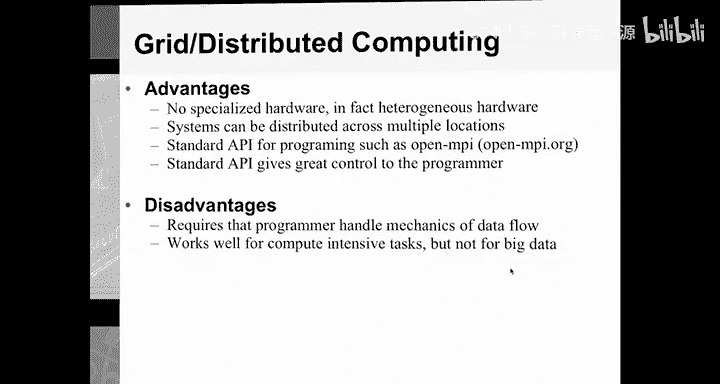
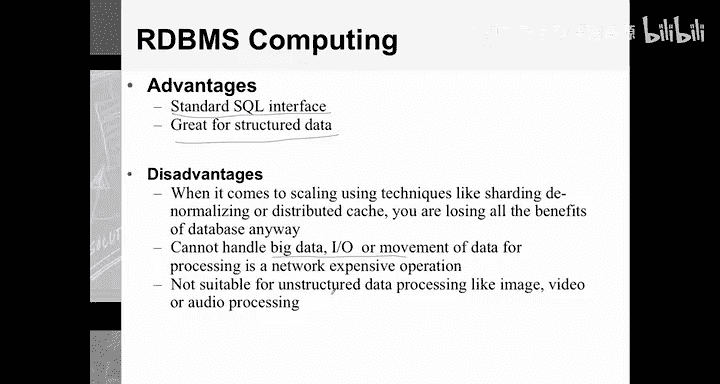
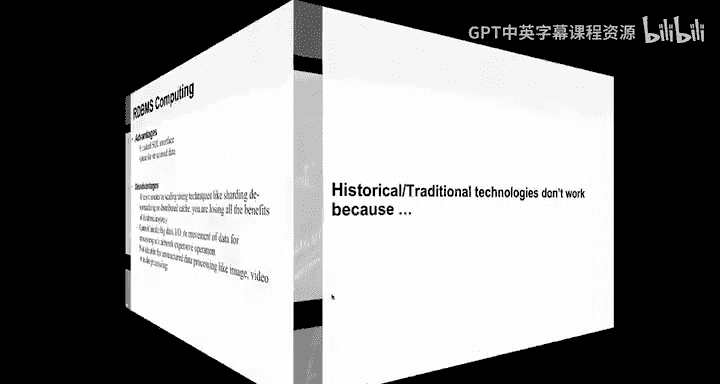
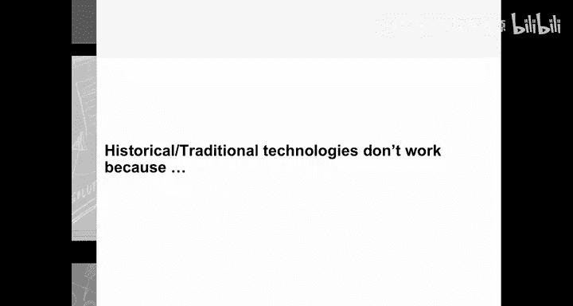
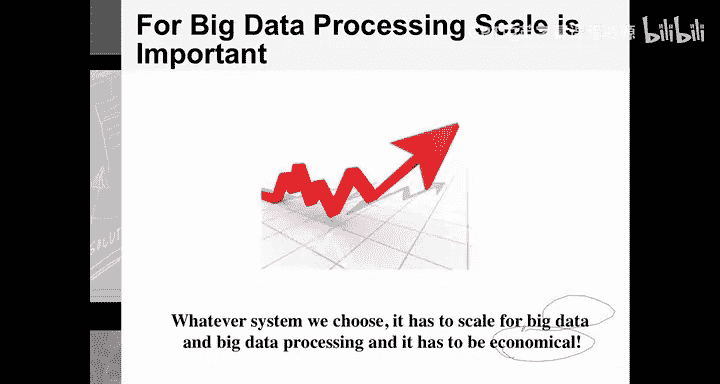

# 约翰霍普金斯大学《Hadoop大数据处理｜Big Data Processing Using Hadoop》中英字幕 - P6：5_历史数据处理技术.zh_en - GPT中英字幕课程资源 - BV1g5u6zBExs

Historical data processing technologies。In this section。

 we will look at how big data issues have been tackled historically and the shortcomings for those solutions。

We will especially take a closer look at supercomputing user supercomputers。

 distributed or grid computing， and ADBMS computing and their shortcomings。Supercomputers。

 supercomputers were introduced in the 1960s。And the big idea behind them was let's use large multiple processors that are connected by a fast local area network so that we can compute things faster and move data between the CPUs faster。

These were usually housed in a single room， such systems were pretty fast。

 but they were quite expensive。

They were privately created to meet the data processing needs for scientific research communities such as the real time weather forecasting system or even the aerospace industry。

 also the nuclear fusion research labs。The first supercomputer was made by SeymourCray at Control Data Corporation。

 and they dominated the market for several decades after the 60s。

 but then several companies like IBM followed to meet the needs in the market。

Here's a supercomputer from 1977 This is the K1A that was used by NcarR。

 the National Center for Atmospheric Research to meet their computing needs This computer is really not in use anymore。

 it is said that your iPhone today has more computing and storage capability than this particular computer。

But that is not to say that supercomputers are not being used anymore。

 here's the IBM Blue Gene P supercomputer used at the Argon National Lab。

So what are the advantages and disadvantages of supercomputers？In terms of advantages。

 since data can move between the processes rapidly。

 all the processing can work together on the same task。

 which means it's really great for CPU intensive tasks and great for highly complex real time application and simulation。

In terms of disadvantages， these are very expensive to build and maintain the Cray computer in the 1970s money itself costed about 2 to3 million。

 you can only imagine what such supercomputers would cost today they also used very specialized hardware。

 which means you cannot take the Ram from the Cray supercomputer and put it on the IBM supercomputer。

They also use specialized software， which means each has its own programming。

 language and methodology， which meant that developers cannot move from one platform to another platform easily if they have to do that。

 they will have to relearn the new system。There is also limited vertical scaling。

So corporations or organizations typically buy a supercomputer with maybe quarter or half the computational capacity。

 and then as the need arises， they would buy more， but once they max out。

 there was no way to add a second machine to balance the load across the two computers。

So there is no concept of horizontal scaling here。Let's look at grid or distributed computing grid or distributed computing was introduced in the late 70s and the early 80s the basic idea or the big idea behind it was let's use nodes of computers in a cluster and have these nodes access to the same shared file system in a centralized server and the nodes don't really have to be in the same room they can be distributed so what you're seeing over here is one centralized server with a shared storage and lots of computers that are connected to the centralized server。

These computers connect to the centralized server， download the data， process the data。

 and then upload the processed data back to the centralized server。

The SEI at home project was a classic example of grid or distributed computing success SEI stands for search for Extraterrestrial intelligence。

 this particular project basically took radio telescope data。Broke it into 0。

35 megabytes worth of unit and send it to the various computers around the world for processing。

These computers had screens savers， which were the SE screen savers that basically when the computer was free。

 would download the data， process the data and upload the data back to the centralized server。

So what are the advantages and disadvantages of grid or distributor computing？

The advantage is clearly no specialized hardware， in fact。

 heterogeneous hardware would work as in the case of the studyD project。

Systems can be distributed across multiple locations， they don't all have to be in the same room。

 there is also a standard API that was developed such as the OpenNpi from opennpi。

org and this standard API gave greater control for the programmer to do his or her operations。

But there were some disadvantages it required the programmer handle the mechanics of data flow。

 and this can become quite complex all the threading and locking and synchronation had to be done You'll see that later on we will be doing Hadoop and in Hadoop Hadoop takes care of all these things for us。

Also， they work well for compute intensive tasks with small amount of data。

 but when it comes to big data because of the network bottleneck， they don't quite work well。

Now let's look at AudiBm computing。This was popularized in the 80s。

 and I'm sure many of you work with RDBMS computing。

The basic idea here is use a single server with attached storage for stor and processing the data because we want to honor the asset properties for the data。

Classic examples of suchy is， of course， the Oracle database， the MyQL database， SQL server。

 Postgres and so on and so forth。And you typically scale up。

 you don't really do too much scaling out because if you scale out。

 you have to do things like sharding or denormalization or even introduce distributor caching。

 and when you start doing that you have some cons and the cons are， for example， if you do sharding。

 it requires you to maintain a create and maintain a schema on every instance of the server that's overhead and if you do denormalization。

 then you're losing some of the benefits of the relation model。If you're doing distributed cash。

 then you suffer from core cash th， it's great if things are under the cache， but if it's not。

 then your performance slows down。So when it comes to RDBM computing， there are some advantages。

Of course， you have the standard SQL interface。And it also it's great for structured data。

 but there are some disadvantages， when it comes to scaling techniques like sharding。

 like we discussed or deorization or distributor cache， you're going to lose benefits of RDBm anyway。

 so why bother doing RDBm computing？Also， they cannot handle big data because IO or a movement from the disk to memory or from the centralized storage to other client servers is going to be expensive。

And they're also not suitable for unstructured data processing like image processing or video processing。

 although they work fairly well for text processing。

So we have seen that historical or traditional technologies don't work。

Qute well， because all the data cannot fit in a single machine and all processing cannot be done on a single machine。

 and even if you put the data on a single machine， bringing the data from the machine to the various distributed systems such as in the grid example was an expensive proposition because of the network bandwidth。

You know there's a great coat by Grace Hopper when it comes to distributor computing。

 she said in pioneer days they used auxen for heavy pulling and when one ox couldn't bud a log。

 they didn't try to grow a larger ox， we shouldn't be trying for bigger computers but for more systems of computers。

 this is a great coat。And that becomes actually the processing foundation for big data。

For big data processing scale is clearly important。

 It is clear at this point that whatever system we choose。

 it has to scale for big data and also big data processing。Has to be economical。

 So these are two key factors that we really need for big data processing。

So in this section， we looked at historical or traditional big data processing methodologies or technologies such as supercomputers。

 distributed grid computing。ADBM is computing and learn about T pros and shortcomings for those solutions。

