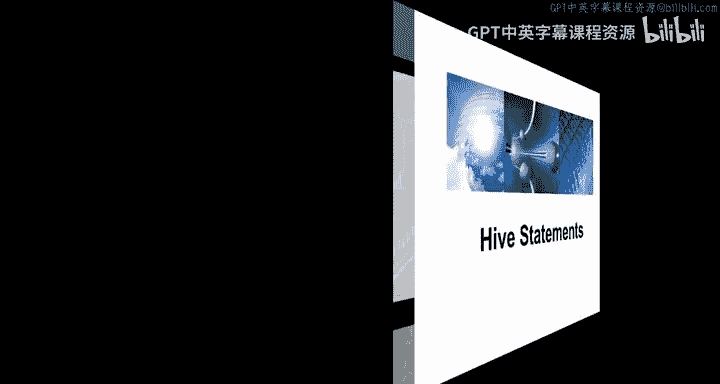
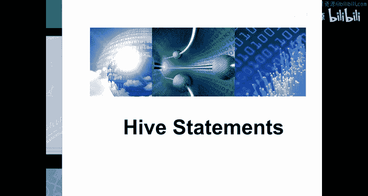
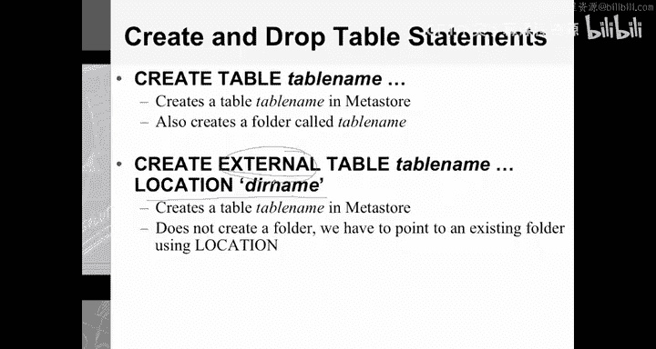
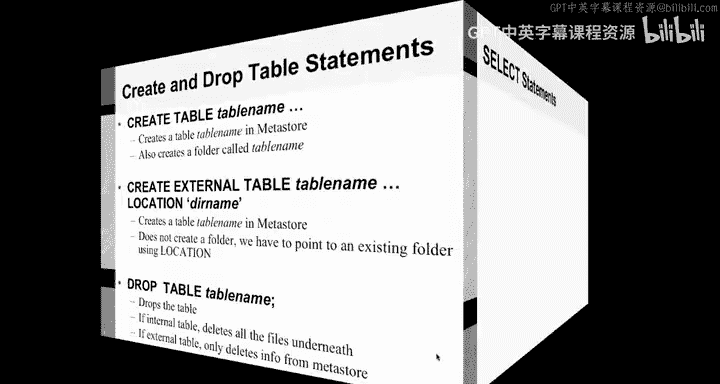
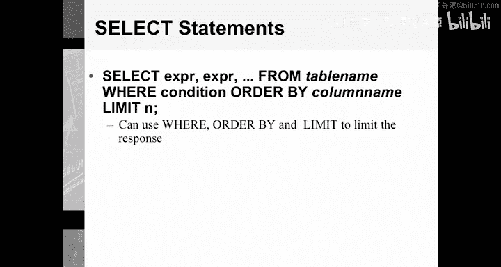
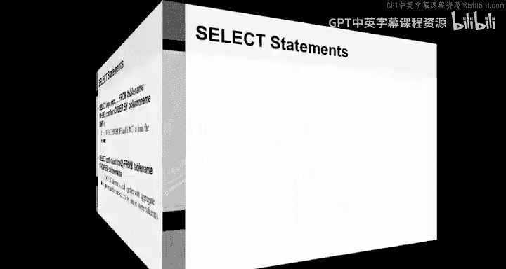
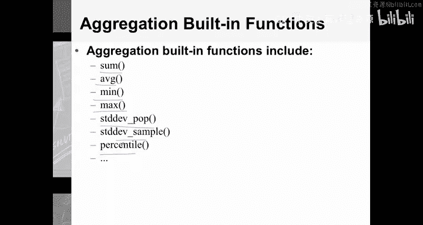
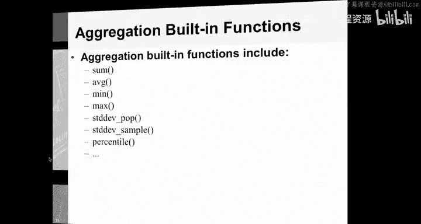
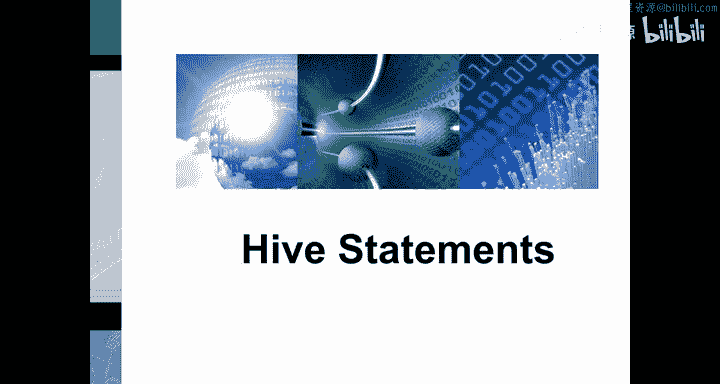

# 约翰霍普金斯大学《Hadoop大数据处理｜Big Data Processing Using Hadoop》中英字幕 - P70：5_Hive语句解析.zh_en - GPT中英字幕课程资源 - BV1g5u6zBExs

Hve statements In this section， we will look at various hive detailed statements such as creating and dropping a database。

Creating and dropping a table。Altering a table， we'll also look at querying hive tables using select statements and built in functions。

Create and drop database statements。Just like in MySQl you can have a schema。

 you can have a database in the same way in hive， you can create a database or a schema the way you create a database or schema is by executing the create database。

Command。Followed by the database name， So for example， if you say create database。

Customust for the customer。 Then it would create a folder。Under slash user， slash hive。

Slash warehouse。Call cut。Dot DB。 So notice the notation dot Db。

 that's the name of the database directory。You would also create an entry in the metastore。

 which is the Derby metastore under that name。If you want to use the database。

 then you simply say use database name and now you are under the context of that particular schema or of that particular database。

 and then when you create tables inside the database。

 all those tables would be created underneath the database name so if you had a table called table1。

 it would be created inside customD inside custom。 Db directory， if you use custom DB。

If you don't have any databases， then it uses the concept of a default database。

 in which case the tables will be created right underneath userH warehouse in the previous sections I had tables but I didn't have any database in such situations it was creating the tables right under userH warehouse so that's the default database。

You can also drop a database， if you drop the database。

 then it deletes the database information from the metastore。It will also delete database。

 Db directory， this command can only be successful if the database is empty， in other words。

 you can drop a database only if you have dropped all the tables in the database。

This is for protection reasons。Create and drop tables。You can create a table in hive。

 I use the create table syntax we have gone through the create table syntax in the previous section。

 I just wanted to kind of tell you that it's possible to create a table。

 don't forget you can create a table， you can also create external table。

Where you define where the location of the directory is going to be。 you use this technique。

 If you already have the directory laid out in a certain way and all the files are appearing in a certain way。

 then you might want to use the external approach。 The other advantage of external approaches if you drop the table。

 it does not delete the folder associated with that particular table。 you can drop the table。

 of course， as I mentioned to you， if it's an internal table， it deletes all the files underneath it。

 If it's an external table， it only deletes the information from the metastore。

 And so the directory structure is maintained。 I personally like to use external tables。

 I bring in the data into the right location and simply use the metastore to make a schema or to make。

A logical table on top of the directory structure so I can start doing my queries。

Select statements， select statements are used to query records from the hive table。

 they are very similar to what you have in SQL 92， in fact it's a subset。

You can have select expression  one， expression2， expression 3 from table name。

 where expressions are basically column names and column expressions。

You can also have the select from with the where condition。

You can have select from with a where condition also in order by clause。

You can have select from table where order by， and you can also do a limit because when you're doing select in hive。

 you're actually dealing with maybe millions or even billions of records。

 and you may want to get the top 10 or top 100。

But maybe with the top million， you could do a limit。

 you can also do select the different columns from table， you can do a group by。

You can do select select specific columns from a table。

 you can select and apply a built in function on the column。

You can also do select star from table name。 if you recall， if you do a select star from table name。

 it is not going to run a map produced job because it says， oh， it's a regular straightforward。

Scan and so it just simply scans the table and prints out the output。You also have order statements。

It's used to alter a table definition such as adding a column or deleting a column or even changing the type of a column。

 you may want to look at the documentations for altering a table。

 by the way the documentation is available online so you may want to simply go to the hiive website and look at the documentation and all the syntax。

Here are the different data types for the columns。You have tiny endt， which is a one byte integer。

 small and two bytes， in for four bytes， big in for eight bytes。

You may want to use Big in for timestamp， you can also use a timestamp。

There is also float double string is what you use for strings。

And then there's also a bull type which takes an value of two or false。

Well then there's this question of schema violations What would happen if you try to insert data that does not comply with the predefined schema if you think about it in hive when you're inserting records into the hive table。

 all you're really doing is copying files into a directory if you insert records into a relational database when you insert that is schema checking that is going on here there is no schema checking that's going on so it's completely possible that you may have a schema。

 but then your data records which is in the file are not really following the schema so the question is what would happen when you have a situation where you are trying to retrieve records which is not following the schema。

Here's an example， I have a table and in the table I have inconsistent records。

 so I have a table which has the user ID， the blog name。

And the timestamp notice in all the three cases， everything is fine。

Except for one case where the timestamp is 2012-01-05 rather than using some kind of a Uni offset。

 it's using a YYY MMDD format that's not right。If you do describe on the post table。

 which is where this particular file is going to be associated with。

You'll notice that the data types are string， string and big end， this is supposed to be a big end。

But it's not a big end， it's a date， so that's not going to be the right column value。

But what would happen if you do a select star from post in such a situation。

 you'll notice that it print out the user ID。The blog。And then the timestamp。

And then it prints out the user ID， the blog it's supposed to print the timestamp notice it actually prints a null。

 so whenever a schema is violated， it actually prints null in such situations or it returns nuts or to be precise it evaluates it to null。

 So the point I'm trying to make is because of the nature of hive which is yeah you have a schema but you can surely bypass the schema and insert records into the table by simply copying bad records。

It's when you query using the select statement when the schema chicken kicks in。

 and at that point it translates invalid columns to be no。Hve also has several built in functions。

 you have numeric functions， string functions， conditional functions， date functions。

 aggregate functions， I put a dot dot dot to illustrate that there are many kinds of functions。

Hve also supports a mechanism to provide user defined functions if you don't like any of the functions here。

 you're welcome to write your own user defined functions in Java and make it part of your collection in hive。

If you are interested in getting a complete list of all the different functions。

 here's a link to which you can go to。To get a list of all the functions。

I wanted to show you some of the functions， here are some of the numeric functions。

 as you can see you can round off， you can flow seal， sine， cosine， absolute values， square root。

 all kinds of calculations can be done。These functions can be applied on columns。

There is also string built in functions。Get the length of the string and cat two strings， upstr。

 upper lower trim， you can even have regular expression replacements。

There is also date functions where you can convert from MuI timesstamp。You can convert two date。

 year， month， pull the year or month or day out of a date。

All kinds of things can be done with date once again。

 I have a bunch of dot dot dots indicating that there are many， many more functions。

Then there are aggregation functions。For example， some average minimum max， standard deviation。

 percentile， all kinds of functions are available for data science activities。

In this section we looked at various hive detail statements such as creating and dropping a database。

 creating and dropping a table， altering a table， we also looked at quotating hive tables using select statements and built in functions。

