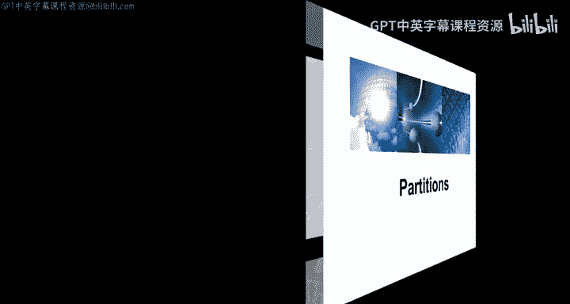
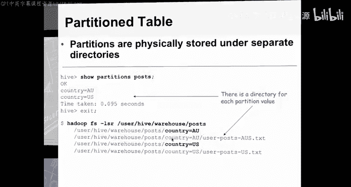
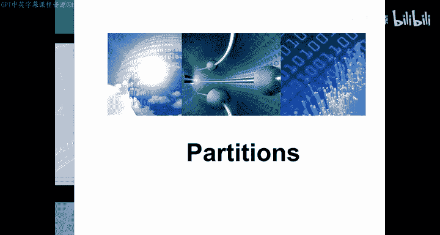

# 约翰霍普金斯大学《Hadoop大数据处理｜Big Data Processing Using Hadoop》中英字幕 - P71：6_分区管理.zh_en - GPT中英字幕课程资源 - BV1g5u6zBExs

Partitions。In this section， we will learn how partitions are created， managed， and used in hive。

To increase liquidity performance， Hve has created the capability to positionition data in a table。

Values of partition column actually divide the table into segments。

 and the entire segments or entire partitions can be ignored at query time when you query tables。

This is very similar to partitions。In RDBM systems。

It's important to realize that partitions have to be properly created by the users。

 and when you're inserting the data， one must specify the partition to which the data applies at query time。

 whenever possible I will automatically filter out the partitions。

The best way to understand partitions is to go through a scenario。

Let's say we have a table called post， I would like to create the table pose with a partition。

 so when I create the table pose I say what the first column is which is the user ID which is a string。

 second column is the block post， which is a string， the third column is the timestamp。

You'll notice that after the create table and the columns。

 there is the partition section where I'm saying I would like to partition this particular table by country。

 which is a string。Now typically when you create partitions， you create partitions on columns。

 but we don't have a column called country， but the way you want to think of partitions in hive is that country is actually a column。

 think of it as a column， in fact， when you describe post。

 you'll notice that it tells you that it has user， post， time， and country as the four columns。

If you type in show partitions posts， show partitions is built in command， notice it says okay。

 it doesn't really show any partitions， we know it's a partition to table but there are no partitions。

 that's what this is trying to ask are there any partitions， there are no partitions at this point。

As I mentioned earlier， users have to be careful when they have partition tables。

 when they insert records into the partition table。

 you need to explicitly say that you're associating these records to this particular partition。

So for example， if you have a table that is a partition table like the blog post table。

 you cannot simply load data from the local file system into the blog post table。

 notice that that is giving you an error saying that you need to specify the partition this is what I mean by you have to be careful when you load the data into a partition table。

The way you do this is you have to say load data， local impactpath。

 load the data from the local file system， overwrite into table posts。

 and then you have to give the partition ID， so you're saying that all the records in this particular file belong to the partition country US so country is the column name which is the partition name and its value is US。

And the interesting thing is when you have partitions， those partitions are mapped into directories。

 if you recall I started this section on hive by saying that hive takes the concepts of a database and mapped it into directories and files and contents within a file。

 even partitions are mapped into a directory， and I'm going to show you that in just a minute。

Let's say I want to load another data， so here I'm loading in pathth。

 I'm loading the Australian blog post。Override into the table post， partition country equals AU。

 so I'm actually creating another set of records into the post table， except in this case。

 it's going to have Australian blog posts。Now when you say show partitions pose。

 notice it saying that there are two partitions， country equals A and country equals AS。

 because those are the two sets of brackets that we inserted as part of partition loads The one interesting thing that I wanted to show you was the table pose is actually part of the default table and that's why it's appearing under a slash user slash hive slash warehouse pose。

But notice the partition is nothing other than the partition column name equals the value so really the directory where the data goes。

 the partition data goes is really the name of the column which is country equals the value that particular column you'll see the same thing for the country equals US which is the second partition so really the point I'm trying to make is partitions are nothing other than directories。

 in fact subdirectories inside your table。

Now， when you query partition table， for example， if you say select star from post where country equals US and user equals user 1。

What you're really saying is that you want all the data where the country is US now we know that's a partition to column。

 which means the entire directory which contains all the files or which are all the blog posts from US will be ignored so when it does the map produce for the job。

 it's not going to include those files as part of its map produce input。In this section。

 we learn how parts are created， managed as a subfolder and used for improving query performance of big data。

