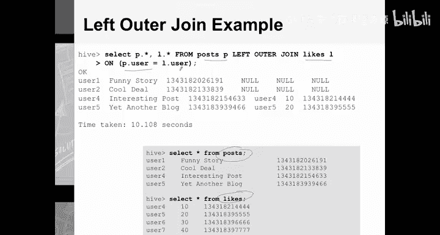
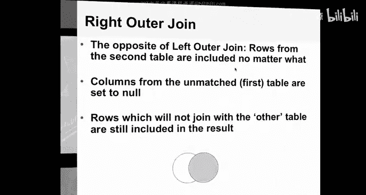
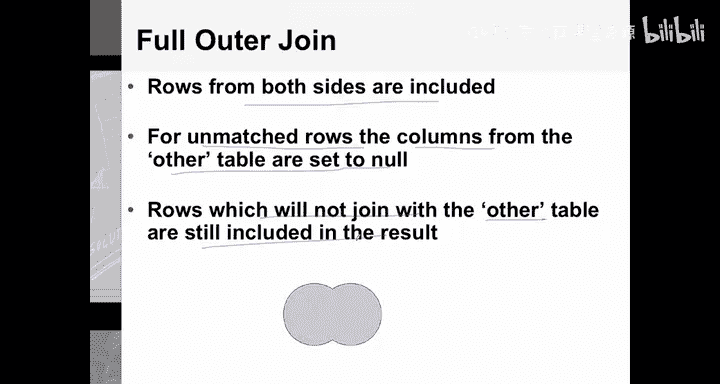

# 约翰霍普金斯大学《Hadoop大数据处理｜Big Data Processing Using Hadoop》中英字幕 - P72：7_联结操作实现.zh_en - GPT中英字幕课程资源 - BV1g5u6zBExs

Joints in this section， we will learn how to join tables in hive。

We will discuss both inner and outer joints。So let's look at joins in hive。

 the concept of join allows you to join multiple tables based upon some key。

 it's very similar to joins in relational database management systems。

Hve joins are trivial compared to Java Mareduce， if you recall how difficult it was to perform joints in Mareduce。

Hve supports both inner and outer joints， when it comes to outer joints。

 it also supports left outer join， right outer join and full outer joints。

The default join in hive is inner join。So let's look at a joint scenario。

Let's say we have two tables。A post table and a life table。

What I've done here is select start from post so you can see the results of the post table in the post table。

 we have three columns， the user ID。The blog story。And also the time the blog was published。

And then I have another table called the likes table。

 so I've done a select star from likes to show you the likes table records。You have the user ID。

 how many times they liked an article and when was the last time they pressed the like button？

So you have the user ID， some kind of account， and timestamp。

What I would like to do is show you scenarios where we can join these two tables。

So let's look at inner join。In inner join the rowsor joined where the keys match。

 let's say we have two tables， table one， and table two， they have their keys。

 the intersection of their keys。Is what is going to be used in the resultant。

 so the rows that do not match either of the keys are not included in the result。

Let's look at an inner join example。You saw the post table and the like table a few seconds ago。

 let's join the two tables and let's do it as an inner join。The joint syntax is select P dot star。

 which is all the columns from the post table， Well why is it called P if you notice it says from post P。

And likes L so those are your alias names for the table。

 so here what I'm saying is I would like to join the post table and the likes table。

 and I would like to join it based upon the user ID so P dot user and L dot user will be equated if the two things match then the two records will be joined。

Of course， I'm going to be printing out all the columns from the post table and all the columns from the like table over here。

And when I do that， you'll notice that in the data scenario。It's record 4 and record 5。

 it's user4 and user 5 that matches across both the tables。

 and so the resultant is user 4 and user 5 and so notice that it's giving me all the columns from the post table and all the columns from the like table。

So here are the columns from the post table。And here are the columns from D。

Light table when I do the join。There are three kinds of outer joins， there's left outer join。

 right outer join， and full outer join， so let's look at left outer join。In left outer join。

 if you have two tables， table1 and table2， then rows from the first table， which is table one。

 are included whether they have a match or not in the second table。

So if you notice in left order join， you will see all the records from table one。

The columns from the unmatched table are set to null and the rows which will not join with the other table are still included in the result。

Let's look at the left outer join。Once again， we have the。Potable。And the like table。

Here I'm joining the post table with the like table based upon the user。

But except I'm doing a left outer join。And I'm printing out all the columns in the post table and the likes table。

You'll notice that it is bringing in all the records from the post table， user one， user 2。

 user 4 and user 5， user one， user 2， user 4 and user 5。

When it does not find columns in the other table， it simply uses null as the column value。

So you'll notice that user one and user2 does not appear in the like stable so it makes it null that's left out of join。

There is also the concept of right outer join， which is the opposite of left outer join。

 where the rows from the second table are included no matter what。

 and the columns from the unmatched table are set to null， of course。

 the rows which will not join with the other table are still included in the result。

Let's look at the right order join example。I have the post table and the like table。

I'm joining the post table with the likes table and it's going to be a right outer join。

I'm going to be printing out all the columns from the post。

And the lightss and the join key is the user ID， so here's the join key。In this case。

 I'm going to be bringing in all the records from the right table， which is the like table。

 so you'll see user 4， user 5 user 6 and user 7 appearing。

 but for the records in which there are no corresponding records in the left table or the number one table or the first table。

 the attributes or columns would be set to null， notice that these columns are set to null and the rest of the columns appear。

All right， that's great， join。There is also full outer join in full outer join rows from both sides are included for unmatched rows。

 the columns from the other table are setturnal。Rs。

 which will not join the other table are still included in the results。

Right， so let's look at the。Full auto join example。Here we have again。

 the post table and the like table。It's going to bring in all the records from all the tables。

 so we're going to see user one， user two， user4， user 5， user 6， user 7。

 all the records are appearing。In the rows where there's no join。

 those columns will still appear and they would be set to null。

 as you can see in all these situations。That would be full order join。

In this section we learned how easy it was to perform joints across tables in hive。

 don't forget when you do joins in hive， they actually translate into a map producedd job。

 whether we have to do inner joins or other joins， it was as simple as writing a select statement。

Compared to the complexity we saw in Java Ma producedd programming。

