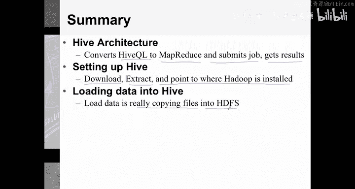

# 约翰霍普金斯大学《Hadoop大数据处理｜Big Data Processing Using Hadoop》中英字幕 - P73：8_Hive模块总结.zh_en - GPT中英字幕课程资源 - BV1g5u6zBExs

Data analysis using hive summary。In summary， we learned that the Hive architecture simply converts hiveQL。

 which is a higher level queryie language into Mareice programs and submits these Mareice programs as a job into Hadoop。

 processes them and gets the results， gives it back to the client。

 so really Hve is built on top of the Hadoop platform。In terms of setting up hive。

 it's as simple as downloading hive， extracting the tarball。

 and then simply pointing to where Hadoop is installed。

 and we can do this by simply setting up an environment variable called Hadoop_ prefix。

 which is where Hadoop is installed。In terms of loading data into Hve。

 it's as simple as copying files into HDFS， there are two different ways to load data into hive。

 one is from the local file system into HDFS， but if you already have the data in HDFS。

 you can simply point to the data in HDFS and that way you don't really have to copy into the specialized folder。

In terms of hive statements， we have create and drop De statements for creating databases。

 create and drop and alter table statements so we can create tables。

 we also have variations of select statements， it's not as extensive as what you can do in SQL 92。

 but apparently good subset is available in hive in R40 to do queries。

There are also built in functions， and you can also define your own functions。

There's also partitions that allows for partitioning a table for performance reasons。

We also have the concept of joins， which allow you to perform inner joins and also outer joins。

 the defaultte is inner joints。