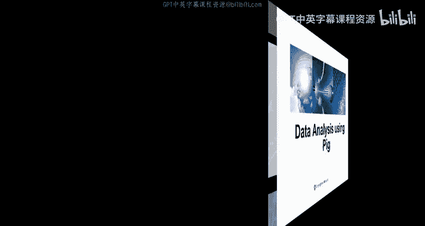
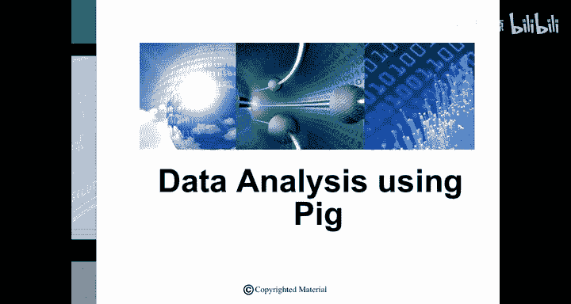
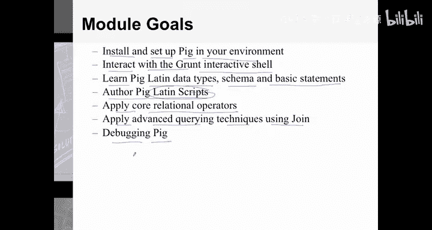

# 约翰霍普金斯大学《Hadoop大数据处理｜Big Data Processing Using Hadoop》中英字幕 - P74：9_Pig导论.zh_en - GPT中英字幕课程资源 - BV1g5u6zBExs

Welcome。Data analysis using P。We spent the last several modules learning about Hadoop architecture。

 HDFS architecture， HDFS programming， yarn map Reduce architecture， yan map Red programming。

 and in the process got into nitty gritty details of mapre using the Java API。In this module。

 we will look at how we can use a higher level programming language called PG to perform big data analysis in Hadoop。

So what are the topics in this module first we will look at the pig overview。And architecture。

 then we will set a pig。Then we will look at the grunt interactive shell to interact with the pig environment。

 then well look at the P Latin language basics， then we'll look at the data types and scheme available in PG followed by the core relation operators。

 these are the key operators that you can take advantage of when you're writing pig scripts。

Then we'll look at the relational join operators to join multiple data sets。

 and then we'll look at the debug operators that help you develop and debug pig scripts。

What are the module goals？Module goals are to learn to install and set a P in our environment in the same Hadoop environment where we installed hive。

Now we'll be able to install P and make P work in conjunction with the Hadoop interact with the grunt interactive shell so that we can execute command line pig statements。

 also we can execute pig scripts， learn the pig Latin data types。

 schema and basic statements to write a pig script。Other complete pig Latin scripts。

 apply the correlational operators in order to order the pig Latin scripts。

And also apply advanced codinging techniques using join。And finally。

 learning to debug P scripts using some of the debug operators。

