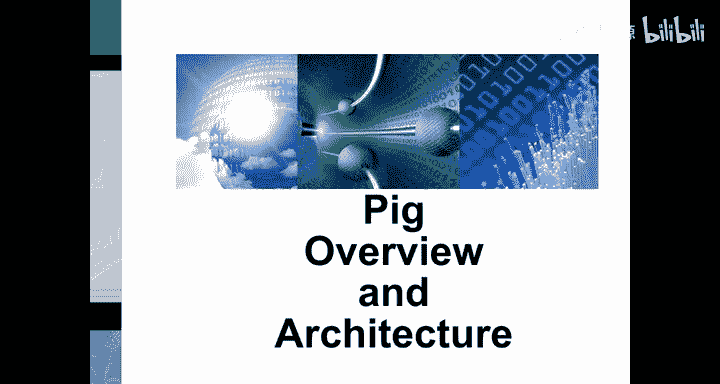
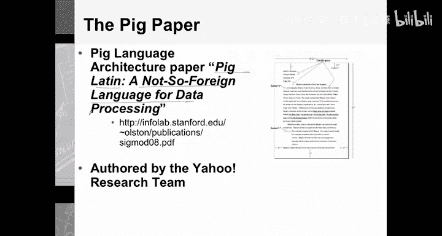
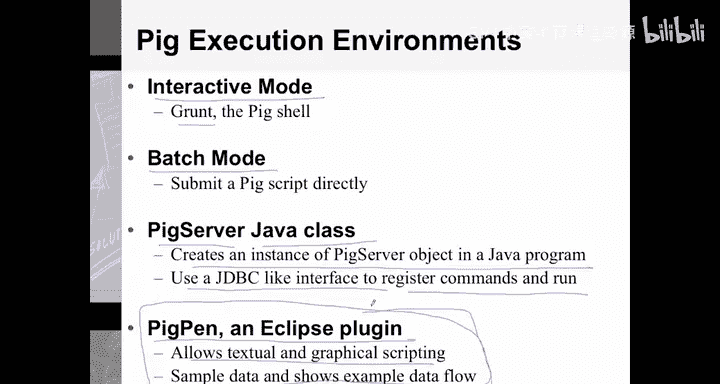
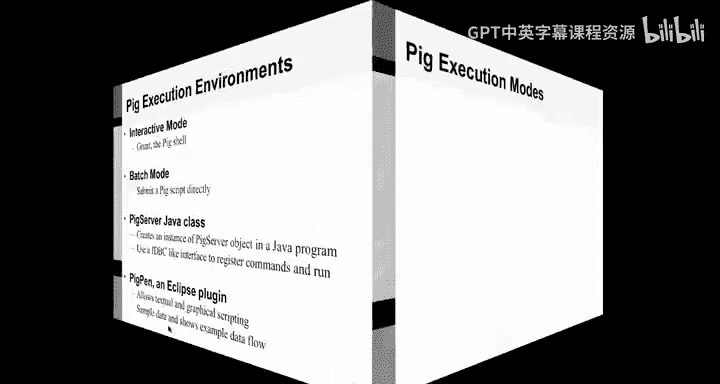
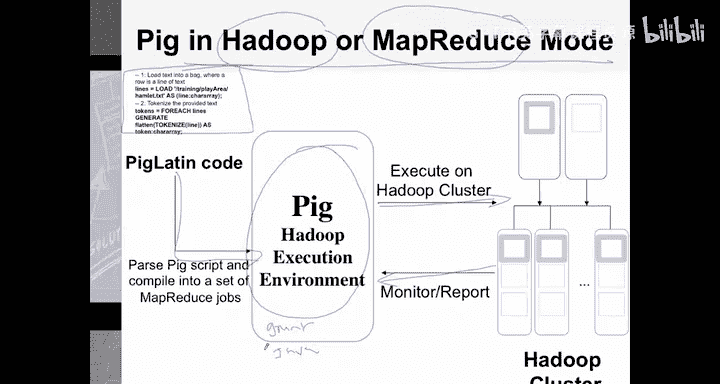
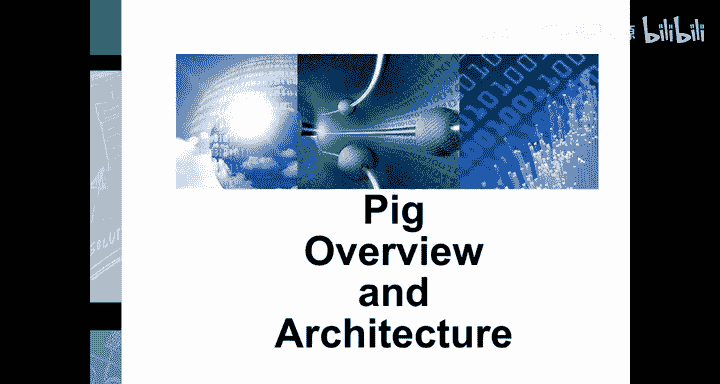

# 约翰霍普金斯大学《Hadoop大数据处理｜Big Data Processing Using Hadoop》中英字幕 - P75：10_Pig架构与核心特性.zh_en - GPT中英字幕课程资源 - BV1g5u6zBExs

Pig overview and architecture。As the title suggests， I will give you an overview of PG。

 including What is PG， the motivation behind P， its origin， concepts， and pig architecture。

So what are the challenges with MaRuce， Mareuce programming is hard。

 especially MaRduce programming in Java is hard。Because it requires someone who knows how to write Java programs。

And not only does the person have to know how to write job programs。

The Mareduce programming paradigm itself is different。

 so it actually requires someone who understands this new distributed computing paradigm developed by Google initially。

Map produce programs take longer to write， it requires someone to write a program using the Hadoop API。

 you have to compile your code and then package it and then run it by submitting a job to Hadoop。

 and so in order to do a simple program like the Word count program， it takes00 plus lines of code。

Let's look at pig history， Yahoo in their data science department or data warehouse department needed a way for nonJa programmers to access the data that is in HDFS and perform analysis on the data and these were data scientists。

 data analysts。Who wanted to access the data and process the data？

So Yahoo developed something called Pig PG is a tool that they developed that would fit their data analysis needs。

 so what isPG is a language that is not based on one liner SQL now if you compare P to hi hi you write one line SQL statements。

 you can write several of these SQL statements， combine them。

 but you typically write one line SQL statements。It is not based on that one liner instead it is considered to be a data flow language I like to describe to be more of a data flow language。

You have some data， you load it up into a relation， you filter it， and then you further filter it。

 maybe you'll filter it further， then you can do group I operations on the results。

 and then you may want to produce some kind of an output So it's more of a dataflow language it's also easy to learn and easy to use Now I have to say this thing with a word of caution which is it's easier than writing Java programs。

 but I would have to say that pig maybe a little bit harder than hive because hi is based on select syn syntax and it's not a very complicated syntax whereas pig can become complicated when you start combining bunch of pig statement when you start combining a series of pig statements to create the effect or to create the program that you want So it's easier than mapproduce for sure make data on the cluster accessible easily。

 What this means is now the data that's on the cluster can be process。

Easily by using a higher level language like PIG， which will access the data and run map programs on top of that。

Today， Yahoo， Twitter， Netflix， and a few other companies useP extensively for their data analysis needs。

So what is pig？Pig is a platform for analyzing large data sets that consists of a high level language for expressing data analysis programs。

 So the key principle behind。Pig is a high level language。

That's the pig Latin language that they have。Pig is an abstraction on top of Hado。

 so it provides a high levelvel programming language designed for data processing。

 which is the P Latin language and basically what it does is it converts your pig scripts or P syntax or pig Latin syntax to Maperties programs and executes them on the Hadoop clusters。

 so you can start seeing some similarities between hive and Pig now。Now。

 PG is an open source project managed by the Apaches of Foundation。

It's no more under the realms of Yahoo， which originally created it。It's now an open source project。

So what are the features of pig。Pig can work with or without data types and schema Well。

 what do I mean by this When you work with hi， you have to create a table。

 you have to say what the different fields are for the file and then you load the data and you process the data whereas with P you can simply say I want to deal with this file or with this series of input files。

 you don't really have to say what the schema is it'll automatically load the data and it'll load the data as field1 field2 field3 as generic types and then you can convert it to whatever type you want at runtime so it's a little bit more flexible from that perspective。

You can also take a data and filter the dataset sets so you can start with the data and then you can filter it down and then you can further filter it down and we'll see examples of this as we go through。

You can also sort data sets。You can also use group syntax to group datasets， you can join datasets。

 and there are also several built-in functions that are available that you can take advantage of and if you don't like any of those functions。

 you can always write your own user defined functions in Java， compile it。

 create Ja files and have access to those functions in your P Latinin language。So it's very powerful。

Let me show you an example。So let's say that you have user records。

And you also have the pages that have been served for these different users。

 and there's a question that is being asked by the data scientist。The five pages。

Most visited by users that are aged 18 to 25。Well， how do you do this， well， you load the user data？

You also load the page of data。You take the user data and you filter it by age when you take the user data and filter it by age。

 now you have a new data set which is filtered by age。

And then you join the user and the page because the page table has the name of the user who has served this particular page。

 and then you group on the URL， and then you count the clicks and then you order by the clicks and then you take the top five。

You get the idea there， so it's a data flow language。

 how you're able to take a piece of data and then how you're able to take another piece of data and then join them and then group them and count them and then order them and then print it out Now rather than writing one big statement to do this。

 you actually write a bunch of pig statement or pig Latin statements。To get the answer that you want。

This example that I'm showing you is from Yahoo and this is the mapreduce code that you have to write in order to get the code working right if you do the same thing in P Latin。

 which is the P script then it's as simple as okay let's go ahead and load users into this relationship called users and then notice I'm using the filter relational operator。

 the load relation operator join group for each generate order。

 limit all these things as special operators that I'm using in order to create the effect that I want and send the output I know we haven't got into the syntax yet。

 which we'll get into but as you can see how you can use P Latin as a language to actually flow through the data to get the effect that you want that's the point I wanted to make。

So let's look at pig use cases。There are two major use cases that we have with P One is ETL。

 which is extract， transform and load you have some data。

 you want to transform that particular data into a different data and load it into a different location and the classic use cases within that is clean balance so you take the data and because it doesn't require a schema to start with。

 you may want to start with no schema on the data and then filter through the data or work through the data and pull records that you care about or clean records that you care about and then create a new data which is a much cleaner data So that's a use case that you have you can also join with other data sets so when you have one data and you have another data and you want to do join operations。

 you know how difficult it was to write map joins we were able to do some in hive here you can do join operations too So these are some classic pig use cases。

 the other interesting use case of P is research and explore。Raw data。

 sometimes you're given raw data， you don't really know what you're looking for。

 you don't really know what the results you're looking for。

 you're trying to figure out what is going on in the system。

 you're trying to figure out what is happening with the data。

 you're trying to figure out what is happening with the users。

 So for that you want to be able to play around with the data process data and get results Now typically in data warehouse situations。

 you write your SQL scripts， you get the results and then figure out what is going on in the system。

 you're talking about big data and when you're talking about big data。

 you can' write SQL scripts So this is your modern SQL kind of syntax so pig Latinin is the language that you write to explore the data as a data scientist to understand the data and maybe come up with business processes that can change the way you operate your business。

So research is another very important use case of PEG。What's in a name。

 what do I mean by what's in a name， Well， why is it called pig pig is not an acronym for anything。

Originally the project researchers called it the language。

 that's what they referred it until someone suggested the word pig。And so， pig got stuck eventually。

The P project lived up to its name because P Latin is the programming language。

Grurunt is the interactive shell， just like we have the hive shell， we have a shell for pig。

 which is called grunt。Pigggy bank。Is the name of a CPPA like shared depository where people upload their pig utility scripts？

And then there is also PP， which is an eclipse ID plugin in order for you to write pickI programs easily。

Pig analogy there is a very interesting analogy between the P programming language and P this is actually coming from Alllan Gates's book Alllan Gates by the way is one of the key contributors towards the P project and he's also the cofounder for Horton Works so this is coming from his book。

Pigs eat anything Well what's the analogy between pigs eat anything to the pig programming language Well the pig programming language or the pig Latin language can operate on any data whether it has metadata or not if you notice in hive you have to have a metadata here you don't have to have a metadata it'll consume any data that you have and then on the fly you can figure out what is it that you want to do with the data because when you ask it to read a file。

 it will read the file and then it'll read the record and then it'll place all the fields as $1 $1$234 and then you can figure out what you want to do with the fields That's what I mean by saying pigs eat anything they can consume any data Ps live anywhere Well what does it have to do with the pig programming language or the pig Latin language the pig Latin language as a much loftier goal the authors or the creators of the pig programming language want pig to be the language for distributed or。

Da processing， in other words， what they're saying is big should be the language of choice。

It shouldn't matter whether you're using distributed computing using Hadoop or distributed computing using MPI or distributed computing using any other technology there are several other distributed computing technologies。

 what they're saying is you should be able to use the P programming language or the pig Latin programming language to be precise for you to process your data and then the pig Latin language will translate your pig Latin scripts to whatever the underlying technology is。

Of course， the version of PI that we're going to be using is the one which was first implemented to work on herdo。

 but in the long run they plan to make it work everywhere。Pigs are domesticated animals。 Well。

 what does that mean Pig is designed to be closely controlled and modified by users。

 So there's a lot of custom functionality that you can do with pig。

 If you don't like some of the functions that's available in pig， you can write your own functions。

 you can write your own supporting functions， you can write your own data loading functions。

 you can write your own。Data output functions， whatever you want。

 as long as you write a Java class that implements a certain interface and implements the methods for that interface。

 you can compile it， create a jar file， add it into your jar and you can start using it within P so the point is you can actually domesticate pig Latin you can make it do whatever you wanted to do because it's so flexible pigs fly big processes data very quickly that's one because when you write a program in P it actually is as straightforward as writing Mareice program In fact it used to be there used to be a time when you wrote a program in P it was actually 13 times slower than if you would have written a Mareuce program but then the folks at Yahoo began working really hard to start making pig translations into Mareuce much better the last time I've heard it's a1 to1。

1 difference。In other words， if a Ma or program takes one hour to run， a big program may take。1。

1 hours to run In fact， in many cases， if you end up writing your own Mareduce program。

 it may run slower than a big program because you're just not experienced enough in doing the right efficiency。

 The developers that wrote big。 they actually satAT down with a bunch of top class Hadoop mapreduce developers。

 ask them how they would actually implement join， how they would implement group by。

 how they would implement filtering logic and then use their best practices to generate the code that needed to be generated for the big programming language and so the point I'm trying to make is big Latin programs are faster to write than Mareduce programs and also big Latin programs run quite fast。

When Yahoo created the P project， they also published a paper called P Latin and not so foreign languagengu for data processing here's the URL let's go ahead and take a look at that here's the pig Latin paper they talk about how P Latin is a data flow language they also talk about the user defined functions。

The data model， the parallelism， the expressions， the pig Latin language itself。

 in the internal data models， they have bags and tuples which we'll talk about later on。

Pretty good paper you might want to quickly scan through this paper to get an idea as to what they were thinking when they wrote the P programming language of course the P programming language has changed a lot since this paper came out。

 but you get the idea。

Let's look at the architectural components of PIG One of the first architectural component that we have in P is the P Latin programming language it's a commandbased language。

 it's designed specifically for data transformation， you take a piece of data， you transform it。

 you transform it， you get D prime， you transform it again， you get D prime prime。

 you transform it again， you get D prime prime prime。

 so you get the idea you always take the data and transform it， and you get new data sets。

So it's based upon the pig Latin programming language。There is also a pig compiler。

 which will convert your pig Latin scripts to mapreduce。I want to make sure that you understand this。

 it's not that when you write a program in P that is going to take your Ps andts and generate Java code and then compile it and then load the Java classes into main memory to run the Java program or to run the Mareduce program they actually have written a bunch of Mareduce classes so when you write your Plod in scripts。

 all the P compiler is doing is translating it into the appropriate Mareduce classes that they already have Gene classes that they've already written and then it executes that As I said to you P compiler also strives to optimize execution。

Then there is， of course， the pig execution environment。

The environment in which pig Latin commands are executed are currently there is support for local and Hadoop modes or to be precise mapreuce modes。

 you can run P in local mode， in which case you're not running any Mareuce or you can run in Hadoop to be precise。

 it's called the Mareuce mode where your P scripts get translated into Mareduce programs。

Interactive shell， there is an interactive shell。And the interactive shell is called grunt。

 we will be interfacing with that shell。You can run P in batch mode。

 which means you can simply write a P script， 17， 1，800 lines of P script。

Create a dot PG file or dot TXD file typically I like to use the extension dot PG。

 you can place the file in your local file system or in the distributed file system。

 and then you can ask PG to execute the PI program。Or the P script。

There is also a P server Java class， it can create an instance of a P serverver object in the Java program。

 you use JDBC like interface to register commands and run。

 so that's also of one of the internals of PG。Pig pen is an eclipse plugin。

 it allows textual and graphical scripting and sample data shows an example of data flow so if you're using eclipse。

 you may want to download P pen and play around with it。

 I personally use Ne beanss a lot more than I use eclipse。

I haven't really worked with Bigpen yet， but you might want to try that。

Big execution modes。Pig can be executed in one of two modes Local mode When you execute P in local mode that means you're executing P script in a single JVM it uses Hadoop's local mode concept and the local file system in order to execute your P scripts The advantage of this is that it's great for development and experimentation because you're really not using the Hadoop cluster in order for you to write your P scripts。

Easy to debug from that perspective。Mareduce mode when P runs in Mareduce mode。

 the P Latin code is converted into Mareduce job and executes them on the cluster。

 whether it's a fully distributed cluster or semi distributed cluster or pseudo distributed cluster。

 it will run within that particular cluster so it will actually talk to the resource manager。

 it will talk to the node manager， it will talk to the data node to get。The Ps working。

 it'll actually submit a job in this particular mode。

So let's talk about P in Hadoop or Mareduce mode to be precise That's what we call it it used to be called the Hadoop mode now it's called the Mareuce mode。

 you can write your P scripts， put it into a file， you submit the Pcr into the P execution environment which is your grunt environment or the P server remember I showed you remember I mentioned to you that there's something called a P server if you don't want to launch the grunt shell and you want to execute your P scripts within your Java program you can do that and that's what the P Hadoop execution environment is so what I mean by this is it could be either the grunt shell or it could be your Java program no matter what it'll translate your P script into a bunch of Mareuce jobs if necessary submit those mapreduce jobs and then finally get the results back to you that's the basic architecture behind P。

In this section we learned that PG is a highlevel language that can easily process the data in the Hadoop cluster without writing any Mareduce code Pig was originally developed by Yahoo for the data scientist and now is an open source project used by many companies one of P's major component is the Pig Latin language which is used to write P scripts。

 P statements or P scripts can run in local mode or Mareduce mode。

 when Pig runs in local mode it is not using the cluster it is running PG in a single JVM great for development。

 but when it runs on Mareduce mode it uses the cluster resources and so actually communicates with Hadoop demons and submits the job to Hadoop。

