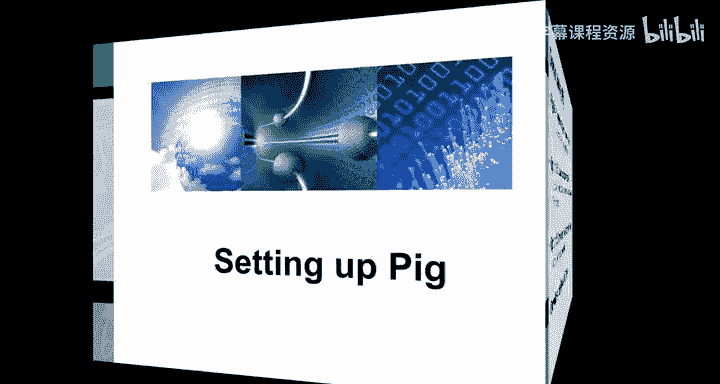
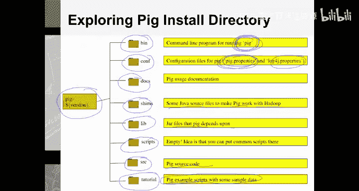
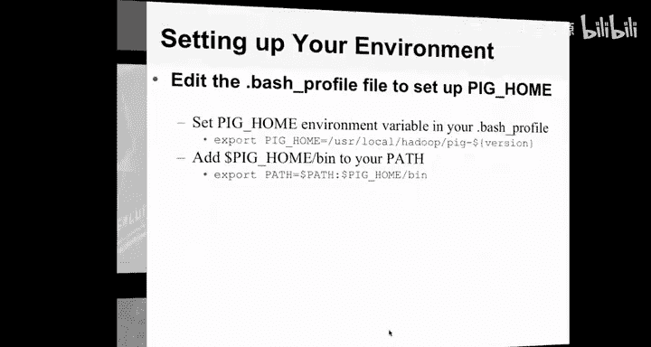
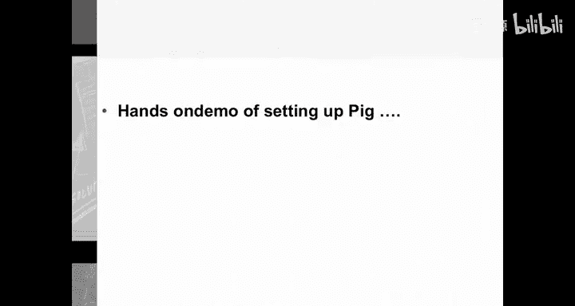
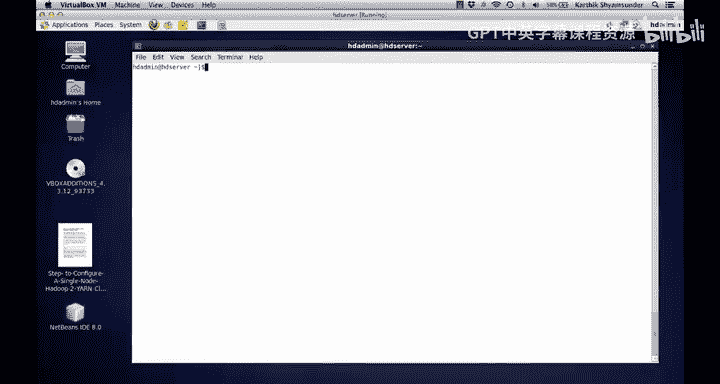
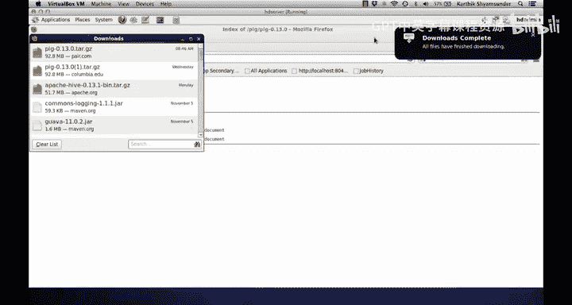
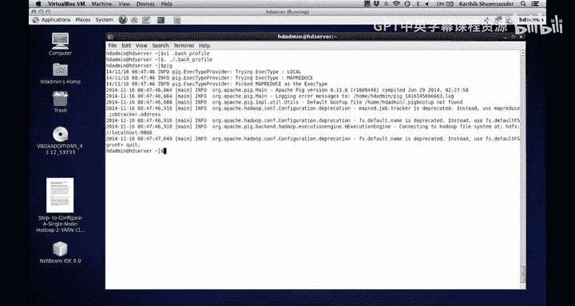

# 约翰霍普金斯大学《Hadoop大数据处理｜Big Data Processing Using Hadoop》中英字幕 - P76：11_Pig环境配置.zh_en - GPT中英字幕课程资源 - BV1g5u6zBExs

Setting up PIig in this section， I'm going to show you how you can download， install， configure。

 and run PI using the command line interface。

One of the first things that we have to do is to download pay。

Pig is an Apache open source project and so the official website is pig。appache。org。

 you can go to this site to download P there are two options to download P。

 the first option is to go to Pig。appache。org site。

 click on downloads or release that will take you to the download page which will eventually take you to a mirror page and so you can download the latest version of PG from one of the mirror sites。

The other option is to download from Apache Archive site。

And the Apache archive site for P is archived or apache。org/d/pig Once you go there。

 you can download Pigdollar version， which is the latest version number that you car about。 To。

gz5 The version numbers are usually something like0。13。0。

 at least at the time of this writing that was the latest version number。Installing pig。

Installing PIig is as simple as extracting the downloaded P ToGZ file and extracting it under/us/ local/ Hadoop。

So all you have to do is open up the terminal， C to/us/ local/o and execute the tar command with the ZxvF option。

 passing through it the fully qualified location of the P tarR GZ file。

 in our case we downloaded the PTR file in the downloads folder。Once you have installed P。

 it's a good idea to explore the P installed directory。

When you go to the Pig installt directory which is slashus/ local/ Hadoop/pig dashash。

 whatever the version number is， underneath it you'll see a folder called bin。

 the bin folder contains a command line tool called PI， this is the command line interpreter。

 which is your Gr shell。You also have a folder called Conf。

 which contains a file called Pig dot Pro and log4 J dot properties。

Pig dot properties is where you end up putting all your property for your pig configuration by default。

 all the properties are pretty much commented out， they're all there。

 but they're all comment out and you can uncomment the ones that you care about。

There is also docs under which you can find the pig usage documentation。

 a worthwhile location to understand pig light and scripts and the different commands and options and Java classes that are available to extend PG。

There is also a folder called shims which contains some of these Java source files to make PG work with Hadoop Don't forget that PG is a dataflow language that is intended to work with multiple technologies and shims allows you to work with Hadoop well which is what we're going to be doing in this class so I just wanted to tell you that's where the source code is for that。

Live folder contains jar files that pig grunt depends upon。There is also scriptris folder。

 which is empty at this point， the idea is for engineers in your team to write P scripts and place those scripts under these scripts folder so other folks or other engineers can use the common Pcrs there is also a source folder that contains the P source code if you want to go through the source code it's available for you。

There's a tutorial folder which contains some pig example scripts with some sample data。

 you may even want to explore this in order to understand the pig language better。

Setting up your environment。Once you have downloaded PG。

 there are a couple of environment variables that you want to set in order for you to execute the pig Grhell。

You can set an environment variable called P_ home passing toward the fully qualified location of where P is installed。

 which would be slash user/lash local/ Hadoop，/P dash， whatever the version number is。

And then you may want to add pigho slash bin to your path so that you can execute the P command on your terminal。

Configuring P to talk to Hadoop， don't forget that when you write pig scripts。

 those pig scripts are communicating with Hadoop in order to run Maped programs under the hood。

So big needs to know where Hadoop is installed。Pig relies upon an environment variable called Hadoop underscore prefix。

If this Hadoop underscore prefix in one variable is set to the location where Hadoop is installed。

 then it would go to that folder， and then subfold。

 which is Etsy/lash Hadoop to look at the Hadoop configuration files to figure out where the name node is and the resource manager is。

The other way by which pick and figure out where Hadoop is installed is if the Hadoop command itself is a near path。

 if the Hadoop command is a near path， then it figures out okay。

 this is where Hadoop command is located and so I'll have to go back one level up and that's the Hadoop Home directory and use that to figure out all the configuration files。

I like the Hadoop underscoreco prefix option in that way you're explicitly saying where it should be picking up the Hadoop information All right。

 so let's do some hands on demo for setting up Ps。

Here I am logged into my HD Ser VM as HD admin user ID。

Let's go ahead and take a look at the pig project， here's the pig project， pig。apaceache。org。

As you can see， it has some basic information about what PI is in the homepage。

 and then there's project information， documentation， and then information for developers。

 which are pig developers。Here's releases。 if you click on releases or you can click on the news as to what the latest version is。

 you can get to the。Pick download page。 I want to download 0。8 or above go to one of the mirror side。

 I want to pick up the latest version。 I want to pick up the non source version。

 So I'll go ahead and click on this。Don download De TGZ file。All right， P has been downloaded。

If I do LS minus L， tilda s downloads。Pig， there it is。 The pig file is there。

 So what I'm going to do is install P for that。 I just go to Cd。User local Hadoop。Tp minus Z。X。

 V F tilda s downloads。Pig。And extract it。Right， I've extracted pick。

 Now I'm going to go back to my home directory。Which I did。Clear。VI dotbsh underscore profile。

I'm going to set。An environment variable called P underscore home， which I've already done。

 notice Ive set the pig underscore home environment variable to where PG is installed。

I've also said the Hado prefix Environ variable， we did this for the Hiive project too。

And I have also set the Pat in we we were able to point to pig home slash pin。 So it's all set。

 ready to go。I would like to do a dot space dots dash profile。There it is， now I could type in P。And。

Pig grunt shell has shown up at this point， so I have successfully installed pig， I could quit。

Get back to my command line and ready to go。

In this section， we learn how we can download， install， configure。

 and run pick using the command line interface。

