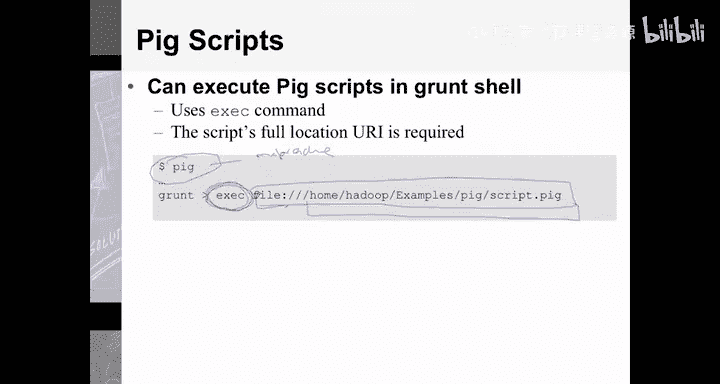
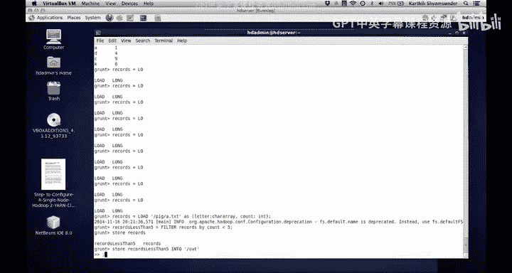
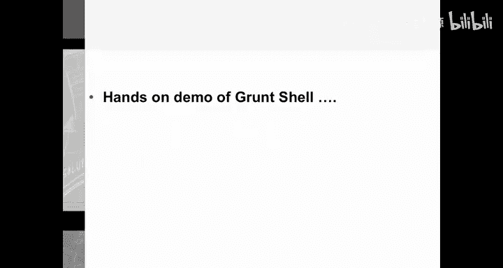

# 约翰霍普金斯大学《Hadoop大数据处理｜Big Data Processing Using Hadoop》中英字幕 - P77：12_Grunt交互式终端.zh_en - GPT中英字幕课程资源 - BV1g5u6zBExs

Grunt interactive shell。In this section， I'm going to show you how you can interact with the gr shellll。

The two modes the grunghell operates on， namely the local mode， the mapreduce mode。

 and how you can execute pig Latin statements both on the shell and as a script。

Launching the P。When you launch the P shell by typing in P on the terminal。

 it's what we call the interactive grunt shell When you launch the P shell。

 you notice that it says trying exact type local and then trying exact type mapreduce and then pick mapreduce as the exact type。

Basically， by default when you launch PG， it launches P in what is called the map produceduce mode。

 which means whenever you execute。Pig scripts or pig statements。

 they will be executed as a map reduceduce program。

You also notice that there is a log file which gets created when you launch PG。

 any log messages that appear will get placed in the log file， so whenever there is an exception。

 you may want to look at the log file。Pig can actually run in what is called the local mode or the Mareuce mode。

You can explicitly run P in the local mode by typing in P dash x local。

 which means you're running in the local mode when you run in the local mode。

There is no mapreuce programs running， everything is running within the context of the P interpreter or the P client and so you'll notice that when you run in the P local mode that it says the exact type is local and it picked the local。

 you'll also notice that the file system that it picked up is file colon s/ s which means it's not using the HFs file system。

 so everything is running in the local mode at this particular point when you run P in the local mode it's good for testing purposes because you're not really making any calls to the resource manager or the node or the name node。

You can also explicitly run pig in Maredice mode， which is the default。

When you type in PX map Prouce， you're executing P in the map produceuce mode。

You'll notice that it says trying exact type local， trying exact type map reduce。

 and then eventually picked up map reduce if you recall。When we installed P。

 we actually set an environment variable called Hadoop andco prefix。

 which was set to the location of where Hadoop was installed。

Because it finds out where Hadoop is installed， it's able to run in what is called the Mareduce mode。

 If it's not able to find Hadoop underscore prefix， and if you try to run in the Mareuce mode。

 you will get a runtime error and the pig interpreter will shut down。 In this case。

 you'll notice that it's actually saying that it is talking to HDFs called and slash local host 9000。

 which is the HDFs file system， and of course， it's running in the Mareuce mode。

There are some cool editing features that are part of Grhell。

It provides command line history using up and down arrows。

 so whenever you type pig scripts or pig statements in the cr shell。

You can use up and down arrow to navigate and execute the same P sequence P script if you want。

Or a pick statement if you want。It also provides navigation within a command using left and right。

 so when you type in a command and if you make a mistake in the command， spelling mistake。

 especially you can go to the left or go to the right and correct the error， that's very useful。

There is also T completion， which is pretty cool。When you are inside the Gre shell。

 there are two places where tab completion comes into place。

 Sometimes you may want to complete relational operator command for example D or store or group by these relational operators these are all commands that's part of pig syntax pig statements So if you type in D tab then dump is an option D is a command in which case itll suggest to your dump and then you can select it from the list that allows you to complete a command It can also complete relation names in Ps via something called relation names whenever you load data。

 you can actually apply relational operators like filter or group by and you can assign the value to a new variable the new variable is what we call relational variables or relational names it will also complete the relational names for you So that's pretty cool too so for example。

 if you type in D P if there is a relation name。Po then in that case。

 it would actually complete the posts for you or at least suggest it to you out of all the various options that it has I'll do a demo of all these things in just a minute。

 just wanted to tell you that these features are available。

And it's also possible to add your own list of completion words in the P dot properties file。

 which is located under the con folder。Another useful feature of the Grund shellll is HDFS commands in Grundhell。

If you recall， if you wanted to do any。Listings of the files in the Hadoop file system。

 it's a lot of work because you have to type in Hadoop FS， and then you have to type in dashash。

 and then you have to type in MKDR slash in to make a directory。

That's a lot of work one of the cool things about the gr shell is that once you're in the grch shell you can say FS and then you can simply type in the command so you can say fslsfsmkDR notice you don't really have to say Hadoop in this way you can actually execute the file system shell commands here。

There are also some very useful handy commands that are available as part of Grunhell， CA， MKDAR。

 RMCD， all these are commands that are available for you right there at the grhell so you don't even have to say FS dashca。

 you can simply say cat and file name and little cat the file name for you from HDFS save thing for copy from local copy tole code as you can see all these commands are available for you in the grund shellll itself so that's pretty useful too。

Let's look at a simple pig example here I'm launching the pig interpreter which is the Gr shell I'm catting slashpig s8 or Txt。

 which is a file that's available in the hts file system it's got four records record at 1，2。

3 and 4 which is four lines each line contains two columns column1 and column 2 column1 looks like a string and column 2 looks like a number so what I'm saying here is records which is a relation name this is the first time you're seeing the concept of a relation name that's like a variable name relation name records equals load sp slash8 or Txt which means what I'm saying is load the file 8 or Txt。

And when you load the file， treat the first column as。A character， and by the way。

 the column name should be called letter， which is also the field name。

 and then the second column should be an integer type and the second column name or field name should be count。

 So what I'm saying is load the contents of8 or TH3 into the records。

Relation name with those two as the field names。 Then I'm applying another relation called the filter relation I'm saying filter records。

 take the records and filter it by count is lesser than five。

 so take anything where the count is lesser than five and assign that to variable records less than five。

And then eventually I'm saying store records less than five into slash out。

 This is when the map reduce job kicks in and that would create the output drop record slash out and place the contents in the output folder。

You can also take all these statements and put it into a file and execute their statement。

 you can do that by typing in P in the script name or P minus x local in the script name in which case it's going to be executing in the local mode or P minus X map produceuce in the script name。

 if P is running in the local mode， then when you give the name or the file。

It's going to be the local file system file， local file system file in this case。

If the P script is executing in the map mode， then it expects the file to be in HFS。

But you can explicitly say in either mode where the file is coming from。

 you can say P HDFS code and slash/， the name node s script。t pig。

Which means you're saying that you're executing the script from HDFS itself。

The script is an HDF us in this case。You can also say that you're executing the P script。

From the local file system so you can use the exact command to execute the script and you're executing it from the local file system So there's a lot of combinations that you have over here here don't forget that you're running in the map or mode。

But the actual file that you're executing is in the file system。

 so that's why you're saying file calling slashlash。

 and you can give a fully qualified path to the file。

And you're using the exact command to execute it。 it's almost like that one command。

Here I am logged into my HD server VM as HD admin user ID at this point I would like to demonstrate the pig Gr interpreter。

Dippe in big。I'm in the grant interpreter now。 I can type in F S dash Ls slash。

Thenll show me the contents of the root directory。 I can do F S dash LS slash B D P。

Soll show me the contents of the BdP directory。I can also do LS slash BD boot。

 that's the shortcut command that's available for us。

I can also execute other pig strips or pig statements。Let's say I cat a file， cat slash pig。

Slash A dot TXt。Corying the content of the file。I can say records。Equals L O， hit the tab。

 Not its says load or long。 That's my tab completion of the relational operator。When say load。

And then slash pig， slash A dot T X D。As。Letter cool can。Aray。Come on， count， Col an end。

So at this point， I'm saying that the contents of8 or Txt should be loaded into the variable records。

And the first column should be called letter and the second column should be called count。

 and those are the types category and enter the two types。And then I'm going to say records。

Less than 5。Should be。Filter。Records。By count。Lesser than 5。In this case。

 what I'm saying is take the records， which is all the records in the file8 or TXt and filter it so that the count。

He's lesser than5， in other words。In any row where the count attribute。

 which is the second attribute， or the second column is less than five。

 use those records and put that into a variable called records less than five。

And then I can simply say store。Records， R DEC， and then hit the tab， there it is。

Notice it's giving me。The command line completion options。Less than 5。Into。

Single ch slash out into that folder Al folder hit enter， When I hit enter here。

 it's going to run the mapre shop。 It's the store command that runs the mapre shop。

 then put the semicolon there， put the semicolon。

Now it's going to be an a a reduced job。There it is running the Ma job。

 so I go to the job history or the resource manager。There is a job has been launched。

The job is running， 50% complete。And if everything is okay。I should see F， S slash out。 I should see。

The full report out。Oh， it's Alice out。And there's the folder out， it contains the part M。

 which is the map output file if I say cat。Slash out。Slash P star。

Should give me the contents of the file。Oh。Should be part。And。ゼロ zero zero。

And that's the contents of the file。 So notice all the records that are there in the output have the second column lesser than five。

So， that works。I can also execute the P script。I wanted to show you the pictures if I do a cat。

Slash pig， slash script， dot pig。There's the P script， the same thing that I just did。

 I put it in a script and I would like to execute the script。

Executing the script would be as simple as typing in exec。Slulash pig， slash script。Dot pigg。

 that's where the script is located。And it says that。It's。Not phoned。The file is not found。

 So let me go ahead slip s script。Dot big。GoodAlice。Slash big。 Let see if I can find the file。

Scriped pig。 It's available。啊， should be H。D F， S color slashlash。Local house column。9000。Okay。

 so now it executes now it says that the output directory already exists。

 so I should read the output directory， it would be FS dash r and， dash or slash out。Execed it。

 There it is。 It's running right now。So that executed successfully。I can also type in P。Dash eggs。

Maap produce。H T T P。So， HDFS。Cool and， slash slash slash。Name node。4 9000 slash pig。

Slash script dot P G and execute that。 That should fail because the proory already exists。

But should not be named nor it should be local host。Fed for a different reason。Yeah。

 our proory already exists， so we do FS dash bar and R。Slash out。And then execute it。

 just wanted to show you that they can execute Pcr on command line too， there it is。There it is。

 all right。So we have that working too。

In this section， we learned that the grune shell can operate on one of two modes。

 local mode or Mareuce mode， but it defaults to Mareice mode。

 we also learned that the grun shell has some built in functionality。

To manipulate the HD first file system easily。We also finally learned how we can execute pig Latinin statements on the shell directly or run a script using the exactec command。

