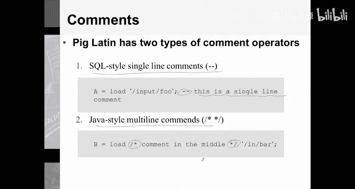
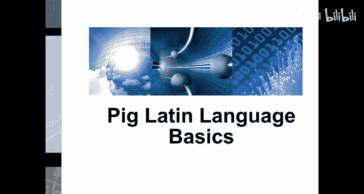

# 约翰霍普金斯大学《Hadoop大数据处理｜Big Data Processing Using Hadoop》中英字幕 - P78：13_Pig Latin语言基础.zh_en - GPT中英字幕课程资源 - BV1g5u6zBExs

Pig Latin， language basics。In this section， we will look at some of the basic building blocks and structure of the pig Latin language。

We will in particular look at data structure， statements， or commands。

 rules for relation and field names， comments， case sensitivity in pig Latin language。

 and finally dump and store statements。

Data structures， let's look at the building blockss。We have。The concept of a bag in P。

 which is really a collection of tuples， you can think of a tuple as a record。

And a bag is represented within braces， so here we have a bag that contains two tuples。

 tuple 1 and tuple 2， so really a bag is a collection of tuples。So what's a tuple？

A tuple is an ordered set of fields represented with parentheses。

 so as you can see here we have a tuple， it's a record， we have field one， field2， field three。

 field4， and field 5。And then we have this concept of a field， a field is really a piece of data。

 it could be a float， it could be an integer， it could be a string， and an integer。

 could even be a boolean like true。If you think about it。

 the data structure in PIG is very similar to relational databases。The concept of a bag。

 which is really a collection of tus。Is like a table in the database。The concept of a tuple。

 which is really an ordered set of fields， is like a row in a table and if you think about it。

 the fields are like the columns in the table。Bags do not require that all the tus contain the same number of fields。

 this is something different now in the case of relational databases。

 and if you think about even in hive， all the rows will have to have the same number of columns。

In the case of the pig， a bag contains tuples and every tuple can potentially be different。

 it can have different number of columns， so this is something different here。Statements or commands。

Don't forget that P Latin is a data flow language。Each processing step actually results in a new data set or what we call a relation。

Fd names are really the name of a field or a column in a relation。Let's look at this example。

 I have a file called input slash data。 Txt。What I would like to do is load the contents of the file here is the field name and type that I'm giving the first field is letter and it's of type ca。

 which is a string， the second field is age and its type is endt。

I'm loading that up into a relation name， that's a relation name called input。

And then I'm running another statement。In this case， a filter statement on the input。

And saying that any rows that have the second column， which is the age column。

 it has a value of greater than 18。Should be taken in as part of the input and should be assigned back into the relation name input。

 So there's a couple of things I want to point out。 One is we have input as a relation name。

 We have a couple of field names。Letter and age。And then once we assign a value to relation name。

 it's not a good idea to assign the same relation name， a different value。

 in this case we could have chosen input2 or adults that could have been a name of the relation name。

 we could have chosen something else， although you can use the same name。

 it's probably not a good idea it's not a good practice to reuse the same name。

What are the rules for relation and field names？R names and field names should follow the following rules。

 it must start with an alphabeic character followed by0 or more alphabeic characters or numer characters or underscore。

All characters must be ASI characters， so it's very similar to a variable name in many languages。

You can also have comments in P statements。The comments can be SQL style。

 single line comments where you can have a dash dash and you can write。

Comments right after that until the end of the line。

You can also have Java style multiline comments where you can start with the slash star and end the star slash and it can span across multiple lines。

Case sensitivity， you'll notice。That I have relation name over here。

 I have the relation operator over here。 I have another keyword called using。 I have a function。

 I have field name。I have keyword here， field name， data type， data type， data type。

 So there are different things that are going on over here。

Keywords in big Latin are not case sensitive， so keywords like load using as group for each generate。

 they are not case sensitive， but we typically use them as uppercase。

The relation names are case sensitive， A， B， C， all three things over here are case sensitive relational names。

Field names are also case sensitive， so F1， F2 and F3 are field names， they're also case sensitive。

 so you should use them the way it is。Function names are also case sensitive in this case。

 pig storage is a function name that's a standard storage format that's case sensitive。

Count is also a function name， and that's also case sensitive。

Now let's talk about store and dump commands when you write pig Latinin statements。

 typically no action is taken when you execute those statements until the dump or the store commands or encountered so you may have a bunch of pig Latinin statements that are assigning values to relation names。

 but nothing really happens， no map reduce job really takes place until you either execute the store command or the dump command。

 so for example you say records equals load this。File as these columns。

 and then you may have other relationship names。But then eventually， when you say store。

 and then you say final bag， which is this final relation name that you want to print。

That's when it actually uses the DA concept， which is directed acyclic graph。

To build out exactly what needs to be executed。Generate the Mareuce code for that。

 submits that map produceuce jobs， and there can be multiple jobs。

To generate the output into the output folder。 So it's when you execute the store command when the real map reduced takes place until then it's just taking the commands and holding on to it。

And the same thing is true for the D command。In terms of large data。

 Hadoop data is usually quite large and so it doesn't really make much sense to print all the results to the screen。

 so the common pattern in PG is to store the results in Hadoop which means stored it back in HDFS。

 or you can also store it in the H based table。And you can do this thing using the store command。

 we've already seen the store command where we actually wrote it into HFS file system。

The other command that's useful to us is the dump command。

Whenever you want to find information for debugging purposes， you may want to use the D command。

The dumb command allows you to print contents to the screen and when you're using the dumb command because you may end up dealing with a lot of data。

 you don't want to print out all the data， you can actually limit the data set。 So in this case。

 I'm loading the records into a variable code records， which is the ratio name。

And then I can have all kinds of statements after that。

 but here what I'm doing is I'm limiting records， which is the records creation name to5。

 and so five records will be picked will be assigned to print and then I can print those five records。

 so this allows me to print a small subset of my dataset set。In this section。

 we looked at some of the building blocks and structure of the pig Latinin language。

 we looked at in particular the data structure， we have the bags， we have the tuples。

 and we have the fields， a bag is really a collection of tuples and a tuple is an ordered set of fields and a field is like a column name in a database table and bags are like tables and tus are like records in a table。

We also looked at statements and commands and relation names。

 We looked at the rules for the relation and field names that they have to be starting with an alphabetic character followed by numeric alphabetic or underscore characters。

 very similar to most programming languages， we also learned that the big Latin relational operators are not case sensitive。

 but functions， relational names and field names are case sensitive。

 and finally we looked at the dump and the store statement。

Dump and store statements are both action statements。

 it's when you hit the dump or the store statement。

 does P actually go through the directed acyclic graph to generate the map produced jobs that need to be executed。

 submits the job， executes the program， and generates the output back to the user。

