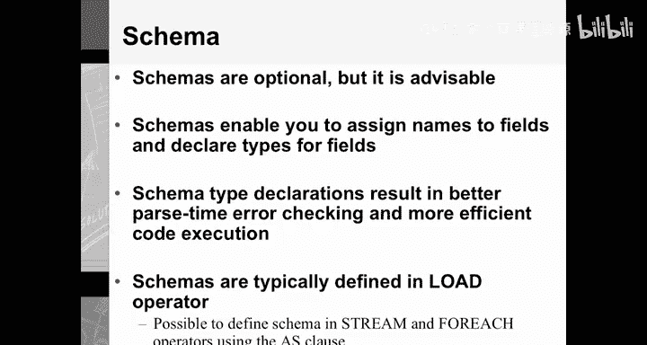
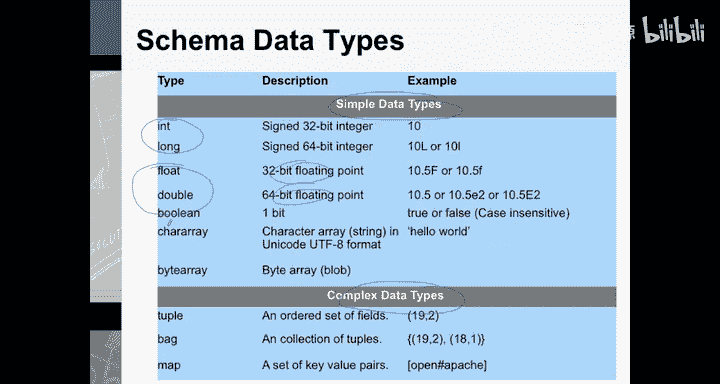
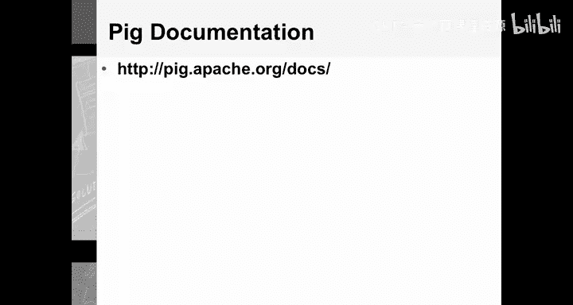
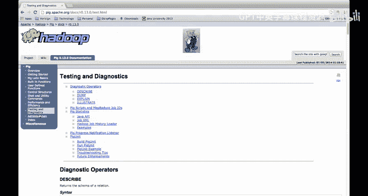

# 约翰霍普金斯大学《Hadoop大数据处理｜Big Data Processing Using Hadoop》中英字幕 - P79：14_Pig数据类型与模式定义.zh_en - GPT中英字幕课程资源 - BV1g5u6zBExs

Pick data types， schema and functions。In this section， we will look at schema in P。

Although schema is optional， it is available so that you can apply the appropriate processing on it。

So we will look at simple and complex data types and functions that can be applied on the data。隙間？

Schemas are optional， but it is advisable。Schemas enable you to assign names to fields and of course。

 declare the types for each one of those fields which allow you to manipulate the data by applying the appropriate functions。

The schema type declarations actually result in better par time error checking because when you have a schema type。

 then you can validate certain things， you can validate the values。

 and it's also more efficient to use a piece of data as an integer versus as a string all the time schemas are typically defined in the load operator。

 it is also possible for you to define schema in the stream which is in the files itself。

 and then you can also use the for each operators using the as clause to define schemas on the fly。

 but most commonly you define the schema in the load operator。

What are the different schema data types？We have the simple data types。And the complex data types。

 in terms of the simple data types， you have these standard integer types。

 which is your inter and long4 bytes and8 bytes， then you have your floating types float and double。

 your4 byte and 8 byte floats and doubles， then you have your Booleion which is one bit。

 and then catt， this is nothing other than your string。

 and then there's also a byteer rate to represent a blob。

 maybe image data or some other kind of a binary data。

In terms of complex types。You have three kinds of complex types， you have tuples。

 which is like a record。You have bag， which is a collection of coupleples。

 a collection of records and map， which is a key value pair combination。

 The map is represented as a bracket with key pound value。And of course， a bag。

 as we discussed in the previous section， is represented within braces inside the braces。

 you have topples represented within parentheses。And fields are separated by a comma。

 very similar to what you see over here between 19 and2， there's a comma， and that's a tuple。

Let me show you a small demo using simple types。If I cat a file called spig sfields。do。

 what you're really seeing here is a file that contains one， two， three。

 four columns or four fields separated by a tab。So what is this file， this file contains one，2，3，4，5。

6， seven records where each record contains four columns， the first column is the character name。

 the second column is the year the character was created。

 the third column is the amount of money that character earned for the studio。

 and then the fourth column is whether the character was married or not。

What I would like to do is load this data set into a relation or a relation name。

 So I say a equals load， load the file， but then I have the opportunity to define a schema。

 so I say as。And then within parentheses， I define the schema。 I say the first column。Is name。

 which is a character array， which is a string， so James Bond will end up becoming a string。1950。

 which is the year of birth for the character， will be an integer， 200，000。

 which is going to be the amount that particular character earned。Is going to be salary float。

And then the character is married or not that's a boolean， so married Boolean。

 So those are the four columns of the column or field names and the field types。

 the contents of the file were loaded into a， but they were loaded as the tuled， So when I dump a。

 you'll notice that it's actually printing out the contents of a， which is really all the tuples。

Let's look at a tuple， a tuple is really a record type。

 a tuple is something that's represented within parentheses and fields separated by a commara and the fields can be of any type。

 for example here' is a tuple Inor gadget is the character name， 1960 the character created。

 it generated $123 and the character was not married just false。So you have strings。Integers。

 floats and booleions as values intervalau。Let's look at a tuple example I have a file here which is slashp ss do dot in this case when I cat the file notice Ive placed the contents within a parentheses。

 but contents are within parentheses and now what I'm going to do is say a goes load I'm going to load the file as a tud record because I have placed the contents in the parentheses I'm loading it up as a tud record and then I'm saying the tud record is really a tuple so I'm reading the entire thing as a tuple and because a is a relation name a is a relation name which is really a list of tuples but what I load into a is really a tuple so as you can see you have a tuple inside a tuple of this particular point What I really read from the file was really a tuple and that tuple is going inside another tuple The point I'm trying to make is you can do that too。

Let's look at the complex map type。 A map type is really a set of key value pairs。

 A map type is represented with square brackets where key and value are separated by a pound sign。

 so I have a key and a value comma key and a value and so on and so forth。

 The key must be carry array data type and must be a unique value within that list within the open square bracket and close square bracket list and the value can be of any type。

 it defaults to byer array by default， So name John phone。

 the telephone number is a map type where there are two map entries。

 the key is name and the value is John， the key is phone and the value is 5551，2，12。

Let me show you a a type example， here's the file sp/mps。

dat notice the file contains an open square bracket and a close square bracket， key value， key value。

 key value pair combinations， I simply want to load this file as a map。And then it gets loaded。

 now I can go ahead and print the contents of that relation， so you can have bags。

 tuples and maps as complex types。We can also have constants。

 we can have integer constants like 19 long constants like 19 L floating point numbers， doubles。

 character array， which is really nothing other than a string by array which is your blob。

 boolean which can be true or false， a tuple which is put within parentheses with a comma separating the fields。

 a bag represented with an open brace closed brace with list of tuples inside them and each tuple is separated by a comma。

 and of course the contents of a tuple are also separated by a commma。And then map。

 which is represented as a square bracket with key value pair combinations as key pound value。

Pig has several built in functions。You have pneumatic functions。String functions， evaluation。

 aggregate functions， load and store functions， Tple map and store functions。

 so many different functions that are there。And if you don't like one of the function。

 you can always write your own too。There are several pneumatic built in functions， absolute acosine。

 asine， Atan all the way through all to 10 functions， so all these are built in math functions。

 pneumatic functions。Pig also has a bunch of built in string functions。

All these things are available as part of the documentation。

 you may want to look at the documentation to get a complete list of all the functions。

And how to use them。There is also evaluation or aggregate functions。

Functions that work on a collection。Such as average concatenate count。Count star if。

 all these are functions， minimum， maximum tokenized。

 all these are functions that work as an eval or aggregate。So you have that too。

And then you also have these things called the load and store built in functions。

Load and store functions are what are used to load the data from the file system and store the data back into the file system。

If you use big storage for loading the data， then you're loading the data and it'll support your map type。

 double type and also your bag type。Pick St can be used to read in data。

 it can also be used to write out data bin St is used to read in binary data and write our binary data。

 and then there is also a JSON St and JSON loader that allows you to read JSON files and write JSON files out all this information is available in the documentation so if you want to understand more detailed variations of how to use these functions。

 please take a look at the documentation。Here are some Tple map and bag functions。

As you can see there are several built-in functions that are there as part of P。

 it's quite extensive， but if you don't like the built-in functions or if they're not doing what you wanted to do。

 or maybe you want a slightly different function in such situations you can actually have your own user defineded functions so P supports this mechanism for you to provide your own user defineded functions and it's as simple as writing a class implementing an interface overwriting one or two methods packaging the class that you wrote of actually before that you compile the class you get the dot class file and then you build a jar file and then all you have to do is take the jar file and set it into an environment variable called P underscore class path。

Once you do that， that particular function is now available for anybody who's using PG and who has set P underscore the Sc Classpa to point to this jar file that you may have written and supplied。

There are two main differences between built in and user defined functions。

 built in functions don't need to be registered because PIG knows where they are。

 built in functions don't need to be qualified when they are used because PIG knows where to find them。

Whereas when you write your own function， you have to do what is called registration。

 and then you have to say that you're using this function， so it's a two step process。

 but the reality is it is extensible。Theres a really nice link for pig documentation。

 I strongly suggest that you go take a look at the pig documentation， which is pig do apache。

org sdogs， let's go ahead and take a look at this。

Here I am at pig。appache。org， I'm looking at the documentation， I'm looking at the homepage。

 if soll click on documentation since0 or 13 is the latest release， I'm going to click on 0 13。

You can see here， it gives you an overview of the P documentation。Getting started。

Talks about the grunthell， talks about the various。Ways by which you can run big。

And then there are pig Latin scripts， documentation， arithmetic operators， relational operators。

 all the different operators。That are available and we'll be looking at some of those operators in the next section。

Built in functions is a list of all the built in functions。

 so you can see how to use them there is also an example， description， example usage。

 all those things are available， very nicely documented。There is also a section on user D functions。

This is where。They show you how you can write your own functions。

 how you can register those functions， notice you can register a jar file。

 notice if you want to write your own function called upperpper， you have to extend the E function。

And then override the method that you need to override， which in this case is exact。

So pig is quite flexible， it's quite extensible。There's information on control structures。

 shell and UD commands。 We talked about how PEg allows you to execute the Hadoop shell commands。

Performance information， diagnostics information。

Which is your debug operators， which you will talk about in administration。And of course。

 index at the bottom。In this section we looked at the various big data types。

 we saw that there were some simple data types and also three complex data types， namely maps。

 tus and bags。We also learned that PI does not really require schema， it can work without schema。

 but it's probably a good idea to have schema because it's much more efficient to run programs with schema。

 especially why use a string data type when you can use an integer data type because integers are much more effective and also they perform better in terms of efficiency。

We also looked at the concept of functions， we saw that P has a rich set of functions。

 and if you don't like them， you can always create your own pig function。

 register them and use them in your pig Latin scripts。

